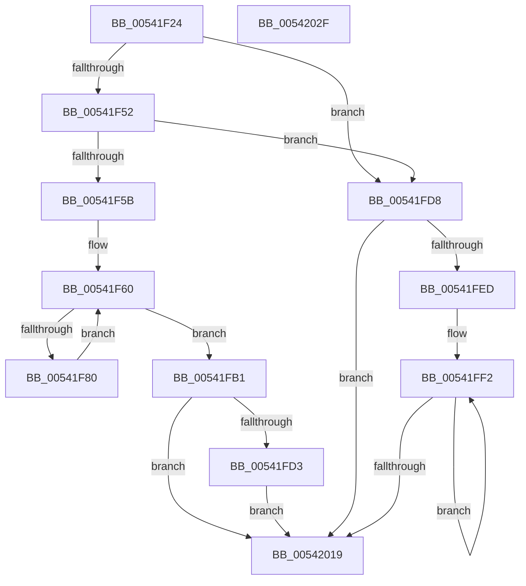

# HalpMceHandler

- RVA: `0x00541F24`–`0x00542030` (길이 `268` bytes)
- VA: `0x0000000140541F24`
- 실행 섹션: `.text`
- PDB 이름 있음: `예`; PDB Function 태그: `아니요`
- unwind 정보 RVA: `0x000BD140`
- 디코드: `72`개 명령, `268/268` bytes 표시
- 미해석 바이트: `0` (있으면 어셈블리에 `.byte`로 보존)

> 이 문서는 커널 이미지의 기계어와 PDB 기호를 분석해 생성했습니다. 4번과 5번은 함수 원형과 자료형을 바이너리 사용 방식에서 추정한 C 해석이며 원본 소스 복구 결과는 아닙니다.

## 1. Dependencies

- 직접 호출 지점: **3**; 고유 호출 대상: **1**
- 직접 호출자로 확인된 함수: **2**
- RIP 상대 이미지 참조: **2**

### Outgoing calls
- `0x00541F85` → [HalpMceHandlerCore](HalpMceHandlerCore_function_00542038.md) (function, `0x00542038`)
- `0x00541FCA` → [HalpMceHandlerCore](HalpMceHandlerCore_function_00542038.md) (function, `0x00542038`)
- `0x00541FFF` → [HalpMceHandlerCore](HalpMceHandlerCore_function_00542038.md) (function, `0x00542038`)

### Direct callers
- [HalpHandleMachineCheck](HalpHandleMachineCheck_function_005413C8.md) at `0x0054143E`
- [HalpHandleMachineCheck](HalpHandleMachineCheck_function_005413C8.md) at `0x00541459`
- [HalpMceHandlerWithRendezvous](HalpMceHandlerWithRendezvous_function_005421E0.md) at `0x0054223D`
- [HalpMceHandlerWithRendezvous](HalpMceHandlerWithRendezvous_function_005421E0.md) at `0x005422A4`

### Static image references
- `0x00541F3F` → RVA `0x00FC1C48` (`.data`; read)
- `0x00541F52` → RVA `0x00E100B9` (`.data`; read)

## 2. Other-region calls and transfers

- 다른 실행 섹션으로 향하는 call: **0**
- 별도 외부 분기/꼬리 이동을 확인하지 못했습니다.

## 3. Assembly (complete function range)

```asm
00541F24  48 89 5C 24 08                  mov qword ptr [rsp + 8], rbx
00541F29  48 89 6C 24 10                  mov qword ptr [rsp + 0x10], rbp
00541F2E  56                              push rsi
00541F2F  57                              push rdi
00541F30  41 56                           push r14
00541F32  48 83 EC 20                     sub rsp, 0x20
00541F36  48 83 64 24 50 00               and qword ptr [rsp + 0x50], 0
00541F3C  40 32 FF                        xor dil, dil
00541F3F  40 38 3D 02 FD A7 00            cmp byte ptr [rip + 0xa7fd02], dil
00541F46  40 8A EA                        mov bpl, dl
00541F49  4C 8B F1                        mov r14, rcx
00541F4C  0F 84 86 00 00 00               je 0x140541fd8
00541F52  40 38 3D 60 E1 8C 00            cmp byte ptr [rip + 0x8ce160], dil
00541F59  75 7D                           jne 0x140541fd8
00541F5B  BE 01 00 00 00                  mov esi, 1
00541F60  B9 30 00 00 40                  mov ecx, 0x40000030
00541F65  0F 32                           rdmsr
00541F67  48 C1 E2 20                     shl rdx, 0x20
00541F6B  49 8B CE                        mov rcx, r14
00541F6E  48 0B C2                        or rax, rdx
00541F71  40 8A D5                        mov dl, bpl
00541F74  48 8B D8                        mov rbx, rax
00541F77  89 5C 24 50                     mov dword ptr [rsp + 0x50], ebx
00541F7B  83 F8 FF                        cmp eax, -1
00541F7E  74 31                           je 0x140541fb1
00541F80  4C 8B 44 24 50                  mov r8, qword ptr [rsp + 0x50]
00541F85  E8 AE 00 00 00                  call 0x140542038
00541F8A  84 C0                           test al, al
00541F8C  40 0F B6 FF                     movzx edi, dil
00541F90  89 5C 24 58                     mov dword ptr [rsp + 0x58], ebx
00541F94  B9 31 00 00 40                  mov ecx, 0x40000031
00541F99  0F 45 FE                        cmovne edi, esi
00541F9C  83 64 24 5C 00                  and dword ptr [rsp + 0x5c], 0
00541FA1  48 8B 54 24 58                  mov rdx, qword ptr [rsp + 0x58]
00541FA6  48 8B C2                        mov rax, rdx
00541FA9  48 C1 EA 20                     shr rdx, 0x20
00541FAD  0F 30                           wrmsr
00541FAF  EB AF                           jmp 0x140541f60
00541FB1  65 8B 04 25 A4 01 00 00         mov eax, dword ptr gs:[0x1a4]
00541FB9  09 74 24 54                     or dword ptr [rsp + 0x54], esi
00541FBD  0F BA F0 1F                     btr eax, 0x1f
00541FC1  89 44 24 50                     mov dword ptr [rsp + 0x50], eax
00541FC5  4C 8B 44 24 50                  mov r8, qword ptr [rsp + 0x50]
00541FCA  E8 69 00 00 00                  call 0x140542038
00541FCF  84 C0                           test al, al
00541FD1  74 46                           je 0x140542019
00541FD3  40 8A FE                        mov dil, sil
00541FD6  EB 41                           jmp 0x140542019
00541FD8  65 48 8B 04 25 18 00 00 00      mov rax, qword ptr gs:[0x18]
00541FE1  48 8B 98 D8 00 00 00            mov rbx, qword ptr [rax + 0xd8]
00541FE8  48 85 DB                        test rbx, rbx
00541FEB  74 2C                           je 0x140542019
00541FED  BE 01 00 00 00                  mov esi, 1
00541FF2  4C 8B 83 AC 00 00 00            mov r8, qword ptr [rbx + 0xac]
00541FF9  40 8A D5                        mov dl, bpl
00541FFC  49 8B CE                        mov rcx, r14
00541FFF  E8 34 00 00 00                  call 0x140542038
00542004  48 8B 9B B8 00 00 00            mov rbx, qword ptr [rbx + 0xb8]
0054200B  84 C0                           test al, al
0054200D  40 0F B6 FF                     movzx edi, dil
00542011  0F 45 FE                        cmovne edi, esi
00542014  48 85 DB                        test rbx, rbx
00542017  75 D9                           jne 0x140541ff2
00542019  48 8B 5C 24 40                  mov rbx, qword ptr [rsp + 0x40]
0054201E  40 8A C7                        mov al, dil
00542021  48 8B 6C 24 48                  mov rbp, qword ptr [rsp + 0x48]
00542026  48 83 C4 20                     add rsp, 0x20
0054202A  41 5E                           pop r14
0054202C  5F                              pop rdi
0054202D  5E                              pop rsi
0054202E  C3                              ret
0054202F  CC                              int3
```

## 4. C-style interpretation (structured pseudocode)

```c
__int64 __fastcall HalpMceHandler(__int64 a1, __int64 a2)
{
    __int64 result;
    __int64 v_rdi;
    __int64 v_rsp;
    unsigned __int64 v_stack_p10;
    unsigned __int64 v_stack_p18;
    unsigned int v_stack_p1C;
    unsigned int v_stack_p20;
    unsigned int v_stack_p24;
    unsigned __int64 v_stack_p8;

    v_stack_p8 = v_rbx;
    v_stack_p10 = v_rbp;
    v_rsp = (v_rsp) - (32);
    v_rdi = 0;
    if ((*(unsigned __int8 *)(v_rip + 11009282)) == 0) goto loc_00541FD8;
    if ((*(unsigned __int8 *)(v_rip + 9232736)) != 0) goto loc_00541FD8;
loc_00541F60:
    a2 = (a2) << (32);
    result = (result) | (a2);
    v_stack_p18 = (unsigned int)(result);
    if (((unsigned int)(result)) == -1) goto loc_00541FB1;
    result = HalpMceHandlerCore(a1, (unsigned __int8)((unsigned __int8)(a2)), v_stack_p18, a4);
    v_stack_p20 = (unsigned int)(result);
    v_rdi = 0;
    if ((unsigned __int8)(result) != 0) { v_rdi = 1; }
    a2 = (v_stack_p20) >> (32);
    goto loc_00541F60;
loc_00541FB1:
    v_stack_p18 = (unsigned int)((unsigned int)(*(unsigned int *)(gs_base + (0 + 420))));
    result = HalpMceHandlerCore((unsigned int)(0x40000031ULL), a2, v_stack_p18, a4);
    if ((unsigned __int8)(result) == 0) goto loc_00542019;
    goto loc_00542019;
loc_00541FD8:
    if (*(unsigned __int64 *)(*(unsigned __int64 *)(gs_base + (0 + 24)) + 216) == 0) goto loc_00542019;
loc_00541FF2:
    result = HalpMceHandlerCore(a1, (unsigned __int8)((unsigned __int8)(a2)), *(unsigned __int64 *)(*(unsigned __int64 *)(*(unsigned __int64 *)(gs_base + (0 + 24)) + 216) + 172), a4);
    v_rdi = 1;
    if ((unsigned __int8)(result) != 0) { v_rdi = 1; }
    if (*(unsigned __int64 *)(*(unsigned __int64 *)(*(unsigned __int64 *)(gs_base + (0 + 24)) + 216) + 184) != 0) goto loc_00541FF2;
loc_00542019:
    v_rsp = (v_rsp) + (32);
    return (unsigned __int8)(v_rdi);
}
```

## 5. (Beta) C Style

```c
int64_t HalpMceHandler(int64_t Arg1, int64_t Arg2)
{
    int64_t result;
    int64_t local_rdi;
    int64_t local_rsp;
    uint64_t v_stack_p10;
    uint64_t v_stack_p18;
    uint32_t v_stack_p1C;
    uint32_t v_stack_p20;
    uint32_t v_stack_p24;
    uint64_t v_stack_p8;

    v_stack_p8 = local_rbx;
    v_stack_p10 = local_rbp;
    local_rsp = (local_rsp) - (32);
    local_rdi = 0;
    if ((*(uint8_t *)(v_rip + 0xA7FD02)) == 0) goto loc_00541FD8;
    if ((*(uint8_t *)(v_rip + 0x8CE160)) != 0) goto loc_00541FD8;
loc_00541F60:
    Arg2 = (Arg2) << (32);
    result = (result) | (Arg2);
    v_stack_p18 = (uint32_t)(result);
    if (((uint32_t)(result)) == -1) goto loc_00541FB1;
    result = HalpMceHandlerCore(Arg1, (uint8_t)((uint8_t)(Arg2)), v_stack_p18, a4);
    v_stack_p20 = (uint32_t)(result);
    local_rdi = 0;
    if ((uint8_t)(result) != 0) { local_rdi = 1; }
    Arg2 = (v_stack_p20) >> (32);
    goto loc_00541F60;
loc_00541FB1:
    v_stack_p18 = (uint32_t)((uint32_t)(*(uint32_t *)(gs_base + (0 + 0x1A4))));
    result = HalpMceHandlerCore((uint32_t)(0x40000031ULL), Arg2, v_stack_p18, a4);
    if ((uint8_t)(result) == 0) goto loc_00542019;
    goto loc_00542019;
loc_00541FD8:
    if (*(uint64_t *)(*(uint64_t *)(gs_base + (0 + 0x18)) + 0xD8) == 0) goto loc_00542019;
loc_00541FF2:
    result = HalpMceHandlerCore(Arg1, (uint8_t)((uint8_t)(Arg2)), *(uint64_t *)(*(uint64_t *)(*(uint64_t *)(gs_base + (0 + 0x18)) + 0xD8) + 0xAC), a4);
    local_rdi = 1;
    if ((uint8_t)(result) != 0) { local_rdi = 1; }
    if (*(uint64_t *)(*(uint64_t *)(*(uint64_t *)(gs_base + (0 + 0x18)) + 0xD8) + 0xB8) != 0) goto loc_00541FF2;
loc_00542019:
    local_rsp = (local_rsp) + (32);
    return (uint8_t)(local_rdi);
}
```

## 6. Execution-region graph

[열기: 2D/3D 그래프와 함수 탐색 컨트롤 패널](../../../control-panel.html?section=text&rva=0x00541F24&view=graph)

- 2D 그래프는 위에서 아래로 흐르고, 3D 그래프는 빈 공간을 드래그해 회전합니다. Shift+드래그는 이동, 휠은 확대·축소, 함수 노드 선택은 대상 보고서 이동입니다.

### Static fallback


