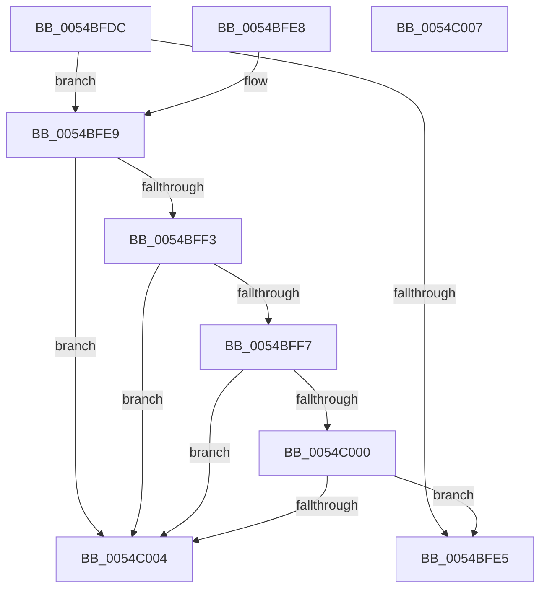

# HalpMiscIsLegacyPcType

- RVA: `0x0054BFDC`–`0x0054C008` (길이 `44` bytes)
- VA: `0x000000014054BFDC`
- 실행 섹션: `.text`
- PDB 이름 있음: `예`; PDB Function 태그: `아니요`
- unwind 정보 RVA: `0x000DB714`
- 디코드: `17`개 명령, `44/44` bytes 표시
- 미해석 바이트: `0` (있으면 어셈블리에 `.byte`로 보존)

> 이 문서는 커널 이미지의 기계어와 PDB 기호를 분석해 생성했습니다. 4번과 5번은 함수 원형과 자료형을 바이너리 사용 방식에서 추정한 C 해석이며 원본 소스 복구 결과는 아닙니다.

## 1. Dependencies

- 직접 호출 지점: **0**; 고유 호출 대상: **0**
- 직접 호출자로 확인된 함수: **3**
- RIP 상대 이미지 참조: **3**

### Outgoing calls
- 직접 디코드된 call 명령이 없습니다.

### Direct callers
- [HalMakeBeep](HalMakeBeep_function_00545B80.md) at `0x00545B91`
- [HalpPowerWriteResetCommand](HalpPowerWriteResetCommand_function_00546744.md) at `0x0054676C`
- [HalpRestoreDmaControllerState](../../pagelk/B5/HalpRestoreDmaControllerState_function_00B5C0D0.md) at `0x00B5C106`

### Static image references
- `0x0054BFDC` → RVA `0x00FC1A28` (`.data`; read)
- `0x0054BFE9` → RVA `0x00E0A808` (`.data`; read)
- `0x0054BFF7` → RVA `0x00E0F598` (`.data`; read)

## 2. Other-region calls and transfers

- 다른 실행 섹션으로 향하는 call: **0**
- 별도 외부 분기/꼬리 이동을 확인하지 못했습니다.

## 3. Assembly (complete function range)

```asm
0054BFDC  80 3D 45 5A A7 00 00            cmp byte ptr [rip + 0xa75a45], 0
0054BFE3  75 04                           jne 0x14054bfe9
0054BFE5  B0 01                           mov al, 1
0054BFE7  C3                              ret
0054BFE8  CC                              int3
0054BFE9  8B 05 19 E8 8B 00               mov eax, dword ptr [rip + 0x8be819]
0054BFEF  A8 01                           test al, 1
0054BFF1  74 11                           je 0x14054c004
0054BFF3  A8 04                           test al, 4
0054BFF5  74 0D                           je 0x14054c004
0054BFF7  80 3D 9A 35 8C 00 00            cmp byte ptr [rip + 0x8c359a], 0
0054BFFE  74 04                           je 0x14054c004
0054C000  A8 08                           test al, 8
0054C002  74 E1                           je 0x14054bfe5
0054C004  32 C0                           xor al, al
0054C006  C3                              ret
0054C007  CC                              int3
```

## 4. C-style interpretation (structured pseudocode)

```c
__int64 __fastcall HalpMiscIsLegacyPcType(void)
{
    __int64 result;

    if ((*(unsigned __int8 *)(v_rip + 10967621)) != 0) goto loc_0054BFE9;
loc_0054BFE5:
    return 1;
loc_0054BFE9:
    if ((((unsigned __int8)((unsigned int)(*(unsigned int *)(v_rip + 9168921)))) & (1)) == 0) goto loc_0054C004;
    if ((((unsigned __int8)((unsigned int)(*(unsigned int *)(v_rip + 9168921)))) & (4)) == 0) goto loc_0054C004;
    if ((*(unsigned __int8 *)(v_rip + 9188762)) == 0) goto loc_0054C004;
    if ((((unsigned __int8)((unsigned int)(*(unsigned int *)(v_rip + 9168921)))) & (8)) == 0) goto loc_0054BFE5;
loc_0054C004:
    result = 0;
    return result;
}
```

## 5. (Beta) C Style

```c
void HalpMiscIsLegacyPcType(void)
{
    int64_t result;

    if ((*(uint8_t *)(v_rip + 0xA75A45)) != 0) goto loc_0054BFE9;
loc_0054BFE5:
    return 1;
loc_0054BFE9:
    if ((((uint8_t)((uint32_t)(*(uint32_t *)(v_rip + 0x8BE819)))) & (1)) == 0) goto loc_0054C004;
    if ((((uint8_t)((uint32_t)(*(uint32_t *)(v_rip + 0x8BE819)))) & (4)) == 0) goto loc_0054C004;
    if ((*(uint8_t *)(v_rip + 0x8C359A)) == 0) goto loc_0054C004;
    if ((((uint8_t)((uint32_t)(*(uint32_t *)(v_rip + 0x8BE819)))) & (8)) == 0) goto loc_0054BFE5;
loc_0054C004:
    result = 0;
    return result;
}
```

## 6. Execution-region graph

[열기: 2D/3D 그래프와 함수 탐색 컨트롤 패널](../../../control-panel.html?section=text&rva=0x0054BFDC&view=graph)

- 2D 그래프는 위에서 아래로 흐르고, 3D 그래프는 빈 공간을 드래그해 회전합니다. Shift+드래그는 이동, 휠은 확대·축소, 함수 노드 선택은 대상 보고서 이동입니다.

### Static fallback


