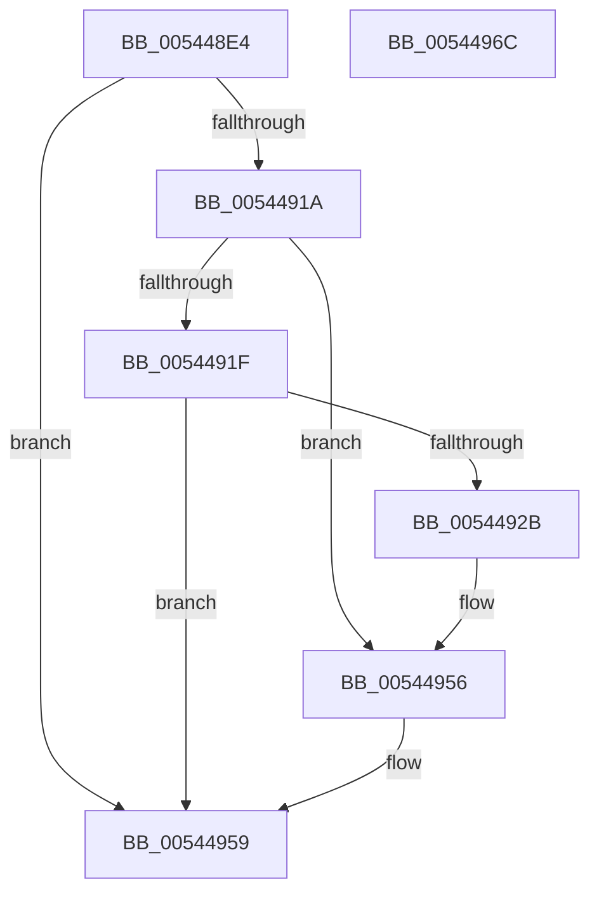

# HalpMmAllocateAndInsertPageTablePage

- RVA: `0x005448E4`–`0x0054496D` (길이 `137` bytes)
- VA: `0x00000001405448E4`
- 실행 섹션: `.text`
- PDB 이름 있음: `예`; PDB Function 태그: `아니요`
- unwind 정보 RVA: `0x000794E0`
- 디코드: `37`개 명령, `137/137` bytes 표시
- 미해석 바이트: `0` (있으면 어셈블리에 `.byte`로 보존)

> 이 문서는 커널 이미지의 기계어와 PDB 기호를 분석해 생성했습니다. 4번과 5번은 함수 원형과 자료형을 바이너리 사용 방식에서 추정한 C 해석이며 원본 소스 복구 결과는 아닙니다.

## 1. Dependencies

- 직접 호출 지점: **2**; 고유 호출 대상: **2**
- 직접 호출자로 확인된 함수: **1**
- RIP 상대 이미지 참조: **1**

### Outgoing calls
- `0x0054490D` → [HalpAllocPhysicalMemoryEx](../../init/C7/HalpAllocPhysicalMemoryEx_function_00C771DC.md) (function, `0x00C771DC`)
- `0x00544922` → [HalpMmZeroPageWithTemporaryMapping](HalpMmZeroPageWithTemporaryMapping_function_00544CA8.md) (function, `0x00544CA8`)

### Direct callers
- [HalpMmGetPteAddressSafe](HalpMmGetPteAddressSafe_function_00544AF4.md) at `0x00544B44`
- [HalpMmGetPteAddressSafe](HalpMmGetPteAddressSafe_function_00544AF4.md) at `0x00544B6F`
- [HalpMmGetPteAddressSafe](HalpMmGetPteAddressSafe_function_00544AF4.md) at `0x00544B9A`

### Static image references
- `0x005448FB` → RVA `0x00E10230` (`.data`; read)

## 2. Other-region calls and transfers

- 다른 실행 섹션으로 향하는 call: **1**
  - `0x0054490D` → [HalpAllocPhysicalMemoryEx](../../init/C7/HalpAllocPhysicalMemoryEx_function_00C771DC.md) (`.text` → `INIT`)
- 별도 외부 분기/꼬리 이동을 확인하지 못했습니다.

## 3. Assembly (complete function range)

```asm
005448E4  48 89 5C 24 08                  mov qword ptr [rsp + 8], rbx
005448E9  48 89 74 24 10                  mov qword ptr [rsp + 0x10], rsi
005448EE  57                              push rdi
005448EF  48 83 EC 30                     sub rsp, 0x30
005448F3  48 8B F1                        mov rsi, rcx
005448F6  48 89 54 24 20                  mov qword ptr [rsp + 0x20], rdx
005448FB  48 8B 0D 2E B9 8C 00            mov rcx, qword ptr [rip + 0x8cb92e]
00544902  33 FF                           xor edi, edi
00544904  45 33 C9                        xor r9d, r9d
00544907  33 D2                           xor edx, edx
00544909  44 8D 47 01                     lea r8d, [rdi + 1]
0054490D  E8 CA 28 73 00                  call 0x140c771dc
00544912  48 8B D8                        mov rbx, rax
00544915  48 85 C0                        test rax, rax
00544918  74 3F                           je 0x140544959
0054491A  F6 06 01                        test byte ptr [rsi], 1
0054491D  75 37                           jne 0x140544956
0054491F  48 8B C8                        mov rcx, rax
00544922  E8 81 03 00 00                  call 0x140544ca8
00544927  85 C0                           test eax, eax
00544929  78 2E                           js 0x140544959
0054492B  F0 09 3C 24                     lock or dword ptr [rsp], edi
0054492F  48 B8 00 F0 FF FF FF FF 0F 00   movabs rax, 0xffffffffff000
00544939  48 89 74 24 50                  mov qword ptr [rsp + 0x50], rsi
0054493E  48 23 D8                        and rbx, rax
00544941  48 B8 03 00 00 00 00 00 00 80   movabs rax, 0x8000000000000003
0054494B  48 0B D8                        or rbx, rax
0054494E  48 8B 44 24 50                  mov rax, qword ptr [rsp + 0x50]
00544953  48 89 18                        mov qword ptr [rax], rbx
00544956  40 B7 01                        mov dil, 1
00544959  48 8B 5C 24 40                  mov rbx, qword ptr [rsp + 0x40]
0054495E  40 8A C7                        mov al, dil
00544961  48 8B 74 24 48                  mov rsi, qword ptr [rsp + 0x48]
00544966  48 83 C4 30                     add rsp, 0x30
0054496A  5F                              pop rdi
0054496B  C3                              ret
0054496C  CC                              int3
```

## 4. C-style interpretation (structured pseudocode)

```c
__int64 __fastcall HalpMmAllocateAndInsertPageTablePage(__int64 a1, __int64 a2, __int64 a3, int a4)
{
    __int64 result;
    __int64 v_rbx;
    __int64 v_rdi;
    __int64 v_rsp;
    unsigned __int64 v_stack_m18;
    unsigned int v_stack_m38;
    unsigned __int64 v_stack_p10;
    unsigned __int64 v_stack_p18;
    unsigned __int64 v_stack_p8;

    v_stack_p8 = v_rbx;
    v_stack_p10 = v_rsi;
    v_rsp = (v_rsp) - (48);
    v_stack_m18 = a2;
    v_rdi = 0;
    a4 = 0;
    a2 = 0;
    result = HalpAllocPhysicalMemoryEx(*(unsigned __int64 *)(v_rip + 9222446), a2, v_rdi + 1, a4);
    if (result == 0) goto loc_00544959;
    if (((*(unsigned __int8 *)(a1)) & (1)) != 0) goto loc_00544956;
    result = HalpMmZeroPageWithTemporaryMapping(result, a2, v_rdi + 1, a4);
    if (sign_flag) goto loc_00544959;
    v_stack_p18 = a1;
    v_rbx = (result) & (result);
    v_rbx = (v_rbx) | (result);
    *(unsigned __int64 *)(v_stack_p18) = v_rbx;
loc_00544956:
loc_00544959:
    v_rsp = (v_rsp) + (48);
    return 1;
}
```

## 5. (Beta) C Style

```c
int64_t HalpMmAllocateAndInsertPageTablePage(void *Arg1, int64_t Arg2, int64_t Arg3, int32_t Arg4)
{
    uint8_t *arg1 = (uint8_t *)Arg1;

    int64_t result;
    int64_t local_rbx;
    int64_t local_rdi;
    int64_t local_rsp;
    uint64_t v_stack_m18;
    uint32_t v_stack_m38;
    uint64_t v_stack_p10;
    uint64_t v_stack_p18;
    uint64_t v_stack_p8;

    v_stack_p8 = local_rbx;
    v_stack_p10 = local_rsi;
    local_rsp = (local_rsp) - (48);
    v_stack_m18 = Arg2;
    local_rdi = 0;
    Arg4 = 0;
    Arg2 = 0;
    result = HalpAllocPhysicalMemoryEx(*(uint64_t *)(v_rip + 0x8CB92E), Arg2, local_rdi + 1, Arg4);
    if (result == 0) goto loc_00544959;
    if (((*(uint8_t *)(arg1)) & (1)) != 0) goto loc_00544956;
    result = HalpMmZeroPageWithTemporaryMapping(result, Arg2, local_rdi + 1, Arg4);
    if (sign_flag) goto loc_00544959;
    v_stack_p18 = Arg1;
    local_rbx = (result) & (result);
    local_rbx = (local_rbx) | (result);
    *(uint64_t *)(v_stack_p18) = local_rbx;
loc_00544956:
loc_00544959:
    local_rsp = (local_rsp) + (48);
    return 1;
}
```

### 관측된 메모리 오프셋

구조체 형식이 확인되지 않은 접근은 인자 기준의 오프셋으로만 기록했습니다.

| 기준 인자 | 오프셋 표현 | 폭 (bit) | 접근 |
|---|---:|---:|---|
| `Arg1` | `+ 0x0` | `8` | `R` |

## 6. Execution-region graph

[열기: 2D/3D 그래프와 함수 탐색 컨트롤 패널](../../../control-panel.html?section=text&rva=0x005448E4&view=graph)

- 2D 그래프는 위에서 아래로 흐르고, 3D 그래프는 빈 공간을 드래그해 회전합니다. Shift+드래그는 이동, 휠은 확대·축소, 함수 노드 선택은 대상 보고서 이동입니다.

### Static fallback


