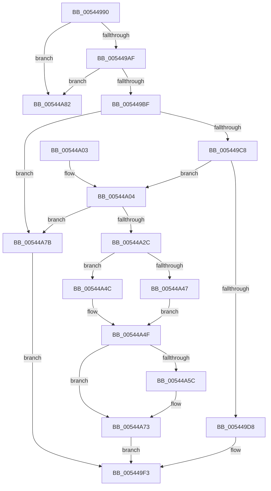

# HalpMmAllocateMemoryInternal

- RVA: `0x00544990`–`0x00544AA0` (길이 `272` bytes)
- VA: `0x0000000140544990`
- 실행 섹션: `.text`
- PDB 이름 있음: `예`; PDB Function 태그: `아니요`
- unwind 정보 RVA: `0x000C3C50`
- 디코드: `70`개 명령, `272/272` bytes 표시
- 미해석 바이트: `0` (있으면 어셈블리에 `.byte`로 보존)

> 이 문서는 커널 이미지의 기계어와 PDB 기호를 분석해 생성했습니다. 4번과 5번은 함수 원형과 자료형을 바이너리 사용 방식에서 추정한 C 해석이며 원본 소스 복구 결과는 아닙니다.

## 1. Dependencies

- 직접 호출 지점: **3**; 고유 호출 대상: **3**
- 직접 호출자로 확인된 함수: **27**
- RIP 상대 이미지 참조: **5**

### Outgoing calls
- `0x00544A22` → [HalpAllocPhysicalMemoryEx](../../init/C7/HalpAllocPhysicalMemoryEx_function_00C771DC.md) (function, `0x00C771DC`)
- `0x00544A4F` → [HalpMap](../3F/HalpMap_function_003F88F4.md) (function, `0x003F88F4`)
- `0x00544A9A` → [KeBugCheckEx](../4F/KeBugCheckEx_function_004FD660.md) (function, `0x004FD660`)

### Direct callers
- [HalpIommuAddDebuggerException](../4D/HalpIommuAddDebuggerException_function_004DA420.md) at `0x004DA44B`
- [HalpInitializeTimers](../53/HalpInitializeTimers_function_0053C1E0.md) at `0x0053C314`
- [HalpMmAllocateMemory](HalpMmAllocateMemory_function_00544974.md) at `0x0054497D`
- [HalpMmAllocatePerProcessorMemory](HalpMmAllocatePerProcessorMemory_function_00544AA8.md) at `0x00544AC3`
- [HalpInterruptInitializeIpis](HalpInterruptInitializeIpis_function_005462AC.md) at `0x0054635F`
- [HalpExtRegisterResourceDescriptor](HalpExtRegisterResourceDescriptor_function_0054E640.md) at `0x0054E774`
- [HalpRegisterDmaController](../55/HalpRegisterDmaController_function_00554638.md) at `0x00554707`
- [HalpIommuProcessReservationsInternal](../55/HalpIommuProcessReservationsInternal_function_00555900.md) at `0x00555944`
- [HalpInterruptParseMadt](../55/HalpInterruptParseMadt_function_00557E74.md) at `0x00557F42`
- [HalpInterruptParseMadt](../55/HalpInterruptParseMadt_function_00557E74.md) at `0x00558200`
- [HalpInterruptParseMadt](../55/HalpInterruptParseMadt_function_00557E74.md) at `0x0055825A`
- [HalpInterruptParseMadt](../55/HalpInterruptParseMadt_function_00557E74.md) at `0x005582FE`
- [EmonAllocateCounters](../55/EmonAllocateCounters_function_0055C32C.md) at `0x0055C364`
- [EmonAllocateCounters](../55/EmonAllocateCounters_function_0055C32C.md) at `0x0055C38B`
- [ExtEnvAllocateMemory](../56/ExtEnvAllocateMemory_function_005610B0.md) at `0x005610D5`
- [HalRegisterPermanentAddressUsage](../56/HalRegisterPermanentAddressUsage_function_00561500.md) at `0x00561527`
- [HalpTimerRegister](../56/HalpTimerRegister_function_005616BC.md) at `0x0056182E`
- [HalpInterruptRegisterController](../56/HalpInterruptRegisterController_function_005640F0.md) at `0x0056438A`
- [HalpInterruptRegisterLine](../56/HalpInterruptRegisterLine_function_005645B0.md) at `0x00564724`
- [HalpIommuCreateDmarPageTable](../56/HalpIommuCreateDmarPageTable_function_00568C4C.md) at `0x00568C7F`
- [sub_006FC0AA](../6F/Unknown_function_006FC0AA.md) at `0x006FC178`
- [HalpInitializeInterrupts](../../init/C1/HalpInitializeInterrupts_function_00C1E4F8.md) at `0x00C1E584`
- [HalpInitializeInterrupts](../../init/C1/HalpInitializeInterrupts_function_00C1E4F8.md) at `0x00C1E5DE`
- [HalpInitializeInterrupts](../../init/C1/HalpInitializeInterrupts_function_00C1E4F8.md) at `0x00C1E60A`
- [HalpInitializeInterrupts](../../init/C1/HalpInitializeInterrupts_function_00C1E4F8.md) at `0x00C1E633`
- [HalpInitializeInterrupts](../../init/C1/HalpInitializeInterrupts_function_00C1E4F8.md) at `0x00C1E667`
- [HalpInitializeInterrupts](../../init/C1/HalpInitializeInterrupts_function_00C1E4F8.md) at `0x00C1E69B`
- [HalpExtInitExtensions](../../init/C1/HalpExtInitExtensions_function_00C1F7FC.md) at `0x00C1F868`
- [ExtEnvRegisterIommu](../../init/C2/ExtEnvRegisterIommu_function_00C213EC.md) at `0x00C2159C`
- [HalpAllocateNumaConfigData](../../init/C2/HalpAllocateNumaConfigData_function_00C2190C.md) at `0x00C219B7`
- [HalpNumaInitializeHmaConfiguration](../../init/C2/HalpNumaInitializeHmaConfiguration_function_00C22054.md) at `0x00C220A1`
- [HalpNumaInitializeStaticConfiguration](../../init/C2/HalpNumaInitializeStaticConfiguration_function_00C220D8.md) at `0x00C221CA`
- [HalpBlkAllocateShadowData](../../init/C2/HalpBlkAllocateShadowData_function_00C23578.md) at `0x00C23596`
- [HalpPowerInitNvsRegionData](../../init/C2/HalpPowerInitNvsRegionData_function_00C239E0.md) at `0x00C23A59`
- [HalpSetupAcpiPhase0](../../init/C2/HalpSetupAcpiPhase0_function_00C23EDC.md) at `0x00C24047`
- [HalpCopyDebugDescriptor](../../init/C2/HalpCopyDebugDescriptor_function_00C24CC0.md) at `0x00C24CFE`

### Static image references
- `0x0054499F` → RVA `0x00E10230` (`.data`; read)
- `0x005449C8` → RVA `0x00E10240` (`.data`; read)
- `0x005449D8` → RVA `0x00E10238` (`.data`; read)
- `0x005449E6` → RVA `0x00E10238` (`.data`; write)
- `0x005449ED` → RVA `0x00E10240` (`.data`; write)

## 2. Other-region calls and transfers

- 다른 실행 섹션으로 향하는 call: **1**
  - `0x00544A22` → [HalpAllocPhysicalMemoryEx](../../init/C7/HalpAllocPhysicalMemoryEx_function_00C771DC.md) (`.text` → `INIT`)
- 별도 외부 분기/꼬리 이동을 확인하지 못했습니다.

## 3. Assembly (complete function range)

```asm
00544990  48 89 5C 24 08                  mov qword ptr [rsp + 8], rbx
00544995  48 89 74 24 10                  mov qword ptr [rsp + 0x10], rsi
0054499A  57                              push rdi
0054499B  48 83 EC 30                     sub rsp, 0x30
0054499F  48 83 3D 89 B8 8C 00 00         cmp qword ptr [rip + 0x8cb889], 0
005449A7  8B F2                           mov esi, edx
005449A9  0F 84 D3 00 00 00               je 0x140544a82
005449AF  65 8B 04 25 A4 01 00 00         mov eax, dword ptr gs:[0x1a4]
005449B7  85 C0                           test eax, eax
005449B9  0F 85 C3 00 00 00               jne 0x140544a82
005449BF  83 FA 01                        cmp edx, 1
005449C2  0F 87 B3 00 00 00               ja 0x140544a7b
005449C8  8B 15 72 B8 8C 00               mov edx, dword ptr [rip + 0x8cb872]
005449CE  8D 59 07                        lea ebx, [rcx + 7]
005449D1  83 E3 F8                        and ebx, 0xfffffff8
005449D4  3B D3                           cmp edx, ebx
005449D6  72 2C                           jb 0x140544a04
005449D8  48 8B 05 59 B8 8C 00            mov rax, qword ptr [rip + 0x8cb859]
005449DF  8B CB                           mov ecx, ebx
005449E1  48 03 C8                        add rcx, rax
005449E4  2B D3                           sub edx, ebx
005449E6  48 89 0D 4B B8 8C 00            mov qword ptr [rip + 0x8cb84b], rcx
005449ED  89 15 4D B8 8C 00               mov dword ptr [rip + 0x8cb84d], edx
005449F3  48 8B 5C 24 40                  mov rbx, qword ptr [rsp + 0x40]
005449F8  48 8B 74 24 48                  mov rsi, qword ptr [rsp + 0x48]
005449FD  48 83 C4 30                     add rsp, 0x30
00544A01  5F                              pop rdi
00544A02  C3                              ret
00544A03  CC                              int3
00544A04  48 8B 0D 25 B8 8C 00            mov rcx, qword ptr [rip + 0x8cb825]
00544A0B  8D BB FF 0F 00 00               lea edi, [rbx + 0xfff]
00544A11  48 83 64 24 20 00               and qword ptr [rsp + 0x20], 0
00544A17  45 33 C9                        xor r9d, r9d
00544A1A  C1 EF 0C                        shr edi, 0xc
00544A1D  33 D2                           xor edx, edx
00544A1F  44 8B C7                        mov r8d, edi
00544A22  E8 B5 27 73 00                  call 0x140c771dc
00544A27  48 85 C0                        test rax, rax
00544A2A  74 4F                           je 0x140544a7b
00544A2C  48 83 64 24 28 00               and qword ptr [rsp + 0x28], 0
00544A32  45 33 C9                        xor r9d, r9d
00544A35  C7 44 24 20 04 00 00 00         mov dword ptr [rsp + 0x20], 4
00544A3D  8B D7                           mov edx, edi
00544A3F  48 8B C8                        mov rcx, rax
00544A42  83 FE 01                        cmp esi, 1
00544A45  75 05                           jne 0x140544a4c
00544A47  44 8B C6                        mov r8d, esi
00544A4A  EB 03                           jmp 0x140544a4f
00544A4C  45 33 C0                        xor r8d, r8d
00544A4F  E8 A0 3E EB FF                  call 0x1403f88f4
00544A54  48 8B C8                        mov rcx, rax
00544A57  48 85 C0                        test rax, rax
00544A5A  74 17                           je 0x140544a73
00544A5C  8B C3                           mov eax, ebx
00544A5E  48 03 C1                        add rax, rcx
00544A61  C1 E7 0C                        shl edi, 0xc
00544A64  2B FB                           sub edi, ebx
00544A66  48 89 05 CB B7 8C 00            mov qword ptr [rip + 0x8cb7cb], rax
00544A6D  89 3D CD B7 8C 00               mov dword ptr [rip + 0x8cb7cd], edi
00544A73  48 8B C1                        mov rax, rcx
00544A76  E9 78 FF FF FF                  jmp 0x1405449f3
00544A7B  33 C0                           xor eax, eax
00544A7D  E9 71 FF FF FF                  jmp 0x1405449f3
00544A82  48 83 64 24 20 00               and qword ptr [rsp + 0x20], 0
00544A88  45 33 C9                        xor r9d, r9d
00544A8B  BA 00 80 00 00                  mov edx, 0x8000
00544A90  41 B8 09 53 67 08               mov r8d, 0x8675309
00544A96  41 8D 49 5C                     lea ecx, [r9 + 0x5c]
00544A9A  E8 C1 8B FB FF                  call 0x1404fd660
00544A9F  CC                              int3
```

## 4. C-style interpretation (structured pseudocode)

```c
__int64 __fastcall HalpMmAllocateMemoryInternal(__int64 a1, int a2, __int64 a3, int a4)
{
    __int64 result;
    __int64 v_rbx;
    __int64 v_rdi;
    __int64 v_rsp;
    unsigned __int64 v_stack_p10;
    unsigned __int64 v_stack_p20;
    unsigned __int64 v_stack_p28;
    unsigned __int64 v_stack_p8;

    v_stack_p8 = v_rbx;
    v_stack_p10 = v_rsi;
    v_rsp = (v_rsp) - (48);
    if ((*(unsigned __int64 *)(v_rip + 9222281)) == 0) goto loc_00544A82;
    if ((unsigned int)((unsigned int)(*(unsigned int *)(gs_base + (0 + 420)))) != 0) goto loc_00544A82;
    if (a2 > 1) goto loc_00544A7B;
    v_rbx = (unsigned int)((a1 + 7) & (0xFFFFFFF8ULL));
    if (((unsigned int)((unsigned int)(*(unsigned int *)(v_rip + 9222258)))) < ((unsigned int)(v_rbx))) goto loc_00544A04;
    a1 = ((unsigned int)((unsigned int)(v_rbx))) + (*(unsigned __int64 *)(v_rip + 9222233));
    a2 = (unsigned int)(((unsigned int)(*(unsigned int *)(v_rip + 9222258))) - ((unsigned int)(v_rbx)));
    *(unsigned __int64 *)(v_rip + 9222219) = a1;
    *(unsigned int *)(v_rip + 9222221) = a2;
loc_005449F3:
    v_rsp = (v_rsp) + (48);
    return *(unsigned __int64 *)(v_rip + 9222233);
loc_00544A04:
    a4 = 0;
    v_rdi = (unsigned int)((v_stack_p8 + 4095) >> (12));
    a2 = 0;
    result = HalpAllocPhysicalMemoryEx(*(unsigned __int64 *)(v_rip + 9222181), a2, (unsigned int)((unsigned int)(v_rdi)), a4);
    if (result == 0) goto loc_00544A7B;
    a4 = 0;
    v_stack_p20 = 4;
    if (((unsigned int)(v_stack_p10)) != 1) goto loc_00544A4C;
    goto loc_00544A4F;
loc_00544A4C:
    a3 = 0;
loc_00544A4F:
    result = HalpMap(result, (unsigned int)((unsigned int)(v_rdi)), a3, a4);
    if (result != 0) {
        result = (unsigned int)(v_stack_p8);
        result = (result) + (result);
        v_rdi = (unsigned int)((v_rdi) << (12));
        v_rdi = (unsigned int)((v_rdi) - ((unsigned int)(v_stack_p8)));
        *(unsigned __int64 *)(v_rip + 9222091) = result;
        *(unsigned int *)(v_rip + 9222093) = (unsigned int)(v_rdi);
    }
    goto loc_005449F3;
loc_00544A7B:
    result = 0;
    goto loc_005449F3;
loc_00544A82:
    a4 = 0;
    result = KeBugCheckEx(a4 + 92, (unsigned int)(0x8000ULL), (unsigned int)(0x8675309ULL), a4);
    return result;
}
```

## 5. (Beta) C Style

```c
int64_t HalpMmAllocateMemoryInternal(void *Arg1, int32_t Arg2, int64_t Arg3, int32_t Arg4)
{
    uint8_t *arg1 = (uint8_t *)Arg1;

    int64_t result;
    int64_t local_rbx;
    int64_t local_rdi;
    int64_t local_rsp;
    uint64_t v_stack_p10;
    uint64_t v_stack_p20;
    uint64_t v_stack_p28;
    uint64_t v_stack_p8;

    v_stack_p8 = local_rbx;
    v_stack_p10 = local_rsi;
    local_rsp = (local_rsp) - (48);
    if ((*(uint64_t *)(v_rip + 0x8CB889)) == 0) goto loc_00544A82;
    if ((uint32_t)((uint32_t)(*(uint32_t *)(gs_base + (0 + 0x1A4)))) != 0) goto loc_00544A82;
    if (Arg2 > 1) goto loc_00544A7B;
    local_rbx = (uint32_t)((Arg1 + 7) & (0xFFFFFFF8ULL));
    if (((uint32_t)((uint32_t)(*(uint32_t *)(v_rip + 0x8CB872)))) < ((uint32_t)(local_rbx))) goto loc_00544A04;
    Arg1 = ((uint32_t)((uint32_t)(local_rbx))) + (*(uint64_t *)(v_rip + 0x8CB859));
    Arg2 = (uint32_t)(((uint32_t)(*(uint32_t *)(v_rip + 0x8CB872))) - ((uint32_t)(local_rbx)));
    *(void **)(v_rip + 0x8CB84B) = Arg1;
    *(uint32_t *)(v_rip + 0x8CB84D) = Arg2;
loc_005449F3:
    local_rsp = (local_rsp) + (48);
    return *(uint64_t *)(v_rip + 0x8CB859);
loc_00544A04:
    Arg4 = 0;
    local_rdi = (uint32_t)((v_stack_p8 + 4095) >> (12));
    Arg2 = 0;
    result = HalpAllocPhysicalMemoryEx(*(uint64_t *)(v_rip + 0x8CB825), Arg2, (uint32_t)((uint32_t)(local_rdi)), Arg4);
    if (result == 0) goto loc_00544A7B;
    Arg4 = 0;
    v_stack_p20 = 4;
    if (((uint32_t)(v_stack_p10)) != 1) goto loc_00544A4C;
    goto loc_00544A4F;
loc_00544A4C:
    Arg3 = 0;
loc_00544A4F:
    result = HalpMap(result, (uint32_t)((uint32_t)(local_rdi)), Arg3, Arg4);
    if (result != 0) {
        result = (uint32_t)(v_stack_p8);
        result = (result) + (result);
        local_rdi = (uint32_t)((local_rdi) << (12));
        local_rdi = (uint32_t)((local_rdi) - ((uint32_t)(v_stack_p8)));
        *(uint64_t *)(v_rip + 0x8CB7CB) = result;
        *(uint32_t *)(v_rip + 0x8CB7CD) = (uint32_t)(local_rdi);
    }
    goto loc_005449F3;
loc_00544A7B:
    result = 0;
    goto loc_005449F3;
loc_00544A82:
    Arg4 = 0;
    result = KeBugCheckEx(Arg4 + 92, (uint32_t)(0x8000ULL), (uint32_t)(0x8675309ULL), Arg4);
    return result;
}
```

### 관측된 메모리 오프셋

구조체 형식이 확인되지 않은 접근은 인자 기준의 오프셋으로만 기록했습니다.

| 기준 인자 | 오프셋 표현 | 폭 (bit) | 접근 |
|---|---:|---:|---|
| `Arg1` | `+ 0x7` | `32` | `R` |
| `Arg1` | `+ 0xFFF` | `32` | `R` |

## 6. Execution-region graph

[열기: 2D/3D 그래프와 함수 탐색 컨트롤 패널](../../../control-panel.html?section=text&rva=0x00544990&view=graph)

- 2D 그래프는 위에서 아래로 흐르고, 3D 그래프는 빈 공간을 드래그해 회전합니다. Shift+드래그는 이동, 휠은 확대·축소, 함수 노드 선택은 대상 보고서 이동입니다.

### Static fallback


