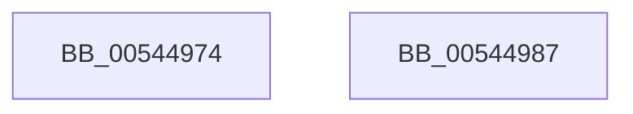

# HalpMmAllocateMemory

- RVA: `0x00544974`–`0x00544988` (길이 `20` bytes)
- VA: `0x0000000140544974`
- 실행 섹션: `.text`
- PDB 이름 있음: `예`; PDB Function 태그: `아니요`
- unwind 정보 RVA: `0x0005C788`
- 디코드: `6`개 명령, `20/20` bytes 표시
- 미해석 바이트: `0` (있으면 어셈블리에 `.byte`로 보존)

> 이 문서는 커널 이미지의 기계어와 PDB 기호를 분석해 생성했습니다. 4번과 5번은 함수 원형과 자료형을 바이너리 사용 방식에서 추정한 C 해석이며 원본 소스 복구 결과는 아닙니다.

## 1. Dependencies

- 직접 호출 지점: **1**; 고유 호출 대상: **1**
- 직접 호출자로 확인된 함수: **9**
- RIP 상대 이미지 참조: **0**

### Outgoing calls
- `0x0054497D` → [HalpMmAllocateMemoryInternal](HalpMmAllocateMemoryInternal_function_00544990.md) (function, `0x00544990`)

### Direct callers
- [InitCounterGroupBspEnhanced](../../pagelk/B5/InitCounterGroupBspEnhanced_function_00B5CCC8.md) at `0x00B5CD38`
- [InitCounterGroupBspOriginal](../../pagelk/B5/InitCounterGroupBspOriginal_function_00B5CDAC.md) at `0x00B5CE0A`
- [HalpInitializeProfiling](../../pagelk/B5/HalpInitializeProfiling_function_00B5EF00.md) at `0x00B5EF50`
- [EmonInitializeProfilingOriginal](../../pagelk/B5/EmonInitializeProfilingOriginal_function_00B5F630.md) at `0x00B5F712`
- [EmonInitializeProfilingOriginal](../../pagelk/B5/EmonInitializeProfilingOriginal_function_00B5F630.md) at `0x00B5F735`
- [EmonInitializeProfilingOriginal](../../pagelk/B5/EmonInitializeProfilingOriginal_function_00B5F630.md) at `0x00B5F77A`
- [EmonInitializeProfilingOriginal](../../pagelk/B5/EmonInitializeProfilingOriginal_function_00B5F630.md) at `0x00B5F79B`
- [Amd64InitializeProfilingEnhanced](../../pagelk/B6/Amd64InitializeProfilingEnhanced_function_00B61318.md) at `0x00B61551`
- [Amd64InitializeProfilingEnhanced](../../pagelk/B6/Amd64InitializeProfilingEnhanced_function_00B61318.md) at `0x00B615A0`
- [Amd64InitializeProfilingEnhanced](../../pagelk/B6/Amd64InitializeProfilingEnhanced_function_00B61318.md) at `0x00B615E4`
- [Amd64InitializeProfilingEnhanced](../../pagelk/B6/Amd64InitializeProfilingEnhanced_function_00B61318.md) at `0x00B61672`
- [Amd64InitializeProfilingOriginal](../../pagelk/B6/Amd64InitializeProfilingOriginal_function_00B618D8.md) at `0x00B61AFA`
- [Amd64InitializeProfilingOriginal](../../pagelk/B6/Amd64InitializeProfilingOriginal_function_00B618D8.md) at `0x00B61B2A`
- [Amd64InitializeProfilingOriginal](../../pagelk/B6/Amd64InitializeProfilingOriginal_function_00B618D8.md) at `0x00B61B49`
- [Amd64InitializeProfilingOriginal](../../pagelk/B6/Amd64InitializeProfilingOriginal_function_00B618D8.md) at `0x00B61B8F`
- [HalpIommuInitializeAll](../../pagelk/B7/HalpIommuInitializeAll_function_00B7A684.md) at `0x00B7A797`
- [HalpKdEnumerateDebuggingDevices](../../pagekd/B8/HalpKdEnumerateDebuggingDevices_function_00B85850.md) at `0x00B85928`
- [HalpKdEnumerateDebuggingDevices](../../pagekd/B8/HalpKdEnumerateDebuggingDevices_function_00B85850.md) at `0x00B85999`
- [HalpRegisterDeviceInUse](../../pagekd/B8/HalpRegisterDeviceInUse_function_00B85C94.md) at `0x00B85CF9`

### Static image references
- 디코드된 RIP-relative 메모리 참조가 없습니다.

## 2. Other-region calls and transfers

- 다른 실행 섹션으로 향하는 call: **0**
- 별도 외부 분기/꼬리 이동을 확인하지 못했습니다.

## 3. Assembly (complete function range)

```asm
00544974  48 83 EC 28                     sub rsp, 0x28
00544978  BA 01 00 00 00                  mov edx, 1
0054497D  E8 0E 00 00 00                  call 0x140544990
00544982  48 83 C4 28                     add rsp, 0x28
00544986  C3                              ret
00544987  CC                              int3
```

## 4. C-style interpretation (structured pseudocode)

```c
__int64 __fastcall HalpMmAllocateMemory(void)
{
    __int64 result;
    __int64 v_rsp;

    v_rsp = (v_rsp) - (40);
    result = HalpMmAllocateMemoryInternal(a1, 1, a3, a4);
    v_rsp = (v_rsp) + (40);
    return result;
}
```

## 5. (Beta) C Style

```c
void HalpMmAllocateMemory(void)
{
    int64_t result;
    int64_t local_rsp;

    local_rsp = (local_rsp) - (40);
    result = HalpMmAllocateMemoryInternal(a1, 1, a3, a4);
    local_rsp = (local_rsp) + (40);
    return result;
}
```

## 6. Execution-region graph

[열기: 2D/3D 그래프와 함수 탐색 컨트롤 패널](../../../control-panel.html?section=text&rva=0x00544974&view=graph)

- 2D 그래프는 위에서 아래로 흐르고, 3D 그래프는 빈 공간을 드래그해 회전합니다. Shift+드래그는 이동, 휠은 확대·축소, 함수 노드 선택은 대상 보고서 이동입니다.

### Static fallback


