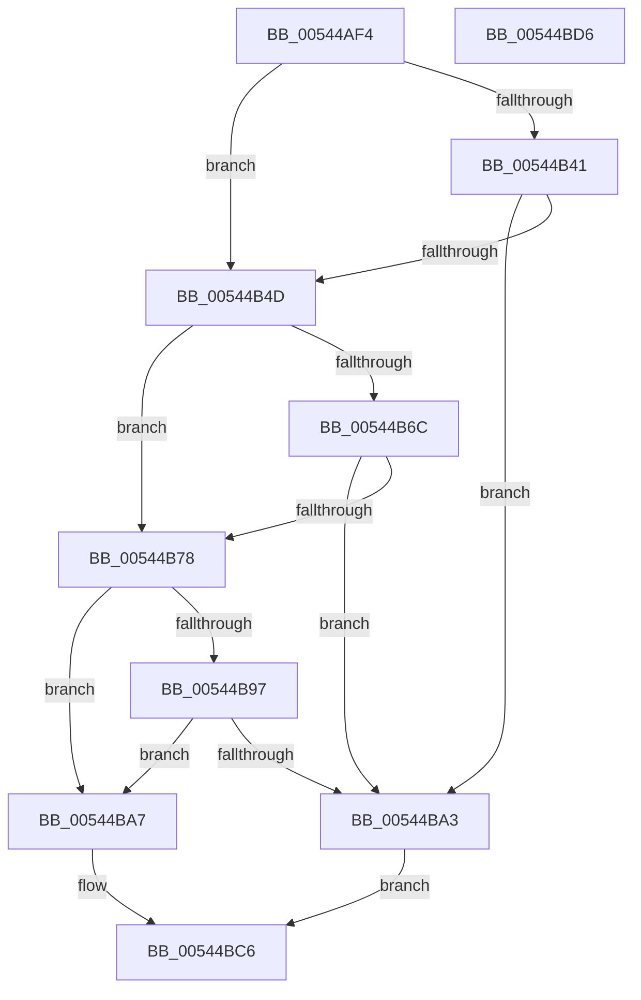

# HalpMmGetPteAddressSafe

- RVA: `0x00544AF4`–`0x00544BD7` (길이 `227` bytes)
- VA: `0x0000000140544AF4`
- 실행 섹션: `.text`
- PDB 이름 있음: `예`; PDB Function 태그: `아니요`
- unwind 정보 RVA: `0x00060BC4`
- 디코드: `57`개 명령, `227/227` bytes 표시
- 미해석 바이트: `0` (있으면 어셈블리에 `.byte`로 보존)

> 이 문서는 커널 이미지의 기계어와 PDB 기호를 분석해 생성했습니다. 4번과 5번은 함수 원형과 자료형을 바이너리 사용 방식에서 추정한 C 해석이며 원본 소스 복구 결과는 아닙니다.

## 1. Dependencies

- 직접 호출 지점: **3**; 고유 호출 대상: **1**
- 직접 호출자로 확인된 함수: **3**
- RIP 상대 이미지 참조: **2**

### Outgoing calls
- `0x00544B44` → [HalpMmAllocateAndInsertPageTablePage](HalpMmAllocateAndInsertPageTablePage_function_005448E4.md) (function, `0x005448E4`)
- `0x00544B6F` → [HalpMmAllocateAndInsertPageTablePage](HalpMmAllocateAndInsertPageTablePage_function_005448E4.md) (function, `0x005448E4`)
- `0x00544B9A` → [HalpMmAllocateAndInsertPageTablePage](HalpMmAllocateAndInsertPageTablePage_function_005448E4.md) (function, `0x005448E4`)

### Direct callers
- [HalpMap](../3F/HalpMap_function_003F88F4.md) at `0x003F899A`
- [HalpMap](../3F/HalpMap_function_003F88F4.md) at `0x003F8A0E`
- [HalpMmReservePageTablePages](HalpMmReservePageTablePages_function_00544C1C.md) at `0x00544C7C`
- [HalpReserveHalPtes](../../init/C1/HalpReserveHalPtes_function_00C1EAE8.md) at `0x00C1EB0A`

### Static image references
- `0x00544B03` → RVA `0x00E0A784` (`.data`; read)
- `0x00544B10` → RVA `0x00FC2CB8` (`.data`; read)

## 2. Other-region calls and transfers

- 다른 실행 섹션으로 향하는 call: **0**
- 별도 외부 분기/꼬리 이동을 확인하지 못했습니다.

## 3. Assembly (complete function range)

```asm
00544AF4  48 89 5C 24 08                  mov qword ptr [rsp + 8], rbx
00544AF9  48 89 74 24 10                  mov qword ptr [rsp + 0x10], rsi
00544AFE  57                              push rdi
00544AFF  48 83 EC 20                     sub rsp, 0x20
00544B03  8B 05 7B 5C 8C 00               mov eax, dword ptr [rip + 0x8c5c7b]
00544B09  48 8D B9 00 10 00 00            lea rdi, [rcx + 0x1000]
00544B10  2B 05 A2 E1 A7 00               sub eax, dword ptr [rip + 0xa7e1a2]
00544B16  33 F6                           xor esi, esi
00544B18  83 F8 04                        cmp eax, 4
00544B1B  48 8B D9                        mov rbx, rcx
00544B1E  48 8B C1                        mov rax, rcx
00544B21  48 0F 47 FE                     cmova rdi, rsi
00544B25  48 C1 E8 27                     shr rax, 0x27
00544B29  25 FF 01 00 00                  and eax, 0x1ff
00544B2E  48 B9 00 D0 BE 7D FB F6 FF FF   movabs rcx, 0xfffff6fb7dbed000
00544B38  48 8D 0C C1                     lea rcx, [rcx + rax*8]
00544B3C  F6 01 01                        test byte ptr [rcx], 1
00544B3F  75 0C                           jne 0x140544b4d
00544B41  48 8B D7                        mov rdx, rdi
00544B44  E8 9B FD FF FF                  call 0x1405448e4
00544B49  84 C0                           test al, al
00544B4B  74 56                           je 0x140544ba3
00544B4D  48 8B C3                        mov rax, rbx
00544B50  48 C1 E8 1E                     shr rax, 0x1e
00544B54  25 FF FF 03 00                  and eax, 0x3ffff
00544B59  48 B9 00 00 A0 7D FB F6 FF FF   movabs rcx, 0xfffff6fb7da00000
00544B63  48 8D 0C C1                     lea rcx, [rcx + rax*8]
00544B67  F6 01 01                        test byte ptr [rcx], 1
00544B6A  75 0C                           jne 0x140544b78
00544B6C  48 8B D7                        mov rdx, rdi
00544B6F  E8 70 FD FF FF                  call 0x1405448e4
00544B74  84 C0                           test al, al
00544B76  74 2B                           je 0x140544ba3
00544B78  48 8B C3                        mov rax, rbx
00544B7B  48 C1 E8 15                     shr rax, 0x15
00544B7F  25 FF FF FF 07                  and eax, 0x7ffffff
00544B84  48 B9 00 00 00 40 FB F6 FF FF   movabs rcx, 0xfffff6fb40000000
00544B8E  48 8D 0C C1                     lea rcx, [rcx + rax*8]
00544B92  F6 01 01                        test byte ptr [rcx], 1
00544B95  75 10                           jne 0x140544ba7
00544B97  48 8B D7                        mov rdx, rdi
00544B9A  E8 45 FD FF FF                  call 0x1405448e4
00544B9F  84 C0                           test al, al
00544BA1  75 04                           jne 0x140544ba7
00544BA3  33 C0                           xor eax, eax
00544BA5  EB 1F                           jmp 0x140544bc6
00544BA7  48 C1 EB 0C                     shr rbx, 0xc
00544BAB  48 B8 FF FF FF FF 0F 00 00 00   movabs rax, 0xfffffffff
00544BB5  48 23 D8                        and rbx, rax
00544BB8  48 B8 00 00 00 00 80 F6 FF FF   movabs rax, 0xfffff68000000000
00544BC2  48 8D 04 D8                     lea rax, [rax + rbx*8]
00544BC6  48 8B 5C 24 30                  mov rbx, qword ptr [rsp + 0x30]
00544BCB  48 8B 74 24 38                  mov rsi, qword ptr [rsp + 0x38]
00544BD0  48 83 C4 20                     add rsp, 0x20
00544BD4  5F                              pop rdi
00544BD5  C3                              ret
00544BD6  CC                              int3
```

## 4. C-style interpretation (structured pseudocode)

```c
__int64 __fastcall HalpMmGetPteAddressSafe(__int64 a1)
{
    __int64 result;
    __int64 v_rbx;
    __int64 v_rdi;
    __int64 v_rsi;
    __int64 v_rsp;
    unsigned __int64 v_stack_p10;
    unsigned __int64 v_stack_p8;

    v_stack_p8 = v_rbx;
    v_stack_p10 = v_rsi;
    v_rsp = (v_rsp) - (32);
    result = (unsigned int)(((unsigned int)(*(unsigned int *)(v_rip + 9198715))) - (*(unsigned int *)(v_rip + 11002274)));
    v_rsi = 0;
    v_rdi = a1 + 4096;
    if (((unsigned int)(result)) > 4) { v_rdi = 0; }
    result = (a1) >> (39);
    result = (unsigned int)((result) & (511));
    if (((*(unsigned __int8 *)(a1 + result * 8)) & (1)) != 0) goto loc_00544B4D;
    result = HalpMmAllocateAndInsertPageTablePage(a1 + result * 8, v_rdi, a3, a4);
    if ((unsigned __int8)(result) == 0) goto loc_00544BA3;
loc_00544B4D:
    result = (a1) >> (30);
    result = (unsigned int)((result) & (0x3FFFFULL));
    if (((*(unsigned __int8 *)(a1 + result * 8 + result * 8)) & (1)) != 0) goto loc_00544B78;
    result = HalpMmAllocateAndInsertPageTablePage(a1 + result * 8 + result * 8, v_rdi, a3, a4);
    if ((unsigned __int8)(result) == 0) goto loc_00544BA3;
loc_00544B78:
    result = (a1) >> (21);
    result = (unsigned int)((result) & (0x7FFFFFFULL));
    if (((*(unsigned __int8 *)(a1 + result * 8 + result * 8 + result * 8)) & (1)) != 0) goto loc_00544BA7;
    result = HalpMmAllocateAndInsertPageTablePage(a1 + result * 8 + result * 8 + result * 8, v_rdi, a3, a4);
    if ((unsigned __int8)(result) != 0) goto loc_00544BA7;
loc_00544BA3:
    result = 0;
    goto loc_00544BC6;
loc_00544BA7:
    v_rbx = (a1) >> (12);
    v_rbx = (v_rbx) & (0);
loc_00544BC6:
    v_rsp = (v_rsp) + (32);
    return result + v_rbx * 8;
}
```

## 5. (Beta) C Style

```c
int64_t HalpMmGetPteAddressSafe(void *Arg1)
{
    uint8_t *arg1 = (uint8_t *)Arg1;

    int64_t result;
    int64_t local_rbx;
    int64_t local_rdi;
    int64_t local_rsi;
    int64_t local_rsp;
    uint64_t v_stack_p10;
    uint64_t v_stack_p8;

    v_stack_p8 = local_rbx;
    v_stack_p10 = local_rsi;
    local_rsp = (local_rsp) - (32);
    result = (uint32_t)(((uint32_t)(*(uint32_t *)(v_rip + 0x8C5C7B))) - (*(uint32_t *)(v_rip + 0xA7E1A2)));
    local_rsi = 0;
    local_rdi = Arg1 + 4096;
    if (((uint32_t)(result)) > 4) { local_rdi = 0; }
    result = (Arg1) >> (39);
    result = (uint32_t)((result) & (511));
    if (((*(uint8_t *)(arg1 + result * 8)) & (1)) != 0) goto loc_00544B4D;
    result = HalpMmAllocateAndInsertPageTablePage(Arg1 + result * 8, local_rdi, a3, a4);
    if ((uint8_t)(result) == 0) goto loc_00544BA3;
loc_00544B4D:
    result = (Arg1) >> (30);
    result = (uint32_t)((result) & (0x3FFFFULL));
    if (((*(uint8_t *)(arg1 + result * 8 + result * 8)) & (1)) != 0) goto loc_00544B78;
    result = HalpMmAllocateAndInsertPageTablePage(Arg1 + result * 8 + result * 8, local_rdi, a3, a4);
    if ((uint8_t)(result) == 0) goto loc_00544BA3;
loc_00544B78:
    result = (Arg1) >> (21);
    result = (uint32_t)((result) & (0x7FFFFFFULL));
    if (((*(uint8_t *)(arg1 + result * 8 + result * 8 + result * 8)) & (1)) != 0) goto loc_00544BA7;
    result = HalpMmAllocateAndInsertPageTablePage(Arg1 + result * 8 + result * 8 + result * 8, local_rdi, a3, a4);
    if ((uint8_t)(result) != 0) goto loc_00544BA7;
loc_00544BA3:
    result = 0;
    goto loc_00544BC6;
loc_00544BA7:
    local_rbx = (Arg1) >> (12);
    local_rbx = (local_rbx) & (0);
loc_00544BC6:
    local_rsp = (local_rsp) + (32);
    return result + local_rbx * 8;
}
```

### 관측된 메모리 오프셋

구조체 형식이 확인되지 않은 접근은 인자 기준의 오프셋으로만 기록했습니다.

| 기준 인자 | 오프셋 표현 | 폭 (bit) | 접근 |
|---|---:|---:|---|
| `Arg1` | `+ 0x1000` | `64` | `R` |

## 6. Execution-region graph

[열기: 2D/3D 그래프와 함수 탐색 컨트롤 패널](../../../control-panel.html?section=text&rva=0x00544AF4&view=graph)

- 2D 그래프는 위에서 아래로 흐르고, 3D 그래프는 빈 공간을 드래그해 회전합니다. Shift+드래그는 이동, 휠은 확대·축소, 함수 노드 선택은 대상 보고서 이동입니다.

### Static fallback


