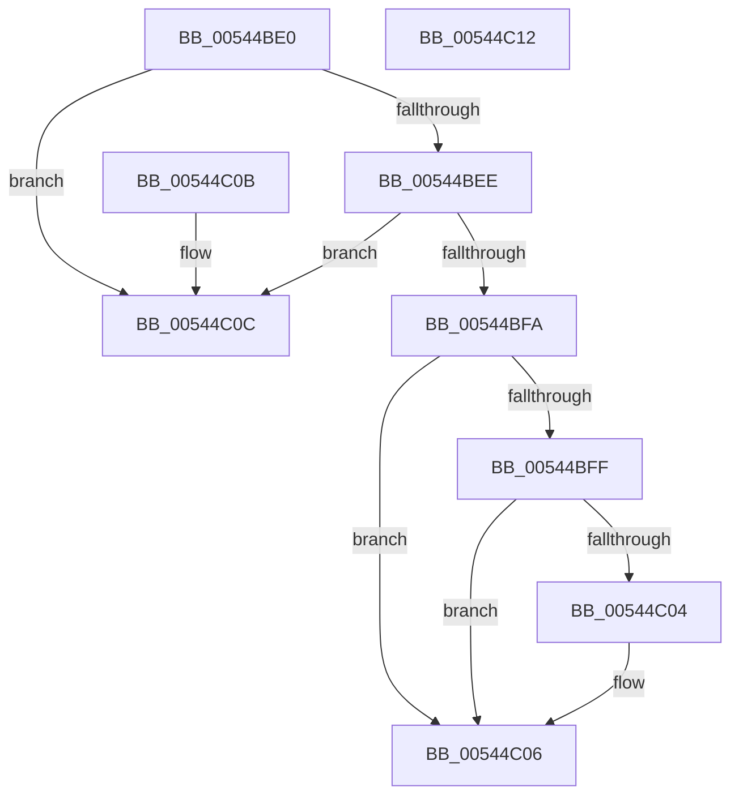

# HalpMmIsInsideHalVa

- RVA: `0x00544BE0`–`0x00544C13` (길이 `51` bytes)
- VA: `0x0000000140544BE0`
- 실행 섹션: `.text`
- PDB 이름 있음: `예`; PDB Function 태그: `아니요`
- unwind 정보 RVA: `0x000DB714`
- 디코드: `19`개 명령, `51/51` bytes 표시
- 미해석 바이트: `0` (있으면 어셈블리에 `.byte`로 보존)

> 이 문서는 커널 이미지의 기계어와 PDB 기호를 분석해 생성했습니다. 4번과 5번은 함수 원형과 자료형을 바이너리 사용 방식에서 추정한 C 해석이며 원본 소스 복구 결과는 아닙니다.

## 1. Dependencies

- 직접 호출 지점: **0**; 고유 호출 대상: **0**
- 직접 호출자로 확인된 함수: **2**
- RIP 상대 이미지 참조: **2**

### Outgoing calls
- 직접 디코드된 call 명령이 없습니다.

### Direct callers
- [ExtEnvFreeMemory](../56/ExtEnvFreeMemory_function_00561320.md) at `0x00561339`
- [ExtEnvFreePhysicalMemory](../56/ExtEnvFreePhysicalMemory_function_00561360.md) at `0x00561391`

### Static image references
- `0x00544BE0` → RVA `0x00E10210` (`.data`; read)
- `0x00544BEE` → RVA `0x00E10228` (`.data`; read)

## 2. Other-region calls and transfers

- 다른 실행 섹션으로 향하는 call: **0**
- 별도 외부 분기/꼬리 이동을 확인하지 못했습니다.

## 3. Assembly (complete function range)

```asm
00544BE0  4C 8B 0D 29 B6 8C 00            mov r9, qword ptr [rip + 0x8cb629]
00544BE7  33 C0                           xor eax, eax
00544BE9  4D 85 C9                        test r9, r9
00544BEC  74 1E                           je 0x140544c0c
00544BEE  4C 8B 05 33 B6 8C 00            mov r8, qword ptr [rip + 0x8cb633]
00544BF5  4D 85 C0                        test r8, r8
00544BF8  74 12                           je 0x140544c0c
00544BFA  49 3B C9                        cmp rcx, r9
00544BFD  72 07                           jb 0x140544c06
00544BFF  49 3B C8                        cmp rcx, r8
00544C02  77 02                           ja 0x140544c06
00544C04  B0 01                           mov al, 1
00544C06  88 02                           mov byte ptr [rdx], al
00544C08  33 C0                           xor eax, eax
00544C0A  C3                              ret
00544C0B  CC                              int3
00544C0C  B8 01 00 00 C0                  mov eax, 0xc0000001
00544C11  C3                              ret
00544C12  CC                              int3
```

## 4. C-style interpretation (structured pseudocode)

```c
__int64 __fastcall HalpMmIsInsideHalVa(__int64 a1, __int64 a2)
{
    __int64 result;

    result = 0;
    if (*(unsigned __int64 *)(v_rip + 9221673) == 0) goto loc_00544C0C;
    if (*(unsigned __int64 *)(v_rip + 9221683) == 0) goto loc_00544C0C;
    if (a1 < (*(unsigned __int64 *)(v_rip + 9221673))) goto loc_00544C06;
    if (a1 <= (*(unsigned __int64 *)(v_rip + 9221683))) {
        result = 1;
    }
    *(unsigned __int8 *)(a2) = (unsigned __int8)(result);
    result = 0;
    return result;
loc_00544C0C:
    return (unsigned int)(0xC0000001ULL);
}
```

## 5. (Beta) C Style

```c
int64_t HalpMmIsInsideHalVa(int64_t Arg1, void *Arg2)
{
    uint8_t *arg2 = (uint8_t *)Arg2;

    int64_t result;

    result = 0;
    if (*(uint64_t *)(v_rip + 0x8CB629) == 0) goto loc_00544C0C;
    if (*(uint64_t *)(v_rip + 0x8CB633) == 0) goto loc_00544C0C;
    if (Arg1 < (*(uint64_t *)(v_rip + 0x8CB629))) goto loc_00544C06;
    if (Arg1 <= (*(uint64_t *)(v_rip + 0x8CB633))) {
        result = 1;
    }
    *(uint8_t *)(arg2) = (uint8_t)(result);
    result = 0;
    return result;
loc_00544C0C:
    return (uint32_t)(0xC0000001ULL);
}
```

### 관측된 메모리 오프셋

구조체 형식이 확인되지 않은 접근은 인자 기준의 오프셋으로만 기록했습니다.

| 기준 인자 | 오프셋 표현 | 폭 (bit) | 접근 |
|---|---:|---:|---|
| `Arg2` | `+ 0x0` | `8` | `W` |

## 6. Execution-region graph

[열기: 2D/3D 그래프와 함수 탐색 컨트롤 패널](../../../control-panel.html?section=text&rva=0x00544BE0&view=graph)

- 2D 그래프는 위에서 아래로 흐르고, 3D 그래프는 빈 공간을 드래그해 회전합니다. Shift+드래그는 이동, 휠은 확대·축소, 함수 노드 선택은 대상 보고서 이동입니다.

### Static fallback


