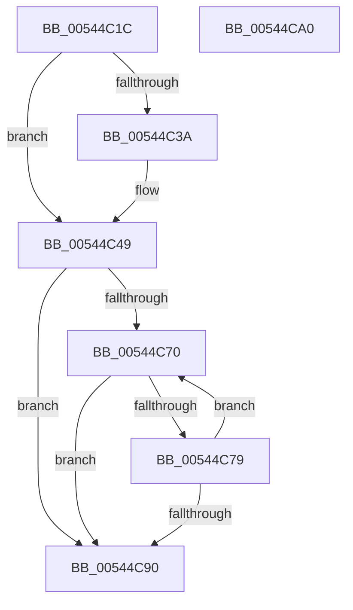

# HalpMmReservePageTablePages

- RVA: `0x00544C1C`–`0x00544CA1` (길이 `133` bytes)
- VA: `0x0000000140544C1C`
- 실행 섹션: `.text`
- PDB 이름 있음: `예`; PDB Function 태그: `아니요`
- unwind 정보 RVA: `0x00060BC4`
- 디코드: `35`개 명령, `133/133` bytes 표시
- 미해석 바이트: `0` (있으면 어셈블리에 `.byte`로 보존)

> 이 문서는 커널 이미지의 기계어와 PDB 기호를 분석해 생성했습니다. 4번과 5번은 함수 원형과 자료형을 바이너리 사용 방식에서 추정한 C 해석이며 원본 소스 복구 결과는 아닙니다.

## 1. Dependencies

- 직접 호출 지점: **3**; 고유 호출 대상: **3**
- 직접 호출자로 확인된 함수: **1**
- RIP 상대 이미지 참조: **3**

### Outgoing calls
- `0x00544C30` → [HalpInterruptModel](../4A/HalpInterruptModel_function_004ACA38.md) (function, `0x004ACA38`)
- `0x00544C3A` → [HalQueryMaximumProcessorCount](../4A/HalQueryMaximumProcessorCount_function_004AC9A0.md) (function, `0x004AC9A0`)
- `0x00544C7C` → [HalpMmGetPteAddressSafe](HalpMmGetPteAddressSafe_function_00544AF4.md) (function, `0x00544AF4`)

### Direct callers
- [HalpMmInitSystem](../../pagelk/B5/HalpMmInitSystem_function_00B5DA60.md) at `0x00B5DAA4`

### Static image references
- `0x00544C49` → RVA `0x00FC38E8` (`.data`; read)
- `0x00544C52` → RVA `0x00E10210` (`.data`; read)
- `0x00544C70` → RVA `0x00E10228` (`.data`; read)

## 2. Other-region calls and transfers

- 다른 실행 섹션으로 향하는 call: **0**
- 별도 외부 분기/꼬리 이동을 확인하지 못했습니다.

## 3. Assembly (complete function range)

```asm
00544C1C  48 89 5C 24 08                  mov qword ptr [rsp + 8], rbx
00544C21  48 89 74 24 10                  mov qword ptr [rsp + 0x10], rsi
00544C26  57                              push rdi
00544C27  48 83 EC 20                     sub rsp, 0x20
00544C2B  BA 00 00 40 00                  mov edx, 0x400000
00544C30  E8 03 7E F6 FF                  call 0x1404aca38
00544C35  83 F8 03                        cmp eax, 3
00544C38  75 0F                           jne 0x140544c49
00544C3A  E8 61 7D F6 FF                  call 0x1404ac9a0
00544C3F  8B D0                           mov edx, eax
00544C41  48 83 C2 10                     add rdx, 0x10
00544C45  48 C1 E2 12                     shl rdx, 0x12
00544C49  48 8B 35 98 EC A7 00            mov rsi, qword ptr [rip + 0xa7ec98]
00544C50  33 FF                           xor edi, edi
00544C52  48 8B 1D B7 B5 8C 00            mov rbx, qword ptr [rip + 0x8cb5b7]
00544C59  48 C1 E6 0C                     shl rsi, 0xc
00544C5D  48 81 C6 FF FF 1F 00            add rsi, 0x1fffff
00544C64  48 03 F2                        add rsi, rdx
00544C67  48 C1 EE 15                     shr rsi, 0x15
00544C6B  48 85 F6                        test rsi, rsi
00544C6E  74 20                           je 0x140544c90
00544C70  48 3B 1D B1 B5 8C 00            cmp rbx, qword ptr [rip + 0x8cb5b1]
00544C77  77 17                           ja 0x140544c90
00544C79  48 8B CB                        mov rcx, rbx
00544C7C  E8 73 FE FF FF                  call 0x140544af4
00544C81  48 FF C7                        inc rdi
00544C84  48 81 C3 00 00 20 00            add rbx, 0x200000
00544C8B  48 3B FE                        cmp rdi, rsi
00544C8E  72 E0                           jb 0x140544c70
00544C90  48 8B 5C 24 30                  mov rbx, qword ptr [rsp + 0x30]
00544C95  48 8B 74 24 38                  mov rsi, qword ptr [rsp + 0x38]
00544C9A  48 83 C4 20                     add rsp, 0x20
00544C9E  5F                              pop rdi
00544C9F  C3                              ret
00544CA0  CC                              int3
```

## 4. C-style interpretation (structured pseudocode)

```c
__int64 __fastcall HalpMmReservePageTablePages(void)
{
    __int64 result;
    __int64 v_rbx;
    __int64 v_rdi;
    __int64 v_rsi;
    __int64 v_rsp;
    unsigned __int64 v_stack_p10;
    unsigned __int64 v_stack_p8;

    v_stack_p8 = v_rbx;
    v_stack_p10 = v_rsi;
    v_rsp = (v_rsp) - (32);
    result = HalpInterruptModel(a1, (unsigned int)(0x400000ULL), a3, a4);
    if (((unsigned int)(result)) == 3) {
        result = HalQueryMaximumProcessorCount(a1, (unsigned int)(0x400000ULL), a3, a4);
        a2 = (unsigned int)(result);
        a2 = (a2) + (16);
        a2 = (a2) << (18);
    }
    v_rdi = 0;
    v_rsi = (*(unsigned __int64 *)(v_rip + 11005080)) << (12);
    v_rsi = (v_rsi) + (0x1FFFFFULL);
    v_rsi = (v_rsi) + (a2);
    v_rsi = (v_rsi) >> (21);
    if (v_rsi == 0) goto loc_00544C90;
loc_00544C70:
    if ((*(unsigned __int64 *)(v_rip + 9221559)) > (*(unsigned __int64 *)(v_rip + 9221553))) goto loc_00544C90;
    result = HalpMmGetPteAddressSafe(*(unsigned __int64 *)(v_rip + 9221559), a2, a3, a4);
    v_rdi = (v_rdi) + 1;
    v_rbx = (*(unsigned __int64 *)(v_rip + 9221559)) + (0x200000ULL);
    if (v_rdi < v_rsi) goto loc_00544C70;
loc_00544C90:
    v_rsp = (v_rsp) + (32);
    return result;
}
```

## 5. (Beta) C Style

```c
void HalpMmReservePageTablePages(void)
{
    int64_t result;
    int64_t local_rbx;
    int64_t local_rdi;
    int64_t local_rsi;
    int64_t local_rsp;
    uint64_t v_stack_p10;
    uint64_t v_stack_p8;

    v_stack_p8 = local_rbx;
    v_stack_p10 = local_rsi;
    local_rsp = (local_rsp) - (32);
    result = HalpInterruptModel(a1, (uint32_t)(0x400000ULL), a3, a4);
    if (((uint32_t)(result)) == 3) {
        result = HalQueryMaximumProcessorCount(a1, (uint32_t)(0x400000ULL), a3, a4);
        a2 = (uint32_t)(result);
        a2 = (a2) + (16);
        a2 = (a2) << (18);
    }
    local_rdi = 0;
    local_rsi = (*(uint64_t *)(v_rip + 0xA7EC98)) << (12);
    local_rsi = (local_rsi) + (0x1FFFFFULL);
    local_rsi = (local_rsi) + (a2);
    local_rsi = (local_rsi) >> (21);
    if (local_rsi == 0) goto loc_00544C90;
loc_00544C70:
    if ((*(uint64_t *)(v_rip + 0x8CB5B7)) > (*(uint64_t *)(v_rip + 0x8CB5B1))) goto loc_00544C90;
    result = HalpMmGetPteAddressSafe(*(uint64_t *)(v_rip + 0x8CB5B7), a2, a3, a4);
    local_rdi = (local_rdi) + 1;
    local_rbx = (*(uint64_t *)(v_rip + 0x8CB5B7)) + (0x200000ULL);
    if (local_rdi < local_rsi) goto loc_00544C70;
loc_00544C90:
    local_rsp = (local_rsp) + (32);
    return result;
}
```

## 6. Execution-region graph

[열기: 2D/3D 그래프와 함수 탐색 컨트롤 패널](../../../control-panel.html?section=text&rva=0x00544C1C&view=graph)

- 2D 그래프는 위에서 아래로 흐르고, 3D 그래프는 빈 공간을 드래그해 회전합니다. Shift+드래그는 이동, 휠은 확대·축소, 함수 노드 선택은 대상 보고서 이동입니다.

### Static fallback


