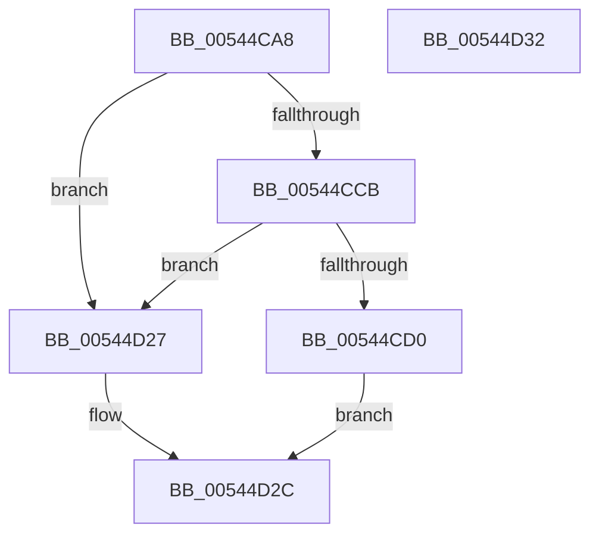

# HalpMmZeroPageWithTemporaryMapping

- RVA: `0x00544CA8`–`0x00544D33` (길이 `139` bytes)
- VA: `0x0000000140544CA8`
- 실행 섹션: `.text`
- PDB 이름 있음: `예`; PDB Function 태그: `아니요`
- unwind 정보 RVA: `0x000805BC`
- 디코드: `32`개 명령, `139/139` bytes 표시
- 미해석 바이트: `0` (있으면 어셈블리에 `.byte`로 보존)

> 이 문서는 커널 이미지의 기계어와 PDB 기호를 분석해 생성했습니다. 4번과 5번은 함수 원형과 자료형을 바이너리 사용 방식에서 추정한 C 해석이며 원본 소스 복구 결과는 아닙니다.

## 1. Dependencies

- 직접 호출 지점: **2**; 고유 호출 대상: **2**
- 직접 호출자로 확인된 함수: **1**
- RIP 상대 이미지 참조: **0**

### Outgoing calls
- `0x00544D0B` → [memset](../6C/memset_function_006C6C40.md) (function, `0x006C6C40`)
- `0x00544D1E` → [HalpFlushTLB](../4F/HalpFlushTLB_function_004F5E9C.md) (function, `0x004F5E9C`)

### Direct callers
- [HalpMmAllocateAndInsertPageTablePage](HalpMmAllocateAndInsertPageTablePage_function_005448E4.md) at `0x00544922`

### Static image references
- 디코드된 RIP-relative 메모리 참조가 없습니다.

## 2. Other-region calls and transfers

- 다른 실행 섹션으로 향하는 call: **0**
- 별도 외부 분기/꼬리 이동을 확인하지 못했습니다.

## 3. Assembly (complete function range)

```asm
00544CA8  48 89 54 24 10                  mov qword ptr [rsp + 0x10], rdx
00544CAD  53                              push rbx
00544CAE  48 83 EC 20                     sub rsp, 0x20
00544CB2  48 BB 00 00 00 00 80 F6 FF FF   movabs rbx, 0xfffff68000000000
00544CBC  48 B8 00 E0 FF FF 7F 00 00 00   movabs rax, 0x7fffffe000
00544CC6  48 03 D8                        add rbx, rax
00544CC9  74 5C                           je 0x140544d27
00544CCB  F6 03 01                        test byte ptr [rbx], 1
00544CCE  75 57                           jne 0x140544d27
00544CD0  48 B8 00 F0 FF FF FF FF 0F 00   movabs rax, 0xffffffffff000
00544CDA  48 89 5C 24 38                  mov qword ptr [rsp + 0x38], rbx
00544CDF  48 23 C8                        and rcx, rax
00544CE2  48 B8 03 00 00 00 00 00 00 80   movabs rax, 0x8000000000000003
00544CEC  48 0B C8                        or rcx, rax
00544CEF  48 8B 44 24 38                  mov rax, qword ptr [rsp + 0x38]
00544CF4  48 89 08                        mov qword ptr [rax], rcx
00544CF7  F0 83 0C 24 00                  lock or dword ptr [rsp], 0
00544CFC  33 D2                           xor edx, edx
00544CFE  48 C7 C1 00 00 C0 FF            mov rcx, 0xffffffffffc00000
00544D05  41 B8 00 10 00 00               mov r8d, 0x1000
00544D0B  E8 30 1F 18 00                  call 0x1406c6c40
00544D10  48 89 5C 24 38                  mov qword ptr [rsp + 0x38], rbx
00544D15  48 8B 44 24 38                  mov rax, qword ptr [rsp + 0x38]
00544D1A  48 83 20 00                     and qword ptr [rax], 0
00544D1E  E8 79 11 FB FF                  call 0x1404f5e9c
00544D23  33 C0                           xor eax, eax
00544D25  EB 05                           jmp 0x140544d2c
00544D27  B8 0D 00 00 C0                  mov eax, 0xc000000d
00544D2C  48 83 C4 20                     add rsp, 0x20
00544D30  5B                              pop rbx
00544D31  C3                              ret
00544D32  CC                              int3
```

## 4. C-style interpretation (structured pseudocode)

```c
__int64 __fastcall HalpMmZeroPageWithTemporaryMapping(__int64 a1, __int64 a2)
{
    __int64 result;
    __int64 v_rbx;
    __int64 v_rsp;
    unsigned int v_stack_m28;
    unsigned __int64 v_stack_p10;

    v_stack_p10 = a2;
    v_rsp = (v_rsp) - (32);
    v_rbx = (v_rbx) + (result);
    if (condition_is_equal) goto loc_00544D27;
    if (((*(unsigned __int8 *)(v_rbx)) & (1)) != 0) goto loc_00544D27;
    v_stack_p10 = v_rbx;
    a1 = (a1) & (result);
    a1 = (a1) | (result);
    *(unsigned __int64 *)(v_stack_p10) = a1;
    a2 = 0;
    result = memset(0xFFFFFFFFFFC00000ULL, a2, (unsigned int)(0x1000ULL), a4);
    v_stack_p10 = v_rbx;
    result = HalpFlushTLB(0xFFFFFFFFFFC00000ULL, a2, (unsigned int)(0x1000ULL), a4);
    result = 0;
    goto loc_00544D2C;
loc_00544D27:
loc_00544D2C:
    v_rsp = (v_rsp) + (32);
    return (unsigned int)(0xC000000DULL);
}
```

## 5. (Beta) C Style

```c
int64_t HalpMmZeroPageWithTemporaryMapping(int64_t Arg1, int64_t Arg2)
{
    int64_t result;
    int64_t local_rbx;
    int64_t local_rsp;
    uint32_t v_stack_m28;
    uint64_t v_stack_p10;

    v_stack_p10 = Arg2;
    local_rsp = (local_rsp) - (32);
    local_rbx = (local_rbx) + (result);
    if (condition_is_equal) goto loc_00544D27;
    if (((*(uint8_t *)(local_rbx)) & (1)) != 0) goto loc_00544D27;
    v_stack_p10 = local_rbx;
    Arg1 = (Arg1) & (result);
    Arg1 = (Arg1) | (result);
    *(uint64_t *)(v_stack_p10) = Arg1;
    Arg2 = 0;
    result = memset(0xFFFFFFFFFFC00000ULL, Arg2, (uint32_t)(0x1000ULL), a4);
    v_stack_p10 = local_rbx;
    result = HalpFlushTLB(0xFFFFFFFFFFC00000ULL, Arg2, (uint32_t)(0x1000ULL), a4);
    result = 0;
    goto loc_00544D2C;
loc_00544D27:
loc_00544D2C:
    local_rsp = (local_rsp) + (32);
    return (uint32_t)(0xC000000DULL);
}
```

## 6. Execution-region graph

[열기: 2D/3D 그래프와 함수 탐색 컨트롤 패널](../../../control-panel.html?section=text&rva=0x00544CA8&view=graph)

- 2D 그래프는 위에서 아래로 흐르고, 3D 그래프는 빈 공간을 드래그해 회전합니다. Shift+드래그는 이동, 휠은 확대·축소, 함수 노드 선택은 대상 보고서 이동입니다.

### Static fallback


