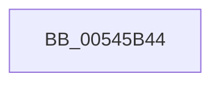

# HalpNMIHalt

- RVA: `0x00545B44`–`0x00545B73` (길이 `47` bytes)
- VA: `0x0000000140545B44`
- 실행 섹션: `.text`
- PDB 이름 있음: `예`; PDB Function 태그: `아니요`
- unwind 정보 RVA: `0x000622F0`
- 디코드: `10`개 명령, `47/47` bytes 표시
- 미해석 바이트: `0` (있으면 어셈블리에 `.byte`로 보존)

> 이 문서는 커널 이미지의 기계어와 PDB 기호를 분석해 생성했습니다. 4번과 5번은 함수 원형과 자료형을 바이너리 사용 방식에서 추정한 C 해석이며 원본 소스 복구 결과는 아닙니다.

## 1. Dependencies

- 직접 호출 지점: **1**; 고유 호출 대상: **1**
- 직접 호출자로 확인된 함수: **2**
- RIP 상대 이미지 참조: **2**

### Outgoing calls
- `0x00545B6D` → [KeBugCheckEx](../4F/KeBugCheckEx_function_004FD660.md) (function, `0x004FD660`)

### Direct callers
- [HalBugCheckSystem](HalBugCheckSystem_function_00540060.md) at `0x005400C4`
- [HalHandleNMI](HalHandleNMI_function_00545800.md) at `0x00545974`

### Static image references
- `0x00545B5F` → RVA `0x00FC19B8` (`.data`; write)
- `0x00545B66` → RVA `0x00FC1C49` (`.data`; write)

## 2. Other-region calls and transfers

- 다른 실행 섹션으로 향하는 call: **0**
- 별도 외부 분기/꼬리 이동을 확인하지 못했습니다.

## 3. Assembly (complete function range)

```asm
00545B44  48 83 EC 38                     sub rsp, 0x38
00545B48  48 83 64 24 20 00               and qword ptr [rsp + 0x20], 0
00545B4E  45 33 C9                        xor r9d, r9d
00545B51  44 0F B6 C1                     movzx r8d, cl
00545B55  BA 54 44 4F 00                  mov edx, 0x4f4454
00545B5A  B9 80 00 00 00                  mov ecx, 0x80
00545B5F  C6 05 52 BE A7 00 01            mov byte ptr [rip + 0xa7be52], 1
00545B66  C6 05 DC C0 A7 00 01            mov byte ptr [rip + 0xa7c0dc], 1
00545B6D  E8 EE 7A FB FF                  call 0x1404fd660
00545B72  CC                              int3
```

## 4. C-style interpretation (structured pseudocode)

```c
__int64 __fastcall HalpNMIHalt(unsigned __int8 a1, __int64 a2, __int64 a3, int a4)
{
    __int64 result;
    __int64 v_rsp;
    unsigned __int64 v_stack_m18;

    v_rsp = (v_rsp) - (56);
    a4 = 0;
    *(unsigned __int8 *)(v_rip + 10993234) = 1;
    *(unsigned __int8 *)(v_rip + 10993884) = 1;
    result = KeBugCheckEx(128, (unsigned int)(0x4F4454ULL), a1, a4);
    return result;
}
```

## 5. (Beta) C Style

```c
int64_t HalpNMIHalt(uint8_t Arg1, int64_t Arg2, int64_t Arg3, int32_t Arg4)
{
    int64_t result;
    int64_t local_rsp;
    uint64_t v_stack_m18;

    local_rsp = (local_rsp) - (56);
    Arg4 = 0;
    *(uint8_t *)(v_rip + 0xA7BE52) = 1;
    *(uint8_t *)(v_rip + 0xA7C0DC) = 1;
    result = KeBugCheckEx(128, (uint32_t)(0x4F4454ULL), Arg1, Arg4);
    return result;
}
```

## 6. Execution-region graph

[열기: 2D/3D 그래프와 함수 탐색 컨트롤 패널](../../../control-panel.html?section=text&rva=0x00545B44&view=graph)

- 2D 그래프는 위에서 아래로 흐르고, 3D 그래프는 빈 공간을 드래그해 회전합니다. Shift+드래그는 이동, 휠은 확대·축소, 함수 노드 선택은 대상 보고서 이동입니다.

### Static fallback


