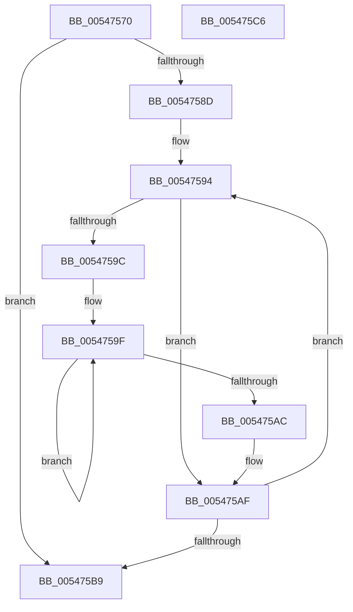

# HalpPmuGetNumberOfReservedCounters

- RVA: `0x00547570`–`0x005475C7` (길이 `87` bytes)
- VA: `0x0000000140547570`
- 실행 섹션: `.text`
- PDB 이름 있음: `예`; PDB Function 태그: `아니요`
- unwind 정보 RVA: `0x0005CAAC`
- 디코드: `30`개 명령, `87/87` bytes 표시
- 미해석 바이트: `0` (있으면 어셈블리에 `.byte`로 보존)

> 이 문서는 커널 이미지의 기계어와 PDB 기호를 분석해 생성했습니다. 4번과 5번은 함수 원형과 자료형을 바이너리 사용 방식에서 추정한 C 해석이며 원본 소스 복구 결과는 아닙니다.

## 1. Dependencies

- 직접 호출 지점: **1**; 고유 호출 대상: **1**
- 직접 호출자로 확인된 함수: **3**
- RIP 상대 이미지 참조: **0**

### Outgoing calls
- `0x00547584` → [KeQueryActiveProcessorCountEx](../24/KeQueryActiveProcessorCountEx_function_00249EF0.md) (function, `0x00249EF0`)

### Direct callers
- [EmonReleaseProfileResources](../55/EmonReleaseProfileResources_function_0055EEC0.md) at `0x0055EEDA`
- [EmonReserveProfileResourcesEnhanced](../55/EmonReserveProfileResourcesEnhanced_function_0055F3C0.md) at `0x0055F551`
- [EmonReserveProfileResourcesOriginal](../55/EmonReserveProfileResourcesOriginal_function_0055F580.md) at `0x0055F72F`

### Static image references
- 디코드된 RIP-relative 메모리 참조가 없습니다.

## 2. Other-region calls and transfers

- 다른 실행 섹션으로 향하는 call: **0**
- 별도 외부 분기/꼬리 이동을 확인하지 못했습니다.

## 3. Assembly (complete function range)

```asm
00547570  48 89 5C 24 08                  mov qword ptr [rsp + 8], rbx
00547575  57                              push rdi
00547576  48 83 EC 20                     sub rsp, 0x20
0054757A  48 8B F9                        mov rdi, rcx
0054757D  33 DB                           xor ebx, ebx
0054757F  B9 FF FF 00 00                  mov ecx, 0xffff
00547584  E8 67 29 D0 FF                  call 0x140249ef0
00547589  85 C0                           test eax, eax
0054758B  74 2C                           je 0x1405475b9
0054758D  48 8D 57 20                     lea rdx, [rdi + 0x20]
00547591  44 8B C8                        mov r9d, eax
00547594  48 8B 0A                        mov rcx, qword ptr [rdx]
00547597  48 85 C9                        test rcx, rcx
0054759A  74 13                           je 0x1405475af
0054759C  45 33 C0                        xor r8d, r8d
0054759F  8B C1                           mov eax, ecx
005475A1  83 E0 01                        and eax, 1
005475A4  44 03 C0                        add r8d, eax
005475A7  48 D1 E9                        shr rcx, 1
005475AA  75 F3                           jne 0x14054759f
005475AC  41 03 D8                        add ebx, r8d
005475AF  48 83 C2 50                     add rdx, 0x50
005475B3  49 83 E9 01                     sub r9, 1
005475B7  75 DB                           jne 0x140547594
005475B9  8B C3                           mov eax, ebx
005475BB  48 8B 5C 24 30                  mov rbx, qword ptr [rsp + 0x30]
005475C0  48 83 C4 20                     add rsp, 0x20
005475C4  5F                              pop rdi
005475C5  C3                              ret
005475C6  CC                              int3
```

## 4. C-style interpretation (structured pseudocode)

```c
__int64 __fastcall HalpPmuGetNumberOfReservedCounters(__int64 a1, __int64 a2, int a3)
{
    __int64 result;
    __int64 v_rbx;
    __int64 v_rsp;
    unsigned __int64 v_stack_p8;

    v_stack_p8 = v_rbx;
    v_rsp = (v_rsp) - (32);
    v_rbx = 0;
    result = KeQueryActiveProcessorCountEx((unsigned int)(0xFFFFULL), a2, a3, a4);
    if ((unsigned int)(result) == 0) goto loc_005475B9;
loc_00547594:
    if (*(unsigned __int64 *)(a1 + 32) == 0) goto loc_005475AF;
    a3 = 0;
loc_0054759F:
    result = (unsigned int)(((unsigned int)((unsigned int)(*(unsigned __int64 *)(a1 + 32)))) & (1));
    a3 = (unsigned int)((a3) + ((unsigned int)(result)));
    a1 = (*(unsigned __int64 *)(a1 + 32)) >> (1);
    if (condition_is_not_equal) goto loc_0054759F;
    v_rbx = (unsigned int)((v_rbx) + (a3));
loc_005475AF:
    a2 = (a1 + 32) + (80);
    a4 = ((unsigned int)((unsigned int)(result))) - (1);
    if (condition_is_not_equal) goto loc_00547594;
loc_005475B9:
    v_rsp = (v_rsp) + (32);
    return (unsigned int)((unsigned int)(v_rbx));
}
```

## 5. (Beta) C Style

```c
int64_t HalpPmuGetNumberOfReservedCounters(void *Arg1, int64_t Arg2, int32_t Arg3)
{
    uint8_t *arg1 = (uint8_t *)Arg1;

    int64_t result;
    int64_t local_rbx;
    int64_t local_rsp;
    uint64_t v_stack_p8;

    v_stack_p8 = local_rbx;
    local_rsp = (local_rsp) - (32);
    local_rbx = 0;
    result = KeQueryActiveProcessorCountEx((uint32_t)(0xFFFFULL), Arg2, Arg3, a4);
    if ((uint32_t)(result) == 0) goto loc_005475B9;
loc_00547594:
    if (*(uint64_t *)(arg1 + 0x20) == 0) goto loc_005475AF;
    Arg3 = 0;
loc_0054759F:
    result = (uint32_t)(((uint32_t)((uint32_t)(*(uint64_t *)(arg1 + 0x20)))) & (1));
    Arg3 = (uint32_t)((Arg3) + ((uint32_t)(result)));
    Arg1 = (*(uint64_t *)(arg1 + 0x20)) >> (1);
    if (condition_is_not_equal) goto loc_0054759F;
    local_rbx = (uint32_t)((local_rbx) + (Arg3));
loc_005475AF:
    Arg2 = (Arg1 + 32) + (80);
    a4 = ((uint32_t)((uint32_t)(result))) - (1);
    if (condition_is_not_equal) goto loc_00547594;
loc_005475B9:
    local_rsp = (local_rsp) + (32);
    return (uint32_t)((uint32_t)(local_rbx));
}
```

### 관측된 메모리 오프셋

구조체 형식이 확인되지 않은 접근은 인자 기준의 오프셋으로만 기록했습니다.

| 기준 인자 | 오프셋 표현 | 폭 (bit) | 접근 |
|---|---:|---:|---|
| `Arg1` | `+ 0x0` | `64` | `R` |
| `Arg1` | `+ 0x20` | `64` | `R` |

## 6. Execution-region graph

[열기: 2D/3D 그래프와 함수 탐색 컨트롤 패널](../../../control-panel.html?section=text&rva=0x00547570&view=graph)

- 2D 그래프는 위에서 아래로 흐르고, 3D 그래프는 빈 공간을 드래그해 회전합니다. Shift+드래그는 이동, 휠은 확대·축소, 함수 노드 선택은 대상 보고서 이동입니다.

### Static fallback


