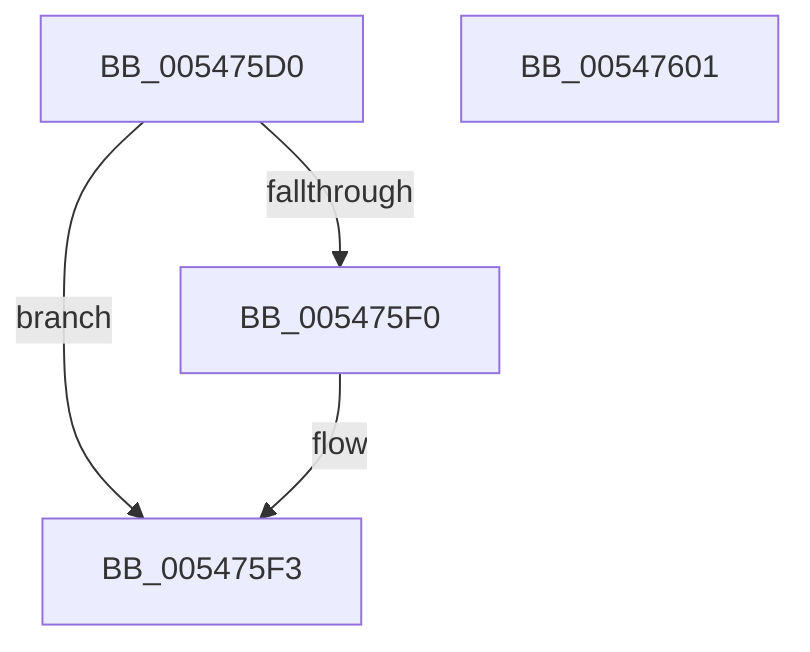

# HalpPmuProcessorCallbackDpcRoutine

- RVA: `0x005475D0`–`0x00547602` (길이 `50` bytes)
- VA: `0x00000001405475D0`
- 실행 섹션: `.text`
- PDB 이름 있음: `예`; PDB Function 태그: `아니요`
- unwind 정보 RVA: `0x0005CAAC`
- 디코드: `17`개 명령, `50/50` bytes 표시
- 미해석 바이트: `0` (있으면 어셈블리에 `.byte`로 보존)

> 이 문서는 커널 이미지의 기계어와 PDB 기호를 분석해 생성했습니다. 4번과 5번은 함수 원형과 자료형을 바이너리 사용 방식에서 추정한 C 해석이며 원본 소스 복구 결과는 아닙니다.

## 1. Dependencies

- 직접 호출 지점: **1**; 고유 호출 대상: **1**
- 직접 호출자로 확인된 함수: **0**
- RIP 상대 이미지 참조: **0**

### Outgoing calls
- `0x005475E7` → [guard_dispatch_icall](../6B/guard_dispatch_icall_function_006BAAD0.md) (function, `0x006BAAD0`)

### Direct callers
- 이 함수 시작 RVA로 연결되는 직접 call은 확인되지 않았습니다. 간접 호출은 완전히 역산할 수 없습니다.

### Static image references
- 디코드된 RIP-relative 메모리 참조가 없습니다.

## 2. Other-region calls and transfers

- 다른 실행 섹션으로 향하는 call: **0**
- 별도 외부 분기/꼬리 이동을 확인하지 못했습니다.

## 3. Assembly (complete function range)

```asm
005475D0  48 89 5C 24 08                  mov qword ptr [rsp + 8], rbx
005475D5  57                              push rdi
005475D6  48 83 EC 20                     sub rsp, 0x20
005475DA  48 8B 02                        mov rax, qword ptr [rdx]
005475DD  49 8B D8                        mov rbx, r8
005475E0  48 8B 4A 08                     mov rcx, qword ptr [rdx + 8]
005475E4  48 8B FA                        mov rdi, rdx
005475E7  E8 E4 34 17 00                  call 0x1406baad0
005475EC  85 C0                           test eax, eax
005475EE  79 03                           jns 0x1405475f3
005475F0  89 47 10                        mov dword ptr [rdi + 0x10], eax
005475F3  F0 FF 03                        lock inc dword ptr [rbx]
005475F6  48 8B 5C 24 30                  mov rbx, qword ptr [rsp + 0x30]
005475FB  48 83 C4 20                     add rsp, 0x20
005475FF  5F                              pop rdi
00547600  C3                              ret
00547601  CC                              int3
```

## 4. C-style interpretation (structured pseudocode)

```c
__int64 __fastcall HalpPmuProcessorCallbackDpcRoutine(__int64 a1, __int64 a2, __int64 a3)
{
    __int64 result;
    __int64 v_rsp;
    unsigned __int64 v_stack_p8;

    v_stack_p8 = v_rbx;
    v_rsp = (v_rsp) - (32);
    result = guard_dispatch_icall(*(unsigned __int64 *)(a2 + 8), a2, a3, a4);
    if (sign_flag) {
        *(unsigned int *)(a2 + 16) = (unsigned int)(result);
    }
    v_rsp = (v_rsp) + (32);
    return result;
}
```

## 5. (Beta) C Style

```c
int64_t HalpPmuProcessorCallbackDpcRoutine(int64_t Arg1, void *Arg2, void *Arg3)
{
    uint8_t *arg2 = (uint8_t *)Arg2;
    uint8_t *arg3 = (uint8_t *)Arg3;

    int64_t result;
    int64_t local_rsp;
    uint64_t v_stack_p8;

    v_stack_p8 = local_rbx;
    local_rsp = (local_rsp) - (32);
    result = guard_dispatch_icall(*(uint64_t *)(arg2 + 0x8), Arg2, Arg3, a4);
    if (sign_flag) {
        *(uint32_t *)(arg2 + 0x10) = (uint32_t)(result);
    }
    local_rsp = (local_rsp) + (32);
    return result;
}
```

### 관측된 메모리 오프셋

구조체 형식이 확인되지 않은 접근은 인자 기준의 오프셋으로만 기록했습니다.

| 기준 인자 | 오프셋 표현 | 폭 (bit) | 접근 |
|---|---:|---:|---|
| `Arg2` | `+ 0x0` | `64` | `R` |
| `Arg2` | `+ 0x8` | `64` | `R` |
| `Arg2` | `+ 0x10` | `32` | `W` |
| `Arg3` | `+ 0x0` | `32` | `R/W` |

## 6. Execution-region graph

[열기: 2D/3D 그래프와 함수 탐색 컨트롤 패널](../../../control-panel.html?section=text&rva=0x005475D0&view=graph)

- 2D 그래프는 위에서 아래로 흐르고, 3D 그래프는 빈 공간을 드래그해 회전합니다. Shift+드래그는 이동, 휠은 확대·축소, 함수 노드 선택은 대상 보고서 이동입니다.

### Static fallback


