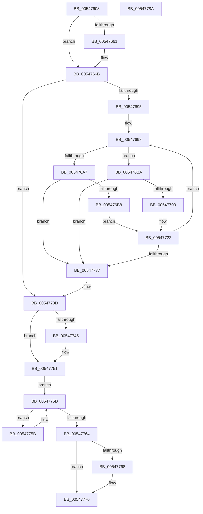

# HalpPmuReservedResourcesProcessorCallback

- RVA: `0x00547608`–`0x0054778B` (길이 `387` bytes)
- VA: `0x0000000140547608`
- 실행 섹션: `.text`
- PDB 이름 있음: `예`; PDB Function 태그: `아니요`
- unwind 정보 RVA: `0x000C3D64`
- 디코드: `117`개 명령, `387/387` bytes 표시
- 미해석 바이트: `0` (있으면 어셈블리에 `.byte`로 보존)

> 이 문서는 커널 이미지의 기계어와 PDB 기호를 분석해 생성했습니다. 4번과 5번은 함수 원형과 자료형을 바이너리 사용 방식에서 추정한 C 해석이며 원본 소스 복구 결과는 아닙니다.

## 1. Dependencies

- 직접 호출 지점: **8**; 고유 호출 대상: **7**
- 직접 호출자로 확인된 함수: **2**
- RIP 상대 이미지 참조: **2**

### Outgoing calls
- `0x00547664` → [KiRaiseIrqlProcessIrqlFlags](../4F/KiRaiseIrqlProcessIrqlFlags_function_004F56FC.md) (function, `0x004F56FC`)
- `0x00547686` → [KeEnumerateNextProcessor](../41/KeEnumerateNextProcessor_function_00415480.md) (function, `0x00415480`)
- `0x005476AD` → [guard_dispatch_icall](../6B/guard_dispatch_icall_function_006BAAD0.md) (function, `0x006BAAD0`)
- `0x005476F8` → [KeGetProcessorNumberFromIndex](../2D/KeGetProcessorNumberFromIndex_function_002DD320.md) (function, `0x002DD320`)
- `0x0054770B` → [KeSetTargetProcessorDpcEx](../2D/KeSetTargetProcessorDpcEx_function_002DD280.md) (function, `0x002DD280`)
- `0x0054771D` → [KeInsertQueueDpc](../20/KeInsertQueueDpc_function_00207C50.md) (function, `0x00207C50`)
- `0x0054772A` → [KeEnumerateNextProcessor](../41/KeEnumerateNextProcessor_function_00415480.md) (function, `0x00415480`)
- `0x0054774C` → [KiLowerIrqlProcessIrqlFlags](../4F/KiLowerIrqlProcessIrqlFlags_function_004F5698.md) (function, `0x004F5698`)

### Direct callers
- [EmonAllocateResources](../55/EmonAllocateResources_function_0055C40C.md) at `0x0055C4EE`
- [EmonReleaseProfileResourcesInternal](../55/EmonReleaseProfileResourcesInternal_function_0055EF54.md) at `0x0055F009`

### Static image references
- `0x00547659` → RVA `0x00FC6D20` (`ALMOSTRO`; read)
- `0x005476C1` → RVA `0x005475D0` (`HalpPmuProcessorCallbackDpcRoutine`; read)

## 2. Other-region calls and transfers

- 다른 실행 섹션으로 향하는 call: **0**
- 별도 외부 분기/꼬리 이동을 확인하지 못했습니다.

## 3. Assembly (complete function range)

```asm
00547608  48 89 5C 24 20                  mov qword ptr [rsp + 0x20], rbx
0054760D  55                              push rbp
0054760E  56                              push rsi
0054760F  57                              push rdi
00547610  41 54                           push r12
00547612  41 55                           push r13
00547614  41 56                           push r14
00547616  41 57                           push r15
00547618  48 8B EC                        mov rbp, rsp
0054761B  48 83 EC 60                     sub rsp, 0x60
0054761F  33 C0                           xor eax, eax
00547621  48 89 55 E0                     mov qword ptr [rbp - 0x20], rdx
00547625  89 45 DA                        mov dword ptr [rbp - 0x26], eax
00547628  8B D8                           mov ebx, eax
0054762A  66 89 45 DE                     mov word ptr [rbp - 0x22], ax
0054762E  8B F0                           mov esi, eax
00547630  89 45 40                        mov dword ptr [rbp + 0x40], eax
00547633  4D 8B E9                        mov r13, r9
00547636  89 45 50                        mov dword ptr [rbp + 0x50], eax
00547639  4D 8B F8                        mov r15, r8
0054763C  48 89 45 F0                     mov qword ptr [rbp - 0x10], rax
00547640  4C 8B E2                        mov r12, rdx
00547643  48 8B F9                        mov rdi, rcx
00547646  4C 89 45 E8                     mov qword ptr [rbp - 0x18], r8
0054764A  45 0F 20 C6                     mov r14, cr8
0054764E  4C 89 75 C0                     mov qword ptr [rbp - 0x40], r14
00547652  8D 50 02                        lea edx, [rax + 2]
00547655  44 0F 22 C2                     mov cr8, rdx
00547659  39 05 C1 F6 A7 00               cmp dword ptr [rip + 0xa7f6c1], eax
0054765F  74 0A                           je 0x14054766b
00547661  41 8A CE                        mov cl, r14b
00547664  E8 93 E0 FA FF                  call 0x1404f56fc
00547669  33 C0                           xor eax, eax
0054766B  89 45 48                        mov dword ptr [rbp + 0x48], eax
0054766E  48 8D 55 C8                     lea rdx, [rbp - 0x38]
00547672  66 89 45 D8                     mov word ptr [rbp - 0x28], ax
00547676  48 8D 4D 40                     lea rcx, [rbp + 0x40]
0054767A  48 8B 47 08                     mov rax, qword ptr [rdi + 8]
0054767E  48 89 45 D0                     mov qword ptr [rbp - 0x30], rax
00547682  48 89 7D C8                     mov qword ptr [rbp - 0x38], rdi
00547686  E8 F5 DD EC FF                  call 0x140415480
0054768B  33 FF                           xor edi, edi
0054768D  85 C0                           test eax, eax
0054768F  0F 85 A8 00 00 00               jne 0x14054773d
00547695  45 33 F6                        xor r14d, r14d
00547698  65 8B 04 25 A4 01 00 00         mov eax, dword ptr gs:[0x1a4]
005476A0  8B 4D 40                        mov ecx, dword ptr [rbp + 0x40]
005476A3  3B C8                           cmp ecx, eax
005476A5  75 13                           jne 0x1405476ba
005476A7  49 8B CF                        mov rcx, r15
005476AA  49 8B C4                        mov rax, r12
005476AD  E8 1E 34 17 00                  call 0x1406baad0
005476B2  8B D8                           mov ebx, eax
005476B4  85 C0                           test eax, eax
005476B6  78 7F                           js 0x140547737
005476B8  EB 68                           jmp 0x140547722
005476BA  48 8D 14 89                     lea rdx, [rcx + rcx*4]
005476BE  48 03 D2                        add rdx, rdx
005476C1  48 8D 05 08 FF FF FF            lea rax, [rip - 0xf8]
005476C8  48 8D 3C D5 00 00 00 00         lea rdi, [rdx*8]
005476D0  49 03 FD                        add rdi, r13
005476D3  48 89 47 48                     mov qword ptr [rdi + 0x48], rax
005476D7  48 8D 45 E0                     lea rax, [rbp - 0x20]
005476DB  48 89 47 50                     mov qword ptr [rdi + 0x50], rax
005476DF  C7 47 30 13 01 00 00            mov dword ptr [rdi + 0x30], 0x113
005476E6  4C 89 77 68                     mov qword ptr [rdi + 0x68], r14
005476EA  4C 89 77 40                     mov qword ptr [rdi + 0x40], r14
005476EE  41 C6 44 D5 31 03               mov byte ptr [r13 + rdx*8 + 0x31], 3
005476F4  48 8D 55 50                     lea rdx, [rbp + 0x50]
005476F8  E8 23 5C D9 FF                  call 0x1402dd320
005476FD  8B D8                           mov ebx, eax
005476FF  85 C0                           test eax, eax
00547701  78 34                           js 0x140547737
00547703  48 8D 55 50                     lea rdx, [rbp + 0x50]
00547707  48 8D 4F 30                     lea rcx, [rdi + 0x30]
0054770B  E8 70 5B D9 FF                  call 0x1402dd280
00547710  45 33 C0                        xor r8d, r8d
00547713  48 8D 55 48                     lea rdx, [rbp + 0x48]
00547717  48 8D 4F 30                     lea rcx, [rdi + 0x30]
0054771B  FF C6                           inc esi
0054771D  E8 2E 05 CC FF                  call 0x140207c50
00547722  48 8D 55 C8                     lea rdx, [rbp - 0x38]
00547726  48 8D 4D 40                     lea rcx, [rbp + 0x40]
0054772A  E8 51 DD EC FF                  call 0x140415480
0054772F  85 C0                           test eax, eax
00547731  0F 84 61 FF FF FF               je 0x140547698
00547737  4C 8B 75 C0                     mov r14, qword ptr [rbp - 0x40]
0054773B  33 FF                           xor edi, edi
0054773D  39 3D DD F5 A7 00               cmp dword ptr [rip + 0xa7f5dd], edi
00547743  74 0C                           je 0x140547751
00547745  44 0F 20 C1                     mov rcx, cr8
00547749  41 8A D6                        mov dl, r14b
0054774C  E8 47 DF FA FF                  call 0x1404f5698
00547751  41 0F B6 C6                     movzx eax, r14b
00547755  44 0F 22 C0                     mov cr8, rax
00547759  EB 02                           jmp 0x14054775d
0054775B  F3 90                           pause
0054775D  8B 45 48                        mov eax, dword ptr [rbp + 0x48]
00547760  3B C6                           cmp eax, esi
00547762  75 F7                           jne 0x14054775b
00547764  85 DB                           test ebx, ebx
00547766  78 08                           js 0x140547770
00547768  8B 45 F0                        mov eax, dword ptr [rbp - 0x10]
0054776B  85 C0                           test eax, eax
0054776D  0F 48 D8                        cmovs ebx, eax
00547770  8B C3                           mov eax, ebx
00547772  48 8B 9C 24 B8 00 00 00         mov rbx, qword ptr [rsp + 0xb8]
0054777A  48 83 C4 60                     add rsp, 0x60
0054777E  41 5F                           pop r15
00547780  41 5E                           pop r14
00547782  41 5D                           pop r13
00547784  41 5C                           pop r12
00547786  5F                              pop rdi
00547787  5E                              pop rsi
00547788  5D                              pop rbp
00547789  C3                              ret
0054778A  CC                              int3
```

## 4. C-style interpretation (structured pseudocode)

```c
__int64 __fastcall HalpPmuReservedResourcesProcessorCallback(__int64 a1, __int64 a2, __int64 a3, __int64 a4)
{
    __int64 result;
    __int64 v_r14;
    __int64 v_rbx;
    __int64 v_rdi;
    __int64 v_rsi;
    __int64 v_rsp;
    unsigned __int64 v_stack_m48;
    unsigned __int64 v_stack_m50;
    unsigned __int64 v_stack_m58;
    unsigned __int16 v_stack_m5A;
    unsigned int v_stack_m5E;
    unsigned __int16 v_stack_m60;
    unsigned __int64 v_stack_m68;
    unsigned __int64 v_stack_m70;
    unsigned __int64 v_stack_m78;
    unsigned int v_stack_p10;
    unsigned int v_stack_p18;
    unsigned __int64 v_stack_p20;
    unsigned int v_stack_p8;

    v_stack_p20 = v_rbx;
    v_rsp = (v_rsp) - (96);
    result = 0;
    v_stack_m58 = a2;
    v_stack_m5E = 0;
    v_stack_m5A = 0;
    v_stack_p8 = 0;
    v_stack_p18 = 0;
    v_stack_m48 = 0;
    v_stack_m50 = a3;
    v_stack_m78 = v_cr8;
    if ((*(unsigned int *)(v_rip + 11007681)) != 0) {
        a1 = (unsigned __int8)(v_cr8);
        result = KiRaiseIrqlProcessIrqlFlags(a1, result + 2, a3, a4);
        result = 0;
    }
    v_stack_p10 = 0;
    v_stack_m60 = 0;
    v_stack_m68 = *(unsigned __int64 *)(a1 + 8);
    v_stack_m70 = a1;
    result = KeEnumerateNextProcessor(v_stack_p8, v_stack_m70, a3, a4);
    v_rdi = 0;
    if ((unsigned int)(result) != 0) goto loc_0054773D;
    v_r14 = 0;
loc_00547698:
    if (((unsigned int)((unsigned int)(v_stack_p8))) != ((unsigned int)((unsigned int)(*(unsigned int *)(gs_base + (0 + 420)))))) goto loc_005476BA;
    result = guard_dispatch_icall(a3, v_stack_m70, a3, a4);
    if (sign_flag) goto loc_00547737;
    goto loc_00547722;
loc_005476BA:
    a2 = (a3 + a3 * 4) + (a3 + a3 * 4);
    v_rdi = (a2 * 8) + (a4);
    *(unsigned __int64 *)(v_rdi + 72) = v_rip - 248;
    *(unsigned __int64 *)(v_rdi + 80) = v_stack_m58;
    *(unsigned int *)(v_rdi + 48) = 275;
    *(unsigned __int64 *)(v_rdi + 104) = 0;
    *(unsigned __int64 *)(v_rdi + 64) = 0;
    *(unsigned __int8 *)(a4 + a2 * 8 + 49) = 3;
    result = KeGetProcessorNumberFromIndex(a3, v_stack_p18, a3, a4);
    if (sign_flag) goto loc_00547737;
    result = KeSetTargetProcessorDpcEx(v_rdi + 48, v_stack_p18, a3, a4);
    a3 = 0;
    v_rsi = (unsigned int)((0) + 1);
    result = KeInsertQueueDpc(v_rdi + 48, v_stack_p10, a3, a4);
loc_00547722:
    result = KeEnumerateNextProcessor(v_stack_p8, v_stack_m70, a3, a4);
    if ((unsigned int)(result) == 0) goto loc_00547698;
loc_00547737:
    v_rdi = 0;
loc_0054773D:
    if ((*(unsigned int *)(v_rip + 11007453)) != 0) {
        a1 = result + 2;
        a2 = (unsigned __int8)(v_stack_m78);
        result = KiLowerIrqlProcessIrqlFlags(a1, a2, a3, a4);
    }
    goto loc_0054775D;
loc_0054775B:
loc_0054775D:
    if (((unsigned int)((unsigned int)(v_stack_p10))) != ((unsigned int)(v_rsi))) goto loc_0054775B;
    result = (unsigned int)(v_stack_p10);
    v_rbx = (unsigned int)((unsigned int)(result));
    if (!(sign_flag)) {
        result = v_stack_m48;
        v_rbx = (unsigned int)((unsigned int)(result));
        if (sign_flag) { v_rbx = (unsigned int)(result); }
    }
    v_rsp = (v_rsp) + (96);
    return (unsigned int)((unsigned int)(v_rbx));
}
```

## 5. (Beta) C Style

```c
int64_t HalpPmuReservedResourcesProcessorCallback(void *Arg1, int64_t Arg2, int64_t Arg3, void *Arg4)
{
    uint8_t *arg1 = (uint8_t *)Arg1;
    uint8_t *arg4 = (uint8_t *)Arg4;

    int64_t result;
    int64_t local_r14;
    int64_t local_rbx;
    int64_t local_rdi;
    int64_t local_rsi;
    int64_t local_rsp;
    uint64_t v_stack_m48;
    uint64_t v_stack_m50;
    uint64_t v_stack_m58;
    uint16_t v_stack_m5A;
    uint32_t v_stack_m5E;
    uint16_t v_stack_m60;
    uint64_t v_stack_m68;
    uint64_t v_stack_m70;
    uint64_t v_stack_m78;
    uint32_t v_stack_p10;
    uint32_t v_stack_p18;
    uint64_t v_stack_p20;
    uint32_t v_stack_p8;

    v_stack_p20 = local_rbx;
    local_rsp = (local_rsp) - (96);
    result = 0;
    v_stack_m58 = Arg2;
    v_stack_m5E = 0;
    v_stack_m5A = 0;
    v_stack_p8 = 0;
    v_stack_p18 = 0;
    v_stack_m48 = 0;
    v_stack_m50 = Arg3;
    v_stack_m78 = v_cr8;
    if ((*(uint32_t *)(v_rip + 0xA7F6C1)) != 0) {
        Arg1 = (uint8_t)(v_cr8);
        result = KiRaiseIrqlProcessIrqlFlags(Arg1, result + 2, Arg3, Arg4);
        result = 0;
    }
    v_stack_p10 = 0;
    v_stack_m60 = 0;
    v_stack_m68 = *(uint64_t *)(arg1 + 0x8);
    v_stack_m70 = Arg1;
    result = KeEnumerateNextProcessor(v_stack_p8, v_stack_m70, Arg3, Arg4);
    local_rdi = 0;
    if ((uint32_t)(result) != 0) goto loc_0054773D;
    local_r14 = 0;
loc_00547698:
    if (((uint32_t)((uint32_t)(v_stack_p8))) != ((uint32_t)((uint32_t)(*(uint32_t *)(gs_base + (0 + 0x1A4)))))) goto loc_005476BA;
    result = guard_dispatch_icall(Arg3, v_stack_m70, Arg3, Arg4);
    if (sign_flag) goto loc_00547737;
    goto loc_00547722;
loc_005476BA:
    Arg2 = (Arg3 + Arg3 * 4) + (Arg3 + Arg3 * 4);
    local_rdi = (Arg2 * 8) + (Arg4);
    *(uint64_t *)(local_rdi + 0x48) = v_rip - 248;
    *(uint64_t *)(local_rdi + 0x50) = v_stack_m58;
    *(uint32_t *)(local_rdi + 0x30) = 275;
    *(uint64_t *)(local_rdi + 0x68) = 0;
    *(uint64_t *)(local_rdi + 0x40) = 0;
    *(uint8_t *)(arg4 + Arg2 * 8 + 0x31) = 3;
    result = KeGetProcessorNumberFromIndex(Arg3, v_stack_p18, Arg3, Arg4);
    if (sign_flag) goto loc_00547737;
    result = KeSetTargetProcessorDpcEx(local_rdi + 48, v_stack_p18, Arg3, Arg4);
    Arg3 = 0;
    local_rsi = (uint32_t)((0) + 1);
    result = KeInsertQueueDpc(local_rdi + 48, v_stack_p10, Arg3, Arg4);
loc_00547722:
    result = KeEnumerateNextProcessor(v_stack_p8, v_stack_m70, Arg3, Arg4);
    if ((uint32_t)(result) == 0) goto loc_00547698;
loc_00547737:
    local_rdi = 0;
loc_0054773D:
    if ((*(uint32_t *)(v_rip + 0xA7F5DD)) != 0) {
        Arg1 = result + 2;
        Arg2 = (uint8_t)(v_stack_m78);
        result = KiLowerIrqlProcessIrqlFlags(Arg1, Arg2, Arg3, Arg4);
    }
    goto loc_0054775D;
loc_0054775B:
loc_0054775D:
    if (((uint32_t)((uint32_t)(v_stack_p10))) != ((uint32_t)(local_rsi))) goto loc_0054775B;
    result = (uint32_t)(v_stack_p10);
    local_rbx = (uint32_t)((uint32_t)(result));
    if (!(sign_flag)) {
        result = v_stack_m48;
        local_rbx = (uint32_t)((uint32_t)(result));
        if (sign_flag) { local_rbx = (uint32_t)(result); }
    }
    local_rsp = (local_rsp) + (96);
    return (uint32_t)((uint32_t)(local_rbx));
}
```

### 관측된 메모리 오프셋

구조체 형식이 확인되지 않은 접근은 인자 기준의 오프셋으로만 기록했습니다.

| 기준 인자 | 오프셋 표현 | 폭 (bit) | 접근 |
|---|---:|---:|---|
| `Arg1` | `+ 0x8` | `64` | `R` |
| `Arg4` | `+ 0x31 + rdx*8` | `8` | `W` |

## 6. Execution-region graph

[열기: 2D/3D 그래프와 함수 탐색 컨트롤 패널](../../../control-panel.html?section=text&rva=0x00547608&view=graph)

- 2D 그래프는 위에서 아래로 흐르고, 3D 그래프는 빈 공간을 드래그해 회전합니다. Shift+드래그는 이동, 휠은 확대·축소, 함수 노드 선택은 대상 보고서 이동입니다.

### Static fallback


