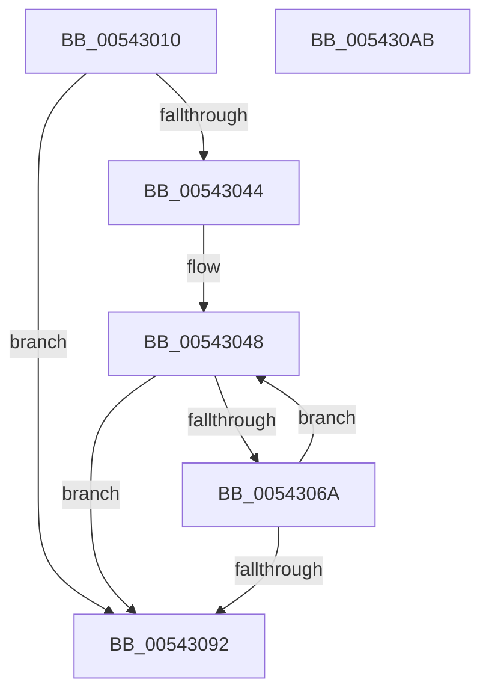

# HalpPopulateMsiMessages

- RVA: `0x00543010`–`0x005430AC` (길이 `156` bytes)
- VA: `0x0000000140543010`
- 실행 섹션: `.text`
- PDB 이름 있음: `예`; PDB Function 태그: `아니요`
- unwind 정보 RVA: `0x00084C9C`
- 디코드: `50`개 명령, `156/156` bytes 표시
- 미해석 바이트: `0` (있으면 어셈블리에 `.byte`로 보존)

> 이 문서는 커널 이미지의 기계어와 PDB 기호를 분석해 생성했습니다. 4번과 5번은 함수 원형과 자료형을 바이너리 사용 방식에서 추정한 C 해석이며 원본 소스 복구 결과는 아닙니다.

## 1. Dependencies

- 직접 호출 지점: **1**; 고유 호출 대상: **1**
- 직접 호출자로 확인된 함수: **1**
- RIP 상대 이미지 참조: **0**

### Outgoing calls
- `0x00543061` → [HalpInterruptGenerateMessage](HalpInterruptGenerateMessage_function_005428F0.md) (function, `0x005428F0`)

### Direct callers
- [HalpInterruptRemap](HalpInterruptRemap_function_00542AE4.md) at `0x00542D4F`

### Static image references
- 디코드된 RIP-relative 메모리 참조가 없습니다.

## 2. Other-region calls and transfers

- 다른 실행 섹션으로 향하는 call: **0**
- 별도 외부 분기/꼬리 이동을 확인하지 못했습니다.

## 3. Assembly (complete function range)

```asm
00543010  48 8B C4                        mov rax, rsp
00543013  48 89 58 08                     mov qword ptr [rax + 8], rbx
00543017  48 89 68 10                     mov qword ptr [rax + 0x10], rbp
0054301B  48 89 70 18                     mov qword ptr [rax + 0x18], rsi
0054301F  57                              push rdi
00543020  41 56                           push r14
00543022  41 57                           push r15
00543024  48 83 EC 30                     sub rsp, 0x30
00543028  48 83 60 20 00                  and qword ptr [rax + 0x20], 0
0054302D  33 FF                           xor edi, edi
0054302F  48 83 60 D8 00                  and qword ptr [rax - 0x28], 0
00543034  41 8B E8                        mov ebp, r8d
00543037  33 C0                           xor eax, eax
00543039  48 8B F2                        mov rsi, rdx
0054303C  4C 8B F9                        mov r15, rcx
0054303F  45 85 C0                        test r8d, r8d
00543042  74 4E                           je 0x140543092
00543044  48 8D 5A 30                     lea rbx, [rdx + 0x30]
00543048  8B C7                           mov eax, edi
0054304A  4C 8D 4C 24 20                  lea r9, [rsp + 0x20]
0054304F  4C 6B F0 58                     imul r14, rax, 0x58
00543053  4C 8D 44 24 68                  lea r8, [rsp + 0x68]
00543058  49 8B CF                        mov rcx, r15
0054305B  4C 03 F6                        add r14, rsi
0054305E  49 8B D6                        mov rdx, r14
00543061  E8 8A F8 FF FF                  call 0x1405428f0
00543066  85 C0                           test eax, eax
00543068  78 28                           js 0x140543092
0054306A  33 C9                           xor ecx, ecx
0054306C  FF C7                           inc edi
0054306E  49 89 4E 2C                     mov qword ptr [r14 + 0x2c], rcx
00543072  41 89 4E 34                     mov dword ptr [r14 + 0x34], ecx
00543076  8B 4C 24 6C                     mov ecx, dword ptr [rsp + 0x6c]
0054307A  89 4B FC                        mov dword ptr [rbx - 4], ecx
0054307D  8B 4C 24 68                     mov ecx, dword ptr [rsp + 0x68]
00543081  89 0B                           mov dword ptr [rbx], ecx
00543083  8B 4C 24 20                     mov ecx, dword ptr [rsp + 0x20]
00543087  89 4B 04                        mov dword ptr [rbx + 4], ecx
0054308A  48 83 C3 58                     add rbx, 0x58
0054308E  3B FD                           cmp edi, ebp
00543090  72 B6                           jb 0x140543048
00543092  48 8B 5C 24 50                  mov rbx, qword ptr [rsp + 0x50]
00543097  48 8B 6C 24 58                  mov rbp, qword ptr [rsp + 0x58]
0054309C  48 8B 74 24 60                  mov rsi, qword ptr [rsp + 0x60]
005430A1  48 83 C4 30                     add rsp, 0x30
005430A5  41 5F                           pop r15
005430A7  41 5E                           pop r14
005430A9  5F                              pop rdi
005430AA  C3                              ret
005430AB  CC                              int3
```

## 4. C-style interpretation (structured pseudocode)

```c
__int64 __fastcall HalpPopulateMsiMessages(__int64 a1, __int64 a2, int a3)
{
    __int64 result;
    __int64 v_r14;
    __int64 v_rbx;
    __int64 v_rdi;
    __int64 v_rsp;
    unsigned __int64 v_stack_m28;
    unsigned __int64 v_stack_p10;
    unsigned __int64 v_stack_p18;
    unsigned __int64 v_stack_p20;
    unsigned int v_stack_p24;
    unsigned __int64 v_stack_p8;

    *(unsigned __int64 *)(v_rsp + 8) = v_rbx;
    *(unsigned __int64 *)(v_rsp + 16) = v_rbp;
    *(unsigned __int64 *)(v_rsp + 24) = v_rsi;
    v_rsp = (v_rsp) - (48);
    v_rdi = 0;
    result = 0;
    if (a3 == 0) goto loc_00543092;
loc_00543048:
    v_r14 = (v_r14) * (0);
    v_r14 = (v_r14) + (a2);
    result = HalpInterruptGenerateMessage(a1, v_r14, v_stack_p20, v_stack_m28);
    if (sign_flag) goto loc_00543092;
    a1 = 0;
    v_rdi = (unsigned int)((v_rdi) + 1);
    *(unsigned __int64 *)(v_r14 + 44) = 0;
    *(unsigned int *)(v_r14 + 52) = 0;
    *(unsigned int *)(a2 + 48 - 4) = (unsigned int)((unsigned int)(v_stack_p24));
    *(unsigned int *)(a2 + 48) = (unsigned int)((unsigned int)(v_stack_p20));
    *(unsigned int *)(a2 + 48 + 4) = (unsigned int)((unsigned int)(v_stack_m28));
    v_rbx = (a2 + 48) + (88);
    if (((unsigned int)(v_rdi)) < ((unsigned int)((unsigned int)(a3)))) goto loc_00543048;
loc_00543092:
    v_rsp = (v_rsp) + (48);
    return result;
}
```

## 5. (Beta) C Style

```c
int64_t HalpPopulateMsiMessages(int64_t Arg1, void *Arg2, int32_t Arg3)
{
    uint8_t *arg2 = (uint8_t *)Arg2;

    int64_t result;
    int64_t local_r14;
    int64_t local_rbx;
    int64_t local_rdi;
    int64_t local_rsp;
    uint64_t v_stack_m28;
    uint64_t v_stack_p10;
    uint64_t v_stack_p18;
    uint64_t v_stack_p20;
    uint32_t v_stack_p24;
    uint64_t v_stack_p8;

    *(uint64_t *)(local_rsp + 0x8) = local_rbx;
    *(uint64_t *)(local_rsp + 0x10) = local_rbp;
    *(uint64_t *)(local_rsp + 0x18) = local_rsi;
    local_rsp = (local_rsp) - (48);
    local_rdi = 0;
    result = 0;
    if (Arg3 == 0) goto loc_00543092;
loc_00543048:
    local_r14 = (local_r14) * (0);
    local_r14 = (local_r14) + (Arg2);
    result = HalpInterruptGenerateMessage(Arg1, local_r14, v_stack_p20, v_stack_m28);
    if (sign_flag) goto loc_00543092;
    Arg1 = 0;
    local_rdi = (uint32_t)((local_rdi) + 1);
    *(uint64_t *)(local_r14 + 0x2C) = 0;
    *(uint32_t *)(local_r14 + 0x34) = 0;
    *(uint32_t *)(arg2 + 0x30 - 0x4) = (uint32_t)((uint32_t)(v_stack_p24));
    *(uint32_t *)(arg2 + 0x30) = (uint32_t)((uint32_t)(v_stack_p20));
    *(uint32_t *)(arg2 + 0x30 + 0x4) = (uint32_t)((uint32_t)(v_stack_m28));
    local_rbx = (Arg2 + 48) + (88);
    if (((uint32_t)(local_rdi)) < ((uint32_t)((uint32_t)(Arg3)))) goto loc_00543048;
loc_00543092:
    local_rsp = (local_rsp) + (48);
    return result;
}
```

### 관측된 메모리 오프셋

구조체 형식이 확인되지 않은 접근은 인자 기준의 오프셋으로만 기록했습니다.

| 기준 인자 | 오프셋 표현 | 폭 (bit) | 접근 |
|---|---:|---:|---|
| `Arg2` | `- 0x4` | `32` | `W` |
| `Arg2` | `+ 0x0` | `32` | `W` |
| `Arg2` | `+ 0x4` | `32` | `W` |
| `Arg2` | `+ 0x30` | `64` | `R` |

## 6. Execution-region graph

[열기: 2D/3D 그래프와 함수 탐색 컨트롤 패널](../../../control-panel.html?section=text&rva=0x00543010&view=graph)

- 2D 그래프는 위에서 아래로 흐르고, 3D 그래프는 빈 공간을 드래그해 회전합니다. Shift+드래그는 이동, 휠은 확대·축소, 함수 노드 선택은 대상 보고서 이동입니다.

### Static fallback


