# HalpPowerWriteResetCommand

- RVA: `0x00546744`–`0x00546868` (길이 `292` bytes)
- VA: `0x0000000140546744`
- 실행 섹션: `.text`
- PDB 이름 있음: `예`; PDB Function 태그: `아니요`
- unwind 정보 RVA: `0x000C3D48`
- 디코드: `88`개 명령, `292/292` bytes 표시
- 미해석 바이트: `0` (있으면 어셈블리에 `.byte`로 보존)

> 이 문서는 커널 이미지의 기계어와 PDB 기호를 분석해 생성했습니다. 4번과 5번은 함수 원형과 자료형을 바이너리 사용 방식에서 추정한 C 해석이며 원본 소스 복구 결과는 아닙니다.

## 1. Dependencies

- 직접 호출 지점: **11**; 고유 호출 대상: **7**
- 직접 호출자로 확인된 함수: **2**
- RIP 상대 이미지 참조: **6**

### Outgoing calls
- `0x0054675F` → [guard_dispatch_icall](../6B/guard_dispatch_icall_function_006BAAD0.md) (function, `0x006BAAD0`)
- `0x0054676C` → [HalpMiscIsLegacyPcType](HalpMiscIsLegacyPcType_function_0054BFDC.md) (function, `0x0054BFDC`)
- `0x00546788` → [KeStallExecutionProcessor](../44/KeStallExecutionProcessor_function_0044F620.md) (function, `0x0044F620`)
- `0x005467B3` → [HalpMap](../3F/HalpMap_function_003F88F4.md) (function, `0x003F88F4`)
- `0x005467DC` → [KeStallExecutionProcessor](../44/KeStallExecutionProcessor_function_0044F620.md) (function, `0x0044F620`)
- `0x005467E1` → [VslTerminateSecureServices](../58/VslTerminateSecureServices_function_0058F83C.md) (function, `0x0058F83C`)
- `0x00546818` → [HalpAcpiPmRegisterWrite](../41/HalpAcpiPmRegisterWrite_function_0041C760.md) (function, `0x0041C760`)
- `0x00546822` → [KeStallExecutionProcessor](../44/KeStallExecutionProcessor_function_0044F620.md) (function, `0x0044F620`)
- `0x00546840` → [KeStallExecutionProcessor](../44/KeStallExecutionProcessor_function_0044F620.md) (function, `0x0044F620`)
- `0x00546850` → [HalEfiResetSystem](HalEfiResetSystem_function_0054DDE8.md) (function, `0x0054DDE8`)
- `0x00546857` → [HalEfiResetSystem](HalEfiResetSystem_function_0054DDE8.md) (function, `0x0054DDE8`)

### Direct callers
- [HalpInterruptResetThisProcessor](HalpInterruptResetThisProcessor_function_00543930.md) at `0x00543A83`
- [HalpReboot](HalpReboot_function_00546870.md) at `0x0054693A`

### Static image references
- `0x0054674E` → RVA `0x00E102F8` (`.data`; read)
- `0x0054678D` → RVA `0x00FC1A28` (`.data`; read)
- `0x005467C6` → RVA `0x00E0A808` (`.data`; read)
- `0x005467E6` → RVA `0x00FC2150` (`.data`; read)
- `0x005467FA` → RVA `0x00F8FFE0` (`.data`; read)
- `0x00546809` → RVA `0x00FC1B60` (`.data`; read)

## 2. Other-region calls and transfers

- 다른 실행 섹션으로 향하는 call: **0**
- 별도 외부 분기/꼬리 이동을 확인하지 못했습니다.

## 3. Assembly (complete function range)

```asm
00546744  48 89 74 24 08                  mov qword ptr [rsp + 8], rsi
00546749  57                              push rdi
0054674A  48 83 EC 30                     sub rsp, 0x30
0054674E  48 8B 05 A3 9B 8C 00            mov rax, qword ptr [rip + 0x8c9ba3]
00546755  48 8B FA                        mov rdi, rdx
00546758  8B F1                           mov esi, ecx
0054675A  48 85 C0                        test rax, rax
0054675D  74 05                           je 0x140546764
0054675F  E8 6C 43 17 00                  call 0x1406baad0
00546764  85 F6                           test esi, esi
00546766  0F 85 F1 00 00 00               jne 0x14054685d
0054676C  E8 6B 58 00 00                  call 0x14054bfdc
00546771  84 C0                           test al, al
00546773  74 18                           je 0x14054678d
00546775  90                              nop
00546776  8D 56 70                        lea edx, [rsi + 0x70]
00546779  B0 0F                           mov al, 0xf
0054677B  8D 4E 64                        lea ecx, [rsi + 0x64]
0054677E  EE                              out dx, al
0054677F  90                              nop
00546780  8D 56 71                        lea edx, [rsi + 0x71]
00546783  90                              nop
00546784  33 C0                           xor eax, eax
00546786  EE                              out dx, al
00546787  90                              nop
00546788  E8 93 8E F0 FF                  call 0x14044f620
0054678D  80 3D 94 B2 A7 00 00            cmp byte ptr [rip + 0xa7b294], 0
00546794  BE 01 00 00 00                  mov esi, 1
00546799  75 2B                           jne 0x1405467c6
0054679B  48 83 64 24 28 00               and qword ptr [rsp + 0x28], 0
005467A1  45 33 C9                        xor r9d, r9d
005467A4  44 8B C6                        mov r8d, esi
005467A7  C7 44 24 20 04 00 00 00         mov dword ptr [rsp + 0x20], 4
005467AF  8B D6                           mov edx, esi
005467B1  33 C9                           xor ecx, ecx
005467B3  E8 3C 21 EB FF                  call 0x1403f88f4
005467B8  48 85 C0                        test rax, rax
005467BB  74 09                           je 0x1405467c6
005467BD  66 C7 80 72 04 00 00 34 12      mov word ptr [rax + 0x472], 0x1234
005467C6  8B 05 3C 40 8C 00               mov eax, dword ptr [rip + 0x8c403c]
005467CC  A8 04                           test al, 4
005467CE  74 11                           je 0x1405467e1
005467D0  90                              nop
005467D1  BA 70 00 00 00                  mov edx, 0x70
005467D6  B0 15                           mov al, 0x15
005467D8  8B CE                           mov ecx, esi
005467DA  EE                              out dx, al
005467DB  90                              nop
005467DC  E8 3F 8E F0 FF                  call 0x14044f620
005467E1  E8 56 90 04 00                  call 0x14058f83c
005467E6  80 3D 63 B9 A7 00 00            cmp byte ptr [rip + 0xa7b963], 0
005467ED  74 0B                           je 0x1405467fa
005467EF  8B C6                           mov eax, esi
005467F1  33 D2                           xor edx, edx
005467F3  B9 03 00 00 40                  mov ecx, 0x40000003
005467F8  0F 30                           wrmsr
005467FA  80 3D DF 97 A4 00 00            cmp byte ptr [rip + 0xa497df], 0
00546801  74 24                           je 0x140546827
00546803  48 83 64 24 20 00               and qword ptr [rsp + 0x20], 0
00546809  4C 8D 05 50 B3 A7 00            lea r8, [rip + 0xa7b350]
00546810  33 D2                           xor edx, edx
00546812  44 8B CE                        mov r9d, esi
00546815  8D 4A 08                        lea ecx, [rdx + 8]
00546818  E8 43 5F ED FF                  call 0x14041c760
0054681D  B9 F4 01 00 00                  mov ecx, 0x1f4
00546822  E8 F9 8D F0 FF                  call 0x14044f620
00546827  8B 05 DB 3F 8C 00               mov eax, dword ptr [rip + 0x8c3fdb]
0054682D  A8 02                           test al, 2
0054682F  74 14                           je 0x140546845
00546831  90                              nop
00546832  BA 64 00 00 00                  mov edx, 0x64
00546837  B0 FE                           mov al, 0xfe
00546839  B9 88 13 00 00                  mov ecx, 0x1388
0054683E  EE                              out dx, al
0054683F  90                              nop
00546840  E8 DB 8D F0 FF                  call 0x14044f620
00546845  80 3D DC B1 A7 00 00            cmp byte ptr [rip + 0xa7b1dc], 0
0054684C  74 0F                           je 0x14054685d
0054684E  8B CE                           mov ecx, esi
00546850  E8 93 75 00 00                  call 0x14054dde8
00546855  33 C9                           xor ecx, ecx
00546857  E8 8C 75 00 00                  call 0x14054dde8
0054685C  CC                              int3
0054685D  48 85 FF                        test rdi, rdi
00546860  74 03                           je 0x140546865
00546862  F0 FF 0F                        lock dec dword ptr [rdi]
00546865  F4                              hlt
00546866  EB FD                           jmp 0x140546865
```

## 4. C-style interpretation (structured pseudocode)

```c
__int64 __fastcall HalpPowerWriteResetCommand(int a1, __int64 a2, __int64 a3, int a4)
{
    __int64 result;
    __int64 v_rsp;
    unsigned __int64 v_stack_m10;
    unsigned int v_stack_m18;
    unsigned __int64 v_stack_p8;

    v_stack_p8 = v_rsi;
    v_rsp = (v_rsp) - (48);
    result = *(unsigned __int64 *)(v_rip + 9214883);
    if (*(unsigned __int64 *)(v_rip + 9214883) != 0) {
        result = guard_dispatch_icall(a1, a2, a3, a4);
    }
    if ((unsigned int)((unsigned int)(a1)) != 0) goto loc_0054685D;
    result = HalpMiscIsLegacyPcType(a1, a2, a3, a4);
    if ((unsigned __int8)(result) != 0) {
        a2 = (unsigned int)(a1) + 112;
        result = 15;
        a1 = (unsigned int)(a1) + 100;
        a2 = (unsigned int)(a1) + 113;
        result = 0;
        result = KeStallExecutionProcessor(a1, a2, a3, a4);
    }
    if ((*(unsigned __int8 *)(v_rip + 10990228)) != 0) goto loc_005467C6;
    a4 = 0;
    v_stack_m18 = 4;
    a1 = 0;
    result = HalpMap(a1, 1, 1, a4);
    if (result != 0) {
        *(unsigned __int16 *)(result + 1138) = 0x1234ULL;
    }
    result = (unsigned int)(*(unsigned int *)(v_rip + 9191484));
    if ((((unsigned __int8)((unsigned int)(*(unsigned int *)(v_rip + 9191484)))) & (4)) != 0) {
        a2 = 112;
        result = 21;
        a1 = 1;
        result = KeStallExecutionProcessor(a1, a2, 1, a4);
    }
    result = VslTerminateSecureServices(a1, a2, 1, a4);
    if ((*(unsigned __int8 *)(v_rip + 10991971)) != 0) {
        result = 1;
        a2 = 0;
        a1 = 0x40000003ULL;
    }
    if ((*(unsigned __int8 *)(v_rip + 10786783)) != 0) {
        a3 = v_rip + 10990416;
        a2 = 0;
        a4 = 1;
        a1 = a2 + 8;
        result = HalpAcpiPmRegisterWrite(a1, a2, a3, a4);
        a1 = 500;
        result = KeStallExecutionProcessor(a1, a2, a3, a4);
    }
    result = (unsigned int)(*(unsigned int *)(v_rip + 9191387));
    if ((((unsigned __int8)((unsigned int)(*(unsigned int *)(v_rip + 9191387)))) & (2)) != 0) {
        a2 = 100;
        result = 254;
        a1 = 0x1388ULL;
        result = KeStallExecutionProcessor(a1, a2, a3, a4);
    }
    if ((*(unsigned __int8 *)(v_rip + 10990044)) != 0) {
        a1 = 1;
        result = HalEfiResetSystem(a1, a2, a3, a4);
        a1 = 0;
        result = HalEfiResetSystem(a1, a2, a3, a4);
    }
    if (a2 != 0) {
    }
    goto loc_00546865;
}
```

## 5. (Beta) C Style

```c
int64_t HalpPowerWriteResetCommand(int32_t Arg1, int64_t Arg2, int64_t Arg3, int32_t Arg4)
{
    int64_t result;
    int64_t local_rsp;
    uint64_t v_stack_m10;
    uint32_t v_stack_m18;
    uint64_t v_stack_p8;

    v_stack_p8 = local_rsi;
    local_rsp = (local_rsp) - (48);
    result = *(uint64_t *)(v_rip + 0x8C9BA3);
    if (*(uint64_t *)(v_rip + 0x8C9BA3) != 0) {
        result = guard_dispatch_icall(Arg1, Arg2, Arg3, Arg4);
    }
    if ((uint32_t)((uint32_t)(Arg1)) != 0) goto loc_0054685D;
    result = HalpMiscIsLegacyPcType(Arg1, Arg2, Arg3, Arg4);
    if ((uint8_t)(result) != 0) {
        Arg2 = (uint32_t)(Arg1) + 112;
        result = 15;
        Arg1 = (uint32_t)(Arg1) + 100;
        Arg2 = (uint32_t)(Arg1) + 113;
        result = 0;
        result = KeStallExecutionProcessor(Arg1, Arg2, Arg3, Arg4);
    }
    if ((*(uint8_t *)(v_rip + 0xA7B294)) != 0) goto loc_005467C6;
    Arg4 = 0;
    v_stack_m18 = 4;
    Arg1 = 0;
    result = HalpMap(Arg1, 1, 1, Arg4);
    if (result != 0) {
        *(uint16_t *)(result + 0x472) = 0x1234ULL;
    }
    result = (uint32_t)(*(uint32_t *)(v_rip + 0x8C403C));
    if ((((uint8_t)((uint32_t)(*(uint32_t *)(v_rip + 0x8C403C)))) & (4)) != 0) {
        Arg2 = 112;
        result = 21;
        Arg1 = 1;
        result = KeStallExecutionProcessor(Arg1, Arg2, 1, Arg4);
    }
    result = VslTerminateSecureServices(Arg1, Arg2, 1, Arg4);
    if ((*(uint8_t *)(v_rip + 0xA7B963)) != 0) {
        result = 1;
        Arg2 = 0;
        Arg1 = 0x40000003ULL;
    }
    if ((*(uint8_t *)(v_rip + 0xA497DF)) != 0) {
        Arg3 = v_rip + 10990416;
        Arg2 = 0;
        Arg4 = 1;
        Arg1 = Arg2 + 8;
        result = HalpAcpiPmRegisterWrite(Arg1, Arg2, Arg3, Arg4);
        Arg1 = 500;
        result = KeStallExecutionProcessor(Arg1, Arg2, Arg3, Arg4);
    }
    result = (uint32_t)(*(uint32_t *)(v_rip + 0x8C3FDB));
    if ((((uint8_t)((uint32_t)(*(uint32_t *)(v_rip + 0x8C3FDB)))) & (2)) != 0) {
        Arg2 = 100;
        result = 254;
        Arg1 = 0x1388ULL;
        result = KeStallExecutionProcessor(Arg1, Arg2, Arg3, Arg4);
    }
    if ((*(uint8_t *)(v_rip + 0xA7B1DC)) != 0) {
        Arg1 = 1;
        result = HalEfiResetSystem(Arg1, Arg2, Arg3, Arg4);
        Arg1 = 0;
        result = HalEfiResetSystem(Arg1, Arg2, Arg3, Arg4);
    }
    if (Arg2 != 0) {
    }
    goto loc_00546865;
}
```

## 6. Execution-region graph

[열기: 2D/3D 그래프와 함수 탐색 컨트롤 패널](../../../control-panel.html?section=text&rva=0x00546744&view=graph)

- 2D 그래프는 위에서 아래로 흐르고, 3D 그래프는 빈 공간을 드래그해 회전합니다. Shift+드래그는 이동, 휠은 확대·축소, 함수 노드 선택은 대상 보고서 이동입니다.

### Static fallback

```mermaid
flowchart TD
  bb_00546744[BB_00546744]
  bb_0054675F[BB_0054675F]
  bb_00546764[BB_00546764]
  bb_0054676C[BB_0054676C]
  bb_00546775[BB_00546775]
  bb_0054678D[BB_0054678D]
  bb_0054679B[BB_0054679B]
  bb_005467BD[BB_005467BD]
  bb_005467C6[BB_005467C6]
  bb_005467D0[BB_005467D0]
  bb_005467E1[BB_005467E1]
  bb_005467EF[BB_005467EF]
  bb_005467FA[BB_005467FA]
  bb_00546803[BB_00546803]
  bb_00546827[BB_00546827]
  bb_00546831[BB_00546831]
  bb_00546845[BB_00546845]
  bb_0054684E[BB_0054684E]
  bb_0054685D[BB_0054685D]
  bb_00546862[BB_00546862]
  bb_00546865[BB_00546865]
  bb_00546744 -->|branch| bb_00546764
  bb_00546744 -->|fallthrough| bb_0054675F
  bb_0054675F -->|flow| bb_00546764
  bb_00546764 -->|branch| bb_0054685D
  bb_00546764 -->|fallthrough| bb_0054676C
  bb_0054676C -->|branch| bb_0054678D
  bb_0054676C -->|fallthrough| bb_00546775
  bb_00546775 -->|flow| bb_0054678D
  bb_0054678D -->|branch| bb_005467C6
  bb_0054678D -->|fallthrough| bb_0054679B
  bb_0054679B -->|branch| bb_005467C6
  bb_0054679B -->|fallthrough| bb_005467BD
  bb_005467BD -->|flow| bb_005467C6
  bb_005467C6 -->|branch| bb_005467E1
  bb_005467C6 -->|fallthrough| bb_005467D0
  bb_005467D0 -->|flow| bb_005467E1
  bb_005467E1 -->|branch| bb_005467FA
  bb_005467E1 -->|fallthrough| bb_005467EF
  bb_005467EF -->|flow| bb_005467FA
  bb_005467FA -->|branch| bb_00546827
  bb_005467FA -->|fallthrough| bb_00546803
  bb_00546803 -->|flow| bb_00546827
  bb_00546827 -->|branch| bb_00546845
  bb_00546827 -->|fallthrough| bb_00546831
  bb_00546831 -->|flow| bb_00546845
  bb_00546845 -->|branch| bb_0054685D
  bb_00546845 -->|fallthrough| bb_0054684E
  bb_0054684E -->|flow| bb_0054685D
  bb_0054685D -->|branch| bb_00546865
  bb_0054685D -->|fallthrough| bb_00546862
  bb_00546862 -->|flow| bb_00546865
  bb_00546865 -->|branch| bb_00546865
```


