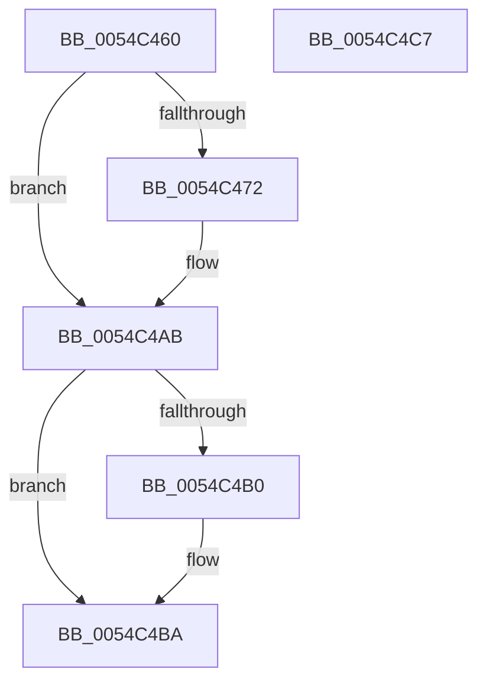

# HalpPrepareForBugcheck

- RVA: `0x0054C460`–`0x0054C4C8` (길이 `104` bytes)
- VA: `0x000000014054C460`
- 실행 섹션: `.text`
- PDB 이름 있음: `예`; PDB Function 태그: `아니요`
- unwind 정보 RVA: `0x0005CF00`
- 디코드: `23`개 명령, `104/104` bytes 표시
- 미해석 바이트: `0` (있으면 어셈블리에 `.byte`로 보존)

> 이 문서는 커널 이미지의 기계어와 PDB 기호를 분석해 생성했습니다. 4번과 5번은 함수 원형과 자료형을 바이너리 사용 방식에서 추정한 C 해석이며 원본 소스 복구 결과는 아닙니다.

## 1. Dependencies

- 직접 호출 지점: **2**; 고유 호출 대상: **2**
- 직접 호출자로 확인된 함수: **0**
- RIP 상대 이미지 참조: **9**

### Outgoing calls
- `0x0054C468` → [HalpInterruptModel](../4A/HalpInterruptModel_function_004ACA38.md) (function, `0x004ACA38`)
- `0x0054C4A6` → [HalpTimerUpdateApiConsumers](../56/HalpTimerUpdateApiConsumers_function_00562D28.md) (function, `0x00562D28`)

### Direct callers
- 이 함수 시작 RVA로 연결되는 직접 call은 확인되지 않았습니다. 간접 호출은 완전히 역산할 수 없습니다.

### Static image references
- `0x0054C474` → RVA `0x00FC1C7C` (`.data`; write)
- `0x0054C47E` → RVA `0x00FC1C80` (`.data`; write)
- `0x0054C485` → RVA `0x00FC1C68` (`.data`; write)
- `0x0054C48C` → RVA `0x00FC1C70` (`.data`; write)
- `0x0054C493` → RVA `0x00FC1D28` (`.data`; write)
- `0x0054C49A` → RVA `0x00FC1C64` (`.data`; write)
- `0x0054C4A0` → RVA `0x00FC1C60` (`.data`; write)
- `0x0054C4B0` → RVA `0x00E10268` (`.data`; write)
- `0x0054C4BA` → RVA `0x00FC1C49` (`.data`; write)

## 2. Other-region calls and transfers

- 다른 실행 섹션으로 향하는 call: **0**
- 별도 외부 분기/꼬리 이동을 확인하지 못했습니다.

## 3. Assembly (complete function range)

```asm
0054C460  40 53                           push rbx
0054C462  48 83 EC 20                     sub rsp, 0x20
0054C466  8B D9                           mov ebx, ecx
0054C468  E8 CB 05 F6 FF                  call 0x1404aca38
0054C46D  83 F8 01                        cmp eax, 1
0054C470  75 39                           jne 0x14054c4ab
0054C472  33 C0                           xor eax, eax
0054C474  C7 05 FE 57 A7 00 FF FF FF FF   mov dword ptr [rip + 0xa757fe], 0xffffffff
0054C47E  48 89 05 FB 57 A7 00            mov qword ptr [rip + 0xa757fb], rax
0054C485  48 89 05 DC 57 A7 00            mov qword ptr [rip + 0xa757dc], rax
0054C48C  48 89 05 DD 57 A7 00            mov qword ptr [rip + 0xa757dd], rax
0054C493  48 89 05 8E 58 A7 00            mov qword ptr [rip + 0xa7588e], rax
0054C49A  89 05 C4 57 A7 00               mov dword ptr [rip + 0xa757c4], eax
0054C4A0  89 05 BA 57 A7 00               mov dword ptr [rip + 0xa757ba], eax
0054C4A6  E8 7D 68 01 00                  call 0x140562d28
0054C4AB  F6 C3 01                        test bl, 1
0054C4AE  74 0A                           je 0x14054c4ba
0054C4B0  C7 05 AE 3D 8C 00 01 00 00 00   mov dword ptr [rip + 0x8c3dae], 1
0054C4BA  C6 05 88 57 A7 00 01            mov byte ptr [rip + 0xa75788], 1
0054C4C1  48 83 C4 20                     add rsp, 0x20
0054C4C5  5B                              pop rbx
0054C4C6  C3                              ret
0054C4C7  CC                              int3
```

## 4. C-style interpretation (structured pseudocode)

```c
__int64 __fastcall HalpPrepareForBugcheck(int a1)
{
    __int64 result;
    __int64 v_rsp;

    v_rsp = (v_rsp) - (32);
    result = HalpInterruptModel(a1, a2, a3, a4);
    if (((unsigned int)(result)) == 1) {
        result = 0;
        *(unsigned int *)(v_rip + 10967038) = 0xFFFFFFFFULL;
        *(unsigned __int64 *)(v_rip + 10967035) = 0;
        *(unsigned __int64 *)(v_rip + 10967004) = 0;
        *(unsigned __int64 *)(v_rip + 10967005) = 0;
        *(unsigned __int64 *)(v_rip + 10967182) = 0;
        *(unsigned int *)(v_rip + 10966980) = 0;
        *(unsigned int *)(v_rip + 10966970) = 0;
        result = HalpTimerUpdateApiConsumers(a1, a2, a3, a4);
    }
    if ((((unsigned __int8)((unsigned int)(a1))) & (1)) != 0) {
        *(unsigned int *)(v_rip + 9190830) = 1;
    }
    *(unsigned __int8 *)(v_rip + 10966920) = 1;
    v_rsp = (v_rsp) + (32);
    return result;
}
```

## 5. (Beta) C Style

```c
int64_t HalpPrepareForBugcheck(int32_t Arg1)
{
    int64_t result;
    int64_t local_rsp;

    local_rsp = (local_rsp) - (32);
    result = HalpInterruptModel(Arg1, a2, a3, a4);
    if (((uint32_t)(result)) == 1) {
        result = 0;
        *(uint32_t *)(v_rip + 0xA757FE) = 0xFFFFFFFFULL;
        *(uint64_t *)(v_rip + 0xA757FB) = 0;
        *(uint64_t *)(v_rip + 0xA757DC) = 0;
        *(uint64_t *)(v_rip + 0xA757DD) = 0;
        *(uint64_t *)(v_rip + 0xA7588E) = 0;
        *(uint32_t *)(v_rip + 0xA757C4) = 0;
        *(uint32_t *)(v_rip + 0xA757BA) = 0;
        result = HalpTimerUpdateApiConsumers(Arg1, a2, a3, a4);
    }
    if ((((uint8_t)((uint32_t)(Arg1))) & (1)) != 0) {
        *(uint32_t *)(v_rip + 0x8C3DAE) = 1;
    }
    *(uint8_t *)(v_rip + 0xA75788) = 1;
    local_rsp = (local_rsp) + (32);
    return result;
}
```

## 6. Execution-region graph

[열기: 2D/3D 그래프와 함수 탐색 컨트롤 패널](../../../control-panel.html?section=text&rva=0x0054C460&view=graph)

- 2D 그래프는 위에서 아래로 흐르고, 3D 그래프는 빈 공간을 드래그해 회전합니다. Shift+드래그는 이동, 휠은 확대·축소, 함수 노드 선택은 대상 보고서 이동입니다.

### Static fallback


