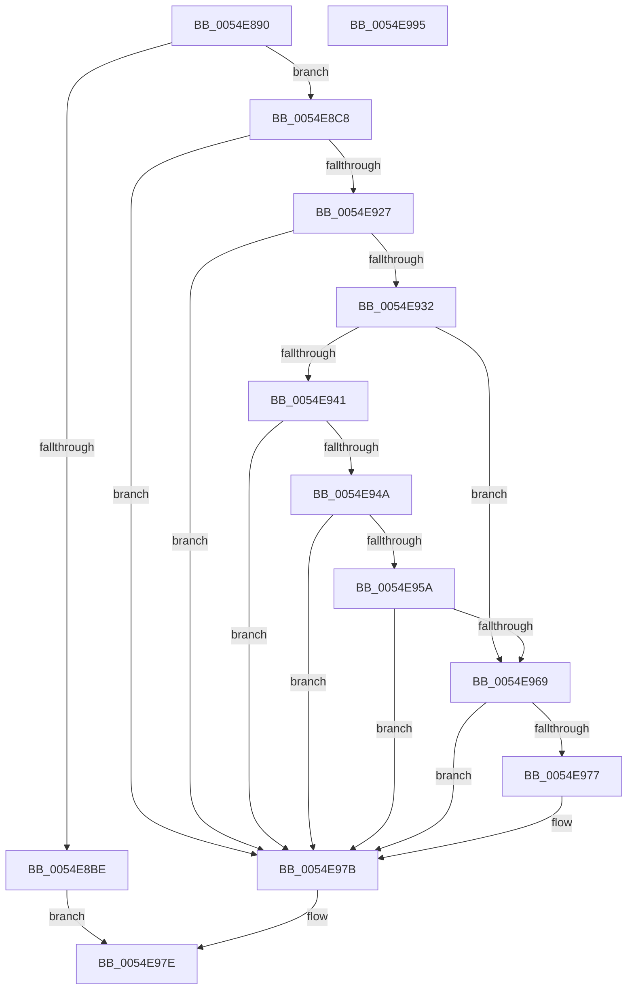

# HalpProcGetFeatureBits

- RVA: `0x0054E890`–`0x0054E996` (길이 `262` bytes)
- VA: `0x000000014054E890`
- 실행 섹션: `.text`
- PDB 이름 있음: `예`; PDB Function 태그: `아니요`
- unwind 정보 RVA: `0x000C412C`
- 디코드: `81`개 명령, `262/262` bytes 표시
- 미해석 바이트: `0` (있으면 어셈블리에 `.byte`로 보존)

> 이 문서는 커널 이미지의 기계어와 PDB 기호를 분석해 생성했습니다. 4번과 5번은 함수 원형과 자료형을 바이너리 사용 방식에서 추정한 C 해석이며 원본 소스 복구 결과는 아닙니다.

## 1. Dependencies

- 직접 호출 지점: **3**; 고유 호출 대상: **3**
- 직접 호출자로 확인된 함수: **2**
- RIP 상대 이미지 참조: **1**

### Outgoing calls
- `0x0054E8D3` → [HalpGetCpuInfo](../49/HalpGetCpuInfo_function_00498A70.md) (function, `0x00498A70`)
- `0x0054E941` → [HalpIsMicrosoftCompatibleHvLoaded](../4A/HalpIsMicrosoftCompatibleHvLoaded_function_004AFAAC.md) (function, `0x004AFAAC`)
- `0x0054E985` → [_security_check_cookie](../6A/_security_check_cookie_function_006AC640.md) (function, `0x006AC640`)

### Direct callers
- [HalpProcInitSystem](../../pagelk/B5/HalpProcInitSystem_function_00B5D440.md) at `0x00B5D494`
- [HalpProcInitDiscard](../../init/C1/HalpProcInitDiscard_function_00C1FB90.md) at `0x00C1FBDA`

### Static image references
- `0x0054E89D` → RVA `0x00E0A740` (`.data`; read)

## 2. Other-region calls and transfers

- 다른 실행 섹션으로 향하는 call: **0**
- 별도 외부 분기/꼬리 이동을 확인하지 못했습니다.

## 3. Assembly (complete function range)

```asm
0054E890  48 89 5C 24 08                  mov qword ptr [rsp + 8], rbx
0054E895  55                              push rbp
0054E896  48 8B EC                        mov rbp, rsp
0054E899  48 83 EC 40                     sub rsp, 0x40
0054E89D  48 8B 05 9C BE 8B 00            mov rax, qword ptr [rip + 0x8bbe9c]
0054E8A4  48 33 C4                        xor rax, rsp
0054E8A7  48 89 45 F8                     mov qword ptr [rbp - 8], rax
0054E8AB  65 48 8B 04 25 20 00 00 00      mov rax, qword ptr gs:[0x20]
0054E8B4  C6 45 E0 00                     mov byte ptr [rbp - 0x20], 0
0054E8B8  80 78 41 00                     cmp byte ptr [rax + 0x41], 0
0054E8BC  75 0A                           jne 0x14054e8c8
0054E8BE  B8 02 00 00 00                  mov eax, 2
0054E8C3  E9 B6 00 00 00                  jmp 0x14054e97e
0054E8C8  4C 8D 4D E0                     lea r9, [rbp - 0x20]
0054E8CC  45 33 C0                        xor r8d, r8d
0054E8CF  33 D2                           xor edx, edx
0054E8D1  33 C9                           xor ecx, ecx
0054E8D3  E8 98 A1 F4 FF                  call 0x140498a70
0054E8D8  F6 D8                           neg al
0054E8DA  B8 01 00 00 00                  mov eax, 1
0054E8DF  45 1A C9                        sbb r9b, r9b
0054E8E2  33 C9                           xor ecx, ecx
0054E8E4  44 22 4D E0                     and r9b, byte ptr [rbp - 0x20]
0054E8E8  0F A2                           cpuid
0054E8EA  44 8B C2                        mov r8d, edx
0054E8ED  8B CA                           mov ecx, edx
0054E8EF  C1 E9 0C                        shr ecx, 0xc
0054E8F2  83 E1 04                        and ecx, 4
0054E8F5  8B D1                           mov edx, ecx
0054E8F7  83 CA 08                        or edx, 8
0054E8FA  41 F6 C0 80                     test r8b, 0x80
0054E8FE  0F 44 D1                        cmove edx, ecx
0054E901  8B CA                           mov ecx, edx
0054E903  83 C9 10                        or ecx, 0x10
0054E906  41 F6 C0 02                     test r8b, 2
0054E90A  0F 44 CA                        cmove ecx, edx
0054E90D  44 8B D1                        mov r10d, ecx
0054E910  41 83 CA 20                     or r10d, 0x20
0054E914  41 0F BA E0 1A                  bt r8d, 0x1a
0054E919  44 0F 43 D1                     cmovae r10d, ecx
0054E91D  41 83 CA 01                     or r10d, 1
0054E921  41 80 F9 02                     cmp r9b, 2
0054E925  75 54                           jne 0x14054e97b
0054E927  33 C0                           xor eax, eax
0054E929  33 C9                           xor ecx, ecx
0054E92B  0F A2                           cpuid
0054E92D  83 F8 14                        cmp eax, 0x14
0054E930  72 49                           jb 0x14054e97b
0054E932  33 C9                           xor ecx, ecx
0054E934  B8 07 00 00 00                  mov eax, 7
0054E939  0F A2                           cpuid
0054E93B  0F BA E3 19                     bt ebx, 0x19
0054E93F  72 28                           jb 0x14054e969
0054E941  E8 66 11 F6 FF                  call 0x1404afaac
0054E946  84 C0                           test al, al
0054E948  74 31                           je 0x14054e97b
0054E94A  33 C9                           xor ecx, ecx
0054E94C  B8 00 00 00 40                  mov eax, 0x40000000
0054E951  0F A2                           cpuid
0054E953  3D 0B 00 00 40                  cmp eax, 0x4000000b
0054E958  72 21                           jb 0x14054e97b
0054E95A  33 C9                           xor ecx, ecx
0054E95C  B8 03 00 00 40                  mov eax, 0x40000003
0054E961  0F A2                           cpuid
0054E963  0F BA E2 1B                     bt edx, 0x1b
0054E967  73 12                           jae 0x14054e97b
0054E969  33 C9                           xor ecx, ecx
0054E96B  B8 14 00 00 00                  mov eax, 0x14
0054E970  0F A2                           cpuid
0054E972  F6 C1 01                        test cl, 1
0054E975  74 04                           je 0x14054e97b
0054E977  41 83 CA 40                     or r10d, 0x40
0054E97B  41 8B C2                        mov eax, r10d
0054E97E  48 8B 4D F8                     mov rcx, qword ptr [rbp - 8]
0054E982  48 33 CC                        xor rcx, rsp
0054E985  E8 B6 DC 15 00                  call 0x1406ac640
0054E98A  48 8B 5C 24 50                  mov rbx, qword ptr [rsp + 0x50]
0054E98F  48 83 C4 40                     add rsp, 0x40
0054E993  5D                              pop rbp
0054E994  C3                              ret
0054E995  CC                              int3
```

## 4. C-style interpretation (structured pseudocode)

```c
__int64 __fastcall HalpProcGetFeatureBits(int a1, int a2, int a3)
{
    __int64 result;
    __int64 v_r10;
    __int64 v_rsp;
    unsigned __int64 v_stack_m10;
    unsigned __int8 v_stack_m28;
    unsigned __int64 v_stack_p8;

    v_stack_p8 = v_rbx;
    v_rsp = (v_rsp) - (64);
    result = (*(unsigned __int64 *)(v_rip + 9158300)) ^ (v_rsp);
    v_stack_m10 = result;
    v_stack_m28 = 0;
    if ((*(unsigned __int8 *)(*(unsigned __int64 *)(gs_base + (0 + 32)) + 65)) != 0) goto loc_0054E8C8;
    goto loc_0054E97E;
loc_0054E8C8:
    a3 = 0;
    a2 = 0;
    a1 = 0;
    result = HalpGetCpuInfo(a1, a2, a3, v_stack_m28);
    result = (unsigned __int8)(-(result));
    a1 = 0;
    a4 = (unsigned __int8)((v_stack_m28) & (v_stack_m28));
    a1 = (unsigned int)((0) >> (12));
    a1 = (unsigned int)((a1) & (4));
    a2 = (unsigned int)(((unsigned int)(a1)) | (8));
    if (((0) & (128)) == 0) { a2 = a1; }
    a1 = (unsigned int)(((unsigned int)(a2)) | (16));
    if (((0) & (2)) == 0) { a1 = a2; }
    v_r10 = (unsigned int)(((unsigned int)(a1)) | (32));
    if (condition_is_above_or_equal) { v_r10 = a1; }
    v_r10 = (unsigned int)((v_r10) | (1));
    if (((unsigned __int8)(a4)) != 2) goto loc_0054E97B;
    result = 0;
    a1 = 0;
    if (0 < 20) goto loc_0054E97B;
    a1 = 0;
    if (condition_is_below) goto loc_0054E969;
    result = HalpIsMicrosoftCompatibleHvLoaded(a1, a2, 0, a4);
    if ((unsigned __int8)(result) == 0) goto loc_0054E97B;
    a1 = 0;
    if (((unsigned int)((unsigned int)(0x40000000ULL))) < 0x4000000BULL) goto loc_0054E97B;
    a1 = 0;
    if (condition_is_above_or_equal) goto loc_0054E97B;
loc_0054E969:
    a1 = 0;
    if (((0) & (1)) != 0) {
        v_r10 = (unsigned int)((v_r10) | (64));
    }
loc_0054E97E:
    a1 = (v_stack_m10) ^ (v_rsp);
    result = _security_check_cookie(a1, a2, 0, a4);
    v_rsp = (v_rsp) + (64);
    return result;
}
```

## 5. (Beta) C Style

```c
int64_t HalpProcGetFeatureBits(int32_t Arg1, int32_t Arg2, int32_t Arg3)
{
    int64_t result;
    int64_t local_r10;
    int64_t local_rsp;
    uint64_t v_stack_m10;
    uint8_t v_stack_m28;
    uint64_t v_stack_p8;

    v_stack_p8 = local_rbx;
    local_rsp = (local_rsp) - (64);
    result = (*(uint64_t *)(v_rip + 0x8BBE9C)) ^ (local_rsp);
    v_stack_m10 = result;
    v_stack_m28 = 0;
    if ((*(uint8_t *)(*(uint64_t *)(gs_base + (0 + 0x20)) + 0x41)) != 0) goto loc_0054E8C8;
    goto loc_0054E97E;
loc_0054E8C8:
    Arg3 = 0;
    Arg2 = 0;
    Arg1 = 0;
    result = HalpGetCpuInfo(Arg1, Arg2, Arg3, v_stack_m28);
    result = (uint8_t)(-(result));
    Arg1 = 0;
    a4 = (uint8_t)((v_stack_m28) & (v_stack_m28));
    Arg1 = (uint32_t)((0) >> (12));
    Arg1 = (uint32_t)((Arg1) & (4));
    Arg2 = (uint32_t)(((uint32_t)(Arg1)) | (8));
    if (((0) & (128)) == 0) { Arg2 = Arg1; }
    Arg1 = (uint32_t)(((uint32_t)(Arg2)) | (16));
    if (((0) & (2)) == 0) { Arg1 = Arg2; }
    local_r10 = (uint32_t)(((uint32_t)(Arg1)) | (32));
    if (condition_is_above_or_equal) { local_r10 = Arg1; }
    local_r10 = (uint32_t)((local_r10) | (1));
    if (((uint8_t)(a4)) != 2) goto loc_0054E97B;
    result = 0;
    Arg1 = 0;
    if (0 < 20) goto loc_0054E97B;
    Arg1 = 0;
    if (condition_is_below) goto loc_0054E969;
    result = HalpIsMicrosoftCompatibleHvLoaded(Arg1, Arg2, 0, a4);
    if ((uint8_t)(result) == 0) goto loc_0054E97B;
    Arg1 = 0;
    if (((uint32_t)((uint32_t)(0x40000000ULL))) < 0x4000000BULL) goto loc_0054E97B;
    Arg1 = 0;
    if (condition_is_above_or_equal) goto loc_0054E97B;
loc_0054E969:
    Arg1 = 0;
    if (((0) & (1)) != 0) {
        local_r10 = (uint32_t)((local_r10) | (64));
    }
loc_0054E97E:
    Arg1 = (v_stack_m10) ^ (local_rsp);
    result = _security_check_cookie(Arg1, Arg2, 0, a4);
    local_rsp = (local_rsp) + (64);
    return result;
}
```

## 6. Execution-region graph

[열기: 2D/3D 그래프와 함수 탐색 컨트롤 패널](../../../control-panel.html?section=text&rva=0x0054E890&view=graph)

- 2D 그래프는 위에서 아래로 흐르고, 3D 그래프는 빈 공간을 드래그해 회전합니다. Shift+드래그는 이동, 휠은 확대·축소, 함수 노드 선택은 대상 보고서 이동입니다.

### Static fallback


