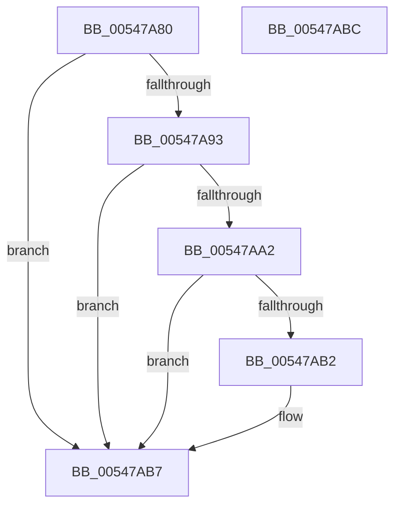

# HalpProcessorResumeFromIdle

- RVA: `0x00547A80`–`0x00547ABD` (길이 `61` bytes)
- VA: `0x0000000140547A80`
- 실행 섹션: `.text`
- PDB 이름 있음: `예`; PDB Function 태그: `아니요`
- unwind 정보 RVA: `0x0005C788`
- 디코드: `15`개 명령, `61/61` bytes 표시
- 미해석 바이트: `0` (있으면 어셈블리에 `.byte`로 보존)

> 이 문서는 커널 이미지의 기계어와 PDB 기호를 분석해 생성했습니다. 4번과 5번은 함수 원형과 자료형을 바이너리 사용 방식에서 추정한 C 해석이며 원본 소스 복구 결과는 아닙니다.

## 1. Dependencies

- 직접 호출 지점: **1**; 고유 호출 대상: **1**
- 직접 호출자로 확인된 함수: **0**
- RIP 상대 이미지 참조: **1**

### Outgoing calls
- `0x00547AB2` → [guard_dispatch_icall](../6B/guard_dispatch_icall_function_006BAAD0.md) (function, `0x006BAAD0`)

### Direct callers
- 이 함수 시작 RVA로 연결되는 직접 call은 확인되지 않았습니다. 간접 호출은 완전히 역산할 수 없습니다.

### Static image references
- `0x00547AA2` → RVA `0x00E03B20` (`.data`; read)

## 2. Other-region calls and transfers

- 다른 실행 섹션으로 향하는 call: **0**
- 별도 외부 분기/꼬리 이동을 확인하지 못했습니다.

## 3. Assembly (complete function range)

```asm
00547A80  48 83 EC 28                     sub rsp, 0x28
00547A84  65 48 8B 04 25 20 00 00 00      mov rax, qword ptr gs:[0x20]
00547A8D  83 78 60 00                     cmp dword ptr [rax + 0x60], 0
00547A91  7E 24                           jle 0x140547ab7
00547A93  65 48 8B 04 25 20 00 00 00      mov rax, qword ptr gs:[0x20]
00547A9C  F6 40 60 01                     test byte ptr [rax + 0x60], 1
00547AA0  75 15                           jne 0x140547ab7
00547AA2  48 8B 05 77 C0 8B 00            mov rax, qword ptr [rip + 0x8bc077]
00547AA9  48 8B 40 50                     mov rax, qword ptr [rax + 0x50]
00547AAD  48 85 C0                        test rax, rax
00547AB0  74 05                           je 0x140547ab7
00547AB2  E8 19 30 17 00                  call 0x1406baad0
00547AB7  48 83 C4 28                     add rsp, 0x28
00547ABB  C3                              ret
00547ABC  CC                              int3
```

## 4. C-style interpretation (structured pseudocode)

```c
__int64 __fastcall HalpProcessorResumeFromIdle(void)
{
    __int64 result;
    __int64 v_rsp;

    v_rsp = (v_rsp) - (40);
    if ((*(unsigned int *)(*(unsigned __int64 *)(gs_base + (0 + 32)) + 96)) <= 0) goto loc_00547AB7;
    if (((*(unsigned __int8 *)(*(unsigned __int64 *)(gs_base + (0 + 32)) + 96)) & (1)) != 0) goto loc_00547AB7;
    result = *(unsigned __int64 *)(*(unsigned __int64 *)(v_rip + 9158775) + 80);
    if (*(unsigned __int64 *)(*(unsigned __int64 *)(v_rip + 9158775) + 80) != 0) {
        result = guard_dispatch_icall(a1, a2, a3, a4);
    }
    v_rsp = (v_rsp) + (40);
    return result;
}
```

## 5. (Beta) C Style

```c
void HalpProcessorResumeFromIdle(void)
{
    int64_t result;
    int64_t local_rsp;

    local_rsp = (local_rsp) - (40);
    if ((*(uint32_t *)(*(uint64_t *)(gs_base + (0 + 0x20)) + 0x60)) <= 0) goto loc_00547AB7;
    if (((*(uint8_t *)(*(uint64_t *)(gs_base + (0 + 0x20)) + 0x60)) & (1)) != 0) goto loc_00547AB7;
    result = *(uint64_t *)(*(uint64_t *)(v_rip + 0x8BC077) + 0x50);
    if (*(uint64_t *)(*(uint64_t *)(v_rip + 0x8BC077) + 0x50) != 0) {
        result = guard_dispatch_icall(a1, a2, a3, a4);
    }
    local_rsp = (local_rsp) + (40);
    return result;
}
```

## 6. Execution-region graph

[열기: 2D/3D 그래프와 함수 탐색 컨트롤 패널](../../../control-panel.html?section=text&rva=0x00547A80&view=graph)

- 2D 그래프는 위에서 아래로 흐르고, 3D 그래프는 빈 공간을 드래그해 회전합니다. Shift+드래그는 이동, 휠은 확대·축소, 함수 노드 선택은 대상 보고서 이동입니다.

### Static fallback


