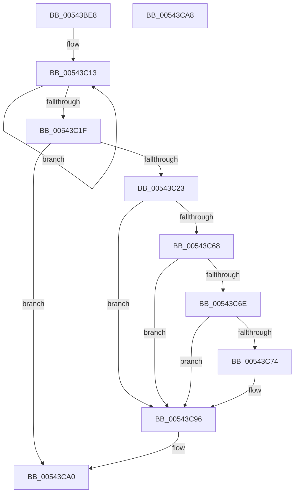

# HalpQueryMaximumRegisteredProcessorCount

- RVA: `0x00543BE8`–`0x00543CA9` (길이 `193` bytes)
- VA: `0x0000000140543BE8`
- 실행 섹션: `.text`
- PDB 이름 있음: `예`; PDB Function 태그: `아니요`
- unwind 정보 RVA: `0x000C3C24`
- 디코드: `54`개 명령, `193/193` bytes 표시
- 미해석 바이트: `0` (있으면 어셈블리에 `.byte`로 보존)

> 이 문서는 커널 이미지의 기계어와 PDB 기호를 분석해 생성했습니다. 4번과 5번은 함수 원형과 자료형을 바이너리 사용 방식에서 추정한 C 해석이며 원본 소스 복구 결과는 아닙니다.

## 1. Dependencies

- 직접 호출 지점: **3**; 고유 호출 대상: **3**
- 직접 호출자로 확인된 함수: **18**
- RIP 상대 이미지 참조: **3**

### Outgoing calls
- `0x00543C23` → [HalQueryMaximumProcessorCount](../4A/HalQueryMaximumProcessorCount_function_004AC9A0.md) (function, `0x004AC9A0`)
- `0x00543C3F` → [RtlInitUnicodeString](../42/RtlInitUnicodeString_function_0042A780.md) (function, `0x0042A780`)
- `0x00543C5F` → [ZwQueryLicenseValue](../6A/ZwQueryLicenseValue_function_006AFCF0.md) (function, `0x006AFCF0`)

### Direct callers
- [HalpTimerSelectRoles](../53/HalpTimerSelectRoles_function_0053D4B0.md) at `0x0053D7D1`
- [HalEnumerateProcessors](HalEnumerateProcessors_function_00543240.md) at `0x005432DB`
- [HalStartDynamicProcessor](HalStartDynamicProcessor_function_00543300.md) at `0x0054333B`
- [HalpInterruptGetNextProcessorLocalId](HalpInterruptGetNextProcessorLocalId_function_005434EC.md) at `0x00543509`
- [HalStartNextProcessor](HalStartNextProcessor_function_005479B0.md) at `0x005479D3`
- [HalpTscReserveResources](HalpTscReserveResources_function_0054AE20.md) at `0x0054AE4C`
- [HalpHvInitMcaStatusMsrCache](HalpHvInitMcaStatusMsrCache_function_0054C170.md) at `0x0054C240`
- [EmonAllocateResources](../55/EmonAllocateResources_function_0055C40C.md) at `0x0055C477`
- [EmonInitializeProfilingBSP](../55/EmonInitializeProfilingBSP_function_0055D0D8.md) at `0x0055D112`
- [HalpTscReportSyncStatus](../../page/70/HalpTscReportSyncStatus_function_00707E44.md) at `0x00707E6E`
- [HalpMcaInitializePcrContext](../../pagelk/B5/HalpMcaInitializePcrContext_function_00B5BDD0.md) at `0x00B5BDF9`
- [HalpInitializeProfiling](../../pagelk/B5/HalpInitializeProfiling_function_00B5EF00.md) at `0x00B5EF43`
- [EmonCompleteInitializeProfiling](../../pagelk/B5/EmonCompleteInitializeProfiling_function_00B5F0D0.md) at `0x00B5F12E`
- [EmonInitializeProfilingOriginal](../../pagelk/B5/EmonInitializeProfilingOriginal_function_00B5F630.md) at `0x00B5F6DB`
- [HalpDpStartProcessor](../../pagelk/B6/HalpDpStartProcessor_function_00B60384.md) at `0x00B603AC`
- [Amd64InitializeProfilingEnhanced](../../pagelk/B6/Amd64InitializeProfilingEnhanced_function_00B61318.md) at `0x00B614FA`
- [Amd64InitializeProfilingOriginal](../../pagelk/B6/Amd64InitializeProfilingOriginal_function_00B618D8.md) at `0x00B61AAD`
- [HalpPreAllocateKInterrupts](../../init/C2/HalpPreAllocateKInterrupts_function_00C2378C.md) at `0x00C2379C`

### Static image references
- `0x00543C06` → RVA `0x00E101B4` (`.data`; read)
- `0x00543C2A` → RVA `0x00023B10` (`.rdata`; read)
- `0x00543C9A` → RVA `0x00E101B4` (`.data`; read/write)

## 2. Other-region calls and transfers

- 다른 실행 섹션으로 향하는 call: **0**
- 별도 외부 분기/꼬리 이동을 확인하지 못했습니다.

## 3. Assembly (complete function range)

```asm
00543BE8  40 55                           push rbp
00543BEA  53                              push rbx
00543BEB  57                              push rdi
00543BEC  48 8B EC                        mov rbp, rsp
00543BEF  48 83 EC 40                     sub rsp, 0x40
00543BF3  83 65 28 00                     and dword ptr [rbp + 0x28], 0
00543BF7  0F 57 C0                        xorps xmm0, xmm0
00543BFA  83 65 30 00                     and dword ptr [rbp + 0x30], 0
00543BFE  83 65 20 00                     and dword ptr [rbp + 0x20], 0
00543C02  0F 11 45 F0                     movups xmmword ptr [rbp - 0x10], xmm0
00543C06  0F 0D 0D A7 C5 8C 00            prefetchw byte ptr [rip + 0x8cc5a7]
00543C0D  8B 05 A1 C5 8C 00               mov eax, dword ptr [rip + 0x8cc5a1]
00543C13  8B C8                           mov ecx, eax
00543C15  F0 0F B1 0D 97 C5 8C 00         lock cmpxchg dword ptr [rip + 0x8cc597], ecx
00543C1D  75 F4                           jne 0x140543c13
00543C1F  85 C0                           test eax, eax
00543C21  75 7D                           jne 0x140543ca0
00543C23  E8 78 8D F6 FF                  call 0x1404ac9a0
00543C28  8B D8                           mov ebx, eax
00543C2A  48 8D 15 DF FE AD FF            lea rdx, [rip - 0x520121]
00543C31  B8 00 08 00 00                  mov eax, 0x800
00543C36  48 8D 4D F0                     lea rcx, [rbp - 0x10]
00543C3A  3B D8                           cmp ebx, eax
00543C3C  0F 47 D8                        cmova ebx, eax
00543C3F  E8 3C 6B EE FF                  call 0x14042a780
00543C44  48 8D 45 28                     lea rax, [rbp + 0x28]
00543C48  41 B9 04 00 00 00               mov r9d, 4
00543C4E  4C 8D 45 20                     lea r8, [rbp + 0x20]
00543C52  48 89 44 24 20                  mov qword ptr [rsp + 0x20], rax
00543C57  48 8D 55 30                     lea rdx, [rbp + 0x30]
00543C5B  48 8D 4D F0                     lea rcx, [rbp - 0x10]
00543C5F  E8 8C C0 16 00                  call 0x1406afcf0
00543C64  85 C0                           test eax, eax
00543C66  78 2E                           js 0x140543c96
00543C68  83 7D 28 04                     cmp dword ptr [rbp + 0x28], 4
00543C6C  75 28                           jne 0x140543c96
00543C6E  83 7D 30 04                     cmp dword ptr [rbp + 0x30], 4
00543C72  75 22                           jne 0x140543c96
00543C74  65 48 8B 04 25 20 00 00 00      mov rax, qword ptr gs:[0x20]
00543C7D  8B 88 A4 00 00 00               mov ecx, dword ptr [rax + 0xa4]
00543C83  0F AF 88 A0 00 00 00            imul ecx, dword ptr [rax + 0xa0]
00543C8A  0F AF 4D 20                     imul ecx, dword ptr [rbp + 0x20]
00543C8E  3B D9                           cmp ebx, ecx
00543C90  89 4D 20                        mov dword ptr [rbp + 0x20], ecx
00543C93  0F 47 D9                        cmova ebx, ecx
00543C96  8B CB                           mov ecx, ebx
00543C98  8B C3                           mov eax, ebx
00543C9A  87 0D 14 C5 8C 00               xchg dword ptr [rip + 0x8cc514], ecx
00543CA0  48 83 C4 40                     add rsp, 0x40
00543CA4  5F                              pop rdi
00543CA5  5B                              pop rbx
00543CA6  5D                              pop rbp
00543CA7  C3                              ret
00543CA8  CC                              int3
```

## 4. C-style interpretation (structured pseudocode)

```c
__int64 __fastcall HalpQueryMaximumRegisteredProcessorCount(void)
{
    __int64 result;
    __int64 v_rbx;
    __int64 v_rsp;
    unsigned __int64 v_stack_m28;
    unsigned __int64 v_stack_m38;
    unsigned int v_stack_p10;
    unsigned int v_stack_p18;
    unsigned int v_stack_p8;

    v_rsp = (v_rsp) - (64);
    v_stack_m28 = v_xmm0;
loc_00543C13:
    if (condition_is_not_equal) goto loc_00543C13;
    if ((unsigned int)((unsigned int)(*(unsigned int *)(v_rip + 9225633))) != 0) goto loc_00543CA0;
    result = HalQueryMaximumProcessorCount((unsigned int)((unsigned int)((unsigned int)(*(unsigned int *)(v_rip + 9225633)))), a2, a3, a4);
    v_rbx = (unsigned int)((unsigned int)(result));
    if (((unsigned int)((unsigned int)((unsigned int)(result)))) > ((unsigned int)((unsigned int)(0x800ULL)))) { v_rbx = (unsigned int)((unsigned int)(0x800ULL)); }
    result = RtlInitUnicodeString(v_stack_m28, v_rip - 5374241, a3, a4);
    v_stack_m38 = v_stack_p10;
    result = ZwQueryLicenseValue(v_stack_m28, v_stack_p18, v_stack_p8, 4);
    if (sign_flag) goto loc_00543C96;
    if (v_stack_p10 != 4) goto loc_00543C96;
    if (v_stack_p18 == 4) {
        result = *(unsigned __int64 *)(gs_base + (0 + 32));
        a1 = *(unsigned int *)(result + 164);
        a1 = (unsigned int)((a1) * (*(unsigned int *)(result + 160)));
        a1 = (unsigned int)((a1) * (v_stack_p8));
        v_stack_p8 = (unsigned int)(a1);
        if (((unsigned int)(v_rbx)) > ((unsigned int)(a1))) { v_rbx = (unsigned int)(a1); }
    }
loc_00543CA0:
    v_rsp = (v_rsp) + (64);
    return (unsigned int)((unsigned int)(v_rbx));
}
```

## 5. (Beta) C Style

```c
void HalpQueryMaximumRegisteredProcessorCount(void)
{
    int64_t result;
    int64_t local_rbx;
    int64_t local_rsp;
    uint64_t v_stack_m28;
    uint64_t v_stack_m38;
    uint32_t v_stack_p10;
    uint32_t v_stack_p18;
    uint32_t v_stack_p8;

    local_rsp = (local_rsp) - (64);
    v_stack_m28 = v_xmm0;
loc_00543C13:
    if (condition_is_not_equal) goto loc_00543C13;
    if ((uint32_t)((uint32_t)(*(uint32_t *)(v_rip + 0x8CC5A1))) != 0) goto loc_00543CA0;
    result = HalQueryMaximumProcessorCount((uint32_t)((uint32_t)((uint32_t)(*(uint32_t *)(v_rip + 0x8CC5A1)))), a2, a3, a4);
    local_rbx = (uint32_t)((uint32_t)(result));
    if (((uint32_t)((uint32_t)((uint32_t)(result)))) > ((uint32_t)((uint32_t)(0x800ULL)))) { local_rbx = (uint32_t)((uint32_t)(0x800ULL)); }
    result = RtlInitUnicodeString(v_stack_m28, v_rip - 5374241, a3, a4);
    v_stack_m38 = v_stack_p10;
    result = ZwQueryLicenseValue(v_stack_m28, v_stack_p18, v_stack_p8, 4);
    if (sign_flag) goto loc_00543C96;
    if (v_stack_p10 != 4) goto loc_00543C96;
    if (v_stack_p18 == 4) {
        result = *(uint64_t *)(gs_base + (0 + 0x20));
        a1 = *(uint32_t *)(result + 0xA4);
        a1 = (uint32_t)((a1) * (*(uint32_t *)(result + 0xA0)));
        a1 = (uint32_t)((a1) * (v_stack_p8));
        v_stack_p8 = (uint32_t)(a1);
        if (((uint32_t)(local_rbx)) > ((uint32_t)(a1))) { local_rbx = (uint32_t)(a1); }
    }
loc_00543CA0:
    local_rsp = (local_rsp) + (64);
    return (uint32_t)((uint32_t)(local_rbx));
}
```

## 6. Execution-region graph

[열기: 2D/3D 그래프와 함수 탐색 컨트롤 패널](../../../control-panel.html?section=text&rva=0x00543BE8&view=graph)

- 2D 그래프는 위에서 아래로 흐르고, 3D 그래프는 빈 공간을 드래그해 회전합니다. Shift+드래그는 이동, 휠은 확대·축소, 함수 노드 선택은 대상 보고서 이동입니다.

### Static fallback


