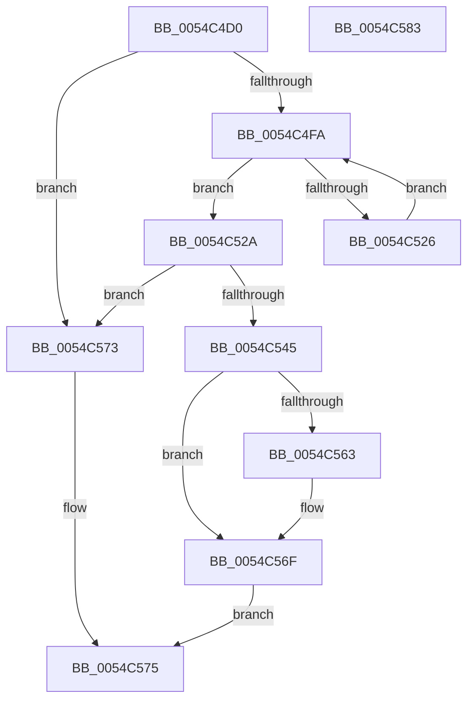

# HalpQueryVirtualRtc

- RVA: `0x0054C4D0`–`0x0054C584` (길이 `180` bytes)
- VA: `0x000000014054C4D0`
- 실행 섹션: `.text`
- PDB 이름 있음: `예`; PDB Function 태그: `아니요`
- unwind 정보 RVA: `0x000A9A38`
- 디코드: `50`개 명령, `180/180` bytes 표시
- 미해석 바이트: `0` (있으면 어셈블리에 `.byte`로 보존)

> 이 문서는 커널 이미지의 기계어와 PDB 기호를 분석해 생성했습니다. 4번과 5번은 함수 원형과 자료형을 바이너리 사용 방식에서 추정한 C 해석이며 원본 소스 복구 결과는 아닙니다.

## 1. Dependencies

- 직접 호출 지점: **2**; 고유 호출 대상: **2**
- 직접 호출자로 확인된 함수: **3**
- RIP 상대 이미지 참조: **5**

### Outgoing calls
- `0x0054C512` → [KeQueryPerformanceCounter](../37/KeQueryPerformanceCounter_function_0037E7E0.md) (function, `0x0037E7E0`)
- `0x0054C534` → [RtlpTimeToTimeFields](../42/RtlpTimeToTimeFields_function_0042E110.md) (function, `0x0042E110`)

### Direct callers
- [HalCalibratePerformanceCounter](../53/HalCalibratePerformanceCounter_function_0053C010.md) at `0x0053C0A4`
- [HalpSetResumeTime](../55/HalpSetResumeTime_function_0055BC08.md) at `0x0055BD4C`
- [sub_006EE4C2](../6E/Unknown_function_006EE4C2.md) at `0x006EE579`

### Static image references
- `0x0054C4E6` → RVA `0x00FC1A98` (`.data`; read)
- `0x0054C4FA` → RVA `0x00FC21A0` (`.data`; read)
- `0x0054C506` → RVA `0x00FC21AC` (`.data`; read)
- `0x0054C517` → RVA `0x00FC21B8` (`.data`; read)
- `0x0054C563` → RVA `0x00FC21C4` (`.data`; read)

## 2. Other-region calls and transfers

- 다른 실행 섹션으로 향하는 call: **0**
- 별도 외부 분기/꼬리 이동을 확인하지 못했습니다.

## 3. Assembly (complete function range)

```asm
0054C4D0  48 89 5C 24 08                  mov qword ptr [rsp + 8], rbx
0054C4D5  56                              push rsi
0054C4D6  57                              push rdi
0054C4D7  41 56                           push r14
0054C4D9  48 83 EC 30                     sub rsp, 0x30
0054C4DD  48 83 64 24 60 00               and qword ptr [rsp + 0x60], 0
0054C4E3  0F 57 C0                        xorps xmm0, xmm0
0054C4E6  83 3D AB 55 A7 00 02            cmp dword ptr [rip + 0xa755ab], 2
0054C4ED  48 8B F2                        mov rsi, rdx
0054C4F0  4C 8B F1                        mov r14, rcx
0054C4F3  0F 11 44 24 20                  movups xmmword ptr [rsp + 0x20], xmm0
0054C4F8  74 79                           je 0x14054c573
0054C4FA  48 8B 3D 9F 5C A7 00            mov rdi, qword ptr [rip + 0xa75c9f]
0054C501  48 8D 4C 24 60                  lea rcx, [rsp + 0x60]
0054C506  48 8B 05 9F 5C A7 00            mov rax, qword ptr [rip + 0xa75c9f]
0054C50D  48 89 44 24 68                  mov qword ptr [rsp + 0x68], rax
0054C512  E8 C9 22 E3 FF                  call 0x14037e7e0
0054C517  48 8B 0D 9A 5C A7 00            mov rcx, qword ptr [rip + 0xa75c9a]
0054C51E  48 8B D8                        mov rbx, rax
0054C521  48 3B F9                        cmp rdi, rcx
0054C524  74 04                           je 0x14054c52a
0054C526  F3 90                           pause
0054C528  EB D0                           jmp 0x14054c4fa
0054C52A  48 8D 54 24 20                  lea rdx, [rsp + 0x20]
0054C52F  48 8D 4C 24 68                  lea rcx, [rsp + 0x68]
0054C534  E8 D7 1B EE FF                  call 0x14042e110
0054C539  B8 41 06 00 00                  mov eax, 0x641
0054C53E  66 39 44 24 20                  cmp word ptr [rsp + 0x20], ax
0054C543  7E 2E                           jle 0x14054c573
0054C545  48 2B DF                        sub rbx, rdi
0054C548  48 69 C3 80 96 98 00            imul rax, rbx, 0x989680
0054C54F  48 99                           cqo
0054C551  48 F7 7C 24 60                  idiv qword ptr [rsp + 0x60]
0054C556  48 03 44 24 68                  add rax, qword ptr [rsp + 0x68]
0054C55B  49 89 06                        mov qword ptr [r14], rax
0054C55E  48 85 F6                        test rsi, rsi
0054C561  74 0C                           je 0x14054c56f
0054C563  80 3D 5A 5C A7 00 00            cmp byte ptr [rip + 0xa75c5a], 0
0054C56A  0F 94 C0                        sete al
0054C56D  88 06                           mov byte ptr [rsi], al
0054C56F  B0 01                           mov al, 1
0054C571  EB 02                           jmp 0x14054c575
0054C573  32 C0                           xor al, al
0054C575  48 8B 5C 24 50                  mov rbx, qword ptr [rsp + 0x50]
0054C57A  48 83 C4 30                     add rsp, 0x30
0054C57E  41 5E                           pop r14
0054C580  5F                              pop rdi
0054C581  5E                              pop rsi
0054C582  C3                              ret
0054C583  CC                              int3
```

## 4. C-style interpretation (structured pseudocode)

```c
__int64 __fastcall HalpQueryVirtualRtc(__int64 a1, __int64 a2)
{
    __int64 result;
    __int64 v_rbx;
    __int64 v_rsp;
    unsigned __int64 v_stack_m28;
    unsigned __int64 v_stack_p18;
    unsigned __int64 v_stack_p20;
    unsigned __int64 v_stack_p8;

    v_stack_p8 = v_rbx;
    v_rsp = (v_rsp) - (48);
    v_stack_m28 = v_xmm0;
    if ((*(unsigned int *)(v_rip + 10966443)) == 2) goto loc_0054C573;
loc_0054C4FA:
    v_stack_p20 = *(unsigned __int64 *)(v_rip + 10968223);
    result = KeQueryPerformanceCounter(v_stack_p18, a2, a3, a4);
    if ((*(unsigned __int64 *)(v_rip + 10968223)) == (*(unsigned __int64 *)(v_rip + 10968218))) goto loc_0054C52A;
    goto loc_0054C4FA;
loc_0054C52A:
    result = RtlpTimeToTimeFields(v_stack_p20, v_stack_m28, a3, a4);
    if (v_stack_m28 <= ((unsigned __int16)((unsigned int)(0x641ULL)))) goto loc_0054C573;
    v_rbx = (result) - (*(unsigned __int64 *)(v_rip + 10968223));
    result = ((unsigned int)(0x641ULL)) * (v_rbx);
    result = (result) + (v_stack_p20);
    *(unsigned __int64 *)(a1) = result;
    if (a2 != 0) {
        result = ((*(unsigned __int8 *)(v_rip + 10968154)) == 0) ? 1 : 0;
        *(unsigned __int8 *)(a2) = (unsigned __int8)(result);
    }
    goto loc_0054C575;
loc_0054C573:
    result = 0;
loc_0054C575:
    v_rsp = (v_rsp) + (48);
    return result;
}
```

## 5. (Beta) C Style

```c
int64_t HalpQueryVirtualRtc(void *Arg1, int64_t Arg2)
{
    uint8_t *arg1 = (uint8_t *)Arg1;

    int64_t result;
    int64_t local_rbx;
    int64_t local_rsp;
    uint64_t v_stack_m28;
    uint64_t v_stack_p18;
    uint64_t v_stack_p20;
    uint64_t v_stack_p8;

    v_stack_p8 = local_rbx;
    local_rsp = (local_rsp) - (48);
    v_stack_m28 = v_xmm0;
    if ((*(uint32_t *)(v_rip + 0xA755AB)) == 2) goto loc_0054C573;
loc_0054C4FA:
    v_stack_p20 = *(uint64_t *)(v_rip + 0xA75C9F);
    result = KeQueryPerformanceCounter(v_stack_p18, Arg2, a3, a4);
    if ((*(uint64_t *)(v_rip + 0xA75C9F)) == (*(uint64_t *)(v_rip + 0xA75C9A))) goto loc_0054C52A;
    goto loc_0054C4FA;
loc_0054C52A:
    result = RtlpTimeToTimeFields(v_stack_p20, v_stack_m28, a3, a4);
    if (v_stack_m28 <= ((uint16_t)((uint32_t)(0x641ULL)))) goto loc_0054C573;
    local_rbx = (result) - (*(uint64_t *)(v_rip + 0xA75C9F));
    result = ((uint32_t)(0x641ULL)) * (local_rbx);
    result = (result) + (v_stack_p20);
    *(uint64_t *)(arg1) = result;
    if (Arg2 != 0) {
        result = ((*(uint8_t *)(v_rip + 0xA75C5A)) == 0) ? 1 : 0;
        *(uint8_t *)(Arg2) = (uint8_t)(result);
    }
    goto loc_0054C575;
loc_0054C573:
    result = 0;
loc_0054C575:
    local_rsp = (local_rsp) + (48);
    return result;
}
```

### 관측된 메모리 오프셋

구조체 형식이 확인되지 않은 접근은 인자 기준의 오프셋으로만 기록했습니다.

| 기준 인자 | 오프셋 표현 | 폭 (bit) | 접근 |
|---|---:|---:|---|
| `Arg1` | `+ 0x0` | `64` | `W` |

## 6. Execution-region graph

[열기: 2D/3D 그래프와 함수 탐색 컨트롤 패널](../../../control-panel.html?section=text&rva=0x0054C4D0&view=graph)

- 2D 그래프는 위에서 아래로 흐르고, 3D 그래프는 빈 공간을 드래그해 회전합니다. Shift+드래그는 이동, 휠은 확대·축소, 함수 노드 선택은 대상 보고서 이동입니다.

### Static fallback


