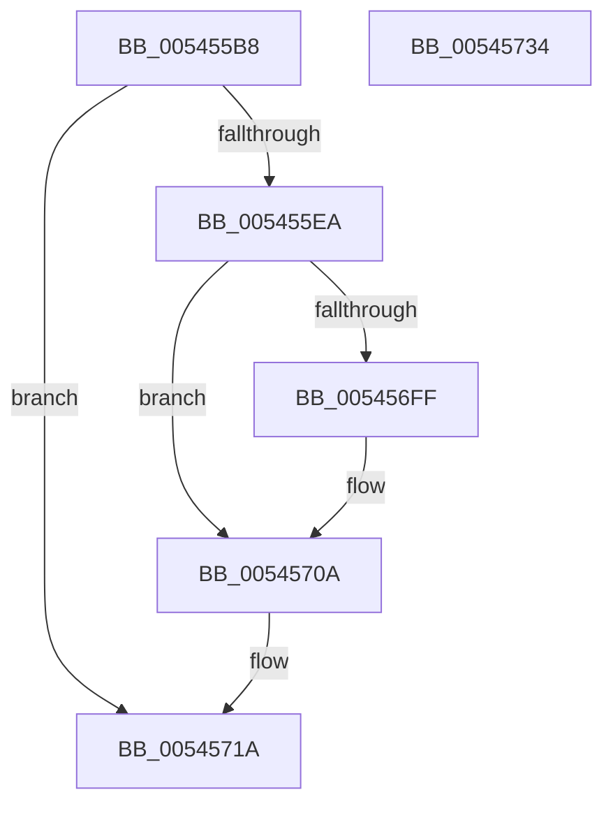

# HalpReadExtendedMcaRegistersAMD

- RVA: `0x005455B8`–`0x00545735` (길이 `381` bytes)
- VA: `0x00000001405455B8`
- 실행 섹션: `.text`
- PDB 이름 있음: `예`; PDB Function 태그: `아니요`
- unwind 정보 RVA: `0x000C3C7C`
- 디코드: `91`개 명령, `381/381` bytes 표시
- 미해석 바이트: `0` (있으면 어셈블리에 `.byte`로 보존)

> 이 문서는 커널 이미지의 기계어와 PDB 기호를 분석해 생성했습니다. 4번과 5번은 함수 원형과 자료형을 바이너리 사용 방식에서 추정한 C 해석이며 원본 소스 복구 결과는 아닙니다.

## 1. Dependencies

- 직접 호출 지점: **10**; 고유 호출 대상: **2**
- 직접 호출자로 확인된 함수: **1**
- RIP 상대 이미지 참조: **3**

### Outgoing calls
- `0x00545600` → [guard_dispatch_icall](../6B/guard_dispatch_icall_function_006BAAD0.md) (function, `0x006BAAD0`)
- `0x0054561C` → [guard_dispatch_icall](../6B/guard_dispatch_icall_function_006BAAD0.md) (function, `0x006BAAD0`)
- `0x00545638` → [guard_dispatch_icall](../6B/guard_dispatch_icall_function_006BAAD0.md) (function, `0x006BAAD0`)
- `0x00545654` → [guard_dispatch_icall](../6B/guard_dispatch_icall_function_006BAAD0.md) (function, `0x006BAAD0`)
- `0x00545670` → [guard_dispatch_icall](../6B/guard_dispatch_icall_function_006BAAD0.md) (function, `0x006BAAD0`)
- `0x0054568C` → [guard_dispatch_icall](../6B/guard_dispatch_icall_function_006BAAD0.md) (function, `0x006BAAD0`)
- `0x005456A8` → [guard_dispatch_icall](../6B/guard_dispatch_icall_function_006BAAD0.md) (function, `0x006BAAD0`)
- `0x005456C4` → [guard_dispatch_icall](../6B/guard_dispatch_icall_function_006BAAD0.md) (function, `0x006BAAD0`)
- `0x005456E3` → [guard_dispatch_icall](../6B/guard_dispatch_icall_function_006BAAD0.md) (function, `0x006BAAD0`)
- `0x00545722` → [_security_check_cookie](../6A/_security_check_cookie_function_006AC640.md) (function, `0x006AC640`)

### Direct callers
- [HalpMcaPopulateErrorData](HalpMcaPopulateErrorData_function_005417AC.md) at `0x005418E9`

### Static image references
- `0x005455C4` → RVA `0x00E0A740` (`.data`; read)
- `0x005455D8` → RVA `0x00E10258` (`.data`; read)
- `0x005455EA` → RVA `0x00FC1990` (`.data`; read)

## 2. Other-region calls and transfers

- 다른 실행 섹션으로 향하는 call: **0**
- 별도 외부 분기/꼬리 이동을 확인하지 못했습니다.

## 3. Assembly (complete function range)

```asm
005455B8  48 89 5C 24 08                  mov qword ptr [rsp + 8], rbx
005455BD  55                              push rbp
005455BE  56                              push rsi
005455BF  57                              push rdi
005455C0  48 83 EC 40                     sub rsp, 0x40
005455C4  48 8B 05 75 51 8C 00            mov rax, qword ptr [rip + 0x8c5175]
005455CB  48 33 C4                        xor rax, rsp
005455CE  48 89 44 24 30                  mov qword ptr [rsp + 0x30], rax
005455D3  33 FF                           xor edi, edi
005455D5  49 8B F1                        mov rsi, r9
005455D8  40 38 3D 79 AC 8C 00            cmp byte ptr [rip + 0x8cac79], dil
005455DF  49 8B D8                        mov rbx, r8
005455E2  8B EA                           mov ebp, edx
005455E4  0F 84 30 01 00 00               je 0x14054571a
005455EA  48 8B 05 9F C3 A7 00            mov rax, qword ptr [rip + 0xa7c39f]
005455F1  45 33 C0                        xor r8d, r8d
005455F4  C1 E5 04                        shl ebp, 4
005455F7  48 8B CB                        mov rcx, rbx
005455FA  8D 95 05 20 00 C0               lea edx, [rbp - 0x3fffdffb]
00545600  E8 CB 54 17 00                  call 0x1406baad0
00545605  48 89 46 48                     mov qword ptr [rsi + 0x48], rax
00545609  8D 95 06 20 00 C0               lea edx, [rbp - 0x3fffdffa]
0054560F  48 8B 05 7A C3 A7 00            mov rax, qword ptr [rip + 0xa7c37a]
00545616  45 33 C0                        xor r8d, r8d
00545619  48 8B CB                        mov rcx, rbx
0054561C  E8 AF 54 17 00                  call 0x1406baad0
00545621  48 89 46 50                     mov qword ptr [rsi + 0x50], rax
00545625  8D 95 04 20 00 C0               lea edx, [rbp - 0x3fffdffc]
0054562B  48 8B 05 5E C3 A7 00            mov rax, qword ptr [rip + 0xa7c35e]
00545632  45 33 C0                        xor r8d, r8d
00545635  48 8B CB                        mov rcx, rbx
00545638  E8 93 54 17 00                  call 0x1406baad0
0054563D  48 89 46 58                     mov qword ptr [rsi + 0x58], rax
00545641  8D 95 08 20 00 C0               lea edx, [rbp - 0x3fffdff8]
00545647  48 8B 05 42 C3 A7 00            mov rax, qword ptr [rip + 0xa7c342]
0054564E  45 33 C0                        xor r8d, r8d
00545651  48 8B CB                        mov rcx, rbx
00545654  E8 77 54 17 00                  call 0x1406baad0
00545659  48 89 46 60                     mov qword ptr [rsi + 0x60], rax
0054565D  8D 95 09 20 00 C0               lea edx, [rbp - 0x3fffdff7]
00545663  48 8B 05 26 C3 A7 00            mov rax, qword ptr [rip + 0xa7c326]
0054566A  45 33 C0                        xor r8d, r8d
0054566D  48 8B CB                        mov rcx, rbx
00545670  E8 5B 54 17 00                  call 0x1406baad0
00545675  48 89 46 68                     mov qword ptr [rsi + 0x68], rax
00545679  8D 95 0A 20 00 C0               lea edx, [rbp - 0x3fffdff6]
0054567F  48 8B 05 0A C3 A7 00            mov rax, qword ptr [rip + 0xa7c30a]
00545686  45 33 C0                        xor r8d, r8d
00545689  48 8B CB                        mov rcx, rbx
0054568C  E8 3F 54 17 00                  call 0x1406baad0
00545691  48 89 46 70                     mov qword ptr [rsi + 0x70], rax
00545695  8D 95 0B 20 00 C0               lea edx, [rbp - 0x3fffdff5]
0054569B  48 8B 05 EE C2 A7 00            mov rax, qword ptr [rip + 0xa7c2ee]
005456A2  45 33 C0                        xor r8d, r8d
005456A5  48 8B CB                        mov rcx, rbx
005456A8  E8 23 54 17 00                  call 0x1406baad0
005456AD  48 89 46 78                     mov qword ptr [rsi + 0x78], rax
005456B1  8D 95 0C 20 00 C0               lea edx, [rbp - 0x3fffdff4]
005456B7  48 8B 05 D2 C2 A7 00            mov rax, qword ptr [rip + 0xa7c2d2]
005456BE  45 33 C0                        xor r8d, r8d
005456C1  48 8B CB                        mov rcx, rbx
005456C4  E8 07 54 17 00                  call 0x1406baad0
005456C9  48 89 86 80 00 00 00            mov qword ptr [rsi + 0x80], rax
005456D0  8D 95 0D 20 00 C0               lea edx, [rbp - 0x3fffdff3]
005456D6  48 8B 05 B3 C2 A7 00            mov rax, qword ptr [rip + 0xa7c2b3]
005456DD  45 33 C0                        xor r8d, r8d
005456E0  48 8B CB                        mov rcx, rbx
005456E3  E8 E8 53 17 00                  call 0x1406baad0
005456E8  48 89 86 88 00 00 00            mov qword ptr [rsi + 0x88], rax
005456EF  33 C9                           xor ecx, ecx
005456F1  B8 00 00 00 80                  mov eax, 0x80000000
005456F6  0F A2                           cpuid
005456F8  3D 07 00 00 80                  cmp eax, 0x80000007
005456FD  72 0B                           jb 0x14054570a
005456FF  B8 07 00 00 80                  mov eax, 0x80000007
00545704  33 C9                           xor ecx, ecx
00545706  0F A2                           cpuid
00545708  8B FB                           mov edi, ebx
0054570A  8B C7                           mov eax, edi
0054570C  48 89 86 90 00 00 00            mov qword ptr [rsi + 0x90], rax
00545713  C7 46 40 0A 00 00 00            mov dword ptr [rsi + 0x40], 0xa
0054571A  48 8B 4C 24 30                  mov rcx, qword ptr [rsp + 0x30]
0054571F  48 33 CC                        xor rcx, rsp
00545722  E8 19 6F 16 00                  call 0x1406ac640
00545727  48 8B 5C 24 60                  mov rbx, qword ptr [rsp + 0x60]
0054572C  48 83 C4 40                     add rsp, 0x40
00545730  5F                              pop rdi
00545731  5E                              pop rsi
00545732  5D                              pop rbp
00545733  C3                              ret
00545734  CC                              int3
```

## 4. C-style interpretation (structured pseudocode)

```c
__int64 __fastcall HalpReadExtendedMcaRegistersAMD(__int64 a1, int a2, __int64 a3, __int64 a4)
{
    __int64 result;
    __int64 v_rbp;
    __int64 v_rdi;
    __int64 v_rsp;
    unsigned __int64 v_stack_m28;
    unsigned __int64 v_stack_p8;

    v_stack_p8 = v_rbx;
    v_rsp = (v_rsp) - (64);
    result = (*(unsigned __int64 *)(v_rip + 9195893)) ^ (v_rsp);
    v_stack_m28 = result;
    v_rdi = 0;
    if ((*(unsigned __int8 *)(v_rip + 9219193)) == 0) goto loc_0054571A;
    a3 = 0;
    v_rbp = (unsigned int)(((unsigned int)(a2)) << (4));
    result = guard_dispatch_icall(0, v_rbp - 1073733627, a3, a4);
    *(unsigned __int64 *)(a4 + 72) = result;
    a3 = 0;
    result = guard_dispatch_icall(0, v_rbp - 1073733626, a3, a4);
    *(unsigned __int64 *)(a4 + 80) = result;
    a3 = 0;
    result = guard_dispatch_icall(0, v_rbp - 1073733628, a3, a4);
    *(unsigned __int64 *)(a4 + 88) = result;
    a3 = 0;
    result = guard_dispatch_icall(0, v_rbp - 1073733624, a3, a4);
    *(unsigned __int64 *)(a4 + 96) = result;
    a3 = 0;
    result = guard_dispatch_icall(0, v_rbp - 1073733623, a3, a4);
    *(unsigned __int64 *)(a4 + 104) = result;
    a3 = 0;
    result = guard_dispatch_icall(0, v_rbp - 1073733622, a3, a4);
    *(unsigned __int64 *)(a4 + 112) = result;
    a3 = 0;
    result = guard_dispatch_icall(0, v_rbp - 1073733621, a3, a4);
    *(unsigned __int64 *)(a4 + 120) = result;
    a3 = 0;
    result = guard_dispatch_icall(0, v_rbp - 1073733620, a3, a4);
    *(unsigned __int64 *)(a4 + 128) = result;
    a3 = 0;
    result = guard_dispatch_icall(0, v_rbp - 1073733619, a3, a4);
    *(unsigned __int64 *)(a4 + 136) = result;
    a1 = 0;
    result = (unsigned int)(0x80000000ULL);
    if (((unsigned int)((unsigned int)(0x80000000ULL))) >= 0x80000007ULL) {
        result = 0x80000007ULL;
        a1 = 0;
        v_rdi = 0;
    }
    *(unsigned __int64 *)(a4 + 144) = (unsigned int)((unsigned int)(v_rdi));
    *(unsigned int *)(a4 + 64) = 10;
loc_0054571A:
    a1 = (v_stack_m28) ^ (v_rsp);
    result = _security_check_cookie(a1, v_rbp - 1073733619, a3, a4);
    v_rsp = (v_rsp) + (64);
    return result;
}
```

## 5. (Beta) C Style

```c
int64_t HalpReadExtendedMcaRegistersAMD(int64_t Arg1, int32_t Arg2, int64_t Arg3, void *Arg4)
{
    uint8_t *arg4 = (uint8_t *)Arg4;

    int64_t result;
    int64_t local_rbp;
    int64_t local_rdi;
    int64_t local_rsp;
    uint64_t v_stack_m28;
    uint64_t v_stack_p8;

    v_stack_p8 = local_rbx;
    local_rsp = (local_rsp) - (64);
    result = (*(uint64_t *)(v_rip + 0x8C5175)) ^ (local_rsp);
    v_stack_m28 = result;
    local_rdi = 0;
    if ((*(uint8_t *)(v_rip + 0x8CAC79)) == 0) goto loc_0054571A;
    Arg3 = 0;
    local_rbp = (uint32_t)(((uint32_t)(Arg2)) << (4));
    result = guard_dispatch_icall(0, local_rbp - 1073733627, Arg3, Arg4);
    *(uint64_t *)(arg4 + 0x48) = result;
    Arg3 = 0;
    result = guard_dispatch_icall(0, local_rbp - 1073733626, Arg3, Arg4);
    *(uint64_t *)(arg4 + 0x50) = result;
    Arg3 = 0;
    result = guard_dispatch_icall(0, local_rbp - 1073733628, Arg3, Arg4);
    *(uint64_t *)(arg4 + 0x58) = result;
    Arg3 = 0;
    result = guard_dispatch_icall(0, local_rbp - 1073733624, Arg3, Arg4);
    *(uint64_t *)(arg4 + 0x60) = result;
    Arg3 = 0;
    result = guard_dispatch_icall(0, local_rbp - 1073733623, Arg3, Arg4);
    *(uint64_t *)(arg4 + 0x68) = result;
    Arg3 = 0;
    result = guard_dispatch_icall(0, local_rbp - 1073733622, Arg3, Arg4);
    *(uint64_t *)(arg4 + 0x70) = result;
    Arg3 = 0;
    result = guard_dispatch_icall(0, local_rbp - 1073733621, Arg3, Arg4);
    *(uint64_t *)(arg4 + 0x78) = result;
    Arg3 = 0;
    result = guard_dispatch_icall(0, local_rbp - 1073733620, Arg3, Arg4);
    *(uint64_t *)(arg4 + 0x80) = result;
    Arg3 = 0;
    result = guard_dispatch_icall(0, local_rbp - 1073733619, Arg3, Arg4);
    *(uint64_t *)(arg4 + 0x88) = result;
    Arg1 = 0;
    result = (uint32_t)(0x80000000ULL);
    if (((uint32_t)((uint32_t)(0x80000000ULL))) >= 0x80000007ULL) {
        result = 0x80000007ULL;
        Arg1 = 0;
        local_rdi = 0;
    }
    *(uint64_t *)(arg4 + 0x90) = (uint32_t)((uint32_t)(local_rdi));
    *(uint32_t *)(arg4 + 0x40) = 10;
loc_0054571A:
    Arg1 = (v_stack_m28) ^ (local_rsp);
    result = _security_check_cookie(Arg1, local_rbp - 1073733619, Arg3, Arg4);
    local_rsp = (local_rsp) + (64);
    return result;
}
```

### 관측된 메모리 오프셋

구조체 형식이 확인되지 않은 접근은 인자 기준의 오프셋으로만 기록했습니다.

| 기준 인자 | 오프셋 표현 | 폭 (bit) | 접근 |
|---|---:|---:|---|
| `Arg4` | `+ 0x40` | `32` | `W` |
| `Arg4` | `+ 0x48` | `64` | `W` |
| `Arg4` | `+ 0x50` | `64` | `W` |
| `Arg4` | `+ 0x58` | `64` | `W` |
| `Arg4` | `+ 0x60` | `64` | `W` |
| `Arg4` | `+ 0x68` | `64` | `W` |
| `Arg4` | `+ 0x70` | `64` | `W` |
| `Arg4` | `+ 0x78` | `64` | `W` |
| `Arg4` | `+ 0x80` | `64` | `W` |
| `Arg4` | `+ 0x88` | `64` | `W` |
| `Arg4` | `+ 0x90` | `64` | `W` |

## 6. Execution-region graph

[열기: 2D/3D 그래프와 함수 탐색 컨트롤 패널](../../../control-panel.html?section=text&rva=0x005455B8&view=graph)

- 2D 그래프는 위에서 아래로 흐르고, 3D 그래프는 빈 공간을 드래그해 회전합니다. Shift+드래그는 이동, 휠은 확대·축소, 함수 노드 선택은 대상 보고서 이동입니다.

### Static fallback


