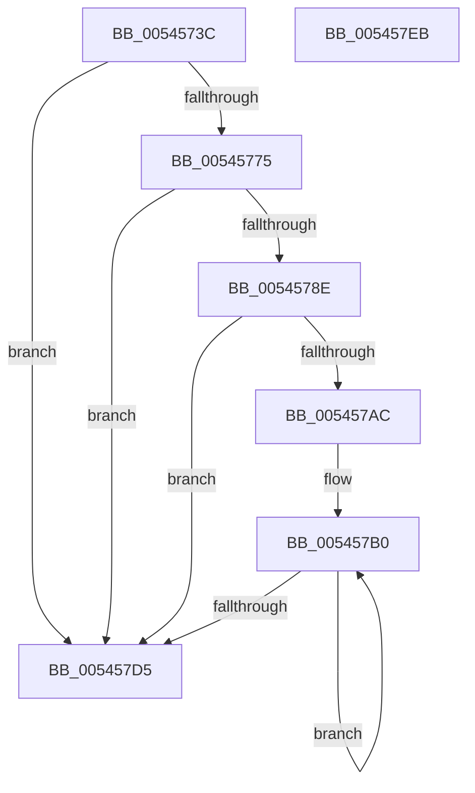

# HalpReadExtendedMcaRegistersIntel

- RVA: `0x0054573C`–`0x005457EC` (길이 `176` bytes)
- VA: `0x000000014054573C`
- 실행 섹션: `.text`
- PDB 이름 있음: `예`; PDB Function 태그: `아니요`
- unwind 정보 RVA: `0x0006F978`
- 디코드: `49`개 명령, `176/176` bytes 표시
- 미해석 바이트: `0` (있으면 어셈블리에 `.byte`로 보존)

> 이 문서는 커널 이미지의 기계어와 PDB 기호를 분석해 생성했습니다. 4번과 5번은 함수 원형과 자료형을 바이너리 사용 방식에서 추정한 C 해석이며 원본 소스 복구 결과는 아닙니다.

## 1. Dependencies

- 직접 호출 지점: **3**; 고유 호출 대상: **1**
- 직접 호출자로 확인된 함수: **1**
- RIP 상대 이미지 참조: **1**

### Outgoing calls
- `0x0054576C` → [guard_dispatch_icall](../6B/guard_dispatch_icall_function_006BAAD0.md) (function, `0x006BAAD0`)
- `0x005457A0` → [guard_dispatch_icall](../6B/guard_dispatch_icall_function_006BAAD0.md) (function, `0x006BAAD0`)
- `0x005457C3` → [guard_dispatch_icall](../6B/guard_dispatch_icall_function_006BAAD0.md) (function, `0x006BAAD0`)

### Direct callers
- [HalpMcaPopulateErrorData](HalpMcaPopulateErrorData_function_005417AC.md) at `0x005418D4`

### Static image references
- `0x00545751` → RVA `0x00FC1990` (`.data`; read)

## 2. Other-region calls and transfers

- 다른 실행 섹션으로 향하는 call: **0**
- 별도 외부 분기/꼬리 이동을 확인하지 못했습니다.

## 3. Assembly (complete function range)

```asm
0054573C  48 89 5C 24 08                  mov qword ptr [rsp + 8], rbx
00545741  48 89 74 24 10                  mov qword ptr [rsp + 0x10], rsi
00545746  48 89 7C 24 18                  mov qword ptr [rsp + 0x18], rdi
0054574B  41 56                           push r14
0054574D  48 83 EC 20                     sub rsp, 0x20
00545751  48 8B 05 38 C2 A7 00            mov rax, qword ptr [rip + 0xa7c238]
00545758  49 8B F8                        mov rdi, r8
0054575B  48 8B D9                        mov rbx, rcx
0054575E  45 33 C0                        xor r8d, r8d
00545761  48 8B CF                        mov rcx, rdi
00545764  BA 7A 01 00 00                  mov edx, 0x17a
00545769  4D 8B F1                        mov r14, r9
0054576C  E8 5F 53 17 00                  call 0x1406baad0
00545771  A8 04                           test al, 4
00545773  74 60                           je 0x1405457d5
00545775  C1 EB 10                        shr ebx, 0x10
00545778  B8 18 00 00 00                  mov eax, 0x18
0054577D  0F B6 DB                        movzx ebx, bl
00545780  3B D8                           cmp ebx, eax
00545782  0F 47 D8                        cmova ebx, eax
00545785  41 89 5E 40                     mov dword ptr [r14 + 0x40], ebx
00545789  83 FB 08                        cmp ebx, 8
0054578C  76 47                           jbe 0x1405457d5
0054578E  48 8B 05 FB C1 A7 00            mov rax, qword ptr [rip + 0xa7c1fb]
00545795  45 33 C0                        xor r8d, r8d
00545798  BA 88 01 00 00                  mov edx, 0x188
0054579D  48 8B CF                        mov rcx, rdi
005457A0  E8 2B 53 17 00                  call 0x1406baad0
005457A5  33 F6                           xor esi, esi
005457A7  48 85 C0                        test rax, rax
005457AA  74 29                           je 0x1405457d5
005457AC  49 83 C6 48                     add r14, 0x48
005457B0  48 8B 05 D9 C1 A7 00            mov rax, qword ptr [rip + 0xa7c1d9]
005457B7  8D 96 80 01 00 00               lea edx, [rsi + 0x180]
005457BD  45 33 C0                        xor r8d, r8d
005457C0  48 8B CF                        mov rcx, rdi
005457C3  E8 08 53 17 00                  call 0x1406baad0
005457C8  FF C6                           inc esi
005457CA  49 89 06                        mov qword ptr [r14], rax
005457CD  4D 8D 76 08                     lea r14, [r14 + 8]
005457D1  3B F3                           cmp esi, ebx
005457D3  72 DB                           jb 0x1405457b0
005457D5  48 8B 5C 24 30                  mov rbx, qword ptr [rsp + 0x30]
005457DA  48 8B 74 24 38                  mov rsi, qword ptr [rsp + 0x38]
005457DF  48 8B 7C 24 40                  mov rdi, qword ptr [rsp + 0x40]
005457E4  48 83 C4 20                     add rsp, 0x20
005457E8  41 5E                           pop r14
005457EA  C3                              ret
005457EB  CC                              int3
```

## 4. C-style interpretation (structured pseudocode)

```c
__int64 __fastcall HalpReadExtendedMcaRegistersIntel(__int64 a1, __int64 a2, __int64 a3, __int64 a4)
{
    __int64 result;
    __int64 v_r14;
    __int64 v_rbx;
    __int64 v_rsi;
    __int64 v_rsp;
    unsigned __int64 v_stack_p10;
    unsigned __int64 v_stack_p18;
    unsigned __int64 v_stack_p8;

    v_stack_p8 = v_rbx;
    v_stack_p10 = v_rsi;
    v_stack_p18 = v_rdi;
    v_rsp = (v_rsp) - (32);
    a3 = 0;
    result = guard_dispatch_icall(0, 378, a3, a4);
    if ((((unsigned __int8)(result)) & (4)) == 0) goto loc_005457D5;
    v_rbx = (unsigned int)((a1) >> (16));
    v_rbx = (unsigned __int8)(v_rbx);
    if (((unsigned int)((unsigned __int8)(v_rbx))) > 24) { v_rbx = 24; }
    *(unsigned int *)(a4 + 64) = (unsigned int)(v_rbx);
    if (((unsigned int)(v_rbx)) <= 8) goto loc_005457D5;
    a3 = 0;
    result = guard_dispatch_icall(0, 392, a3, a4);
    v_rsi = 0;
    if (result == 0) goto loc_005457D5;
    v_r14 = (a4) + (72);
loc_005457B0:
    a3 = 0;
    result = guard_dispatch_icall(0, v_rsi + 384, a3, a4);
    v_rsi = (unsigned int)((v_rsi) + 1);
    *(unsigned __int64 *)(v_r14) = result;
    if (((unsigned int)(v_rsi)) < ((unsigned int)(v_rbx))) goto loc_005457B0;
loc_005457D5:
    v_rsp = (v_rsp) + (32);
    return result;
}
```

## 5. (Beta) C Style

```c
int64_t HalpReadExtendedMcaRegistersIntel(int64_t Arg1, int64_t Arg2, int64_t Arg3, void *Arg4)
{
    uint8_t *arg4 = (uint8_t *)Arg4;

    int64_t result;
    int64_t local_r14;
    int64_t local_rbx;
    int64_t local_rsi;
    int64_t local_rsp;
    uint64_t v_stack_p10;
    uint64_t v_stack_p18;
    uint64_t v_stack_p8;

    v_stack_p8 = local_rbx;
    v_stack_p10 = local_rsi;
    v_stack_p18 = local_rdi;
    local_rsp = (local_rsp) - (32);
    Arg3 = 0;
    result = guard_dispatch_icall(0, 378, Arg3, Arg4);
    if ((((uint8_t)(result)) & (4)) == 0) goto loc_005457D5;
    local_rbx = (uint32_t)((Arg1) >> (16));
    local_rbx = (uint8_t)(local_rbx);
    if (((uint32_t)((uint8_t)(local_rbx))) > 24) { local_rbx = 24; }
    *(uint32_t *)(arg4 + 0x40) = (uint32_t)(local_rbx);
    if (((uint32_t)(local_rbx)) <= 8) goto loc_005457D5;
    Arg3 = 0;
    result = guard_dispatch_icall(0, 392, Arg3, Arg4);
    local_rsi = 0;
    if (result == 0) goto loc_005457D5;
    local_r14 = (Arg4) + (72);
loc_005457B0:
    Arg3 = 0;
    result = guard_dispatch_icall(0, local_rsi + 384, Arg3, Arg4);
    local_rsi = (uint32_t)((local_rsi) + 1);
    *(uint64_t *)(local_r14) = result;
    if (((uint32_t)(local_rsi)) < ((uint32_t)(local_rbx))) goto loc_005457B0;
loc_005457D5:
    local_rsp = (local_rsp) + (32);
    return result;
}
```

### 관측된 메모리 오프셋

구조체 형식이 확인되지 않은 접근은 인자 기준의 오프셋으로만 기록했습니다.

| 기준 인자 | 오프셋 표현 | 폭 (bit) | 접근 |
|---|---:|---:|---|
| `Arg4` | `+ 0x0` | `64` | `W` |
| `Arg4` | `+ 0x8` | `64` | `R` |
| `Arg4` | `+ 0x40` | `32` | `W` |

## 6. Execution-region graph

[열기: 2D/3D 그래프와 함수 탐색 컨트롤 패널](../../../control-panel.html?section=text&rva=0x0054573C&view=graph)

- 2D 그래프는 위에서 아래로 흐르고, 3D 그래프는 빈 공간을 드래그해 회전합니다. Shift+드래그는 이동, 휠은 확대·축소, 함수 노드 선택은 대상 보고서 이동입니다.

### Static fallback


