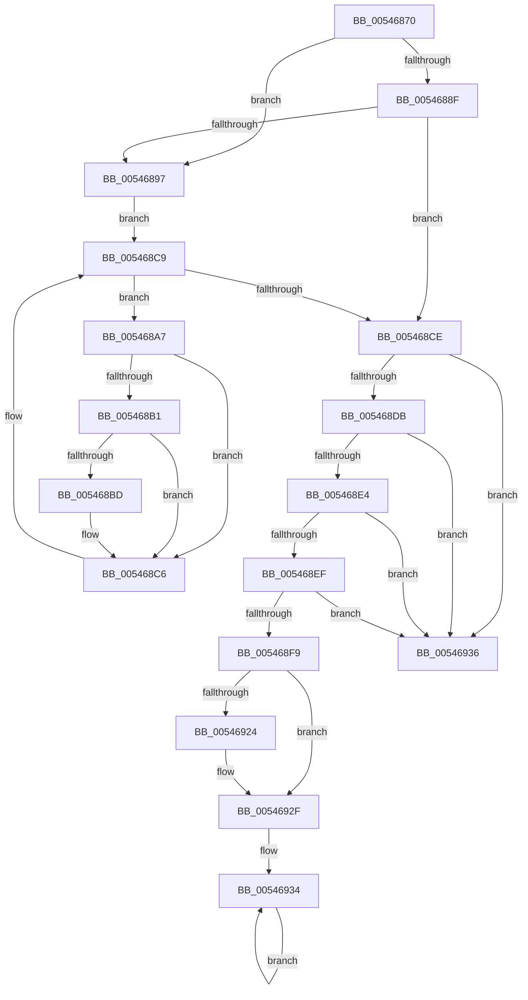

# HalpReboot

- RVA: `0x00546870`–`0x00546940` (길이 `208` bytes)
- VA: `0x0000000140546870`
- 실행 섹션: `.text`
- PDB 이름 있음: `예`; PDB Function 태그: `아니요`
- unwind 정보 RVA: `0x000BC874`
- 디코드: `54`개 명령, `208/208` bytes 표시
- 미해석 바이트: `0` (있으면 어셈블리에 `.byte`로 보존)

> 이 문서는 커널 이미지의 기계어와 PDB 기호를 분석해 생성했습니다. 4번과 5번은 함수 원형과 자료형을 바이너리 사용 방식에서 추정한 C 해석이며 원본 소스 복구 결과는 아닙니다.

## 1. Dependencies

- 직접 호출 지점: **7**; 고유 호출 대상: **7**
- 직접 호출자로 확인된 함수: **1**
- RIP 상대 이미지 참조: **10**

### Outgoing calls
- `0x0054687F` → [HalpDisableInterrupts](../25/HalpDisableInterrupts_function_002521A0.md) (function, `0x002521A0`)
- `0x005468C1` → [guard_dispatch_icall](../6B/guard_dispatch_icall_function_006BAAD0.md) (function, `0x006BAAD0`)
- `0x005468CE` → [HalpAcquireCmosSpinLock](../42/HalpAcquireCmosSpinLock_function_0042DEE8.md) (function, `0x0042DEE8`)
- `0x005468F9` → [HalpNmiReboot](../55/HalpNmiReboot_function_0055B2D4.md) (function, `0x0055B2D4`)
- `0x00546917` → [HalRequestIpiSpecifyVector](../43/HalRequestIpiSpecifyVector_function_0043E750.md) (function, `0x0043E750`)
- `0x0054692A` → [KiLowerIrqlProcessIrqlFlags](../4F/KiLowerIrqlProcessIrqlFlags_function_004F5698.md) (function, `0x004F5698`)
- `0x0054693A` → [HalpPowerWriteResetCommand](HalpPowerWriteResetCommand_function_00546744.md) (function, `0x00546744`)

### Direct callers
- [HalReturnToFirmware](HalReturnToFirmware_function_00546550.md) at `0x005465A9`

### Static image references
- `0x00546886` → RVA `0x00FC1ED0` (`.data`; read)
- `0x0054688F` → RVA `0x00FC1C60` (`.data`; read)
- `0x00546897` → RVA `0x00FC4120` (`.data`; read)
- `0x005468D3` → RVA `0x00E0A794` (`.data`; read)
- `0x005468DB` → RVA `0x00E101F0` (`.data`; read)
- `0x005468E4` → RVA `0x00E0A774` (`.data`; read)
- `0x005468EF` → RVA `0x00E10268` (`.data`; read)
- `0x00546900` → RVA `0x00543930` (`HalpInterruptResetThisProcessor`; read)
- `0x0054690D` → RVA `0x00FC2C58` (`.data`; write)
- `0x0054691C` → RVA `0x00FC6D20` (`ALMOSTRO`; read)

## 2. Other-region calls and transfers

- 다른 실행 섹션으로 향하는 call: **0**
- 별도 외부 분기/꼬리 이동을 확인하지 못했습니다.

## 3. Assembly (complete function range)

```asm
00546870  48 89 5C 24 08                  mov qword ptr [rsp + 8], rbx
00546875  48 89 74 24 10                  mov qword ptr [rsp + 0x10], rsi
0054687A  57                              push rdi
0054687B  48 83 EC 20                     sub rsp, 0x20
0054687F  E8 1C B9 D0 FF                  call 0x1402521a0
00546884  33 FF                           xor edi, edi
00546886  40 38 3D 43 B6 A7 00            cmp byte ptr [rip + 0xa7b643], dil
0054688D  74 08                           je 0x140546897
0054688F  39 3D CB B3 A7 00               cmp dword ptr [rip + 0xa7b3cb], edi
00546895  74 37                           je 0x1405468ce
00546897  48 8B 1D 82 D8 A7 00            mov rbx, qword ptr [rip + 0xa7d882]
0054689E  48 8D 35 7B D8 A7 00            lea rsi, [rip + 0xa7d87b]
005468A5  EB 22                           jmp 0x1405468c9
005468A7  8B 83 B8 00 00 00               mov eax, dword ptr [rbx + 0xb8]
005468AD  A8 02                           test al, 2
005468AF  74 15                           je 0x1405468c6
005468B1  48 8B 83 88 00 00 00            mov rax, qword ptr [rbx + 0x88]
005468B8  48 85 C0                        test rax, rax
005468BB  74 09                           je 0x1405468c6
005468BD  48 8B 4B 48                     mov rcx, qword ptr [rbx + 0x48]
005468C1  E8 0A 42 17 00                  call 0x1406baad0
005468C6  48 8B 1B                        mov rbx, qword ptr [rbx]
005468C9  48 3B DE                        cmp rbx, rsi
005468CC  75 D9                           jne 0x1405468a7
005468CE  E8 15 76 EE FF                  call 0x14042dee8
005468D3  39 3D BB 3E 8C 00               cmp dword ptr [rip + 0x8c3ebb], edi
005468D9  74 5B                           je 0x140546936
005468DB  48 39 3D 0E 99 8C 00            cmp qword ptr [rip + 0x8c990e], rdi
005468E2  74 52                           je 0x140546936
005468E4  8B 05 8A 3E 8C 00               mov eax, dword ptr [rip + 0x8c3e8a]
005468EA  83 F8 01                        cmp eax, 1
005468ED  74 47                           je 0x140546936
005468EF  8B 05 73 99 8C 00               mov eax, dword ptr [rip + 0x8c9973]
005468F5  85 C0                           test eax, eax
005468F7  75 3D                           jne 0x140546936
005468F9  E8 D6 49 01 00                  call 0x14055b2d4
005468FE  33 D2                           xor edx, edx
00546900  48 8D 05 29 D0 FF FF            lea rax, [rip - 0x2fd7]
00546907  41 B8 D7 00 00 00               mov r8d, 0xd7
0054690D  48 89 05 44 C3 A7 00            mov qword ptr [rip + 0xa7c344], rax
00546914  8D 4A 02                        lea ecx, [rdx + 2]
00546917  E8 34 7E EF FF                  call 0x14043e750
0054691C  39 3D FE 03 A8 00               cmp dword ptr [rip + 0xa803fe], edi
00546922  74 0B                           je 0x14054692f
00546924  44 0F 20 C1                     mov rcx, cr8
00546928  33 D2                           xor edx, edx
0054692A  E8 69 ED FA FF                  call 0x1404f5698
0054692F  44 0F 22 C7                     mov cr8, rdi
00546933  FB                              sti
00546934  EB FE                           jmp 0x140546934
00546936  33 D2                           xor edx, edx
00546938  33 C9                           xor ecx, ecx
0054693A  E8 05 FE FF FF                  call 0x140546744
0054693F  CC                              int3
```

## 4. C-style interpretation (structured pseudocode)

```c
__int64 __fastcall HalpReboot(__int64 a1, int a2)
{
    __int64 result;
    __int64 v_rdi;
    __int64 v_rsp;
    unsigned __int64 v_stack_p10;
    unsigned __int64 v_stack_p8;

    v_stack_p8 = v_rbx;
    v_stack_p10 = v_rsi;
    v_rsp = (v_rsp) - (32);
    result = HalpDisableInterrupts(a1, a2, a3, a4);
    v_rdi = 0;
    if ((*(unsigned __int8 *)(v_rip + 10991171)) == 0) goto loc_00546897;
    if ((*(unsigned int *)(v_rip + 10990539)) == 0) goto loc_005468CE;
loc_00546897:
    goto loc_005468C9;
loc_005468A7:
    if ((((unsigned __int8)((unsigned int)(*(unsigned int *)(*(unsigned __int64 *)(v_rip + 10999938) + 184)))) & (2)) == 0) goto loc_005468C6;
    result = *(unsigned __int64 *)(*(unsigned __int64 *)(v_rip + 10999938) + 136);
    if (*(unsigned __int64 *)(*(unsigned __int64 *)(v_rip + 10999938) + 136) != 0) {
        a1 = *(unsigned __int64 *)(*(unsigned __int64 *)(v_rip + 10999938) + 72);
        result = guard_dispatch_icall(a1, a2, a3, a4);
    }
loc_005468C9:
    if ((*(unsigned __int64 *)(*(unsigned __int64 *)(v_rip + 10999938))) != (v_rip + 10999931)) goto loc_005468A7;
loc_005468CE:
    result = HalpAcquireCmosSpinLock(a1, a2, a3, a4);
    if ((*(unsigned int *)(v_rip + 9191099)) == 0) goto loc_00546936;
    if ((*(unsigned __int64 *)(v_rip + 9214222)) == 0) goto loc_00546936;
    if (((unsigned int)((unsigned int)(*(unsigned int *)(v_rip + 9191050)))) == 1) goto loc_00546936;
    if ((unsigned int)((unsigned int)(*(unsigned int *)(v_rip + 9214323))) != 0) goto loc_00546936;
    result = HalpNmiReboot(a1, a2, a3, a4);
    a2 = 0;
    *(unsigned __int64 *)(v_rip + 10994500) = v_rip - 12247;
    result = HalRequestIpiSpecifyVector(a2 + 2, a2, 215, a4);
    if ((*(unsigned int *)(v_rip + 11011070)) != 0) {
        a1 = v_cr8;
        a2 = 0;
        result = KiLowerIrqlProcessIrqlFlags(a1, a2, 215, a4);
    }
loc_00546934:
    goto loc_00546934;
loc_00546936:
    a2 = 0;
    a1 = 0;
    result = HalpPowerWriteResetCommand(a1, a2, 215, a4);
    return result;
}
```

## 5. (Beta) C Style

```c
int64_t HalpReboot(int64_t Arg1, int32_t Arg2)
{
    int64_t result;
    int64_t local_rdi;
    int64_t local_rsp;
    uint64_t v_stack_p10;
    uint64_t v_stack_p8;

    v_stack_p8 = local_rbx;
    v_stack_p10 = local_rsi;
    local_rsp = (local_rsp) - (32);
    result = HalpDisableInterrupts(Arg1, Arg2, a3, a4);
    local_rdi = 0;
    if ((*(uint8_t *)(v_rip + 0xA7B643)) == 0) goto loc_00546897;
    if ((*(uint32_t *)(v_rip + 0xA7B3CB)) == 0) goto loc_005468CE;
loc_00546897:
    goto loc_005468C9;
loc_005468A7:
    if ((((uint8_t)((uint32_t)(*(uint32_t *)(*(uint64_t *)(v_rip + 0xA7D882) + 0xB8)))) & (2)) == 0) goto loc_005468C6;
    result = *(uint64_t *)(*(uint64_t *)(v_rip + 0xA7D882) + 0x88);
    if (*(uint64_t *)(*(uint64_t *)(v_rip + 0xA7D882) + 0x88) != 0) {
        Arg1 = *(uint64_t *)(*(uint64_t *)(v_rip + 0xA7D882) + 0x48);
        result = guard_dispatch_icall(Arg1, Arg2, a3, a4);
    }
loc_005468C9:
    if ((*(uint64_t *)(*(uint64_t *)(v_rip + 0xA7D882))) != (v_rip + 10999931)) goto loc_005468A7;
loc_005468CE:
    result = HalpAcquireCmosSpinLock(Arg1, Arg2, a3, a4);
    if ((*(uint32_t *)(v_rip + 0x8C3EBB)) == 0) goto loc_00546936;
    if ((*(uint64_t *)(v_rip + 0x8C990E)) == 0) goto loc_00546936;
    if (((uint32_t)((uint32_t)(*(uint32_t *)(v_rip + 0x8C3E8A)))) == 1) goto loc_00546936;
    if ((uint32_t)((uint32_t)(*(uint32_t *)(v_rip + 0x8C9973))) != 0) goto loc_00546936;
    result = HalpNmiReboot(Arg1, Arg2, a3, a4);
    Arg2 = 0;
    *(uint64_t *)(v_rip + 0xA7C344) = v_rip - 12247;
    result = HalRequestIpiSpecifyVector(Arg2 + 2, Arg2, 215, a4);
    if ((*(uint32_t *)(v_rip + 0xA803FE)) != 0) {
        Arg1 = v_cr8;
        Arg2 = 0;
        result = KiLowerIrqlProcessIrqlFlags(Arg1, Arg2, 215, a4);
    }
loc_00546934:
    goto loc_00546934;
loc_00546936:
    Arg2 = 0;
    Arg1 = 0;
    result = HalpPowerWriteResetCommand(Arg1, Arg2, 215, a4);
    return result;
}
```

## 6. Execution-region graph

[열기: 2D/3D 그래프와 함수 탐색 컨트롤 패널](../../../control-panel.html?section=text&rva=0x00546870&view=graph)

- 2D 그래프는 위에서 아래로 흐르고, 3D 그래프는 빈 공간을 드래그해 회전합니다. Shift+드래그는 이동, 휠은 확대·축소, 함수 노드 선택은 대상 보고서 이동입니다.

### Static fallback


