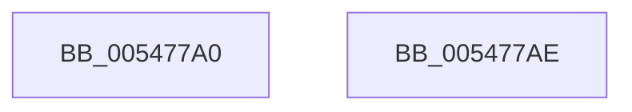

# HalpReleasePmuAccessRequest

- RVA: `0x005477A0`–`0x005477AF` (길이 `15` bytes)
- VA: `0x00000001405477A0`
- 실행 섹션: `.text`
- PDB 이름 있음: `예`; PDB Function 태그: `아니요`
- unwind 정보 RVA: `0x000DB714`
- 디코드: `5`개 명령, `15/15` bytes 표시
- 미해석 바이트: `0` (있으면 어셈블리에 `.byte`로 보존)

> 이 문서는 커널 이미지의 기계어와 PDB 기호를 분석해 생성했습니다. 4번과 5번은 함수 원형과 자료형을 바이너리 사용 방식에서 추정한 C 해석이며 원본 소스 복구 결과는 아닙니다.

## 1. Dependencies

- 직접 호출 지점: **0**; 고유 호출 대상: **0**
- 직접 호출자로 확인된 함수: **3**
- RIP 상대 이미지 참조: **1**

### Outgoing calls
- 직접 디코드된 call 명령이 없습니다.

### Direct callers
- [HalAllocateHardwareCounters](../../page/70/HalAllocateHardwareCounters_function_00707050.md) at `0x007071A8`
- [HalpNotifyActorIfPmuAvailable](../../page/70/HalpNotifyActorIfPmuAvailable_function_00707880.md) at `0x00707B2C`
- [HalpPmuArbiterPeriodicWorkItem](../../page/70/HalpPmuArbiterPeriodicWorkItem_function_00707B90.md) at `0x00707CA7`

### Static image references
- `0x005477A5` → RVA `0x00FC2B48` (`.data`; read)

## 2. Other-region calls and transfers

- 다른 실행 섹션으로 향하는 call: **0**
- 별도 외부 분기/꼬리 이동을 확인하지 못했습니다.

## 3. Assembly (complete function range)

```asm
005477A0  33 C9                           xor ecx, ecx
005477A2  8D 41 01                        lea eax, [rcx + 1]
005477A5  F0 0F B1 0D 9B B3 A7 00         lock cmpxchg dword ptr [rip + 0xa7b39b], ecx
005477AD  C3                              ret
005477AE  CC                              int3
```

## 4. C-style interpretation (structured pseudocode)

```c
__int64 __fastcall HalpReleasePmuAccessRequest(int a1)
{
    a1 = 0;
    return a1 + 1;
}
```

## 5. (Beta) C Style

```c
int64_t HalpReleasePmuAccessRequest(int32_t Arg1)
{
    Arg1 = 0;
    return Arg1 + 1;
}
```

## 6. Execution-region graph

[열기: 2D/3D 그래프와 함수 탐색 컨트롤 패널](../../../control-panel.html?section=text&rva=0x005477A0&view=graph)

- 2D 그래프는 위에서 아래로 흐르고, 3D 그래프는 빈 공간을 드래그해 회전합니다. Shift+드래그는 이동, 휠은 확대·축소, 함수 노드 선택은 대상 보고서 이동입니다.

### Static fallback


