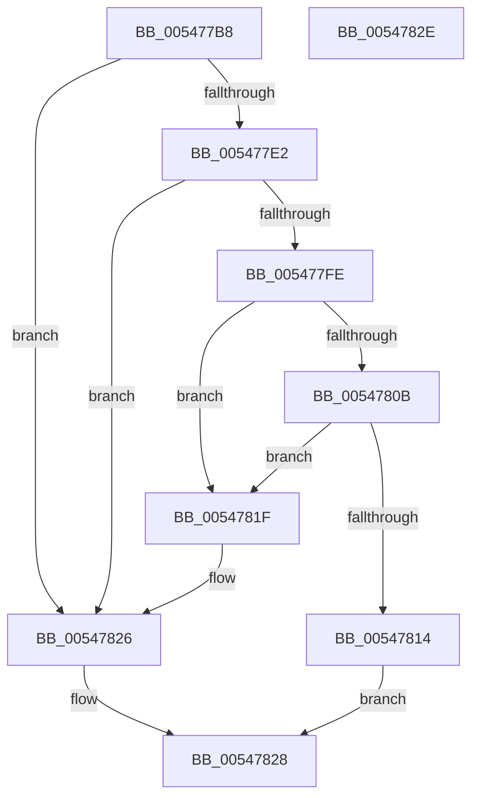

# HalpRemoveProfileSourceFromList

- RVA: `0x005477B8`–`0x0054782F` (길이 `119` bytes)
- VA: `0x00000001405477B8`
- 실행 섹션: `.text`
- PDB 이름 있음: `예`; PDB Function 태그: `아니요`
- unwind 정보 RVA: `0x000805BC`
- 디코드: `38`개 명령, `119/119` bytes 표시
- 미해석 바이트: `0` (있으면 어셈블리에 `.byte`로 보존)

> 이 문서는 커널 이미지의 기계어와 PDB 기호를 분석해 생성했습니다. 4번과 5번은 함수 원형과 자료형을 바이너리 사용 방식에서 추정한 C 해석이며 원본 소스 복구 결과는 아닙니다.

## 1. Dependencies

- 직접 호출 지점: **2**; 고유 호출 대상: **2**
- 직접 호출자로 확인된 함수: **3**
- RIP 상대 이미지 참조: **0**

### Outgoing calls
- `0x005477D9` → [HalpGetProfileDescriptor](../4B/HalpGetProfileDescriptor_function_004BB170.md) (function, `0x004BB170`)
- `0x005477F5` → [KeSubtractAffinityEx2](../2D/KeSubtractAffinityEx2_function_002D5BA0.md) (function, `0x002D5BA0`)

### Direct callers
- [EmonRemoveProfileSourceEnhanced](../55/EmonRemoveProfileSourceEnhanced_function_0055F1C0.md) at `0x0055F253`
- [EmonRemoveProfileSourceOriginal](../55/EmonRemoveProfileSourceOriginal_function_0055F2C0.md) at `0x0055F353`
- [Amd64RemoveProfileSource](../56/Amd64RemoveProfileSource_function_0056D900.md) at `0x0056D9A6`

### Static image references
- 디코드된 RIP-relative 메모리 참조가 없습니다.

## 2. Other-region calls and transfers

- 다른 실행 섹션으로 향하는 call: **0**
- 별도 외부 분기/꼬리 이동을 확인하지 못했습니다.

## 3. Assembly (complete function range)

```asm
005477B8  48 89 54 24 10                  mov qword ptr [rsp + 0x10], rdx
005477BD  53                              push rbx
005477BE  48 83 EC 20                     sub rsp, 0x20
005477C2  49 83 20 00                     and qword ptr [r8], 0
005477C6  4D 8B C8                        mov r9, r8
005477C9  48 83 64 24 38 00               and qword ptr [rsp + 0x38], 0
005477CF  4C 8D 44 24 38                  lea r8, [rsp + 0x38]
005477D4  4C 8B D1                        mov r10, rcx
005477D7  8B 09                           mov ecx, dword ptr [rcx]
005477D9  E8 92 39 F7 FF                  call 0x1404bb170
005477DE  85 C0                           test eax, eax
005477E0  78 44                           js 0x140547826
005477E2  48 8B 5C 24 38                  mov rbx, qword ptr [rsp + 0x38]
005477E7  49 8D 52 08                     lea rdx, [r10 + 8]
005477EB  49 89 19                        mov qword ptr [r9], rbx
005477EE  48 8D 4B 20                     lea rcx, [rbx + 0x20]
005477F2  4C 8B C1                        mov r8, rcx
005477F5  E8 A6 E3 D8 FF                  call 0x1402d5ba0
005477FA  85 C0                           test eax, eax
005477FC  75 28                           jne 0x140547826
005477FE  48 8D 43 08                     lea rax, [rbx + 8]
00547802  48 8B 10                        mov rdx, qword ptr [rax]
00547805  48 39 42 08                     cmp qword ptr [rdx + 8], rax
00547809  75 14                           jne 0x14054781f
0054780B  48 8B 48 08                     mov rcx, qword ptr [rax + 8]
0054780F  48 39 01                        cmp qword ptr [rcx], rax
00547812  75 0B                           jne 0x14054781f
00547814  48 89 11                        mov qword ptr [rcx], rdx
00547817  B0 01                           mov al, 1
00547819  48 89 4A 08                     mov qword ptr [rdx + 8], rcx
0054781D  EB 09                           jmp 0x140547828
0054781F  B9 03 00 00 00                  mov ecx, 3
00547824  CD 29                           int 0x29
00547826  32 C0                           xor al, al
00547828  48 83 C4 20                     add rsp, 0x20
0054782C  5B                              pop rbx
0054782D  C3                              ret
0054782E  CC                              int3
```

## 4. C-style interpretation (structured pseudocode)

```c
__int64 __fastcall HalpRemoveProfileSourceFromList(__int64 a1, __int64 a2, __int64 a3)
{
    __int64 result;
    __int64 v_rsp;
    unsigned __int64 v_stack_p10;

    v_stack_p10 = a2;
    v_rsp = (v_rsp) - (32);
    result = HalpGetProfileDescriptor((unsigned int)(*(unsigned int *)(a1)), a2, v_stack_p10, a3);
    if (sign_flag) goto loc_00547826;
    *(unsigned __int64 *)(a3) = v_stack_p10;
    result = KeSubtractAffinityEx2(v_stack_p10 + 32, a1 + 8, v_stack_p10 + 32, a3);
    if ((unsigned int)(result) != 0) goto loc_00547826;
    if ((*(unsigned __int64 *)(*(unsigned __int64 *)(v_stack_p10 + 8) + 8)) != (v_stack_p10 + 8)) goto loc_0054781F;
    if ((*(unsigned __int64 *)(*(unsigned __int64 *)(v_stack_p10 + 8 + 8))) != (v_stack_p10 + 8)) goto loc_0054781F;
    *(unsigned __int64 *)(*(unsigned __int64 *)(v_stack_p10 + 8 + 8)) = *(unsigned __int64 *)(v_stack_p10 + 8);
    *(unsigned __int64 *)(*(unsigned __int64 *)(v_stack_p10 + 8) + 8) = *(unsigned __int64 *)(v_stack_p10 + 8 + 8);
    goto loc_00547828;
loc_0054781F:
loc_00547826:
    result = 0;
loc_00547828:
    v_rsp = (v_rsp) + (32);
    return result;
}
```

## 5. (Beta) C Style

```c
int64_t HalpRemoveProfileSourceFromList(void *Arg1, int64_t Arg2, void *Arg3)
{
    uint8_t *arg1 = (uint8_t *)Arg1;
    uint8_t *arg3 = (uint8_t *)Arg3;

    int64_t result;
    int64_t local_rsp;
    uint64_t v_stack_p10;

    v_stack_p10 = Arg2;
    local_rsp = (local_rsp) - (32);
    result = HalpGetProfileDescriptor((uint32_t)(*(uint32_t *)(arg1)), Arg2, v_stack_p10, Arg3);
    if (sign_flag) goto loc_00547826;
    *(uint64_t *)(arg3) = v_stack_p10;
    result = KeSubtractAffinityEx2(v_stack_p10 + 32, Arg1 + 8, v_stack_p10 + 32, Arg3);
    if ((uint32_t)(result) != 0) goto loc_00547826;
    if ((*(uint64_t *)(*(uint64_t *)(v_stack_p10 + 0x8) + 0x8)) != (v_stack_p10 + 8)) goto loc_0054781F;
    if ((*(uint64_t *)(*(uint64_t *)(v_stack_p10 + 0x8 + 0x8))) != (v_stack_p10 + 8)) goto loc_0054781F;
    *(uint64_t *)(*(uint64_t *)(v_stack_p10 + 0x8 + 0x8)) = *(uint64_t *)(v_stack_p10 + 0x8);
    *(uint64_t *)(*(uint64_t *)(v_stack_p10 + 0x8) + 0x8) = *(uint64_t *)(v_stack_p10 + 0x8 + 0x8);
    goto loc_00547828;
loc_0054781F:
loc_00547826:
    result = 0;
loc_00547828:
    local_rsp = (local_rsp) + (32);
    return result;
}
```

### 관측된 메모리 오프셋

구조체 형식이 확인되지 않은 접근은 인자 기준의 오프셋으로만 기록했습니다.

| 기준 인자 | 오프셋 표현 | 폭 (bit) | 접근 |
|---|---:|---:|---|
| `Arg1` | `+ 0x0` | `32` | `R` |
| `Arg3` | `+ 0x0` | `64` | `R/W` |

## 6. Execution-region graph

[열기: 2D/3D 그래프와 함수 탐색 컨트롤 패널](../../../control-panel.html?section=text&rva=0x005477B8&view=graph)

- 2D 그래프는 위에서 아래로 흐르고, 3D 그래프는 빈 공간을 드래그해 회전합니다. Shift+드래그는 이동, 휠은 확대·축소, 함수 노드 선택은 대상 보고서 이동입니다.

### Static fallback


