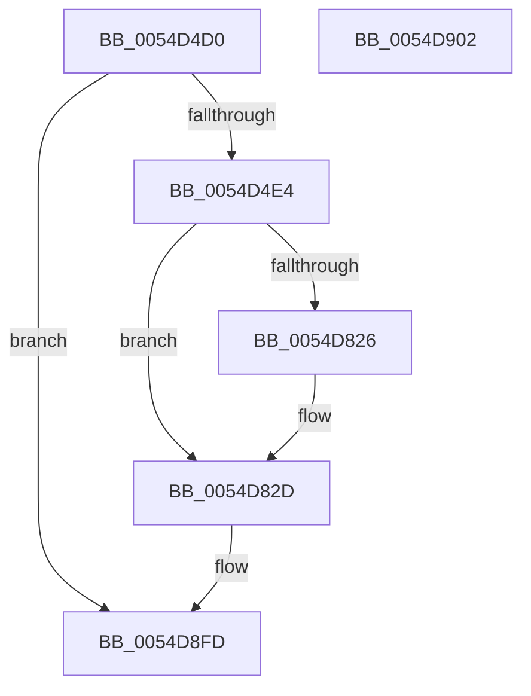

# HalpSaveAndDisableEnlightenment

- RVA: `0x0054D4D0`–`0x0054D903` (길이 `1,075` bytes)
- VA: `0x000000014054D4D0`
- 실행 섹션: `.text`
- PDB 이름 있음: `예`; PDB Function 태그: `아니요`
- unwind 정보 RVA: `0x0005C788`
- 디코드: `161`개 명령, `1,075/1,075` bytes 표시
- 미해석 바이트: `0` (있으면 어셈블리에 `.byte`로 보존)

> 이 문서는 커널 이미지의 기계어와 PDB 기호를 분석해 생성했습니다. 4번과 5번은 함수 원형과 자료형을 바이너리 사용 방식에서 추정한 C 해석이며 원본 소스 복구 결과는 아닙니다.

## 1. Dependencies

- 직접 호출 지점: **2**; 고유 호출 대상: **2**
- 직접 호출자로 확인된 함수: **0**
- RIP 상대 이미지 참조: **149**

### Outgoing calls
- `0x0054D4D6` → [HalpInterruptModel](../4A/HalpInterruptModel_function_004ACA38.md) (function, `0x004ACA38`)
- `0x0054D8F8` → [HalpTimerUpdateApiConsumers](../56/HalpTimerUpdateApiConsumers_function_00562D28.md) (function, `0x00562D28`)

### Direct callers
- 이 함수 시작 RVA로 연결되는 직접 call은 확인되지 않았습니다. 간접 호출은 완전히 역산할 수 없습니다.

### Static image references
- `0x0054D4E4` → RVA `0x00FC1C7C` (`.data`; read)
- `0x0054D4EA` → RVA `0x00FC1EFC` (`.data`; write)
- `0x0054D4F0` → RVA `0x00FC1C80` (`.data`; read)
- `0x0054D4F7` → RVA `0x00FC1F00` (`.data`; write)
- `0x0054D4FE` → RVA `0x00FC1C64` (`.data`; read)
- `0x0054D504` → RVA `0x00FC1EE4` (`.data`; write)
- `0x0054D50A` → RVA `0x00FC1C90` (`.data`; read)
- `0x0054D511` → RVA `0x00FC1F10` (`.data`; write)
- `0x0054D518` → RVA `0x00FC1C98` (`.data`; read)
- `0x0054D51F` → RVA `0x00FC1F18` (`.data`; write)
- `0x0054D526` → RVA `0x00FC1CA0` (`.data`; read)
- `0x0054D52D` → RVA `0x00FC1F20` (`.data`; write)
- `0x0054D534` → RVA `0x00FC1CA8` (`.data`; read)
- `0x0054D53B` → RVA `0x00FC1F28` (`.data`; write)
- `0x0054D542` → RVA `0x00FC1CB0` (`.data`; read)
- `0x0054D549` → RVA `0x00FC1F30` (`.data`; write)
- `0x0054D550` → RVA `0x00FC1CB8` (`.data`; read)
- `0x0054D557` → RVA `0x00FC1F38` (`.data`; write)
- `0x0054D55E` → RVA `0x00FC1CD0` (`.data`; read)
- `0x0054D565` → RVA `0x00FC1F50` (`.data`; write)
- `0x0054D56C` → RVA `0x00FC1CF8` (`.data`; read)
- `0x0054D573` → RVA `0x00FC1F78` (`.data`; write)
- `0x0054D57A` → RVA `0x00FC1D00` (`.data`; read)
- `0x0054D581` → RVA `0x00FC1F80` (`.data`; write)
- `0x0054D588` → RVA `0x00FC1D08` (`.data`; read)
- `0x0054D58F` → RVA `0x00FC1F88` (`.data`; write)
- `0x0054D596` → RVA `0x00FC1D10` (`.data`; read)
- `0x0054D59D` → RVA `0x00FC1F90` (`.data`; write)
- `0x0054D5A4` → RVA `0x00FC1D18` (`.data`; read)
- `0x0054D5AB` → RVA `0x00FC1F98` (`.data`; write)
- `0x0054D5B2` → RVA `0x00FC1D20` (`.data`; read)
- `0x0054D5B9` → RVA `0x00FC1FA0` (`.data`; write)
- `0x0054D5C0` → RVA `0x00FC1C60` (`.data`; read)
- `0x0054D5C6` → RVA `0x00FC1EE0` (`.data`; write)
- `0x0054D5CC` → RVA `0x00FC1DE8` (`.data`; read)
- `0x0054D5D3` → RVA `0x00FC2068` (`.data`; write)
- `0x0054D5DA` → RVA `0x00FC1DF0` (`.data`; read)
- `0x0054D5E1` → RVA `0x00FC2070` (`.data`; write)
- `0x0054D5E8` → RVA `0x00FC1D60` (`.data`; read)
- `0x0054D5EF` → RVA `0x00FC1FE0` (`.data`; write)
- `0x0054D5F6` → RVA `0x00FC1D48` (`.data`; read)
- `0x0054D5FD` → RVA `0x00FC1FC8` (`.data`; write)
- `0x0054D604` → RVA `0x00FC1D50` (`.data`; read)
- `0x0054D60B` → RVA `0x00FC1FD0` (`.data`; write)
- `0x0054D612` → RVA `0x00FC1C68` (`.data`; read)
- `0x0054D619` → RVA `0x00FC1EE8` (`.data`; write)
- `0x0054D620` → RVA `0x00FC1C70` (`.data`; read)
- `0x0054D627` → RVA `0x00FC1EF0` (`.data`; write)
- `0x0054D62E` → RVA `0x00FC1CC0` (`.data`; read)
- `0x0054D635` → RVA `0x00FC1F40` (`.data`; write)
- `0x0054D63C` → RVA `0x00FC1CC8` (`.data`; read)
- `0x0054D643` → RVA `0x00FC1F48` (`.data`; write)
- `0x0054D64A` → RVA `0x00FC1CD8` (`.data`; read)
- `0x0054D651` → RVA `0x00FC1F58` (`.data`; write)
- `0x0054D658` → RVA `0x00FC1CE0` (`.data`; read)
- `0x0054D65F` → RVA `0x00FC1F60` (`.data`; write)
- `0x0054D666` → RVA `0x00FC1CE8` (`.data`; read)
- `0x0054D66D` → RVA `0x00FC1F68` (`.data`; write)
- `0x0054D674` → RVA `0x00FC1CF0` (`.data`; read)
- `0x0054D67B` → RVA `0x00FC1F70` (`.data`; write)
- `0x0054D682` → RVA `0x00FC1D30` (`.data`; read)
- `0x0054D689` → RVA `0x00FC1FB0` (`.data`; write)
- `0x0054D690` → RVA `0x00FC1D38` (`.data`; read)
- `0x0054D697` → RVA `0x00FC1FB8` (`.data`; write)
- `0x0054D69E` → RVA `0x00FC1D40` (`.data`; read)
- `0x0054D6A5` → RVA `0x00FC1FC0` (`.data`; write)
- `0x0054D6AC` → RVA `0x00FC1D58` (`.data`; read)
- `0x0054D6B3` → RVA `0x00FC1FD8` (`.data`; write)
- `0x0054D6BA` → RVA `0x00FC1D68` (`.data`; read)
- `0x0054D6C1` → RVA `0x00FC1FE8` (`.data`; write)
- `0x0054D6C8` → RVA `0x00FC1D70` (`.data`; read)
- `0x0054D6CF` → RVA `0x00FC1FF0` (`.data`; write)
- `0x0054D6D6` → RVA `0x00FC1D78` (`.data`; read)
- `0x0054D6DD` → RVA `0x00FC1FF8` (`.data`; write)
- `0x0054D6E4` → RVA `0x00FC1D80` (`.data`; read)
- `0x0054D6EB` → RVA `0x00FC2000` (`.data`; write)
- `0x0054D6F2` → RVA `0x00FC1D88` (`.data`; read)
- `0x0054D6F9` → RVA `0x00FC2008` (`.data`; write)
- `0x0054D700` → RVA `0x00FC1D90` (`.data`; read)
- `0x0054D707` → RVA `0x00FC2010` (`.data`; write)
- `0x0054D70E` → RVA `0x00FC1D98` (`.data`; read)
- `0x0054D715` → RVA `0x00FC2018` (`.data`; write)
- `0x0054D71C` → RVA `0x00FC1DA0` (`.data`; read)
- `0x0054D723` → RVA `0x00FC2020` (`.data`; write)
- `0x0054D72A` → RVA `0x00FC1DA8` (`.data`; read)
- `0x0054D731` → RVA `0x00FC2028` (`.data`; write)
- `0x0054D738` → RVA `0x00FC1DB0` (`.data`; read)
- `0x0054D73F` → RVA `0x00FC2030` (`.data`; write)
- `0x0054D746` → RVA `0x00FC1DB8` (`.data`; read)
- `0x0054D74D` → RVA `0x00FC2038` (`.data`; write)
- `0x0054D754` → RVA `0x00FC1DC0` (`.data`; read)
- `0x0054D75B` → RVA `0x00FC2040` (`.data`; write)
- `0x0054D762` → RVA `0x00FC1DC8` (`.data`; read)
- `0x0054D769` → RVA `0x00FC2048` (`.data`; write)
- `0x0054D770` → RVA `0x00FC1DD0` (`.data`; read)
- `0x0054D777` → RVA `0x00FC2050` (`.data`; write)
- `0x0054D77E` → RVA `0x00FC1DD8` (`.data`; read)
- `0x0054D785` → RVA `0x00FC2058` (`.data`; write)
- `0x0054D78C` → RVA `0x00FC1DE0` (`.data`; read)
- `0x0054D793` → RVA `0x00FC2060` (`.data`; write)
- `0x0054D79C` → RVA `0x00FC1C60` (`.data`; write)
- `0x0054D7A2` → RVA `0x00FC1C7C` (`.data`; write)
- `0x0054D7AC` → RVA `0x00FC1C80` (`.data`; write)
- `0x0054D7B3` → RVA `0x00FC1C64` (`.data`; write)
- `0x0054D7B9` → RVA `0x00FC1C90` (`.data`; write)
- `0x0054D7C0` → RVA `0x00FC1C98` (`.data`; write)
- `0x0054D7C7` → RVA `0x00FC1CA0` (`.data`; write)
- `0x0054D7CE` → RVA `0x00FC1CA8` (`.data`; write)
- `0x0054D7D5` → RVA `0x00FC1CB0` (`.data`; write)
- `0x0054D7DC` → RVA `0x00FC1CB8` (`.data`; write)
- `0x0054D7E3` → RVA `0x00FC1CD0` (`.data`; write)
- `0x0054D7EA` → RVA `0x00FC1CF8` (`.data`; write)
- `0x0054D7F1` → RVA `0x00FC1D00` (`.data`; write)
- `0x0054D7F8` → RVA `0x00FC1D08` (`.data`; write)
- `0x0054D7FF` → RVA `0x00FC1D10` (`.data`; write)
- `0x0054D806` → RVA `0x00FC1D18` (`.data`; write)
- `0x0054D80D` → RVA `0x00FC1D20` (`.data`; write)
- `0x0054D814` → RVA `0x00FC1DE8` (`.data`; write)
- `0x0054D81B` → RVA `0x00FC1D60` (`.data`; write)
- `0x0054D826` → RVA `0x00FC1D48` (`.data`; write)
- `0x0054D82D` → RVA `0x00FC1D50` (`.data`; write)
- `0x0054D834` → RVA `0x00FC1C68` (`.data`; write)
- `0x0054D83B` → RVA `0x00FC1C70` (`.data`; write)
- `0x0054D842` → RVA `0x00FC1CC0` (`.data`; write)
- `0x0054D849` → RVA `0x00FC1CC8` (`.data`; write)
- `0x0054D850` → RVA `0x00FC1CD8` (`.data`; write)
- `0x0054D857` → RVA `0x00FC1CE0` (`.data`; write)
- `0x0054D85E` → RVA `0x00FC1CE8` (`.data`; write)
- `0x0054D865` → RVA `0x00FC1CF0` (`.data`; write)
- `0x0054D86C` → RVA `0x00FC1D30` (`.data`; write)
- `0x0054D873` → RVA `0x00FC1D38` (`.data`; write)
- `0x0054D87A` → RVA `0x00FC1D40` (`.data`; write)
- `0x0054D881` → RVA `0x00FC1D58` (`.data`; write)
- `0x0054D888` → RVA `0x00FC1D68` (`.data`; write)
- `0x0054D88F` → RVA `0x00FC1D70` (`.data`; write)
- `0x0054D896` → RVA `0x00FC1D78` (`.data`; write)
- `0x0054D89D` → RVA `0x00FC1D80` (`.data`; write)
- `0x0054D8A4` → RVA `0x00FC1D88` (`.data`; write)
- `0x0054D8AB` → RVA `0x00FC1D90` (`.data`; write)
- `0x0054D8B2` → RVA `0x00FC1D98` (`.data`; write)
- `0x0054D8B9` → RVA `0x00FC1DA0` (`.data`; write)
- `0x0054D8C0` → RVA `0x00FC1DA8` (`.data`; write)
- `0x0054D8C7` → RVA `0x00FC1DB0` (`.data`; write)
- `0x0054D8CE` → RVA `0x00FC1DB8` (`.data`; write)
- `0x0054D8D5` → RVA `0x00FC1DC0` (`.data`; write)
- `0x0054D8DC` → RVA `0x00FC1DC8` (`.data`; write)
- `0x0054D8E3` → RVA `0x00FC1DD0` (`.data`; write)
- `0x0054D8EA` → RVA `0x00FC1DD8` (`.data`; write)
- `0x0054D8F1` → RVA `0x00FC1DE0` (`.data`; write)

## 2. Other-region calls and transfers

- 다른 실행 섹션으로 향하는 call: **0**
- 별도 외부 분기/꼬리 이동을 확인하지 못했습니다.

## 3. Assembly (complete function range)

```asm
0054D4D0  48 83 EC 28                     sub rsp, 0x28
0054D4D4  8A D1                           mov dl, cl
0054D4D6  E8 5D F5 F5 FF                  call 0x1404aca38
0054D4DB  83 F8 01                        cmp eax, 1
0054D4DE  0F 85 19 04 00 00               jne 0x14054d8fd
0054D4E4  8B 05 92 47 A7 00               mov eax, dword ptr [rip + 0xa74792]
0054D4EA  89 05 0C 4A A7 00               mov dword ptr [rip + 0xa74a0c], eax
0054D4F0  48 8B 05 89 47 A7 00            mov rax, qword ptr [rip + 0xa74789]
0054D4F7  48 89 05 02 4A A7 00            mov qword ptr [rip + 0xa74a02], rax
0054D4FE  8B 05 60 47 A7 00               mov eax, dword ptr [rip + 0xa74760]
0054D504  89 05 DA 49 A7 00               mov dword ptr [rip + 0xa749da], eax
0054D50A  48 8B 05 7F 47 A7 00            mov rax, qword ptr [rip + 0xa7477f]
0054D511  48 89 05 F8 49 A7 00            mov qword ptr [rip + 0xa749f8], rax
0054D518  48 8B 05 79 47 A7 00            mov rax, qword ptr [rip + 0xa74779]
0054D51F  48 89 05 F2 49 A7 00            mov qword ptr [rip + 0xa749f2], rax
0054D526  48 8B 05 73 47 A7 00            mov rax, qword ptr [rip + 0xa74773]
0054D52D  48 89 05 EC 49 A7 00            mov qword ptr [rip + 0xa749ec], rax
0054D534  48 8B 05 6D 47 A7 00            mov rax, qword ptr [rip + 0xa7476d]
0054D53B  48 89 05 E6 49 A7 00            mov qword ptr [rip + 0xa749e6], rax
0054D542  48 8B 05 67 47 A7 00            mov rax, qword ptr [rip + 0xa74767]
0054D549  48 89 05 E0 49 A7 00            mov qword ptr [rip + 0xa749e0], rax
0054D550  48 8B 05 61 47 A7 00            mov rax, qword ptr [rip + 0xa74761]
0054D557  48 89 05 DA 49 A7 00            mov qword ptr [rip + 0xa749da], rax
0054D55E  48 8B 05 6B 47 A7 00            mov rax, qword ptr [rip + 0xa7476b]
0054D565  48 89 05 E4 49 A7 00            mov qword ptr [rip + 0xa749e4], rax
0054D56C  48 8B 05 85 47 A7 00            mov rax, qword ptr [rip + 0xa74785]
0054D573  48 89 05 FE 49 A7 00            mov qword ptr [rip + 0xa749fe], rax
0054D57A  48 8B 05 7F 47 A7 00            mov rax, qword ptr [rip + 0xa7477f]
0054D581  48 89 05 F8 49 A7 00            mov qword ptr [rip + 0xa749f8], rax
0054D588  48 8B 05 79 47 A7 00            mov rax, qword ptr [rip + 0xa74779]
0054D58F  48 89 05 F2 49 A7 00            mov qword ptr [rip + 0xa749f2], rax
0054D596  48 8B 05 73 47 A7 00            mov rax, qword ptr [rip + 0xa74773]
0054D59D  48 89 05 EC 49 A7 00            mov qword ptr [rip + 0xa749ec], rax
0054D5A4  48 8B 05 6D 47 A7 00            mov rax, qword ptr [rip + 0xa7476d]
0054D5AB  48 89 05 E6 49 A7 00            mov qword ptr [rip + 0xa749e6], rax
0054D5B2  48 8B 05 67 47 A7 00            mov rax, qword ptr [rip + 0xa74767]
0054D5B9  48 89 05 E0 49 A7 00            mov qword ptr [rip + 0xa749e0], rax
0054D5C0  8B 05 9A 46 A7 00               mov eax, dword ptr [rip + 0xa7469a]
0054D5C6  89 05 14 49 A7 00               mov dword ptr [rip + 0xa74914], eax
0054D5CC  48 8B 05 15 48 A7 00            mov rax, qword ptr [rip + 0xa74815]
0054D5D3  48 89 05 8E 4A A7 00            mov qword ptr [rip + 0xa74a8e], rax
0054D5DA  48 8B 05 0F 48 A7 00            mov rax, qword ptr [rip + 0xa7480f]
0054D5E1  48 89 05 88 4A A7 00            mov qword ptr [rip + 0xa74a88], rax
0054D5E8  48 8B 05 71 47 A7 00            mov rax, qword ptr [rip + 0xa74771]
0054D5EF  48 89 05 EA 49 A7 00            mov qword ptr [rip + 0xa749ea], rax
0054D5F6  48 8B 05 4B 47 A7 00            mov rax, qword ptr [rip + 0xa7474b]
0054D5FD  48 89 05 C4 49 A7 00            mov qword ptr [rip + 0xa749c4], rax
0054D604  48 8B 05 45 47 A7 00            mov rax, qword ptr [rip + 0xa74745]
0054D60B  48 89 05 BE 49 A7 00            mov qword ptr [rip + 0xa749be], rax
0054D612  48 8B 05 4F 46 A7 00            mov rax, qword ptr [rip + 0xa7464f]
0054D619  48 89 05 C8 48 A7 00            mov qword ptr [rip + 0xa748c8], rax
0054D620  48 8B 05 49 46 A7 00            mov rax, qword ptr [rip + 0xa74649]
0054D627  48 89 05 C2 48 A7 00            mov qword ptr [rip + 0xa748c2], rax
0054D62E  48 8B 05 8B 46 A7 00            mov rax, qword ptr [rip + 0xa7468b]
0054D635  48 89 05 04 49 A7 00            mov qword ptr [rip + 0xa74904], rax
0054D63C  48 8B 05 85 46 A7 00            mov rax, qword ptr [rip + 0xa74685]
0054D643  48 89 05 FE 48 A7 00            mov qword ptr [rip + 0xa748fe], rax
0054D64A  48 8B 05 87 46 A7 00            mov rax, qword ptr [rip + 0xa74687]
0054D651  48 89 05 00 49 A7 00            mov qword ptr [rip + 0xa74900], rax
0054D658  48 8B 05 81 46 A7 00            mov rax, qword ptr [rip + 0xa74681]
0054D65F  48 89 05 FA 48 A7 00            mov qword ptr [rip + 0xa748fa], rax
0054D666  48 8B 05 7B 46 A7 00            mov rax, qword ptr [rip + 0xa7467b]
0054D66D  48 89 05 F4 48 A7 00            mov qword ptr [rip + 0xa748f4], rax
0054D674  48 8B 05 75 46 A7 00            mov rax, qword ptr [rip + 0xa74675]
0054D67B  48 89 05 EE 48 A7 00            mov qword ptr [rip + 0xa748ee], rax
0054D682  48 8B 05 A7 46 A7 00            mov rax, qword ptr [rip + 0xa746a7]
0054D689  48 89 05 20 49 A7 00            mov qword ptr [rip + 0xa74920], rax
0054D690  48 8B 05 A1 46 A7 00            mov rax, qword ptr [rip + 0xa746a1]
0054D697  48 89 05 1A 49 A7 00            mov qword ptr [rip + 0xa7491a], rax
0054D69E  48 8B 05 9B 46 A7 00            mov rax, qword ptr [rip + 0xa7469b]
0054D6A5  48 89 05 14 49 A7 00            mov qword ptr [rip + 0xa74914], rax
0054D6AC  48 8B 05 A5 46 A7 00            mov rax, qword ptr [rip + 0xa746a5]
0054D6B3  48 89 05 1E 49 A7 00            mov qword ptr [rip + 0xa7491e], rax
0054D6BA  48 8B 05 A7 46 A7 00            mov rax, qword ptr [rip + 0xa746a7]
0054D6C1  48 89 05 20 49 A7 00            mov qword ptr [rip + 0xa74920], rax
0054D6C8  48 8B 05 A1 46 A7 00            mov rax, qword ptr [rip + 0xa746a1]
0054D6CF  48 89 05 1A 49 A7 00            mov qword ptr [rip + 0xa7491a], rax
0054D6D6  48 8B 05 9B 46 A7 00            mov rax, qword ptr [rip + 0xa7469b]
0054D6DD  48 89 05 14 49 A7 00            mov qword ptr [rip + 0xa74914], rax
0054D6E4  48 8B 05 95 46 A7 00            mov rax, qword ptr [rip + 0xa74695]
0054D6EB  48 89 05 0E 49 A7 00            mov qword ptr [rip + 0xa7490e], rax
0054D6F2  48 8B 05 8F 46 A7 00            mov rax, qword ptr [rip + 0xa7468f]
0054D6F9  48 89 05 08 49 A7 00            mov qword ptr [rip + 0xa74908], rax
0054D700  48 8B 05 89 46 A7 00            mov rax, qword ptr [rip + 0xa74689]
0054D707  48 89 05 02 49 A7 00            mov qword ptr [rip + 0xa74902], rax
0054D70E  48 8B 05 83 46 A7 00            mov rax, qword ptr [rip + 0xa74683]
0054D715  48 89 05 FC 48 A7 00            mov qword ptr [rip + 0xa748fc], rax
0054D71C  48 8B 05 7D 46 A7 00            mov rax, qword ptr [rip + 0xa7467d]
0054D723  48 89 05 F6 48 A7 00            mov qword ptr [rip + 0xa748f6], rax
0054D72A  48 8B 05 77 46 A7 00            mov rax, qword ptr [rip + 0xa74677]
0054D731  48 89 05 F0 48 A7 00            mov qword ptr [rip + 0xa748f0], rax
0054D738  48 8B 05 71 46 A7 00            mov rax, qword ptr [rip + 0xa74671]
0054D73F  48 89 05 EA 48 A7 00            mov qword ptr [rip + 0xa748ea], rax
0054D746  48 8B 05 6B 46 A7 00            mov rax, qword ptr [rip + 0xa7466b]
0054D74D  48 89 05 E4 48 A7 00            mov qword ptr [rip + 0xa748e4], rax
0054D754  48 8B 05 65 46 A7 00            mov rax, qword ptr [rip + 0xa74665]
0054D75B  48 89 05 DE 48 A7 00            mov qword ptr [rip + 0xa748de], rax
0054D762  48 8B 05 5F 46 A7 00            mov rax, qword ptr [rip + 0xa7465f]
0054D769  48 89 05 D8 48 A7 00            mov qword ptr [rip + 0xa748d8], rax
0054D770  48 8B 05 59 46 A7 00            mov rax, qword ptr [rip + 0xa74659]
0054D777  48 89 05 D2 48 A7 00            mov qword ptr [rip + 0xa748d2], rax
0054D77E  48 8B 05 53 46 A7 00            mov rax, qword ptr [rip + 0xa74653]
0054D785  48 89 05 CC 48 A7 00            mov qword ptr [rip + 0xa748cc], rax
0054D78C  48 8B 05 4D 46 A7 00            mov rax, qword ptr [rip + 0xa7464d]
0054D793  48 89 05 C6 48 A7 00            mov qword ptr [rip + 0xa748c6], rax
0054D79A  33 C0                           xor eax, eax
0054D79C  89 05 BE 44 A7 00               mov dword ptr [rip + 0xa744be], eax
0054D7A2  C7 05 D0 44 A7 00 FF FF FF FF   mov dword ptr [rip + 0xa744d0], 0xffffffff
0054D7AC  48 89 05 CD 44 A7 00            mov qword ptr [rip + 0xa744cd], rax
0054D7B3  89 05 AB 44 A7 00               mov dword ptr [rip + 0xa744ab], eax
0054D7B9  48 89 05 D0 44 A7 00            mov qword ptr [rip + 0xa744d0], rax
0054D7C0  48 89 05 D1 44 A7 00            mov qword ptr [rip + 0xa744d1], rax
0054D7C7  48 89 05 D2 44 A7 00            mov qword ptr [rip + 0xa744d2], rax
0054D7CE  48 89 05 D3 44 A7 00            mov qword ptr [rip + 0xa744d3], rax
0054D7D5  48 89 05 D4 44 A7 00            mov qword ptr [rip + 0xa744d4], rax
0054D7DC  48 89 05 D5 44 A7 00            mov qword ptr [rip + 0xa744d5], rax
0054D7E3  48 89 05 E6 44 A7 00            mov qword ptr [rip + 0xa744e6], rax
0054D7EA  48 89 05 07 45 A7 00            mov qword ptr [rip + 0xa74507], rax
0054D7F1  48 89 05 08 45 A7 00            mov qword ptr [rip + 0xa74508], rax
0054D7F8  48 89 05 09 45 A7 00            mov qword ptr [rip + 0xa74509], rax
0054D7FF  48 89 05 0A 45 A7 00            mov qword ptr [rip + 0xa7450a], rax
0054D806  48 89 05 0B 45 A7 00            mov qword ptr [rip + 0xa7450b], rax
0054D80D  48 89 05 0C 45 A7 00            mov qword ptr [rip + 0xa7450c], rax
0054D814  48 89 05 CD 45 A7 00            mov qword ptr [rip + 0xa745cd], rax
0054D81B  48 89 05 3E 45 A7 00            mov qword ptr [rip + 0xa7453e], rax
0054D822  84 D2                           test dl, dl
0054D824  75 07                           jne 0x14054d82d
0054D826  48 89 05 1B 45 A7 00            mov qword ptr [rip + 0xa7451b], rax
0054D82D  48 89 05 1C 45 A7 00            mov qword ptr [rip + 0xa7451c], rax
0054D834  48 89 05 2D 44 A7 00            mov qword ptr [rip + 0xa7442d], rax
0054D83B  48 89 05 2E 44 A7 00            mov qword ptr [rip + 0xa7442e], rax
0054D842  48 89 05 77 44 A7 00            mov qword ptr [rip + 0xa74477], rax
0054D849  48 89 05 78 44 A7 00            mov qword ptr [rip + 0xa74478], rax
0054D850  48 89 05 81 44 A7 00            mov qword ptr [rip + 0xa74481], rax
0054D857  48 89 05 82 44 A7 00            mov qword ptr [rip + 0xa74482], rax
0054D85E  48 89 05 83 44 A7 00            mov qword ptr [rip + 0xa74483], rax
0054D865  48 89 05 84 44 A7 00            mov qword ptr [rip + 0xa74484], rax
0054D86C  48 89 05 BD 44 A7 00            mov qword ptr [rip + 0xa744bd], rax
0054D873  48 89 05 BE 44 A7 00            mov qword ptr [rip + 0xa744be], rax
0054D87A  48 89 05 BF 44 A7 00            mov qword ptr [rip + 0xa744bf], rax
0054D881  48 89 05 D0 44 A7 00            mov qword ptr [rip + 0xa744d0], rax
0054D888  48 89 05 D9 44 A7 00            mov qword ptr [rip + 0xa744d9], rax
0054D88F  48 89 05 DA 44 A7 00            mov qword ptr [rip + 0xa744da], rax
0054D896  48 89 05 DB 44 A7 00            mov qword ptr [rip + 0xa744db], rax
0054D89D  48 89 05 DC 44 A7 00            mov qword ptr [rip + 0xa744dc], rax
0054D8A4  48 89 05 DD 44 A7 00            mov qword ptr [rip + 0xa744dd], rax
0054D8AB  48 89 05 DE 44 A7 00            mov qword ptr [rip + 0xa744de], rax
0054D8B2  48 89 05 DF 44 A7 00            mov qword ptr [rip + 0xa744df], rax
0054D8B9  48 89 05 E0 44 A7 00            mov qword ptr [rip + 0xa744e0], rax
0054D8C0  48 89 05 E1 44 A7 00            mov qword ptr [rip + 0xa744e1], rax
0054D8C7  48 89 05 E2 44 A7 00            mov qword ptr [rip + 0xa744e2], rax
0054D8CE  48 89 05 E3 44 A7 00            mov qword ptr [rip + 0xa744e3], rax
0054D8D5  48 89 05 E4 44 A7 00            mov qword ptr [rip + 0xa744e4], rax
0054D8DC  48 89 05 E5 44 A7 00            mov qword ptr [rip + 0xa744e5], rax
0054D8E3  48 89 05 E6 44 A7 00            mov qword ptr [rip + 0xa744e6], rax
0054D8EA  48 89 05 E7 44 A7 00            mov qword ptr [rip + 0xa744e7], rax
0054D8F1  48 89 05 E8 44 A7 00            mov qword ptr [rip + 0xa744e8], rax
0054D8F8  E8 2B 54 01 00                  call 0x140562d28
0054D8FD  48 83 C4 28                     add rsp, 0x28
0054D901  C3                              ret
0054D902  CC                              int3
```

## 4. C-style interpretation (structured pseudocode)

```c
__int64 __fastcall HalpSaveAndDisableEnlightenment(unsigned __int8 a1)
{
    __int64 result;
    __int64 v_rsp;

    v_rsp = (v_rsp) - (40);
    result = HalpInterruptModel(a1, a1, a3, a4);
    if (((unsigned int)(result)) != 1) goto loc_0054D8FD;
    *(unsigned int *)(v_rip + 10963468) = (unsigned int)((unsigned int)(*(unsigned int *)(v_rip + 10962834)));
    *(unsigned __int64 *)(v_rip + 10963458) = *(unsigned __int64 *)(v_rip + 10962825);
    *(unsigned int *)(v_rip + 10963418) = (unsigned int)((unsigned int)(*(unsigned int *)(v_rip + 10962784)));
    *(unsigned __int64 *)(v_rip + 10963448) = *(unsigned __int64 *)(v_rip + 10962815);
    *(unsigned __int64 *)(v_rip + 10963442) = *(unsigned __int64 *)(v_rip + 10962809);
    *(unsigned __int64 *)(v_rip + 10963436) = *(unsigned __int64 *)(v_rip + 10962803);
    *(unsigned __int64 *)(v_rip + 10963430) = *(unsigned __int64 *)(v_rip + 10962797);
    *(unsigned __int64 *)(v_rip + 10963424) = *(unsigned __int64 *)(v_rip + 10962791);
    *(unsigned __int64 *)(v_rip + 10963418) = *(unsigned __int64 *)(v_rip + 10962785);
    *(unsigned __int64 *)(v_rip + 10963428) = *(unsigned __int64 *)(v_rip + 10962795);
    *(unsigned __int64 *)(v_rip + 10963454) = *(unsigned __int64 *)(v_rip + 10962821);
    *(unsigned __int64 *)(v_rip + 10963448) = *(unsigned __int64 *)(v_rip + 10962815);
    *(unsigned __int64 *)(v_rip + 10963442) = *(unsigned __int64 *)(v_rip + 10962809);
    *(unsigned __int64 *)(v_rip + 10963436) = *(unsigned __int64 *)(v_rip + 10962803);
    *(unsigned __int64 *)(v_rip + 10963430) = *(unsigned __int64 *)(v_rip + 10962797);
    *(unsigned __int64 *)(v_rip + 10963424) = *(unsigned __int64 *)(v_rip + 10962791);
    *(unsigned int *)(v_rip + 10963220) = (unsigned int)((unsigned int)(*(unsigned int *)(v_rip + 10962586)));
    *(unsigned __int64 *)(v_rip + 10963598) = *(unsigned __int64 *)(v_rip + 10962965);
    *(unsigned __int64 *)(v_rip + 10963592) = *(unsigned __int64 *)(v_rip + 10962959);
    *(unsigned __int64 *)(v_rip + 10963434) = *(unsigned __int64 *)(v_rip + 10962801);
    *(unsigned __int64 *)(v_rip + 10963396) = *(unsigned __int64 *)(v_rip + 10962763);
    *(unsigned __int64 *)(v_rip + 10963390) = *(unsigned __int64 *)(v_rip + 10962757);
    *(unsigned __int64 *)(v_rip + 10963144) = *(unsigned __int64 *)(v_rip + 10962511);
    *(unsigned __int64 *)(v_rip + 10963138) = *(unsigned __int64 *)(v_rip + 10962505);
    *(unsigned __int64 *)(v_rip + 10963204) = *(unsigned __int64 *)(v_rip + 10962571);
    *(unsigned __int64 *)(v_rip + 10963198) = *(unsigned __int64 *)(v_rip + 10962565);
    *(unsigned __int64 *)(v_rip + 10963200) = *(unsigned __int64 *)(v_rip + 10962567);
    *(unsigned __int64 *)(v_rip + 10963194) = *(unsigned __int64 *)(v_rip + 10962561);
    *(unsigned __int64 *)(v_rip + 10963188) = *(unsigned __int64 *)(v_rip + 10962555);
    *(unsigned __int64 *)(v_rip + 10963182) = *(unsigned __int64 *)(v_rip + 10962549);
    *(unsigned __int64 *)(v_rip + 10963232) = *(unsigned __int64 *)(v_rip + 10962599);
    *(unsigned __int64 *)(v_rip + 10963226) = *(unsigned __int64 *)(v_rip + 10962593);
    *(unsigned __int64 *)(v_rip + 10963220) = *(unsigned __int64 *)(v_rip + 10962587);
    *(unsigned __int64 *)(v_rip + 10963230) = *(unsigned __int64 *)(v_rip + 10962597);
    *(unsigned __int64 *)(v_rip + 10963232) = *(unsigned __int64 *)(v_rip + 10962599);
    *(unsigned __int64 *)(v_rip + 10963226) = *(unsigned __int64 *)(v_rip + 10962593);
    *(unsigned __int64 *)(v_rip + 10963220) = *(unsigned __int64 *)(v_rip + 10962587);
    *(unsigned __int64 *)(v_rip + 10963214) = *(unsigned __int64 *)(v_rip + 10962581);
    *(unsigned __int64 *)(v_rip + 10963208) = *(unsigned __int64 *)(v_rip + 10962575);
    *(unsigned __int64 *)(v_rip + 10963202) = *(unsigned __int64 *)(v_rip + 10962569);
    *(unsigned __int64 *)(v_rip + 10963196) = *(unsigned __int64 *)(v_rip + 10962563);
    *(unsigned __int64 *)(v_rip + 10963190) = *(unsigned __int64 *)(v_rip + 10962557);
    *(unsigned __int64 *)(v_rip + 10963184) = *(unsigned __int64 *)(v_rip + 10962551);
    *(unsigned __int64 *)(v_rip + 10963178) = *(unsigned __int64 *)(v_rip + 10962545);
    *(unsigned __int64 *)(v_rip + 10963172) = *(unsigned __int64 *)(v_rip + 10962539);
    *(unsigned __int64 *)(v_rip + 10963166) = *(unsigned __int64 *)(v_rip + 10962533);
    *(unsigned __int64 *)(v_rip + 10963160) = *(unsigned __int64 *)(v_rip + 10962527);
    *(unsigned __int64 *)(v_rip + 10963154) = *(unsigned __int64 *)(v_rip + 10962521);
    *(unsigned __int64 *)(v_rip + 10963148) = *(unsigned __int64 *)(v_rip + 10962515);
    *(unsigned __int64 *)(v_rip + 10963142) = *(unsigned __int64 *)(v_rip + 10962509);
    result = 0;
    *(unsigned int *)(v_rip + 10962110) = 0;
    *(unsigned int *)(v_rip + 10962128) = 0xFFFFFFFFULL;
    *(unsigned __int64 *)(v_rip + 10962125) = 0;
    *(unsigned int *)(v_rip + 10962091) = 0;
    *(unsigned __int64 *)(v_rip + 10962128) = 0;
    *(unsigned __int64 *)(v_rip + 10962129) = 0;
    *(unsigned __int64 *)(v_rip + 10962130) = 0;
    *(unsigned __int64 *)(v_rip + 10962131) = 0;
    *(unsigned __int64 *)(v_rip + 10962132) = 0;
    *(unsigned __int64 *)(v_rip + 10962133) = 0;
    *(unsigned __int64 *)(v_rip + 10962150) = 0;
    *(unsigned __int64 *)(v_rip + 10962183) = 0;
    *(unsigned __int64 *)(v_rip + 10962184) = 0;
    *(unsigned __int64 *)(v_rip + 10962185) = 0;
    *(unsigned __int64 *)(v_rip + 10962186) = 0;
    *(unsigned __int64 *)(v_rip + 10962187) = 0;
    *(unsigned __int64 *)(v_rip + 10962188) = 0;
    *(unsigned __int64 *)(v_rip + 10962381) = 0;
    *(unsigned __int64 *)(v_rip + 10962238) = 0;
    if (a1 == 0) {
        *(unsigned __int64 *)(v_rip + 10962203) = 0;
    }
    *(unsigned __int64 *)(v_rip + 10962204) = 0;
    *(unsigned __int64 *)(v_rip + 10961965) = 0;
    *(unsigned __int64 *)(v_rip + 10961966) = 0;
    *(unsigned __int64 *)(v_rip + 10962039) = 0;
    *(unsigned __int64 *)(v_rip + 10962040) = 0;
    *(unsigned __int64 *)(v_rip + 10962049) = 0;
    *(unsigned __int64 *)(v_rip + 10962050) = 0;
    *(unsigned __int64 *)(v_rip + 10962051) = 0;
    *(unsigned __int64 *)(v_rip + 10962052) = 0;
    *(unsigned __int64 *)(v_rip + 10962109) = 0;
    *(unsigned __int64 *)(v_rip + 10962110) = 0;
    *(unsigned __int64 *)(v_rip + 10962111) = 0;
    *(unsigned __int64 *)(v_rip + 10962128) = 0;
    *(unsigned __int64 *)(v_rip + 10962137) = 0;
    *(unsigned __int64 *)(v_rip + 10962138) = 0;
    *(unsigned __int64 *)(v_rip + 10962139) = 0;
    *(unsigned __int64 *)(v_rip + 10962140) = 0;
    *(unsigned __int64 *)(v_rip + 10962141) = 0;
    *(unsigned __int64 *)(v_rip + 10962142) = 0;
    *(unsigned __int64 *)(v_rip + 10962143) = 0;
    *(unsigned __int64 *)(v_rip + 10962144) = 0;
    *(unsigned __int64 *)(v_rip + 10962145) = 0;
    *(unsigned __int64 *)(v_rip + 10962146) = 0;
    *(unsigned __int64 *)(v_rip + 10962147) = 0;
    *(unsigned __int64 *)(v_rip + 10962148) = 0;
    *(unsigned __int64 *)(v_rip + 10962149) = 0;
    *(unsigned __int64 *)(v_rip + 10962150) = 0;
    *(unsigned __int64 *)(v_rip + 10962151) = 0;
    *(unsigned __int64 *)(v_rip + 10962152) = 0;
    result = HalpTimerUpdateApiConsumers(a1, a1, a3, a4);
loc_0054D8FD:
    v_rsp = (v_rsp) + (40);
    return result;
}
```

## 5. (Beta) C Style

```c
int64_t HalpSaveAndDisableEnlightenment(uint8_t Arg1)
{
    int64_t result;
    int64_t local_rsp;

    local_rsp = (local_rsp) - (40);
    result = HalpInterruptModel(Arg1, Arg1, a3, a4);
    if (((uint32_t)(result)) != 1) goto loc_0054D8FD;
    *(uint32_t *)(v_rip + 0xA74A0C) = (uint32_t)((uint32_t)(*(uint32_t *)(v_rip + 0xA74792)));
    *(uint64_t *)(v_rip + 0xA74A02) = *(uint64_t *)(v_rip + 0xA74789);
    *(uint32_t *)(v_rip + 0xA749DA) = (uint32_t)((uint32_t)(*(uint32_t *)(v_rip + 0xA74760)));
    *(uint64_t *)(v_rip + 0xA749F8) = *(uint64_t *)(v_rip + 0xA7477F);
    *(uint64_t *)(v_rip + 0xA749F2) = *(uint64_t *)(v_rip + 0xA74779);
    *(uint64_t *)(v_rip + 0xA749EC) = *(uint64_t *)(v_rip + 0xA74773);
    *(uint64_t *)(v_rip + 0xA749E6) = *(uint64_t *)(v_rip + 0xA7476D);
    *(uint64_t *)(v_rip + 0xA749E0) = *(uint64_t *)(v_rip + 0xA74767);
    *(uint64_t *)(v_rip + 0xA749DA) = *(uint64_t *)(v_rip + 0xA74761);
    *(uint64_t *)(v_rip + 0xA749E4) = *(uint64_t *)(v_rip + 0xA7476B);
    *(uint64_t *)(v_rip + 0xA749FE) = *(uint64_t *)(v_rip + 0xA74785);
    *(uint64_t *)(v_rip + 0xA749F8) = *(uint64_t *)(v_rip + 0xA7477F);
    *(uint64_t *)(v_rip + 0xA749F2) = *(uint64_t *)(v_rip + 0xA74779);
    *(uint64_t *)(v_rip + 0xA749EC) = *(uint64_t *)(v_rip + 0xA74773);
    *(uint64_t *)(v_rip + 0xA749E6) = *(uint64_t *)(v_rip + 0xA7476D);
    *(uint64_t *)(v_rip + 0xA749E0) = *(uint64_t *)(v_rip + 0xA74767);
    *(uint32_t *)(v_rip + 0xA74914) = (uint32_t)((uint32_t)(*(uint32_t *)(v_rip + 0xA7469A)));
    *(uint64_t *)(v_rip + 0xA74A8E) = *(uint64_t *)(v_rip + 0xA74815);
    *(uint64_t *)(v_rip + 0xA74A88) = *(uint64_t *)(v_rip + 0xA7480F);
    *(uint64_t *)(v_rip + 0xA749EA) = *(uint64_t *)(v_rip + 0xA74771);
    *(uint64_t *)(v_rip + 0xA749C4) = *(uint64_t *)(v_rip + 0xA7474B);
    *(uint64_t *)(v_rip + 0xA749BE) = *(uint64_t *)(v_rip + 0xA74745);
    *(uint64_t *)(v_rip + 0xA748C8) = *(uint64_t *)(v_rip + 0xA7464F);
    *(uint64_t *)(v_rip + 0xA748C2) = *(uint64_t *)(v_rip + 0xA74649);
    *(uint64_t *)(v_rip + 0xA74904) = *(uint64_t *)(v_rip + 0xA7468B);
    *(uint64_t *)(v_rip + 0xA748FE) = *(uint64_t *)(v_rip + 0xA74685);
    *(uint64_t *)(v_rip + 0xA74900) = *(uint64_t *)(v_rip + 0xA74687);
    *(uint64_t *)(v_rip + 0xA748FA) = *(uint64_t *)(v_rip + 0xA74681);
    *(uint64_t *)(v_rip + 0xA748F4) = *(uint64_t *)(v_rip + 0xA7467B);
    *(uint64_t *)(v_rip + 0xA748EE) = *(uint64_t *)(v_rip + 0xA74675);
    *(uint64_t *)(v_rip + 0xA74920) = *(uint64_t *)(v_rip + 0xA746A7);
    *(uint64_t *)(v_rip + 0xA7491A) = *(uint64_t *)(v_rip + 0xA746A1);
    *(uint64_t *)(v_rip + 0xA74914) = *(uint64_t *)(v_rip + 0xA7469B);
    *(uint64_t *)(v_rip + 0xA7491E) = *(uint64_t *)(v_rip + 0xA746A5);
    *(uint64_t *)(v_rip + 0xA74920) = *(uint64_t *)(v_rip + 0xA746A7);
    *(uint64_t *)(v_rip + 0xA7491A) = *(uint64_t *)(v_rip + 0xA746A1);
    *(uint64_t *)(v_rip + 0xA74914) = *(uint64_t *)(v_rip + 0xA7469B);
    *(uint64_t *)(v_rip + 0xA7490E) = *(uint64_t *)(v_rip + 0xA74695);
    *(uint64_t *)(v_rip + 0xA74908) = *(uint64_t *)(v_rip + 0xA7468F);
    *(uint64_t *)(v_rip + 0xA74902) = *(uint64_t *)(v_rip + 0xA74689);
    *(uint64_t *)(v_rip + 0xA748FC) = *(uint64_t *)(v_rip + 0xA74683);
    *(uint64_t *)(v_rip + 0xA748F6) = *(uint64_t *)(v_rip + 0xA7467D);
    *(uint64_t *)(v_rip + 0xA748F0) = *(uint64_t *)(v_rip + 0xA74677);
    *(uint64_t *)(v_rip + 0xA748EA) = *(uint64_t *)(v_rip + 0xA74671);
    *(uint64_t *)(v_rip + 0xA748E4) = *(uint64_t *)(v_rip + 0xA7466B);
    *(uint64_t *)(v_rip + 0xA748DE) = *(uint64_t *)(v_rip + 0xA74665);
    *(uint64_t *)(v_rip + 0xA748D8) = *(uint64_t *)(v_rip + 0xA7465F);
    *(uint64_t *)(v_rip + 0xA748D2) = *(uint64_t *)(v_rip + 0xA74659);
    *(uint64_t *)(v_rip + 0xA748CC) = *(uint64_t *)(v_rip + 0xA74653);
    *(uint64_t *)(v_rip + 0xA748C6) = *(uint64_t *)(v_rip + 0xA7464D);
    result = 0;
    *(uint32_t *)(v_rip + 0xA744BE) = 0;
    *(uint32_t *)(v_rip + 0xA744D0) = 0xFFFFFFFFULL;
    *(uint64_t *)(v_rip + 0xA744CD) = 0;
    *(uint32_t *)(v_rip + 0xA744AB) = 0;
    *(uint64_t *)(v_rip + 0xA744D0) = 0;
    *(uint64_t *)(v_rip + 0xA744D1) = 0;
    *(uint64_t *)(v_rip + 0xA744D2) = 0;
    *(uint64_t *)(v_rip + 0xA744D3) = 0;
    *(uint64_t *)(v_rip + 0xA744D4) = 0;
    *(uint64_t *)(v_rip + 0xA744D5) = 0;
    *(uint64_t *)(v_rip + 0xA744E6) = 0;
    *(uint64_t *)(v_rip + 0xA74507) = 0;
    *(uint64_t *)(v_rip + 0xA74508) = 0;
    *(uint64_t *)(v_rip + 0xA74509) = 0;
    *(uint64_t *)(v_rip + 0xA7450A) = 0;
    *(uint64_t *)(v_rip + 0xA7450B) = 0;
    *(uint64_t *)(v_rip + 0xA7450C) = 0;
    *(uint64_t *)(v_rip + 0xA745CD) = 0;
    *(uint64_t *)(v_rip + 0xA7453E) = 0;
    if (Arg1 == 0) {
        *(uint64_t *)(v_rip + 0xA7451B) = 0;
    }
    *(uint64_t *)(v_rip + 0xA7451C) = 0;
    *(uint64_t *)(v_rip + 0xA7442D) = 0;
    *(uint64_t *)(v_rip + 0xA7442E) = 0;
    *(uint64_t *)(v_rip + 0xA74477) = 0;
    *(uint64_t *)(v_rip + 0xA74478) = 0;
    *(uint64_t *)(v_rip + 0xA74481) = 0;
    *(uint64_t *)(v_rip + 0xA74482) = 0;
    *(uint64_t *)(v_rip + 0xA74483) = 0;
    *(uint64_t *)(v_rip + 0xA74484) = 0;
    *(uint64_t *)(v_rip + 0xA744BD) = 0;
    *(uint64_t *)(v_rip + 0xA744BE) = 0;
    *(uint64_t *)(v_rip + 0xA744BF) = 0;
    *(uint64_t *)(v_rip + 0xA744D0) = 0;
    *(uint64_t *)(v_rip + 0xA744D9) = 0;
    *(uint64_t *)(v_rip + 0xA744DA) = 0;
    *(uint64_t *)(v_rip + 0xA744DB) = 0;
    *(uint64_t *)(v_rip + 0xA744DC) = 0;
    *(uint64_t *)(v_rip + 0xA744DD) = 0;
    *(uint64_t *)(v_rip + 0xA744DE) = 0;
    *(uint64_t *)(v_rip + 0xA744DF) = 0;
    *(uint64_t *)(v_rip + 0xA744E0) = 0;
    *(uint64_t *)(v_rip + 0xA744E1) = 0;
    *(uint64_t *)(v_rip + 0xA744E2) = 0;
    *(uint64_t *)(v_rip + 0xA744E3) = 0;
    *(uint64_t *)(v_rip + 0xA744E4) = 0;
    *(uint64_t *)(v_rip + 0xA744E5) = 0;
    *(uint64_t *)(v_rip + 0xA744E6) = 0;
    *(uint64_t *)(v_rip + 0xA744E7) = 0;
    *(uint64_t *)(v_rip + 0xA744E8) = 0;
    result = HalpTimerUpdateApiConsumers(Arg1, Arg1, a3, a4);
loc_0054D8FD:
    local_rsp = (local_rsp) + (40);
    return result;
}
```

## 6. Execution-region graph

[열기: 2D/3D 그래프와 함수 탐색 컨트롤 패널](../../../control-panel.html?section=text&rva=0x0054D4D0&view=graph)

- 2D 그래프는 위에서 아래로 흐르고, 3D 그래프는 빈 공간을 드래그해 회전합니다. Shift+드래그는 이동, 휠은 확대·축소, 함수 노드 선택은 대상 보고서 이동입니다.

### Static fallback


