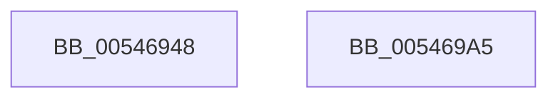

# HalpSetShutdownResetHandler

- RVA: `0x00546948`–`0x005469A6` (길이 `94` bytes)
- VA: `0x0000000140546948`
- 실행 섹션: `.text`
- PDB 이름 있음: `예`; PDB Function 태그: `아니요`
- unwind 정보 RVA: `0x000B3A94`
- 디코드: `23`개 명령, `94/94` bytes 표시
- 미해석 바이트: `0` (있으면 어셈블리에 `.byte`로 보존)

> 이 문서는 커널 이미지의 기계어와 PDB 기호를 분석해 생성했습니다. 4번과 5번은 함수 원형과 자료형을 바이너리 사용 방식에서 추정한 C 해석이며 원본 소스 복구 결과는 아닙니다.

## 1. Dependencies

- 직접 호출 지점: **2**; 고유 호출 대상: **2**
- 직접 호출자로 확인된 함수: **1**
- RIP 상대 이미지 참조: **1**

### Outgoing calls
- `0x0054698E` → [ZwPowerInformation](../6A/ZwPowerInformation_function_006ADCB0.md) (function, `0x006ADCB0`)
- `0x0054699B` → [_security_check_cookie](../6A/_security_check_cookie_function_006AC640.md) (function, `0x006AC640`)

### Direct callers
- [HalpKsrCallbackRoutine](../../page/70/HalpKsrCallbackRoutine_function_0070C5E0.md) at `0x0070C607`

### Static image references
- `0x0054694C` → RVA `0x00E0A740` (`.data`; read)

## 2. Other-region calls and transfers

- 다른 실행 섹션으로 향하는 call: **0**
- 별도 외부 분기/꼬리 이동을 확인하지 못했습니다.

## 3. Assembly (complete function range)

```asm
00546948  48 83 EC 58                     sub rsp, 0x58
0054694C  48 8B 05 ED 3D 8C 00            mov rax, qword ptr [rip + 0x8c3ded]
00546953  48 33 C4                        xor rax, rsp
00546956  48 89 44 24 48                  mov qword ptr [rsp + 0x48], rax
0054695B  33 C0                           xor eax, eax
0054695D  48 8D 54 24 30                  lea rdx, [rsp + 0x30]
00546962  21 44 24 20                     and dword ptr [rsp + 0x20], eax
00546966  0F 57 C0                        xorps xmm0, xmm0
00546969  0F 11 44 24 30                  movups xmmword ptr [rsp + 0x30], xmm0
0054696E  48 89 4C 24 38                  mov qword ptr [rsp + 0x38], rcx
00546973  45 33 C9                        xor r9d, r9d
00546976  44 8D 40 18                     lea r8d, [rax + 0x18]
0054697A  48 89 44 24 40                  mov qword ptr [rsp + 0x40], rax
0054697F  8D 48 06                        lea ecx, [rax + 6]
00546982  C7 44 24 30 05 00 00 00         mov dword ptr [rsp + 0x30], 5
0054698A  88 44 24 34                     mov byte ptr [rsp + 0x34], al
0054698E  E8 1D 73 16 00                  call 0x1406adcb0
00546993  48 8B 4C 24 48                  mov rcx, qword ptr [rsp + 0x48]
00546998  48 33 CC                        xor rcx, rsp
0054699B  E8 A0 5C 16 00                  call 0x1406ac640
005469A0  48 83 C4 58                     add rsp, 0x58
005469A4  C3                              ret
005469A5  CC                              int3
```

## 4. C-style interpretation (structured pseudocode)

```c
__int64 __fastcall HalpSetShutdownResetHandler(__int64 a1, __int64 a2, __int64 a3, int a4)
{
    __int64 result;
    __int64 v_rsp;
    unsigned __int64 v_stack_m10;
    unsigned __int64 v_stack_m18;
    unsigned __int64 v_stack_m20;
    unsigned __int8 v_stack_m24;
    unsigned __int64 v_stack_m28;
    unsigned int v_stack_m38;

    v_rsp = (v_rsp) - (88);
    result = (*(unsigned __int64 *)(v_rip + 9190893)) ^ (v_rsp);
    v_stack_m10 = result;
    result = 0;
    v_stack_m28 = v_xmm0;
    v_stack_m20 = a1;
    a4 = 0;
    v_stack_m18 = 0;
    v_stack_m28 = 5;
    v_stack_m24 = 0;
    result = ZwPowerInformation(result + 6, v_stack_m28, result + 24, a4);
    a1 = (v_stack_m10) ^ (v_rsp);
    result = _security_check_cookie(a1, v_stack_m28, result + 24, a4);
    v_rsp = (v_rsp) + (88);
    return result;
}
```

## 5. (Beta) C Style

```c
int64_t HalpSetShutdownResetHandler(int64_t Arg1, int64_t Arg2, int64_t Arg3, int32_t Arg4)
{
    int64_t result;
    int64_t local_rsp;
    uint64_t v_stack_m10;
    uint64_t v_stack_m18;
    uint64_t v_stack_m20;
    uint8_t v_stack_m24;
    uint64_t v_stack_m28;
    uint32_t v_stack_m38;

    local_rsp = (local_rsp) - (88);
    result = (*(uint64_t *)(v_rip + 0x8C3DED)) ^ (local_rsp);
    v_stack_m10 = result;
    result = 0;
    v_stack_m28 = v_xmm0;
    v_stack_m20 = Arg1;
    Arg4 = 0;
    v_stack_m18 = 0;
    v_stack_m28 = 5;
    v_stack_m24 = 0;
    result = ZwPowerInformation(result + 6, v_stack_m28, result + 24, Arg4);
    Arg1 = (v_stack_m10) ^ (local_rsp);
    result = _security_check_cookie(Arg1, v_stack_m28, result + 24, Arg4);
    local_rsp = (local_rsp) + (88);
    return result;
}
```

## 6. Execution-region graph

[열기: 2D/3D 그래프와 함수 탐색 컨트롤 패널](../../../control-panel.html?section=text&rva=0x00546948&view=graph)

- 2D 그래프는 위에서 아래로 흐르고, 3D 그래프는 빈 공간을 드래그해 회전합니다. Shift+드래그는 이동, 휠은 확대·축소, 함수 노드 선택은 대상 보고서 이동입니다.

### Static fallback


