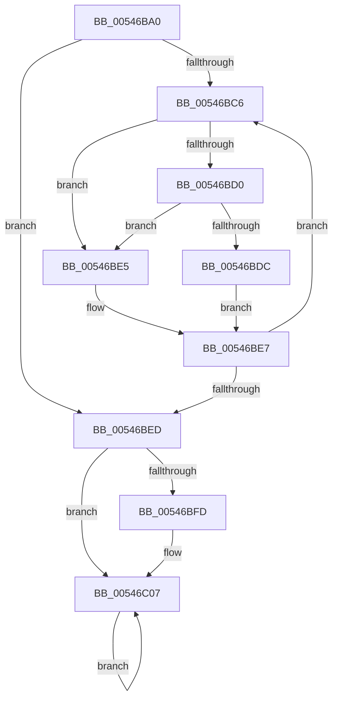

# HalpShutdownReset

- RVA: `0x00546BA0`–`0x00546C0B` (길이 `107` bytes)
- VA: `0x0000000140546BA0`
- 실행 섹션: `.text`
- PDB 이름 있음: `예`; PDB Function 태그: `아니요`
- unwind 정보 RVA: `0x000BC874`
- 디코드: `30`개 명령, `107/107` bytes 표시
- 미해석 바이트: `0` (있으면 어셈블리에 `.byte`로 보존)

> 이 문서는 커널 이미지의 기계어와 PDB 기호를 분석해 생성했습니다. 4번과 5번은 함수 원형과 자료형을 바이너리 사용 방식에서 추정한 C 해석이며 원본 소스 복구 결과는 아닙니다.

## 1. Dependencies

- 직접 호출 지점: **2**; 고유 호출 대상: **2**
- 직접 호출자로 확인된 함수: **0**
- RIP 상대 이미지 참조: **3**

### Outgoing calls
- `0x00546BDE` → [guard_dispatch_icall](../6B/guard_dispatch_icall_function_006BAAD0.md) (function, `0x006BAAD0`)
- `0x00546C02` → [HalReturnToFirmware](HalReturnToFirmware_function_00546550.md) (function, `0x00546550`)

### Direct callers
- 이 함수 시작 RVA로 연결되는 직접 call은 확인되지 않았습니다. 간접 호출은 완전히 역산할 수 없습니다.

### Static image references
- `0x00546BC8` → RVA `0x00FC1C7C` (`.data`; reference)
- `0x00546BD0` → RVA `0x00FC1C80` (`.data`; read)
- `0x00546BED` → RVA `0x00FC2C60` (`.data`; write)

## 2. Other-region calls and transfers

- 다른 실행 섹션으로 향하는 call: **0**
- 별도 외부 분기/꼬리 이동을 확인하지 못했습니다.

## 3. Assembly (complete function range)

```asm
00546BA0  48 89 5C 24 08                  mov qword ptr [rsp + 8], rbx
00546BA5  48 89 74 24 10                  mov qword ptr [rsp + 0x10], rsi
00546BAA  57                              push rdi
00546BAB  48 83 EC 20                     sub rsp, 0x20
00546BAF  48 8B 7C 24 50                  mov rdi, qword ptr [rsp + 0x50]
00546BB4  33 DB                           xor ebx, ebx
00546BB6  65 48 8B 34 25 20 00 00 00      mov rsi, qword ptr gs:[0x20]
00546BBF  F0 FF 0F                        lock dec dword ptr [rdi]
00546BC2  8B 07                           mov eax, dword ptr [rdi]
00546BC4  74 27                           je 0x140546bed
00546BC6  FF C3                           inc ebx
00546BC8  85 1D AE B0 A7 00               test dword ptr [rip + 0xa7b0ae], ebx
00546BCE  75 15                           jne 0x140546be5
00546BD0  48 8B 05 A9 B0 A7 00            mov rax, qword ptr [rip + 0xa7b0a9]
00546BD7  48 85 C0                        test rax, rax
00546BDA  74 09                           je 0x140546be5
00546BDC  8B CB                           mov ecx, ebx
00546BDE  E8 ED 3E 17 00                  call 0x1406baad0
00546BE3  EB 02                           jmp 0x140546be7
00546BE5  F3 90                           pause
00546BE7  8B 07                           mov eax, dword ptr [rdi]
00546BE9  85 C0                           test eax, eax
00546BEB  75 D9                           jne 0x140546bc6
00546BED  C7 05 69 C0 A7 00 01 00 00 00   mov dword ptr [rip + 0xa7c069], 1
00546BF7  83 7E 24 00                     cmp dword ptr [rsi + 0x24], 0
00546BFB  75 0A                           jne 0x140546c07
00546BFD  B9 03 00 00 00                  mov ecx, 3
00546C02  E8 49 F9 FF FF                  call 0x140546550
00546C07  F3 90                           pause
00546C09  EB FC                           jmp 0x140546c07
```

## 4. C-style interpretation (structured pseudocode)

```c
__int64 __fastcall HalpShutdownReset(__int64 a1, __int64 a2, __int64 a3, __int64 a4, __int64 a5)
{
    __int64 result;
    __int64 v_rbx;
    __int64 v_rsp;
    unsigned __int64 v_stack_p10;
    unsigned __int64 v_stack_p8;

    v_stack_p8 = v_rbx;
    v_stack_p10 = v_rsi;
    v_rsp = (v_rsp) - (32);
    v_rbx = 0;
    if (condition_is_equal) goto loc_00546BED;
loc_00546BC6:
    v_rbx = (unsigned int)((v_rbx) + 1);
    if (((*(unsigned int *)(v_rip + 10989742)) & ((unsigned int)(v_rbx))) != 0) goto loc_00546BE5;
    if (*(unsigned __int64 *)(v_rip + 10989737) == 0) goto loc_00546BE5;
    result = guard_dispatch_icall((unsigned int)((unsigned int)(v_rbx)), a2, a3, a4);
    goto loc_00546BE7;
loc_00546BE5:
loc_00546BE7:
    if ((unsigned int)((unsigned int)(*(unsigned int *)(a5))) != 0) goto loc_00546BC6;
loc_00546BED:
    *(unsigned int *)(v_rip + 10993769) = 1;
    result = (unsigned int)(*(unsigned int *)(a5));
    if ((*(unsigned int *)(*(unsigned __int64 *)(gs_base + (0 + 32)) + 36)) == 0) {
        a1 = 3;
        result = HalReturnToFirmware(a1, a2, a3, a4);
    }
    goto loc_00546C07;
}
```

## 5. (Beta) C Style

```c
int64_t HalpShutdownReset(int64_t Arg1, int64_t Arg2, int64_t Arg3, int64_t Arg4, void *Arg5)
{
    uint8_t *arg5 = (uint8_t *)Arg5;

    int64_t result;
    int64_t local_rbx;
    int64_t local_rsp;
    uint64_t v_stack_p10;
    uint64_t v_stack_p8;

    v_stack_p8 = local_rbx;
    v_stack_p10 = local_rsi;
    local_rsp = (local_rsp) - (32);
    local_rbx = 0;
    if (condition_is_equal) goto loc_00546BED;
loc_00546BC6:
    local_rbx = (uint32_t)((local_rbx) + 1);
    if (((*(uint32_t *)(v_rip + 0xA7B0AE)) & ((uint32_t)(local_rbx))) != 0) goto loc_00546BE5;
    if (*(uint64_t *)(v_rip + 0xA7B0A9) == 0) goto loc_00546BE5;
    result = guard_dispatch_icall((uint32_t)((uint32_t)(local_rbx)), Arg2, Arg3, Arg4);
    goto loc_00546BE7;
loc_00546BE5:
loc_00546BE7:
    if ((uint32_t)((uint32_t)(*(uint32_t *)(arg5))) != 0) goto loc_00546BC6;
loc_00546BED:
    *(uint32_t *)(v_rip + 0xA7C069) = 1;
    result = (uint32_t)(*(uint32_t *)(arg5));
    if ((*(uint32_t *)(*(uint64_t *)(gs_base + (0 + 0x20)) + 0x24)) == 0) {
        Arg1 = 3;
        result = HalReturnToFirmware(Arg1, Arg2, Arg3, Arg4);
    }
    goto loc_00546C07;
}
```

### 관측된 메모리 오프셋

구조체 형식이 확인되지 않은 접근은 인자 기준의 오프셋으로만 기록했습니다.

| 기준 인자 | 오프셋 표현 | 폭 (bit) | 접근 |
|---|---:|---:|---|
| `Arg5` | `+ 0x0` | `32` | `R` |
| `Arg5` | `+ 0x0` | `32` | `R/W` |

## 6. Execution-region graph

[열기: 2D/3D 그래프와 함수 탐색 컨트롤 패널](../../../control-panel.html?section=text&rva=0x00546BA0&view=graph)

- 2D 그래프는 위에서 아래로 흐르고, 3D 그래프는 빈 공간을 드래그해 회전합니다. Shift+드래그는 이동, 휠은 확대·축소, 함수 노드 선택은 대상 보고서 이동입니다.

### Static fallback


