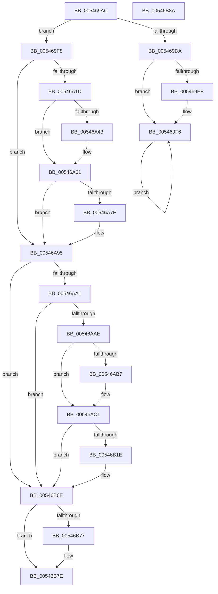

# HalpShutdown

- RVA: `0x005469AC`–`0x00546B8B` (길이 `479` bytes)
- VA: `0x00000001405469AC`
- 실행 섹션: `.text`
- PDB 이름 있음: `예`; PDB Function 태그: `아니요`
- unwind 정보 RVA: `0x000C3D28`
- 디코드: `125`개 명령, `479/479` bytes 표시
- 미해석 바이트: `0` (있으면 어셈블리에 `.byte`로 보존)

> 이 문서는 커널 이미지의 기계어와 PDB 기호를 분석해 생성했습니다. 4번과 5번은 함수 원형과 자료형을 바이너리 사용 방식에서 추정한 C 해석이며 원본 소스 복구 결과는 아닙니다.

## 1. Dependencies

- 직접 호출 지점: **12**; 고유 호출 대상: **6**
- 직접 호출자로 확인된 함수: **3**
- RIP 상대 이미지 참조: **9**

### Outgoing calls
- `0x00546A05` → [guard_dispatch_icall](../6B/guard_dispatch_icall_function_006BAAD0.md) (function, `0x006BAAD0`)
- `0x00546A0A` → [VslTerminateSecureServices](../58/VslTerminateSecureServices_function_0058F83C.md) (function, `0x0058F83C`)
- `0x00546A2D` → [HalpAcpiPmRegisterRead](../41/HalpAcpiPmRegisterRead_function_0041DB30.md) (function, `0x0041DB30`)
- `0x00546A54` → [HalpAcpiPmRegisterRead](../41/HalpAcpiPmRegisterRead_function_0041DB30.md) (function, `0x0041DB30`)
- `0x00546A71` → [HalpAcpiPmRegisterWrite](../41/HalpAcpiPmRegisterWrite_function_0041C760.md) (function, `0x0041C760`)
- `0x00546A90` → [HalpAcpiPmRegisterWrite](../41/HalpAcpiPmRegisterWrite_function_0041C760.md) (function, `0x0041C760`)
- `0x00546ABC` → [HalpHvEnterSleepState](HalpHvEnterSleepState_function_0054CDEC.md) (function, `0x0054CDEC`)
- `0x00546AD2` → [HalpAcpiPmRegisterRead](../41/HalpAcpiPmRegisterRead_function_0041DB30.md) (function, `0x0041DB30`)
- `0x00546B10` → [HalpAcpiPmRegisterWrite](../41/HalpAcpiPmRegisterWrite_function_0041C760.md) (function, `0x0041C760`)
- `0x00546B2F` → [HalpAcpiPmRegisterRead](../41/HalpAcpiPmRegisterRead_function_0041DB30.md) (function, `0x0041DB30`)
- `0x00546B69` → [HalpAcpiPmRegisterWrite](../41/HalpAcpiPmRegisterWrite_function_0041C760.md) (function, `0x0041C760`)
- `0x00546B79` → [HalEfiResetSystem](HalEfiResetSystem_function_0054DDE8.md) (function, `0x0054DDE8`)

### Direct callers
- [HalReturnToFirmware](HalReturnToFirmware_function_00546550.md) at `0x00546584`
- [HaliHaltSystem](HaliHaltSystem_function_005465C0.md) at `0x0054664B`
- [HalpCheckPowerButton](HalpCheckPowerButton_function_00546660.md) at `0x005466EB`

### Static image references
- `0x005469CF` → RVA `0x00FC2C64` (`.data`; read)
- `0x005469F8` → RVA `0x00E11750` (`.data`; read)
- `0x00546A0F` → RVA `0x00F8FE60` (`.data`; read)
- `0x00546A32` → RVA `0x00F8FEF0` (`.data`; read)
- `0x00546A95` → RVA `0x00FC2C68` (`.data`; read)
- `0x00546AA1` → RVA `0x00F8FE90` (`.data`; read)
- `0x00546AAE` → RVA `0x00FC1C42` (`.data`; read)
- `0x00546B15` → RVA `0x00F8FF20` (`.data`; read)
- `0x00546B6E` → RVA `0x00FC1A28` (`.data`; read)

## 2. Other-region calls and transfers

- 다른 실행 섹션으로 향하는 call: **0**
- 별도 외부 분기/꼬리 이동을 확인하지 못했습니다.

## 3. Assembly (complete function range)

```asm
005469AC  40 55                           push rbp
005469AE  56                              push rsi
005469AF  57                              push rdi
005469B0  41 56                           push r14
005469B2  41 57                           push r15
005469B4  48 8B EC                        mov rbp, rsp
005469B7  48 83 EC 30                     sub rsp, 0x30
005469BB  33 FF                           xor edi, edi
005469BD  66 89 7D 40                     mov word ptr [rbp + 0x40], di
005469C1  33 C0                           xor eax, eax
005469C3  66 89 7D 30                     mov word ptr [rbp + 0x30], di
005469C7  66 89 7D 38                     mov word ptr [rbp + 0x38], di
005469CB  44 8D 77 01                     lea r14d, [rdi + 1]
005469CF  F0 44 0F B1 35 8C C2 A7 00      lock cmpxchg dword ptr [rip + 0xa7c28c], r14d
005469D8  74 1E                           je 0x1405469f8
005469DA  65 48 8B 04 25 20 00 00 00      mov rax, qword ptr gs:[0x20]
005469E3  48 8B 88 B8 8E 00 00            mov rcx, qword ptr [rax + 0x8eb8]
005469EA  48 85 C9                        test rcx, rcx
005469ED  74 07                           je 0x1405469f6
005469EF  F0 81 09 00 00 02 00            lock or dword ptr [rcx], 0x20000
005469F6  EB FE                           jmp 0x1405469f6
005469F8  48 8B 05 51 AD 8C 00            mov rax, qword ptr [rip + 0x8cad51]
005469FF  33 C9                           xor ecx, ecx
00546A01  48 8B 40 08                     mov rax, qword ptr [rax + 8]
00546A05  E8 C6 40 17 00                  call 0x1406baad0
00546A0A  E8 2D 8E 04 00                  call 0x14058f83c
00546A0F  40 38 3D 4A 94 A4 00            cmp byte ptr [rip + 0xa4944a], dil
00546A16  BE 02 00 00 00                  mov esi, 2
00546A1B  74 78                           je 0x140546a95
00546A1D  44 8B CE                        mov r9d, esi
00546A20  48 89 7C 24 20                  mov qword ptr [rsp + 0x20], rdi
00546A25  4C 8D 45 40                     lea r8, [rbp + 0x40]
00546A29  33 D2                           xor edx, edx
00546A2B  33 C9                           xor ecx, ecx
00546A2D  E8 FE 70 ED FF                  call 0x14041db30
00546A32  40 38 3D B7 94 A4 00            cmp byte ptr [rip + 0xa494b7], dil
00546A39  0F B7 45 40                     movzx eax, word ptr [rbp + 0x40]
00546A3D  66 89 45 38                     mov word ptr [rbp + 0x38], ax
00546A41  74 1E                           je 0x140546a61
00546A43  44 8B CE                        mov r9d, esi
00546A46  48 89 7C 24 20                  mov qword ptr [rsp + 0x20], rdi
00546A4B  4C 8D 45 40                     lea r8, [rbp + 0x40]
00546A4F  33 D2                           xor edx, edx
00546A51  8D 4E 01                        lea ecx, [rsi + 1]
00546A54  E8 D7 70 ED FF                  call 0x14041db30
00546A59  0F B7 45 40                     movzx eax, word ptr [rbp + 0x40]
00546A5D  66 09 45 38                     or word ptr [rbp + 0x38], ax
00546A61  44 8B CE                        mov r9d, esi
00546A64  48 89 7C 24 20                  mov qword ptr [rsp + 0x20], rdi
00546A69  4C 8D 45 38                     lea r8, [rbp + 0x38]
00546A6D  33 D2                           xor edx, edx
00546A6F  33 C9                           xor ecx, ecx
00546A71  E8 EA 5C ED FF                  call 0x14041c760
00546A76  40 38 3D 73 94 A4 00            cmp byte ptr [rip + 0xa49473], dil
00546A7D  74 16                           je 0x140546a95
00546A7F  33 D2                           xor edx, edx
00546A81  48 89 7C 24 20                  mov qword ptr [rsp + 0x20], rdi
00546A86  44 8B CE                        mov r9d, esi
00546A89  4C 8D 45 38                     lea r8, [rbp + 0x38]
00546A8D  8D 4A 03                        lea ecx, [rdx + 3]
00546A90  E8 CB 5C ED FF                  call 0x14041c760
00546A95  39 3D CD C1 A7 00               cmp dword ptr [rip + 0xa7c1cd], edi
00546A9B  0F 84 CD 00 00 00               je 0x140546b6e
00546AA1  40 38 3D E8 93 A4 00            cmp byte ptr [rip + 0xa493e8], dil
00546AA8  0F 84 C0 00 00 00               je 0x140546b6e
00546AAE  40 38 3D 8D B1 A7 00            cmp byte ptr [rip + 0xa7b18d], dil
00546AB5  74 0A                           je 0x140546ac1
00546AB7  B9 05 00 00 00                  mov ecx, 5
00546ABC  E8 2B 63 00 00                  call 0x14054cdec
00546AC1  44 8B CE                        mov r9d, esi
00546AC4  48 89 7C 24 20                  mov qword ptr [rsp + 0x20], rdi
00546AC9  4C 8D 45 30                     lea r8, [rbp + 0x30]
00546ACD  33 D2                           xor edx, edx
00546ACF  41 8B CE                        mov ecx, r14d
00546AD2  E8 59 70 ED FF                  call 0x14041db30
00546AD7  0F B7 15 8A C1 A7 00            movzx edx, word ptr [rip + 0xa7c18a]
00546ADE  4C 8D 45 30                     lea r8, [rbp + 0x30]
00546AE2  0F B7 45 30                     movzx eax, word ptr [rbp + 0x30]
00546AE6  66 83 E2 07                     and dx, 7
00546AEA  66 83 CA 08                     or dx, 8
00546AEE  48 89 7C 24 20                  mov qword ptr [rsp + 0x20], rdi
00546AF3  66 C1 E2 0A                     shl dx, 0xa
00546AF7  41 BF 03 02 00 00               mov r15d, 0x203
00546AFD  66 41 23 C7                     and ax, r15w
00546B01  44 8B CE                        mov r9d, esi
00546B04  66 0B D0                        or dx, ax
00546B07  41 8B CE                        mov ecx, r14d
00546B0A  66 89 55 30                     mov word ptr [rbp + 0x30], dx
00546B0E  33 D2                           xor edx, edx
00546B10  E8 4B 5C ED FF                  call 0x14041c760
00546B15  40 38 3D 04 94 A4 00            cmp byte ptr [rip + 0xa49404], dil
00546B1C  74 50                           je 0x140546b6e
00546B1E  33 D2                           xor edx, edx
00546B20  48 89 7C 24 20                  mov qword ptr [rsp + 0x20], rdi
00546B25  44 8B CE                        mov r9d, esi
00546B28  4C 8D 45 30                     lea r8, [rbp + 0x30]
00546B2C  8D 4A 04                        lea ecx, [rdx + 4]
00546B2F  E8 FC 6F ED FF                  call 0x14041db30
00546B34  8B 15 2E C1 A7 00               mov edx, dword ptr [rip + 0xa7c12e]
00546B3A  4C 8D 45 30                     lea r8, [rbp + 0x30]
00546B3E  0F B7 45 30                     movzx eax, word ptr [rbp + 0x30]
00546B42  44 8B CE                        mov r9d, esi
00546B45  C1 EA 04                        shr edx, 4
00546B48  66 41 23 C7                     and ax, r15w
00546B4C  66 83 E2 07                     and dx, 7
00546B50  48 89 7C 24 20                  mov qword ptr [rsp + 0x20], rdi
00546B55  66 83 CA 08                     or dx, 8
00546B59  66 C1 E2 0A                     shl dx, 0xa
00546B5D  66 0B D0                        or dx, ax
00546B60  66 89 55 30                     mov word ptr [rbp + 0x30], dx
00546B64  33 D2                           xor edx, edx
00546B66  8D 4A 04                        lea ecx, [rdx + 4]
00546B69  E8 F2 5B ED FF                  call 0x14041c760
00546B6E  40 38 3D B3 AE A7 00            cmp byte ptr [rip + 0xa7aeb3], dil
00546B75  74 07                           je 0x140546b7e
00546B77  8B CE                           mov ecx, esi
00546B79  E8 6A 72 00 00                  call 0x14054dde8
00546B7E  48 83 C4 30                     add rsp, 0x30
00546B82  41 5F                           pop r15
00546B84  41 5E                           pop r14
00546B86  5F                              pop rdi
00546B87  5E                              pop rsi
00546B88  5D                              pop rbp
00546B89  C3                              ret
00546B8A  CC                              int3
```

## 4. C-style interpretation (structured pseudocode)

```c
__int64 __fastcall HalpShutdown(__int64 a1, int a2)
{
    __int64 result;
    __int64 v_rdi;
    __int64 v_rsp;
    unsigned __int64 v_stack_m38;
    unsigned __int16 v_stack_p10;
    unsigned __int16 v_stack_p18;
    unsigned __int16 v_stack_p8;

    v_rsp = (v_rsp) - (48);
    v_rdi = 0;
    v_stack_p18 = 0;
    result = 0;
    v_stack_p8 = 0;
    v_stack_p10 = 0;
    if (condition_is_equal) goto loc_005469F8;
    if (*(unsigned __int64 *)(*(unsigned __int64 *)(gs_base + (0 + 32)) + 36536) != 0) {
    }
    goto loc_005469F6;
loc_005469F8:
    a1 = 0;
    result = guard_dispatch_icall(a1, a2, a3, a4);
    result = VslTerminateSecureServices(a1, a2, a3, a4);
    if ((*(unsigned __int8 *)(v_rip + 10785866)) == 0) goto loc_00546A95;
    v_stack_m38 = 0;
    a2 = 0;
    a1 = 0;
    result = HalpAcpiPmRegisterRead(a1, a2, v_stack_p18, 2);
    v_stack_p10 = (unsigned __int16)(v_stack_p18);
    result = v_stack_p18;
    if ((*(unsigned __int8 *)(v_rip + 10785975)) != 0) {
        a4 = 2;
        v_stack_m38 = 0;
        a3 = v_stack_p18;
        a2 = 0;
        a1 = 2 + 1;
        result = HalpAcpiPmRegisterRead(a1, a2, a3, a4);
        result = v_stack_p18;
    }
    v_stack_m38 = 0;
    a2 = 0;
    a1 = 0;
    result = HalpAcpiPmRegisterWrite(a1, a2, v_stack_p10, 2);
    if ((*(unsigned __int8 *)(v_rip + 10785907)) != 0) {
        a2 = 0;
        v_stack_m38 = 0;
        a4 = 2;
        a3 = v_stack_p10;
        a1 = a2 + 3;
        result = HalpAcpiPmRegisterWrite(a1, a2, a3, a4);
    }
    if ((*(unsigned int *)(v_rip + 10994125)) == 0) goto loc_00546B6E;
    if ((*(unsigned __int8 *)(v_rip + 10785768)) == 0) goto loc_00546B6E;
    if ((*(unsigned __int8 *)(v_rip + 10989965)) != 0) {
        a1 = 5;
        result = HalpHvEnterSleepState(a1, a2, a3, a4);
    }
    v_stack_m38 = 0;
    a2 = 0;
    result = HalpAcpiPmRegisterRead((unsigned int)((unsigned int)(v_rdi + 1)), a2, v_stack_p8, 2);
    a2 = (unsigned __int16)((*(unsigned __int16 *)(v_rip + 10994058)) & (7));
    a2 = (unsigned __int16)((a2) | (8));
    v_stack_m38 = 0;
    a2 = (unsigned __int16)((a2) << (10));
    result = (unsigned __int16)((v_stack_p8) & (515));
    a2 = (unsigned __int16)((a2) | ((unsigned __int16)(result)));
    v_stack_p8 = (unsigned __int16)(a2);
    a2 = 0;
    result = HalpAcpiPmRegisterWrite((unsigned int)((unsigned int)(v_rdi + 1)), a2, v_stack_p8, 2);
    if ((*(unsigned __int8 *)(v_rip + 10785796)) != 0) {
        a2 = 0;
        v_stack_m38 = 0;
        a4 = 2;
        a3 = v_stack_p8;
        a1 = a2 + 4;
        result = HalpAcpiPmRegisterRead(a1, a2, a3, a4);
        a2 = *(unsigned int *)(v_rip + 10993966);
        a3 = v_stack_p8;
        result = v_stack_p8;
        a4 = 2;
        a2 = (unsigned int)((a2) >> (4));
        result = (unsigned __int16)((result) & (515));
        a2 = (unsigned __int16)((a2) & (7));
        v_stack_m38 = 0;
        a2 = (unsigned __int16)((a2) | (8));
        a2 = (unsigned __int16)((a2) << (10));
        a2 = (unsigned __int16)((a2) | ((unsigned __int16)(result)));
        v_stack_p8 = (unsigned __int16)(a2);
        a2 = 0;
        a1 = a2 + 4;
        result = HalpAcpiPmRegisterWrite(a1, a2, a3, a4);
    }
    if ((*(unsigned __int8 *)(v_rip + 10989235)) != 0) {
        a1 = 2;
        result = HalEfiResetSystem(a1, a2, a3, a4);
    }
    v_rsp = (v_rsp) + (48);
    return result;
}
```

## 5. (Beta) C Style

```c
int64_t HalpShutdown(int64_t Arg1, int32_t Arg2)
{
    int64_t result;
    int64_t local_rdi;
    int64_t local_rsp;
    uint64_t v_stack_m38;
    uint16_t v_stack_p10;
    uint16_t v_stack_p18;
    uint16_t v_stack_p8;

    local_rsp = (local_rsp) - (48);
    local_rdi = 0;
    v_stack_p18 = 0;
    result = 0;
    v_stack_p8 = 0;
    v_stack_p10 = 0;
    if (condition_is_equal) goto loc_005469F8;
    if (*(uint64_t *)(*(uint64_t *)(gs_base + (0 + 0x20)) + 0x8EB8) != 0) {
    }
    goto loc_005469F6;
loc_005469F8:
    Arg1 = 0;
    result = guard_dispatch_icall(Arg1, Arg2, a3, a4);
    result = VslTerminateSecureServices(Arg1, Arg2, a3, a4);
    if ((*(uint8_t *)(v_rip + 0xA4944A)) == 0) goto loc_00546A95;
    v_stack_m38 = 0;
    Arg2 = 0;
    Arg1 = 0;
    result = HalpAcpiPmRegisterRead(Arg1, Arg2, v_stack_p18, 2);
    v_stack_p10 = (uint16_t)(v_stack_p18);
    result = v_stack_p18;
    if ((*(uint8_t *)(v_rip + 0xA494B7)) != 0) {
        a4 = 2;
        v_stack_m38 = 0;
        a3 = v_stack_p18;
        Arg2 = 0;
        Arg1 = 2 + 1;
        result = HalpAcpiPmRegisterRead(Arg1, Arg2, a3, a4);
        result = v_stack_p18;
    }
    v_stack_m38 = 0;
    Arg2 = 0;
    Arg1 = 0;
    result = HalpAcpiPmRegisterWrite(Arg1, Arg2, v_stack_p10, 2);
    if ((*(uint8_t *)(v_rip + 0xA49473)) != 0) {
        Arg2 = 0;
        v_stack_m38 = 0;
        a4 = 2;
        a3 = v_stack_p10;
        Arg1 = Arg2 + 3;
        result = HalpAcpiPmRegisterWrite(Arg1, Arg2, a3, a4);
    }
    if ((*(uint32_t *)(v_rip + 0xA7C1CD)) == 0) goto loc_00546B6E;
    if ((*(uint8_t *)(v_rip + 0xA493E8)) == 0) goto loc_00546B6E;
    if ((*(uint8_t *)(v_rip + 0xA7B18D)) != 0) {
        Arg1 = 5;
        result = HalpHvEnterSleepState(Arg1, Arg2, a3, a4);
    }
    v_stack_m38 = 0;
    Arg2 = 0;
    result = HalpAcpiPmRegisterRead((uint32_t)((uint32_t)(local_rdi + 1)), Arg2, v_stack_p8, 2);
    Arg2 = (uint16_t)((*(uint16_t *)(v_rip + 0xA7C18A)) & (7));
    Arg2 = (uint16_t)((Arg2) | (8));
    v_stack_m38 = 0;
    Arg2 = (uint16_t)((Arg2) << (10));
    result = (uint16_t)((v_stack_p8) & (515));
    Arg2 = (uint16_t)((Arg2) | ((uint16_t)(result)));
    v_stack_p8 = (uint16_t)(Arg2);
    Arg2 = 0;
    result = HalpAcpiPmRegisterWrite((uint32_t)((uint32_t)(local_rdi + 1)), Arg2, v_stack_p8, 2);
    if ((*(uint8_t *)(v_rip + 0xA49404)) != 0) {
        Arg2 = 0;
        v_stack_m38 = 0;
        a4 = 2;
        a3 = v_stack_p8;
        Arg1 = Arg2 + 4;
        result = HalpAcpiPmRegisterRead(Arg1, Arg2, a3, a4);
        Arg2 = *(uint32_t *)(v_rip + 0xA7C12E);
        a3 = v_stack_p8;
        result = v_stack_p8;
        a4 = 2;
        Arg2 = (uint32_t)((Arg2) >> (4));
        result = (uint16_t)((result) & (515));
        Arg2 = (uint16_t)((Arg2) & (7));
        v_stack_m38 = 0;
        Arg2 = (uint16_t)((Arg2) | (8));
        Arg2 = (uint16_t)((Arg2) << (10));
        Arg2 = (uint16_t)((Arg2) | ((uint16_t)(result)));
        v_stack_p8 = (uint16_t)(Arg2);
        Arg2 = 0;
        Arg1 = Arg2 + 4;
        result = HalpAcpiPmRegisterWrite(Arg1, Arg2, a3, a4);
    }
    if ((*(uint8_t *)(v_rip + 0xA7AEB3)) != 0) {
        Arg1 = 2;
        result = HalEfiResetSystem(Arg1, Arg2, a3, a4);
    }
    local_rsp = (local_rsp) + (48);
    return result;
}
```

## 6. Execution-region graph

[열기: 2D/3D 그래프와 함수 탐색 컨트롤 패널](../../../control-panel.html?section=text&rva=0x005469AC&view=graph)

- 2D 그래프는 위에서 아래로 흐르고, 3D 그래프는 빈 공간을 드래그해 회전합니다. Shift+드래그는 이동, 휠은 확대·축소, 함수 노드 선택은 대상 보고서 이동입니다.

### Static fallback


