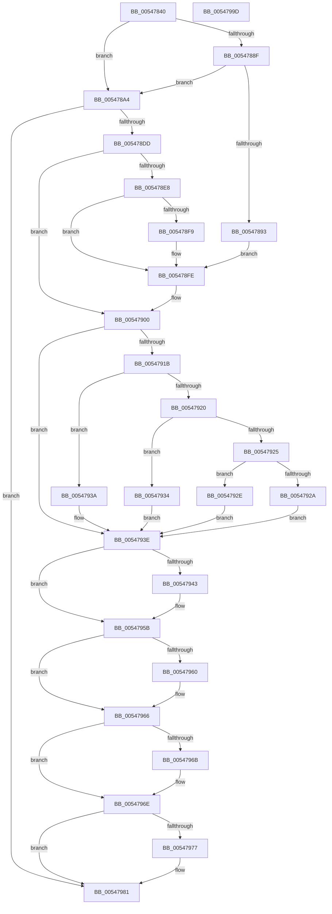

# HalpStartProfileInterruptEx

- RVA: `0x00547840`–`0x0054799E` (길이 `350` bytes)
- VA: `0x0000000140547840`
- 실행 섹션: `.text`
- PDB 이름 있음: `예`; PDB Function 태그: `아니요`
- unwind 정보 RVA: `0x000C3D9C`
- 디코드: `110`개 명령, `350/350` bytes 표시
- 미해석 바이트: `0` (있으면 어셈블리에 `.byte`로 보존)

> 이 문서는 커널 이미지의 기계어와 PDB 기호를 분석해 생성했습니다. 4번과 5번은 함수 원형과 자료형을 바이너리 사용 방식에서 추정한 C 해석이며 원본 소스 복구 결과는 아닙니다.

## 1. Dependencies

- 직접 호출 지점: **1**; 고유 호출 대상: **1**
- 직접 호출자로 확인된 함수: **1**
- RIP 상대 이미지 참조: **5**

### Outgoing calls
- `0x005478CD` → [guard_dispatch_icall](../6B/guard_dispatch_icall_function_006BAAD0.md) (function, `0x006BAAD0`)

### Direct callers
- [HalStartProfileInterrupt](HalStartProfileInterrupt_function_00546C60.md) at `0x00546C72`

### Static image references
- `0x00547884` → RVA `0x00FC2C28` (`.data`; read)
- `0x005478A4` → RVA `0x00E03B20` (`.data`; read)
- `0x005478DD` → RVA `0x00FC2B4C` (`.data`; read/write)
- `0x00547904` → RVA `0x00FC8C40` (`ALMOSTRO`; read)
- `0x00547977` → RVA `0x00FC2BE0` (`.data`; read)

## 2. Other-region calls and transfers

- 다른 실행 섹션으로 향하는 call: **0**
- 별도 외부 분기/꼬리 이동을 확인하지 못했습니다.

## 3. Assembly (complete function range)

```asm
00547840  48 89 5C 24 10                  mov qword ptr [rsp + 0x10], rbx
00547845  48 89 74 24 18                  mov qword ptr [rsp + 0x18], rsi
0054784A  55                              push rbp
0054784B  57                              push rdi
0054784C  41 54                           push r12
0054784E  41 56                           push r14
00547850  41 57                           push r15
00547852  48 8B EC                        mov rbp, rsp
00547855  48 83 EC 50                     sub rsp, 0x50
00547859  83 65 30 00                     and dword ptr [rbp + 0x30], 0
0054785D  4D 8B F1                        mov r14, r9
00547860  83 65 F0 00                     and dword ptr [rbp - 0x10], 0
00547864  4D 8B F8                        mov r15, r8
00547867  83 65 F8 00                     and dword ptr [rbp - 8], 0
0054786B  48 8B FA                        mov rdi, rdx
0054786E  83 65 F4 00                     and dword ptr [rbp - 0xc], 0
00547872  8B F1                           mov esi, ecx
00547874  65 44 8B 24 25 A4 01 00 00      mov r12d, dword ptr gs:[0x1a4]
0054787D  41 8B DC                        mov ebx, r12d
00547880  48 C1 E3 04                     shl rbx, 4
00547884  48 03 1D 9D B3 A7 00            add rbx, qword ptr [rip + 0xa7b39d]
0054788B  85 C9                           test ecx, ecx
0054788D  75 15                           jne 0x1405478a4
0054788F  39 0B                           cmp dword ptr [rbx], ecx
00547891  76 11                           jbe 0x1405478a4
00547893  8B 43 04                        mov eax, dword ptr [rbx + 4]
00547896  45 33 C9                        xor r9d, r9d
00547899  89 45 F0                        mov dword ptr [rbp - 0x10], eax
0054789C  8B 43 08                        mov eax, dword ptr [rbx + 8]
0054789F  89 45 30                        mov dword ptr [rbp + 0x30], eax
005478A2  EB 5A                           jmp 0x1405478fe
005478A4  48 8B 05 75 C2 8B 00            mov rax, qword ptr [rip + 0x8bc275]
005478AB  48 8D 4D 30                     lea rcx, [rbp + 0x30]
005478AF  48 89 4C 24 28                  mov qword ptr [rsp + 0x28], rcx
005478B4  4C 8D 4D F0                     lea r9, [rbp - 0x10]
005478B8  48 8D 4D F4                     lea rcx, [rbp - 0xc]
005478BC  8B D6                           mov edx, esi
005478BE  48 89 4C 24 20                  mov qword ptr [rsp + 0x20], rcx
005478C3  4C 8D 45 F8                     lea r8, [rbp - 8]
005478C7  48 8B 40 08                     mov rax, qword ptr [rax + 8]
005478CB  33 C9                           xor ecx, ecx
005478CD  E8 FE 31 17 00                  call 0x1406baad0
005478D2  44 8B C8                        mov r9d, eax
005478D5  85 C0                           test eax, eax
005478D7  0F 88 A4 00 00 00               js 0x140547981
005478DD  F0 FF 05 68 B2 A7 00            lock inc dword ptr [rip + 0xa7b268]
005478E4  85 F6                           test esi, esi
005478E6  75 18                           jne 0x140547900
005478E8  8B 4D F0                        mov ecx, dword ptr [rbp - 0x10]
005478EB  89 4B 04                        mov dword ptr [rbx + 4], ecx
005478EE  8B 4D 30                        mov ecx, dword ptr [rbp + 0x30]
005478F1  89 4B 08                        mov dword ptr [rbx + 8], ecx
005478F4  48 85 FF                        test rdi, rdi
005478F7  74 05                           je 0x1405478fe
005478F9  8B 07                           mov eax, dword ptr [rdi]
005478FB  89 43 0C                        mov dword ptr [rbx + 0xc], eax
005478FE  FF 03                           inc dword ptr [rbx]
00547900  44 8B 45 30                     mov r8d, dword ptr [rbp + 0x30]
00547904  48 8D 0D 35 13 A8 00            lea rcx, [rip + 0xa81335]
0054790B  4A 8B 04 E1                     mov rax, qword ptr [rcx + r12*8]
0054790F  41 8B D0                        mov edx, r8d
00547912  48 8B 48 58                     mov rcx, qword ptr [rax + 0x58]
00547916  45 85 C0                        test r8d, r8d
00547919  74 23                           je 0x14054793e
0054791B  83 EA 01                        sub edx, 1
0054791E  74 1A                           je 0x14054793a
00547920  83 EA 63                        sub edx, 0x63
00547923  74 0F                           je 0x140547934
00547925  83 FA 01                        cmp edx, 1
00547928  74 04                           je 0x14054792e
0054792A  33 C9                           xor ecx, ecx
0054792C  EB 10                           jmp 0x14054793e
0054792E  48 83 C1 48                     add rcx, 0x48
00547932  EB 0A                           jmp 0x14054793e
00547934  48 83 C1 30                     add rcx, 0x30
00547938  EB 04                           jmp 0x14054793e
0054793A  48 83 C1 18                     add rcx, 0x18
0054793E  48 85 FF                        test rdi, rdi
00547941  74 18                           je 0x14054795b
00547943  8B 45 F0                        mov eax, dword ptr [rbp - 0x10]
00547946  48 8B 49 10                     mov rcx, qword ptr [rcx + 0x10]
0054794A  48 8D 14 40                     lea rdx, [rax + rax*2]
0054794E  8B 07                           mov eax, dword ptr [rdi]
00547950  48 03 D2                        add rdx, rdx
00547953  89 44 D1 20                     mov dword ptr [rcx + rdx*8 + 0x20], eax
00547957  44 8B 45 30                     mov r8d, dword ptr [rbp + 0x30]
0054795B  4D 85 FF                        test r15, r15
0054795E  74 06                           je 0x140547966
00547960  8B 45 F0                        mov eax, dword ptr [rbp - 0x10]
00547963  41 89 07                        mov dword ptr [r15], eax
00547966  4D 85 F6                        test r14, r14
00547969  74 03                           je 0x14054796e
0054796B  45 89 06                        mov dword ptr [r14], r8d
0054796E  48 8B 45 50                     mov rax, qword ptr [rbp + 0x50]
00547972  48 85 C0                        test rax, rax
00547975  74 0A                           je 0x140547981
00547977  48 8D 0D 62 B2 A7 00            lea rcx, [rip + 0xa7b262]
0054797E  48 89 08                        mov qword ptr [rax], rcx
00547981  4C 8D 5C 24 50                  lea r11, [rsp + 0x50]
00547986  41 8B C1                        mov eax, r9d
00547989  49 8B 5B 38                     mov rbx, qword ptr [r11 + 0x38]
0054798D  49 8B 73 40                     mov rsi, qword ptr [r11 + 0x40]
00547991  49 8B E3                        mov rsp, r11
00547994  41 5F                           pop r15
00547996  41 5E                           pop r14
00547998  41 5C                           pop r12
0054799A  5F                              pop rdi
0054799B  5D                              pop rbp
0054799C  C3                              ret
0054799D  CC                              int3
```

## 4. C-style interpretation (structured pseudocode)

```c
__int64 __fastcall HalpStartProfileInterruptEx(int a1, __int64 a2, __int64 a3, __int64 a4, __int64 a5)
{
    __int64 result;
    __int64 v_rbx;
    __int64 v_rsp;
    unsigned __int64 v_stack_m28;
    unsigned int v_stack_m30;
    unsigned int v_stack_m34;
    unsigned int v_stack_m38;
    unsigned __int64 v_stack_m50;
    unsigned __int64 v_stack_m58;
    unsigned __int64 v_stack_p10;
    unsigned __int64 v_stack_p18;
    unsigned int v_stack_p8;

    v_stack_p10 = v_rbx;
    v_stack_p18 = v_rsi;
    v_rsp = (v_rsp) - (80);
    v_rbx = ((unsigned int)((unsigned int)((unsigned int)(*(unsigned int *)(gs_base + (0 + 420)))))) << (4);
    v_rbx = (v_rbx) + (*(unsigned __int64 *)(v_rip + 10990493));
    if (a1 != 0) goto loc_005478A4;
    if ((*(unsigned int *)(v_rbx)) <= a1) goto loc_005478A4;
    a4 = 0;
    v_stack_m38 = (unsigned int)((unsigned int)(*(unsigned int *)(v_rbx + 4)));
    v_stack_p8 = (unsigned int)((unsigned int)(*(unsigned int *)(v_rbx + 8)));
    goto loc_005478FE;
loc_005478A4:
    v_stack_m50 = v_stack_p8;
    v_stack_m58 = v_stack_m34;
    a1 = 0;
    result = guard_dispatch_icall(a1, (unsigned int)((unsigned int)((unsigned int)(a1))), v_stack_m30, v_stack_m38);
    if (sign_flag) goto loc_00547981;
    if ((unsigned int)((unsigned int)(a1)) != 0) goto loc_00547900;
    *(unsigned int *)(v_rbx + 4) = (unsigned int)((unsigned int)(v_stack_m38));
    *(unsigned int *)(v_rbx + 8) = (unsigned int)((unsigned int)(v_stack_p8));
    if (a2 != 0) {
        result = *(unsigned int *)(a2);
        *(unsigned int *)(v_rbx + 12) = (unsigned int)(result);
    }
loc_00547900:
    if ((unsigned int)((unsigned int)(v_stack_p8)) == 0) goto loc_0054793E;
    a2 = (unsigned int)(((unsigned int)((unsigned int)((unsigned int)(v_stack_p8)))) - (1));
    if (condition_is_equal) goto loc_0054793A;
    a2 = (unsigned int)((a2) - (99));
    if (condition_is_equal) goto loc_00547934;
    if (((unsigned int)(a2)) == 1) goto loc_0054792E;
    a1 = 0;
    goto loc_0054793E;
loc_0054792E:
    a1 = (a1) + (72);
    goto loc_0054793E;
loc_00547934:
    a1 = (a1) + (48);
    goto loc_0054793E;
loc_0054793A:
    a1 = (a1) + (24);
loc_0054793E:
    result = *(unsigned __int64 *)(v_rip + 11014965 + (unsigned int)(*(unsigned int *)(gs_base + (0 + 420))) * 8);
    if (a2 != 0) {
        result = v_stack_m38;
        a1 = *(unsigned __int64 *)(a1 + 16);
        a2 = result + result * 2;
        result = *(unsigned int *)(a2);
        a2 = (a2) + (a2);
        *(unsigned int *)(a1 + a2 * 8 + 32) = (unsigned int)(result);
        a3 = v_stack_p8;
    }
    if (a3 != 0) {
        result = v_stack_m38;
        *(unsigned int *)(a3) = (unsigned int)(result);
    }
    if (0 != 0) {
        *(unsigned int *)(a4) = (unsigned int)(a3);
    }
    if (a5 != 0) {
        a1 = v_rip + 10990178;
        *(unsigned __int64 *)(a5) = a1;
    }
    return (unsigned int)((unsigned int)((unsigned int)((unsigned int)(result))));
}
```

## 5. (Beta) C Style

```c
int64_t HalpStartProfileInterruptEx(int32_t Arg1, int64_t Arg2, int64_t Arg3, int64_t Arg4, int64_t Arg5)
{
    int64_t result;
    int64_t local_rbx;
    int64_t local_rsp;
    uint64_t v_stack_m28;
    uint32_t v_stack_m30;
    uint32_t v_stack_m34;
    uint32_t v_stack_m38;
    uint64_t v_stack_m50;
    uint64_t v_stack_m58;
    uint64_t v_stack_p10;
    uint64_t v_stack_p18;
    uint32_t v_stack_p8;

    v_stack_p10 = local_rbx;
    v_stack_p18 = local_rsi;
    local_rsp = (local_rsp) - (80);
    local_rbx = ((uint32_t)((uint32_t)((uint32_t)(*(uint32_t *)(gs_base + (0 + 0x1A4)))))) << (4);
    local_rbx = (local_rbx) + (*(uint64_t *)(v_rip + 0xA7B39D));
    if (Arg1 != 0) goto loc_005478A4;
    if ((*(uint32_t *)(local_rbx)) <= Arg1) goto loc_005478A4;
    Arg4 = 0;
    v_stack_m38 = (uint32_t)((uint32_t)(*(uint32_t *)(local_rbx + 0x4)));
    v_stack_p8 = (uint32_t)((uint32_t)(*(uint32_t *)(local_rbx + 0x8)));
    goto loc_005478FE;
loc_005478A4:
    v_stack_m50 = v_stack_p8;
    v_stack_m58 = v_stack_m34;
    Arg1 = 0;
    result = guard_dispatch_icall(Arg1, (uint32_t)((uint32_t)((uint32_t)(Arg1))), v_stack_m30, v_stack_m38);
    if (sign_flag) goto loc_00547981;
    if ((uint32_t)((uint32_t)(Arg1)) != 0) goto loc_00547900;
    *(uint32_t *)(local_rbx + 0x4) = (uint32_t)((uint32_t)(v_stack_m38));
    *(uint32_t *)(local_rbx + 0x8) = (uint32_t)((uint32_t)(v_stack_p8));
    if (Arg2 != 0) {
        result = *(uint32_t *)(Arg2);
        *(uint32_t *)(local_rbx + 0xC) = (uint32_t)(result);
    }
loc_00547900:
    if ((uint32_t)((uint32_t)(v_stack_p8)) == 0) goto loc_0054793E;
    Arg2 = (uint32_t)(((uint32_t)((uint32_t)((uint32_t)(v_stack_p8)))) - (1));
    if (condition_is_equal) goto loc_0054793A;
    Arg2 = (uint32_t)((Arg2) - (99));
    if (condition_is_equal) goto loc_00547934;
    if (((uint32_t)(Arg2)) == 1) goto loc_0054792E;
    Arg1 = 0;
    goto loc_0054793E;
loc_0054792E:
    Arg1 = (Arg1) + (72);
    goto loc_0054793E;
loc_00547934:
    Arg1 = (Arg1) + (48);
    goto loc_0054793E;
loc_0054793A:
    Arg1 = (Arg1) + (24);
loc_0054793E:
    result = *(uint64_t *)(v_rip + 0xA81335 + (uint32_t)(*(uint32_t *)(gs_base + (0 + 0x1A4))) * 8);
    if (Arg2 != 0) {
        result = v_stack_m38;
        Arg1 = *(uint64_t *)(Arg1 + 0x10);
        Arg2 = result + result * 2;
        result = *(uint32_t *)(Arg2);
        Arg2 = (Arg2) + (Arg2);
        *(uint32_t *)(Arg1 + Arg2 * 8 + 0x20) = (uint32_t)(result);
        Arg3 = v_stack_p8;
    }
    if (Arg3 != 0) {
        result = v_stack_m38;
        *(uint32_t *)(Arg3) = (uint32_t)(result);
    }
    if (0 != 0) {
        *(uint32_t *)(Arg4) = (uint32_t)(Arg3);
    }
    if (Arg5 != 0) {
        Arg1 = v_rip + 10990178;
        *(uint64_t *)(Arg5) = Arg1;
    }
    return (uint32_t)((uint32_t)((uint32_t)((uint32_t)(result))));
}
```

## 6. Execution-region graph

[열기: 2D/3D 그래프와 함수 탐색 컨트롤 패널](../../../control-panel.html?section=text&rva=0x00547840&view=graph)

- 2D 그래프는 위에서 아래로 흐르고, 3D 그래프는 빈 공간을 드래그해 회전합니다. Shift+드래그는 이동, 휠은 확대·축소, 함수 노드 선택은 대상 보고서 이동입니다.

### Static fallback


