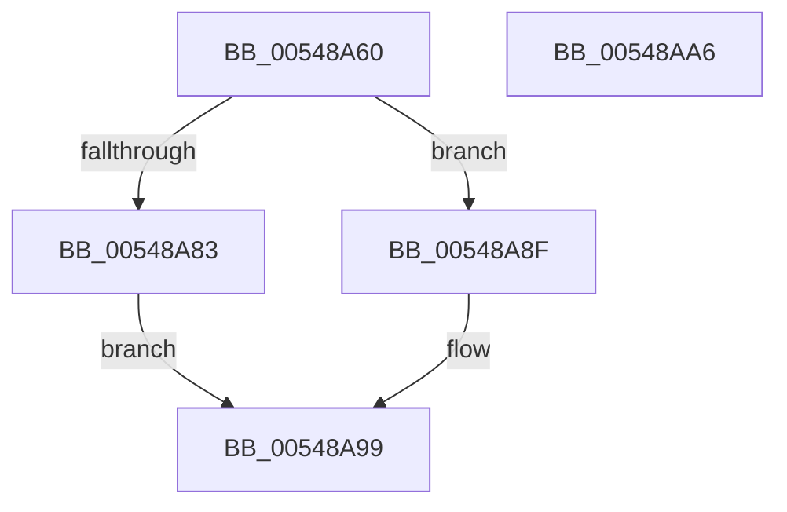

# HalpTimerCalculateMaximumAllowableDrift

- RVA: `0x00548A60`–`0x00548AA7` (길이 `71` bytes)
- VA: `0x0000000140548A60`
- 실행 섹션: `.text`
- PDB 이름 있음: `예`; PDB Function 태그: `아니요`
- unwind 정보 RVA: `0x000DB714`
- 디코드: `19`개 명령, `71/71` bytes 표시
- 미해석 바이트: `0` (있으면 어셈블리에 `.byte`로 보존)

> 이 문서는 커널 이미지의 기계어와 PDB 기호를 분석해 생성했습니다. 4번과 5번은 함수 원형과 자료형을 바이너리 사용 방식에서 추정한 C 해석이며 원본 소스 복구 결과는 아닙니다.

## 1. Dependencies

- 직접 호출 지점: **0**; 고유 호출 대상: **0**
- 직접 호출자로 확인된 함수: **2**
- RIP 상대 이미지 참조: **2**

### Outgoing calls
- 직접 디코드된 call 명령이 없습니다.

### Direct callers
- [HalpInitializeTimers](../53/HalpInitializeTimers_function_0053C1E0.md) at `0x0053C3FA`
- [HalpTscFallback](HalpTscFallback_function_0054AC40.md) at `0x0054ACCC`

### Static image references
- `0x00548A60` → RVA `0x00FC3FD0` (`.data`; read)
- `0x00548A70` → RVA `0x00FC4140` (`.data`; read)

## 2. Other-region calls and transfers

- 다른 실행 섹션으로 향하는 call: **0**
- 별도 외부 분기/꼬리 이동을 확인하지 못했습니다.

## 3. Assembly (complete function range)

```asm
00548A60  48 8B 05 69 B5 A7 00            mov rax, qword ptr [rip + 0xa7b569]
00548A67  33 D2                           xor edx, edx
00548A69  48 8B 88 C0 00 00 00            mov rcx, qword ptr [rax + 0xc0]
00548A70  48 8B 05 C9 B6 A7 00            mov rax, qword ptr [rip + 0xa7b6c9]
00548A77  4C 8B 80 C0 00 00 00            mov r8, qword ptr [rax + 0xc0]
00548A7E  49 3B C8                        cmp rcx, r8
00548A81  76 0C                           jbe 0x140548a8f
00548A83  48 8D 04 89                     lea rax, [rcx + rcx*4]
00548A87  48 03 C0                        add rax, rax
00548A8A  49 F7 F0                        div r8
00548A8D  EB 0A                           jmp 0x140548a99
00548A8F  4B 8D 04 80                     lea rax, [r8 + r8*4]
00548A93  48 03 C0                        add rax, rax
00548A96  48 F7 F1                        div rcx
00548A99  B9 0A 00 00 00                  mov ecx, 0xa
00548A9E  48 3B C1                        cmp rax, rcx
00548AA1  48 0F 42 C1                     cmovb rax, rcx
00548AA5  C3                              ret
00548AA6  CC                              int3
```

## 4. C-style interpretation (structured pseudocode)

```c
__int64 __fastcall HalpTimerCalculateMaximumAllowableDrift(__int64 a1, int a2)
{
    __int64 result;

    a2 = 0;
    if ((*(unsigned __int64 *)(*(unsigned __int64 *)(v_rip + 10990953) + 192)) <= (*(unsigned __int64 *)(*(unsigned __int64 *)(v_rip + 10991305) + 192))) goto loc_00548A8F;
    result = (*(unsigned __int64 *)(*(unsigned __int64 *)(v_rip + 10990953) + 192) + *(unsigned __int64 *)(*(unsigned __int64 *)(v_rip + 10990953) + 192) * 4) + (*(unsigned __int64 *)(*(unsigned __int64 *)(v_rip + 10990953) + 192) + *(unsigned __int64 *)(*(unsigned __int64 *)(v_rip + 10990953) + 192) * 4);
    goto loc_00548A99;
loc_00548A8F:
    result = (*(unsigned __int64 *)(*(unsigned __int64 *)(v_rip + 10991305) + 192) + *(unsigned __int64 *)(*(unsigned __int64 *)(v_rip + 10991305) + 192) * 4) + (*(unsigned __int64 *)(*(unsigned __int64 *)(v_rip + 10991305) + 192) + *(unsigned __int64 *)(*(unsigned __int64 *)(v_rip + 10991305) + 192) * 4);
loc_00548A99:
    if (result < 10) { result = 10; }
    return result;
}
```

## 5. (Beta) C Style

```c
int64_t HalpTimerCalculateMaximumAllowableDrift(int64_t Arg1, int32_t Arg2)
{
    int64_t result;

    Arg2 = 0;
    if ((*(uint64_t *)(*(uint64_t *)(v_rip + 0xA7B569) + 0xC0)) <= (*(uint64_t *)(*(uint64_t *)(v_rip + 0xA7B6C9) + 0xC0))) goto loc_00548A8F;
    result = (*(uint64_t *)(*(uint64_t *)(v_rip + 0xA7B569) + 0xC0) + *(uint64_t *)(*(uint64_t *)(v_rip + 0xA7B569) + 0xC0) * 4) + (*(uint64_t *)(*(uint64_t *)(v_rip + 0xA7B569) + 0xC0) + *(uint64_t *)(*(uint64_t *)(v_rip + 0xA7B569) + 0xC0) * 4);
    goto loc_00548A99;
loc_00548A8F:
    result = (*(uint64_t *)(*(uint64_t *)(v_rip + 0xA7B6C9) + 0xC0) + *(uint64_t *)(*(uint64_t *)(v_rip + 0xA7B6C9) + 0xC0) * 4) + (*(uint64_t *)(*(uint64_t *)(v_rip + 0xA7B6C9) + 0xC0) + *(uint64_t *)(*(uint64_t *)(v_rip + 0xA7B6C9) + 0xC0) * 4);
loc_00548A99:
    if (result < 10) { result = 10; }
    return result;
}
```

## 6. Execution-region graph

[열기: 2D/3D 그래프와 함수 탐색 컨트롤 패널](../../../control-panel.html?section=text&rva=0x00548A60&view=graph)

- 2D 그래프는 위에서 아래로 흐르고, 3D 그래프는 빈 공간을 드래그해 회전합니다. Shift+드래그는 이동, 휠은 확대·축소, 함수 노드 선택은 대상 보고서 이동입니다.

### Static fallback


