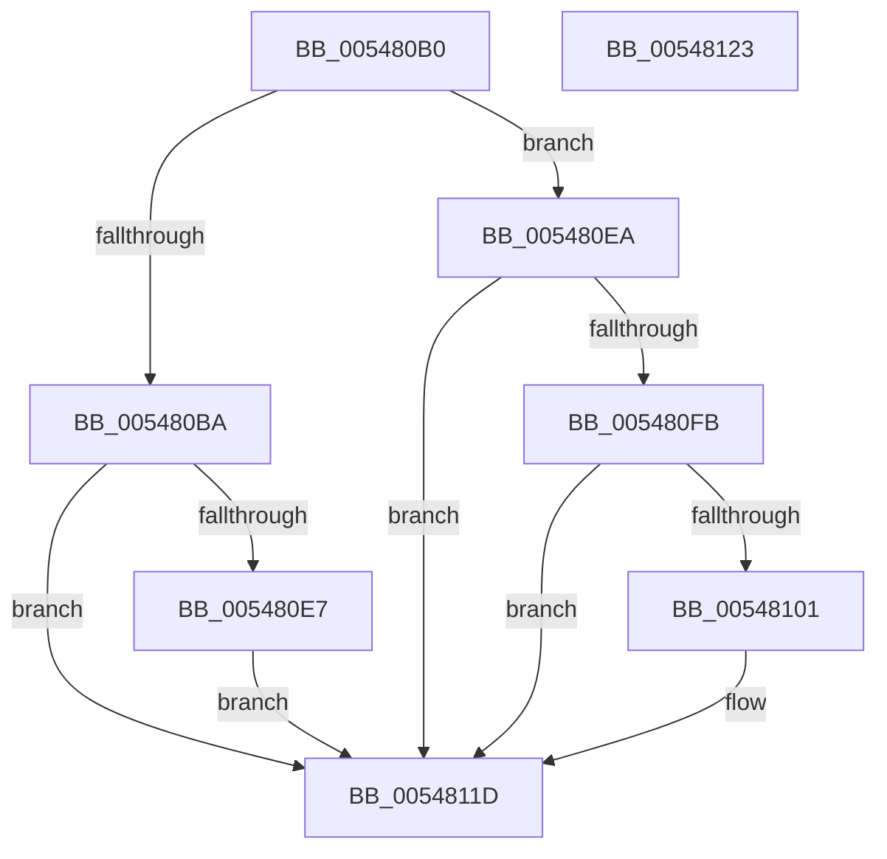

# HalpTimerClockActivate

- RVA: `0x005480B0`–`0x00548124` (길이 `116` bytes)
- VA: `0x00000001405480B0`
- 실행 섹션: `.text`
- PDB 이름 있음: `예`; PDB Function 태그: `아니요`
- unwind 정보 RVA: `0x00064C80`
- 디코드: `32`개 명령, `116/116` bytes 표시
- 미해석 바이트: `0` (있으면 어셈블리에 `.byte`로 보존)

> 이 문서는 커널 이미지의 기계어와 PDB 기호를 분석해 생성했습니다. 4번과 5번은 함수 원형과 자료형을 바이너리 사용 방식에서 추정한 C 해석이며 원본 소스 복구 결과는 아닙니다.

## 1. Dependencies

- 직접 호출 지점: **5**; 고유 호출 대상: **5**
- 직접 호출자로 확인된 함수: **0**
- RIP 상대 이미지 참조: **2**

### Outgoing calls
- `0x005480BA` → [HalpTimerPrepareClockInterrupt](HalpTimerPrepareClockInterrupt_function_00548750.md) (function, `0x00548750`)
- `0x005480BF` → [HalpDisableInterrupts](../25/HalpDisableInterrupts_function_002521A0.md) (function, `0x002521A0`)
- `0x005480DE` → [HalpInterruptSetIdtEntry](../55/HalpInterruptSetIdtEntry_function_0055BAE0.md) (function, `0x0055BAE0`)
- `0x00548104` → [HalpTimerGetInternalData](../20/HalpTimerGetInternalData_function_00209500.md) (function, `0x00209500`)
- `0x00548118` → [guard_dispatch_icall](../6B/guard_dispatch_icall_function_006BAAD0.md) (function, `0x006BAAD0`)

### Direct callers
- 이 함수 시작 RVA로 연결되는 직접 call은 확인되지 않았습니다. 간접 호출은 완전히 역산할 수 없습니다.

### Static image references
- `0x005480D5` → RVA `0x002086A0` (`HalpTimerClockInterrupt`; read)
- `0x005480EA` → RVA `0x00FC40F0` (`.data`; read)

## 2. Other-region calls and transfers

- 다른 실행 섹션으로 향하는 call: **0**
- 별도 외부 분기/꼬리 이동을 확인하지 못했습니다.

## 3. Assembly (complete function range)

```asm
005480B0  40 53                           push rbx
005480B2  48 83 EC 30                     sub rsp, 0x30
005480B6  84 C9                           test cl, cl
005480B8  74 30                           je 0x1405480ea
005480BA  E8 91 06 00 00                  call 0x140548750
005480BF  E8 DC A0 D0 FF                  call 0x1402521a0
005480C4  B9 D1 00 00 00                  mov ecx, 0xd1
005480C9  48 C7 44 24 20 FD FF FF FF      mov qword ptr [rsp + 0x20], 0xfffffffffffffffd
005480D2  41 B0 0D                        mov r8b, 0xd
005480D5  48 8D 15 C4 05 CC FF            lea rdx, [rip - 0x33fa3c]
005480DC  8A D8                           mov bl, al
005480DE  E8 FD 39 01 00                  call 0x14055bae0
005480E3  84 DB                           test bl, bl
005480E5  74 36                           je 0x14054811d
005480E7  FB                              sti
005480E8  EB 33                           jmp 0x14054811d
005480EA  48 8B 15 FF BF A7 00            mov rdx, qword ptr [rip + 0xa7bfff]
005480F1  8B 82 E0 00 00 00               mov eax, dword ptr [rdx + 0xe0]
005480F7  A8 01                           test al, 1
005480F9  74 22                           je 0x14054811d
005480FB  0F BA E0 0B                     bt eax, 0xb
005480FF  73 1C                           jae 0x14054811d
00548101  48 8B CA                        mov rcx, rdx
00548104  E8 F7 13 CC FF                  call 0x140209500
00548109  48 8B C8                        mov rcx, rax
0054810C  48 8B 82 A8 00 00 00            mov rax, qword ptr [rdx + 0xa8]
00548113  BA D1 00 00 00                  mov edx, 0xd1
00548118  E8 B3 29 17 00                  call 0x1406baad0
0054811D  48 83 C4 30                     add rsp, 0x30
00548121  5B                              pop rbx
00548122  C3                              ret
00548123  CC                              int3
```

## 4. C-style interpretation (structured pseudocode)

```c
__int64 __fastcall HalpTimerClockActivate(unsigned __int8 a1)
{
    __int64 result;
    __int64 v_rsp;
    unsigned __int64 v_stack_m18;

    v_rsp = (v_rsp) - (48);
    if (a1 == 0) goto loc_005480EA;
    result = HalpTimerPrepareClockInterrupt(a1, a2, a3, a4);
    result = HalpDisableInterrupts(a1, a2, a3, a4);
    v_stack_m18 = -3;
    result = HalpInterruptSetIdtEntry(209, v_rip - 3406396, 13, a4);
    if ((unsigned __int8)((unsigned __int8)(result)) == 0) goto loc_0054811D;
    goto loc_0054811D;
loc_005480EA:
    if ((((unsigned __int8)((unsigned int)(*(unsigned int *)(*(unsigned __int64 *)(v_rip + 10993663) + 224)))) & (1)) == 0) goto loc_0054811D;
    result = (unsigned int)(*(unsigned int *)(*(unsigned __int64 *)(v_rip + 10993663) + 224));
    if (!(condition_is_above_or_equal)) {
        a1 = *(unsigned __int64 *)(v_rip + 10993663);
        result = HalpTimerGetInternalData(a1, *(unsigned __int64 *)(v_rip + 10993663), 13, a4);
        a1 = result;
        result = *(unsigned __int64 *)(*(unsigned __int64 *)(v_rip + 10993663) + 168);
        a2 = 209;
        result = guard_dispatch_icall(a1, a2, 13, a4);
    }
    v_rsp = (v_rsp) + (48);
    return result;
}
```

## 5. (Beta) C Style

```c
int64_t HalpTimerClockActivate(uint8_t Arg1)
{
    int64_t result;
    int64_t local_rsp;
    uint64_t v_stack_m18;

    local_rsp = (local_rsp) - (48);
    if (Arg1 == 0) goto loc_005480EA;
    result = HalpTimerPrepareClockInterrupt(Arg1, a2, a3, a4);
    result = HalpDisableInterrupts(Arg1, a2, a3, a4);
    v_stack_m18 = -3;
    result = HalpInterruptSetIdtEntry(209, v_rip - 3406396, 13, a4);
    if ((uint8_t)((uint8_t)(result)) == 0) goto loc_0054811D;
    goto loc_0054811D;
loc_005480EA:
    if ((((uint8_t)((uint32_t)(*(uint32_t *)(*(uint64_t *)(v_rip + 0xA7BFFF) + 0xE0)))) & (1)) == 0) goto loc_0054811D;
    result = (uint32_t)(*(uint32_t *)(*(uint64_t *)(v_rip + 0xA7BFFF) + 0xE0));
    if (!(condition_is_above_or_equal)) {
        Arg1 = *(uint64_t *)(v_rip + 0xA7BFFF);
        result = HalpTimerGetInternalData(Arg1, *(uint64_t *)(v_rip + 0xA7BFFF), 13, a4);
        Arg1 = result;
        result = *(uint64_t *)(*(uint64_t *)(v_rip + 0xA7BFFF) + 0xA8);
        a2 = 209;
        result = guard_dispatch_icall(Arg1, a2, 13, a4);
    }
    local_rsp = (local_rsp) + (48);
    return result;
}
```

## 6. Execution-region graph

[열기: 2D/3D 그래프와 함수 탐색 컨트롤 패널](../../../control-panel.html?section=text&rva=0x005480B0&view=graph)

- 2D 그래프는 위에서 아래로 흐르고, 3D 그래프는 빈 공간을 드래그해 회전합니다. Shift+드래그는 이동, 휠은 확대·축소, 함수 노드 선택은 대상 보고서 이동입니다.

### Static fallback


