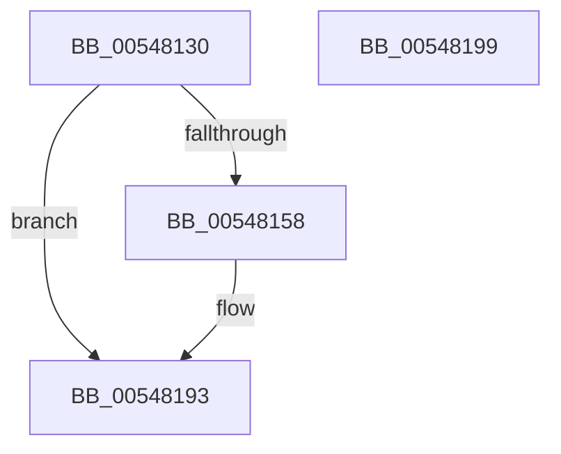

# HalpTimerClockInitialize

- RVA: `0x00548130`–`0x0054819A` (길이 `106` bytes)
- VA: `0x0000000140548130`
- 실행 섹션: `.text`
- PDB 이름 있음: `예`; PDB Function 태그: `아니요`
- unwind 정보 RVA: `0x00064C80`
- 디코드: `27`개 명령, `106/106` bytes 표시
- 미해석 바이트: `0` (있으면 어셈블리에 `.byte`로 보존)

> 이 문서는 커널 이미지의 기계어와 PDB 기호를 분석해 생성했습니다. 4번과 5번은 함수 원형과 자료형을 바이너리 사용 방식에서 추정한 C 해석이며 원본 소스 복구 결과는 아닙니다.

## 1. Dependencies

- 직접 호출 지점: **4**; 고유 호출 대상: **4**
- 직접 호출자로 확인된 함수: **1**
- RIP 상대 이미지 참조: **3**

### Outgoing calls
- `0x00548140` → [HalpTimerGetInternalData](../20/HalpTimerGetInternalData_function_00209500.md) (function, `0x00209500`)
- `0x0054814C` → [guard_dispatch_icall](../6B/guard_dispatch_icall_function_006BAAD0.md) (function, `0x006BAAD0`)
- `0x0054816F` → [HalpTimerSetProblemEx](../4F/HalpTimerSetProblemEx_function_004FAEC4.md) (function, `0x004FAEC4`)
- `0x0054818D` → [KeBugCheckEx](../4F/KeBugCheckEx_function_004FD660.md) (function, `0x004FD660`)

### Direct callers
- [HalpTimerClockPowerChange](HalpTimerClockPowerChange_function_005481A0.md) at `0x005482DA`

### Static image references
- `0x00548136` → RVA `0x00FC40F0` (`.data`; read)
- `0x00548158` → RVA `0x00023E30` (`.rdata`; read)
- `0x00548174` → RVA `0x00E10358` (`.data`; read)

## 2. Other-region calls and transfers

- 다른 실행 섹션으로 향하는 call: **0**
- 별도 외부 분기/꼬리 이동을 확인하지 못했습니다.

## 3. Assembly (complete function range)

```asm
00548130  40 53                           push rbx
00548132  48 83 EC 30                     sub rsp, 0x30
00548136  48 8B 1D B3 BF A7 00            mov rbx, qword ptr [rip + 0xa7bfb3]
0054813D  48 8B CB                        mov rcx, rbx
00548140  E8 BB 13 CC FF                  call 0x140209500
00548145  48 8B C8                        mov rcx, rax
00548148  48 8B 43 68                     mov rax, qword ptr [rbx + 0x68]
0054814C  E8 7F 29 17 00                  call 0x1406baad0
00548151  4C 63 C0                        movsxd r8, eax
00548154  85 C0                           test eax, eax
00548156  79 3B                           jns 0x140548193
00548158  4C 8D 0D D1 BC AD FF            lea r9, [rip - 0x52432f]
0054815F  C7 44 24 20 AF 05 00 00         mov dword ptr [rsp + 0x20], 0x5af
00548167  BA 0F 00 00 00                  mov edx, 0xf
0054816C  48 8B CB                        mov rcx, rbx
0054816F  E8 50 2D FB FF                  call 0x1404faec4
00548174  4C 63 0D DD 81 8C 00            movsxd r9, dword ptr [rip + 0x8c81dd]
0054817B  BA 10 01 00 00                  mov edx, 0x110
00548180  4C 89 44 24 20                  mov qword ptr [rsp + 0x20], r8
00548185  B9 5C 00 00 00                  mov ecx, 0x5c
0054818A  4C 8B C3                        mov r8, rbx
0054818D  E8 CE 54 FB FF                  call 0x1404fd660
00548192  CC                              int3
00548193  48 83 C4 30                     add rsp, 0x30
00548197  5B                              pop rbx
00548198  C3                              ret
00548199  CC                              int3
```

## 4. C-style interpretation (structured pseudocode)

```c
__int64 __fastcall HalpTimerClockInitialize(void)
{
    __int64 result;
    __int64 v_rsp;
    unsigned int v_stack_m18;

    v_rsp = (v_rsp) - (48);
    result = HalpTimerGetInternalData(*(unsigned __int64 *)(v_rip + 10993587), a2, a3, a4);
    result = guard_dispatch_icall(result, a2, a3, a4);
    if (sign_flag) {
        a4 = v_rip - 5391151;
        v_stack_m18 = 0x5AFULL;
        a2 = 15;
        a1 = *(unsigned __int64 *)(v_rip + 10993587);
        result = HalpTimerSetProblemEx(a1, a2, (int)((unsigned int)(result)), a4);
        a4 = (int)(*(unsigned int *)(v_rip + 9208285));
        a2 = 272;
        v_stack_m18 = (int)((unsigned int)(result));
        a1 = 92;
        a3 = *(unsigned __int64 *)(v_rip + 10993587);
        result = KeBugCheckEx(a1, a2, a3, a4);
    }
    v_rsp = (v_rsp) + (48);
    return result;
}
```

## 5. (Beta) C Style

```c
void HalpTimerClockInitialize(void)
{
    int64_t result;
    int64_t local_rsp;
    uint32_t v_stack_m18;

    local_rsp = (local_rsp) - (48);
    result = HalpTimerGetInternalData(*(uint64_t *)(v_rip + 0xA7BFB3), a2, a3, a4);
    result = guard_dispatch_icall(result, a2, a3, a4);
    if (sign_flag) {
        a4 = v_rip - 5391151;
        v_stack_m18 = 0x5AFULL;
        a2 = 15;
        a1 = *(uint64_t *)(v_rip + 0xA7BFB3);
        result = HalpTimerSetProblemEx(a1, a2, (int32_t)((uint32_t)(result)), a4);
        a4 = (int32_t)(*(uint32_t *)(v_rip + 0x8C81DD));
        a2 = 272;
        v_stack_m18 = (int32_t)((uint32_t)(result));
        a1 = 92;
        a3 = *(uint64_t *)(v_rip + 0xA7BFB3);
        result = KeBugCheckEx(a1, a2, a3, a4);
    }
    local_rsp = (local_rsp) + (48);
    return result;
}
```

## 6. Execution-region graph

[열기: 2D/3D 그래프와 함수 탐색 컨트롤 패널](../../../control-panel.html?section=text&rva=0x00548130&view=graph)

- 2D 그래프는 위에서 아래로 흐르고, 3D 그래프는 빈 공간을 드래그해 회전합니다. Shift+드래그는 이동, 휠은 확대·축소, 함수 노드 선택은 대상 보고서 이동입니다.

### Static fallback


