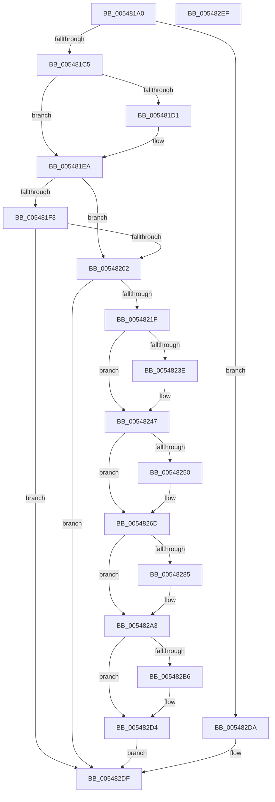

# HalpTimerClockPowerChange

- RVA: `0x005481A0`–`0x005482F0` (길이 `336` bytes)
- VA: `0x00000001405481A0`
- 실행 섹션: `.text`
- PDB 이름 있음: `예`; PDB Function 태그: `아니요`
- unwind 정보 RVA: `0x000C3DF4`
- 디코드: `87`개 명령, `336/336` bytes 표시
- 미해석 바이트: `0` (있으면 어셈블리에 `.byte`로 보존)

> 이 문서는 커널 이미지의 기계어와 PDB 기호를 분석해 생성했습니다. 4번과 5번은 함수 원형과 자료형을 바이너리 사용 방식에서 추정한 C 해석이며 원본 소스 복구 결과는 아닙니다.

## 1. Dependencies

- 직접 호출 지점: **10**; 고유 호출 대상: **7**
- 직접 호출자로 확인된 함수: **1**
- RIP 상대 이미지 참조: **5**

### Outgoing calls
- `0x005481E4` → [KeBugCheckEx](../4F/KeBugCheckEx_function_004FD660.md) (function, `0x004FD660`)
- `0x00548202` → [HalpTimerClockStop](../4C/HalpTimerClockStop_function_004C0690.md) (function, `0x004C0690`)
- `0x0054820C` → [KeGetNextClockTickDuration](../5B/KeGetNextClockTickDuration_function_005BA350.md) (function, `0x005BA350`)
- `0x00548267` → [KeBugCheckEx](../4F/KeBugCheckEx_function_004FD660.md) (function, `0x004FD660`)
- `0x00548270` → [HalpTimerGetInternalData](../20/HalpTimerGetInternalData_function_00209500.md) (function, `0x00209500`)
- `0x0054827C` → [guard_dispatch_icall](../6B/guard_dispatch_icall_function_006BAAD0.md) (function, `0x006BAAD0`)
- `0x0054829D` → [KeBugCheckEx](../4F/KeBugCheckEx_function_004FD660.md) (function, `0x004FD660`)
- `0x005482AD` → [HalpSetTimerAnyMode](../42/HalpSetTimerAnyMode_function_0042B868.md) (function, `0x0042B868`)
- `0x005482CE` → [KeBugCheckEx](../4F/KeBugCheckEx_function_004FD660.md) (function, `0x004FD660`)
- `0x005482DA` → [HalpTimerClockInitialize](HalpTimerClockInitialize_function_00548130.md) (function, `0x00548130`)

### Direct callers
- [HalpTimerPowerChange](HalpTimerPowerChange_function_00549DF0.md) at `0x00549E3E`

### Static image references
- `0x005481C5` → RVA `0x00FC4108` (`.data`; read)
- `0x005481EA` → RVA `0x00FC6A85` (`ALMOSTRO`; read)
- `0x005481F3` → RVA `0x00F21FB0` (`.data`; read)
- `0x0054823E` → RVA `0x00E10340` (`.data`; read/write)
- `0x00548247` → RVA `0x00FC22D8` (`.data`; read)

## 2. Other-region calls and transfers

- 다른 실행 섹션으로 향하는 call: **0**
- 별도 외부 분기/꼬리 이동을 확인하지 못했습니다.

## 3. Assembly (complete function range)

```asm
005481A0  48 8B C4                        mov rax, rsp
005481A3  48 89 58 08                     mov qword ptr [rax + 8], rbx
005481A7  48 89 70 20                     mov qword ptr [rax + 0x20], rsi
005481AB  57                              push rdi
005481AC  48 83 EC 30                     sub rsp, 0x30
005481B0  65 48 8B 34 25 20 00 00 00      mov rsi, qword ptr gs:[0x20]
005481B9  C6 40 10 00                     mov byte ptr [rax + 0x10], 0
005481BD  84 D2                           test dl, dl
005481BF  0F 85 15 01 00 00               jne 0x1405482da
005481C5  48 8B 1D 3C BF A7 00            mov rbx, qword ptr [rip + 0xa7bf3c]
005481CC  48 85 DB                        test rbx, rbx
005481CF  75 19                           jne 0x1405481ea
005481D1  48 21 58 E8                     and qword ptr [rax - 0x18], rbx
005481D5  44 8D 43 21                     lea r8d, [rbx + 0x21]
005481D9  4C 8B C9                        mov r9, rcx
005481DC  BA 13 01 00 00                  mov edx, 0x113
005481E1  8D 4B 5C                        lea ecx, [rbx + 0x5c]
005481E4  E8 77 54 FB FF                  call 0x1404fd660
005481E9  CC                              int3
005481EA  80 3D 94 E8 A7 00 00            cmp byte ptr [rip + 0xa7e894], 0
005481F1  75 0F                           jne 0x140548202
005481F3  8B 05 B7 9D 9D 00               mov eax, dword ptr [rip + 0x9d9db7]
005481F9  39 46 24                        cmp dword ptr [rsi + 0x24], eax
005481FC  0F 85 DD 00 00 00               jne 0x1405482df
00548202  E8 89 84 F7 FF                  call 0x1404c0690
00548207  48 8D 4C 24 48                  lea rcx, [rsp + 0x48]
0054820C  E8 3F 21 07 00                  call 0x1405ba350
00548211  80 7C 24 48 00                  cmp byte ptr [rsp + 0x48], 0
00548216  48 8B F8                        mov rdi, rax
00548219  0F 85 C0 00 00 00               jne 0x1405482df
0054821F  33 D2                           xor edx, edx
00548221  B8 80 96 98 00                  mov eax, 0x989680
00548226  48 F7 B3 C0 00 00 00            div qword ptr [rbx + 0xc0]
0054822D  B9 88 13 00 00                  mov ecx, 0x1388
00548232  48 3B C1                        cmp rax, rcx
00548235  48 0F 4C C1                     cmovl rax, rcx
00548239  48 3B F8                        cmp rdi, rax
0054823C  7D 09                           jge 0x140548247
0054823E  FF 05 FC 80 8C 00               inc dword ptr [rip + 0x8c80fc]
00548244  48 8B F8                        mov rdi, rax
00548247  48 3B 3D 8A A0 A7 00            cmp rdi, qword ptr [rip + 0xa7a08a]
0054824E  76 1D                           jbe 0x14054826d
00548250  48 83 64 24 20 00               and qword ptr [rsp + 0x20], 0
00548256  B9 5C 00 00 00                  mov ecx, 0x5c
0054825B  4C 8B CF                        mov r9, rdi
0054825E  BA 13 01 00 00                  mov edx, 0x113
00548263  44 8D 41 C9                     lea r8d, [rcx - 0x37]
00548267  E8 F4 53 FB FF                  call 0x1404fd660
0054826C  CC                              int3
0054826D  48 8B CB                        mov rcx, rbx
00548270  E8 8B 12 CC FF                  call 0x140209500
00548275  48 8B C8                        mov rcx, rax
00548278  48 8B 43 68                     mov rax, qword ptr [rbx + 0x68]
0054827C  E8 4F 28 17 00                  call 0x1406baad0
00548281  85 C0                           test eax, eax
00548283  79 1E                           jns 0x1405482a3
00548285  B9 5C 00 00 00                  mov ecx, 0x5c
0054828A  48 98                           cdqe
0054828C  4C 8B CB                        mov r9, rbx
0054828F  48 89 44 24 20                  mov qword ptr [rsp + 0x20], rax
00548294  BA 13 01 00 00                  mov edx, 0x113
00548299  44 8D 41 B3                     lea r8d, [rcx - 0x4d]
0054829D  E8 BE 53 FB FF                  call 0x1404fd660
005482A2  CC                              int3
005482A3  8B D7                           mov edx, edi
005482A5  4C 8D 4C 24 50                  lea r9, [rsp + 0x50]
005482AA  48 8B CB                        mov rcx, rbx
005482AD  E8 B6 35 EE FF                  call 0x14042b868
005482B2  85 C0                           test eax, eax
005482B4  79 1E                           jns 0x1405482d4
005482B6  B9 5C 00 00 00                  mov ecx, 0x5c
005482BB  48 98                           cdqe
005482BD  4C 8B CB                        mov r9, rbx
005482C0  48 89 44 24 20                  mov qword ptr [rsp + 0x20], rax
005482C5  BA 13 01 00 00                  mov edx, 0x113
005482CA  44 8D 41 C7                     lea r8d, [rcx - 0x39]
005482CE  E8 8D 53 FB FF                  call 0x1404fd660
005482D3  CC                              int3
005482D4  80 4E 22 02                     or byte ptr [rsi + 0x22], 2
005482D8  EB 05                           jmp 0x1405482df
005482DA  E8 51 FE FF FF                  call 0x140548130
005482DF  48 8B 5C 24 40                  mov rbx, qword ptr [rsp + 0x40]
005482E4  48 8B 74 24 58                  mov rsi, qword ptr [rsp + 0x58]
005482E9  48 83 C4 30                     add rsp, 0x30
005482ED  5F                              pop rdi
005482EE  C3                              ret
005482EF  CC                              int3
```

## 4. C-style interpretation (structured pseudocode)

```c
__int64 __fastcall HalpTimerClockPowerChange(__int64 a1, unsigned __int8 a2)
{
    __int64 result;
    __int64 v_rdi;
    __int64 v_rsp;
    unsigned __int64 v_stack_m18;
    unsigned __int64 v_stack_p10;
    unsigned __int64 v_stack_p18;
    unsigned __int64 v_stack_p20;
    unsigned __int64 v_stack_p8;

    *(unsigned __int64 *)(v_rsp + 8) = v_rbx;
    *(unsigned __int64 *)(v_rsp + 32) = v_rsi;
    v_rsp = (v_rsp) - (48);
    *(unsigned __int8 *)(v_rsp + 16) = 0;
    if (a2 != 0) goto loc_005482DA;
    result = v_rsp;
    if (*(unsigned __int64 *)(v_rip + 10993468) == 0) {
        a3 = *(unsigned __int64 *)(v_rip + 10993468) + 33;
        a4 = a1;
        a2 = 275;
        a1 = *(unsigned __int64 *)(v_rip + 10993468) + 92;
        result = KeBugCheckEx(a1, a2, a3, a4);
    }
    if ((*(unsigned __int8 *)(v_rip + 11004052)) != 0) goto loc_00548202;
    if ((*(unsigned int *)(*(unsigned __int64 *)(gs_base + (0 + 32)) + 36)) != ((unsigned int)((unsigned int)(*(unsigned int *)(v_rip + 10329527))))) goto loc_005482DF;
loc_00548202:
    result = HalpTimerClockStop(a1, a2, a3, a4);
    result = KeGetNextClockTickDuration(v_stack_p10, a2, a3, a4);
    if (v_stack_p10 != 0) goto loc_005482DF;
    a2 = 0;
    result = (unsigned int)(0x989680ULL);
    if (((unsigned int)(0x989680ULL)) < ((unsigned int)(0x1388ULL))) { result = (unsigned int)(0x1388ULL); }
    v_rdi = result;
    if (result < result) {
        v_rdi = result;
    }
    if (v_rdi >= = (*(unsigned __int64 *)(v_rip + 10985610))) {
        a1 = 92;
        a4 = v_rdi;
        a2 = 275;
        a3 = a1 - 55;
        result = KeBugCheckEx(a1, a2, a3, a4);
    }
    result = HalpTimerGetInternalData(*(unsigned __int64 *)(v_rip + 10993468), a2, a3, a4);
    result = guard_dispatch_icall(result, a2, a3, a4);
    if (sign_flag) {
        a1 = 92;
        a4 = *(unsigned __int64 *)(v_rip + 10993468);
        v_stack_m18 = result;
        a2 = 275;
        a3 = a1 - 77;
        result = KeBugCheckEx(a1, a2, a3, a4);
    }
    result = HalpSetTimerAnyMode(*(unsigned __int64 *)(v_rip + 10993468), (unsigned int)((unsigned int)(v_rdi)), a3, v_stack_p18);
    if (sign_flag) {
        a1 = 92;
        a4 = *(unsigned __int64 *)(v_rip + 10993468);
        v_stack_m18 = result;
        a2 = 275;
        a3 = a1 - 57;
        result = KeBugCheckEx(a1, a2, a3, a4);
    }
    goto loc_005482DF;
loc_005482DA:
    result = HalpTimerClockInitialize(a1, a2, a3, a4);
loc_005482DF:
    v_rsp = (v_rsp) + (48);
    return result;
}
```

## 5. (Beta) C Style

```c
int64_t HalpTimerClockPowerChange(int64_t Arg1, uint8_t Arg2)
{
    int64_t result;
    int64_t local_rdi;
    int64_t local_rsp;
    uint64_t v_stack_m18;
    uint64_t v_stack_p10;
    uint64_t v_stack_p18;
    uint64_t v_stack_p20;
    uint64_t v_stack_p8;

    *(uint64_t *)(local_rsp + 0x8) = local_rbx;
    *(uint64_t *)(local_rsp + 0x20) = local_rsi;
    local_rsp = (local_rsp) - (48);
    *(uint8_t *)(local_rsp + 0x10) = 0;
    if (Arg2 != 0) goto loc_005482DA;
    result = local_rsp;
    if (*(uint64_t *)(v_rip + 0xA7BF3C) == 0) {
        a3 = *(uint64_t *)(v_rip + 0xA7BF3C) + 33;
        a4 = Arg1;
        Arg2 = 275;
        Arg1 = *(uint64_t *)(v_rip + 0xA7BF3C) + 92;
        result = KeBugCheckEx(Arg1, Arg2, a3, a4);
    }
    if ((*(uint8_t *)(v_rip + 0xA7E894)) != 0) goto loc_00548202;
    if ((*(uint32_t *)(*(uint64_t *)(gs_base + (0 + 0x20)) + 0x24)) != ((uint32_t)((uint32_t)(*(uint32_t *)(v_rip + 0x9D9DB7))))) goto loc_005482DF;
loc_00548202:
    result = HalpTimerClockStop(Arg1, Arg2, a3, a4);
    result = KeGetNextClockTickDuration(v_stack_p10, Arg2, a3, a4);
    if (v_stack_p10 != 0) goto loc_005482DF;
    Arg2 = 0;
    result = (uint32_t)(0x989680ULL);
    if (((uint32_t)(0x989680ULL)) < ((uint32_t)(0x1388ULL))) { result = (uint32_t)(0x1388ULL); }
    local_rdi = result;
    if (result < result) {
        local_rdi = result;
    }
    if (local_rdi >= = (*(uint64_t *)(v_rip + 0xA7A08A))) {
        Arg1 = 92;
        a4 = local_rdi;
        Arg2 = 275;
        a3 = Arg1 - 55;
        result = KeBugCheckEx(Arg1, Arg2, a3, a4);
    }
    result = HalpTimerGetInternalData(*(uint64_t *)(v_rip + 0xA7BF3C), Arg2, a3, a4);
    result = guard_dispatch_icall(result, Arg2, a3, a4);
    if (sign_flag) {
        Arg1 = 92;
        a4 = *(uint64_t *)(v_rip + 0xA7BF3C);
        v_stack_m18 = result;
        Arg2 = 275;
        a3 = Arg1 - 77;
        result = KeBugCheckEx(Arg1, Arg2, a3, a4);
    }
    result = HalpSetTimerAnyMode(*(uint64_t *)(v_rip + 0xA7BF3C), (uint32_t)((uint32_t)(local_rdi)), a3, v_stack_p18);
    if (sign_flag) {
        Arg1 = 92;
        a4 = *(uint64_t *)(v_rip + 0xA7BF3C);
        v_stack_m18 = result;
        Arg2 = 275;
        a3 = Arg1 - 57;
        result = KeBugCheckEx(Arg1, Arg2, a3, a4);
    }
    goto loc_005482DF;
loc_005482DA:
    result = HalpTimerClockInitialize(Arg1, Arg2, a3, a4);
loc_005482DF:
    local_rsp = (local_rsp) + (48);
    return result;
}
```

## 6. Execution-region graph

[열기: 2D/3D 그래프와 함수 탐색 컨트롤 패널](../../../control-panel.html?section=text&rva=0x005481A0&view=graph)

- 2D 그래프는 위에서 아래로 흐르고, 3D 그래프는 빈 공간을 드래그해 회전합니다. Shift+드래그는 이동, 휠은 확대·축소, 함수 노드 선택은 대상 보고서 이동입니다.

### Static fallback


