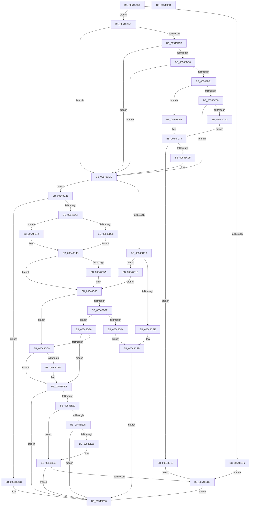

# HalpTimerConfigureInterrupt

- RVA: `0x00548AB0`–`0x00548F12` (길이 `1,122` bytes)
- VA: `0x0000000140548AB0`
- 실행 섹션: `.text`
- PDB 이름 있음: `예`; PDB Function 태그: `아니요`
- unwind 정보 RVA: `0x000C3E34`
- 디코드: `274`개 명령, `1,122/1,122` bytes 표시
- 미해석 바이트: `0` (있으면 어셈블리에 `.byte`로 보존)

> 이 문서는 커널 이미지의 기계어와 PDB 기호를 분석해 생성했습니다. 4번과 5번은 함수 원형과 자료형을 바이너리 사용 방식에서 추정한 C 해석이며 원본 소스 복구 결과는 아닙니다.

## 1. Dependencies

- 직접 호출 지점: **25**; 고유 호출 대상: **16**
- 직접 호출자로 확인된 함수: **4**
- RIP 상대 이미지 참조: **5**

### Outgoing calls
- `0x00548B0E` → [memset](../6C/memset_function_006C6C40.md) (function, `0x006C6C40`)
- `0x00548B44` → [KeFindFirstSetRightGroupAffinity](../2C/KeFindFirstSetRightGroupAffinity_function_002CFB10.md) (function, `0x002CFB10`)
- `0x00548B79` → [HalpTimerGetInternalData](../20/HalpTimerGetInternalData_function_00209500.md) (function, `0x00209500`)
- `0x00548B8B` → [guard_dispatch_icall](../6B/guard_dispatch_icall_function_006BAAD0.md) (function, `0x006BAAD0`)
- `0x00548BA3` → [HalpInterruptSetIdtEntry](../55/HalpInterruptSetIdtEntry_function_0055BAE0.md) (function, `0x0055BAE0`)
- `0x00548BC3` → [HalpInterruptIsMsiSupported](../4C/HalpInterruptIsMsiSupported_function_004C225C.md) (function, `0x004C225C`)
- `0x00548BF0` → [HalpInterruptSetIdtEntry](../55/HalpInterruptSetIdtEntry_function_0055BAE0.md) (function, `0x0055BAE0`)
- `0x00548C2E` → [HalpInterruptRemap](HalpInterruptRemap_function_00542AE4.md) (function, `0x00542AE4`)
- `0x00548C7C` → [HalpTimerGetInternalData](../20/HalpTimerGetInternalData_function_00209500.md) (function, `0x00209500`)
- `0x00548C94` → [guard_dispatch_icall](../6B/guard_dispatch_icall_function_006BAAD0.md) (function, `0x006BAAD0`)
- `0x00548CB9` → [HalpTimerSetProblemEx](../4F/HalpTimerSetProblemEx_function_004FAEC4.md) (function, `0x004FAEC4`)
- `0x00548CC8` → [HalpTimerUnmapInterrupt](HalpTimerUnmapInterrupt_function_0054A140.md) (function, `0x0054A140`)
- `0x00548CE3` → [HalpInterruptGsiToLine](../2D/HalpInterruptGsiToLine_function_002D2DD0.md) (function, `0x002D2DD0`)
- `0x00548D08` → [HalpTimerSetProblemEx](../4F/HalpTimerSetProblemEx_function_004FAEC4.md) (function, `0x004FAEC4`)
- `0x00548D6F` → [HalpInterruptSetIdtEntry](../55/HalpInterruptSetIdtEntry_function_0055BAE0.md) (function, `0x0055BAE0`)
- `0x00548D82` → [HalpTimerGetInternalData](../20/HalpTimerGetInternalData_function_00209500.md) (function, `0x00209500`)
- `0x00548D99` → [guard_dispatch_icall](../6B/guard_dispatch_icall_function_006BAAD0.md) (function, `0x006BAAD0`)
- `0x00548E05` → [HalpInterruptApplyOverrides](../2D/HalpInterruptApplyOverrides_function_002D2CE0.md) (function, `0x002D2CE0`)
- `0x00548E13` → [HalpInterruptLineToGsi](../4A/HalpInterruptLineToGsi_function_004A94F8.md) (function, `0x004A94F8`)
- `0x00548E51` → [HalpInterruptRemap](HalpInterruptRemap_function_00542AE4.md) (function, `0x00542AE4`)
- `0x00548E7C` → [HalpAcquireHighLevelLock](../2D/HalpAcquireHighLevelLock_function_002D2390.md) (function, `0x002D2390`)
- `0x00548EAE` → [HalpInterruptSetLineState](../48/HalpInterruptSetLineState_function_0048A0C8.md) (function, `0x0048A0C8`)
- `0x00548EBF` → [HalpReleaseHighLevelLock](../2D/HalpReleaseHighLevelLock_function_002D1C58.md) (function, `0x002D1C58`)
- `0x00548EE6` → [HalpTimerSetProblemEx](../4F/HalpTimerSetProblemEx_function_004FAEC4.md) (function, `0x004FAEC4`)
- `0x00548EF9` → [_security_check_cookie](../6A/_security_check_cookie_function_006AC640.md) (function, `0x006AC640`)

### Direct callers
- [HalpTimerInitializeClock](HalpTimerInitializeClock_function_00548424.md) at `0x005484B9`
- [HalpTimerInitializeClock](HalpTimerInitializeClock_function_00548424.md) at `0x005484FC`
- [HalpTimerPrepareClockInterrupt](HalpTimerPrepareClockInterrupt_function_00548750.md) at `0x005487CA`
- [HalpTimerInitializeProfiling](HalpTimerInitializeProfiling_function_0054B4FC.md) at `0x0054B5D8`
- [HalpTimerTestHypervisorTimer](HalpTimerTestHypervisorTimer_function_0054BBC0.md) at `0x0054BC55`

### Static image references
- `0x00548AC8` → RVA `0x00E0A740` (`.data`; read)
- `0x00548C9F` → RVA `0x000144D8` (`.rdata`; read)
- `0x00548DD7` → RVA `0x00FC22C8` (`.data`; write)
- `0x00548DDE` → RVA `0x00E10344` (`.data`; write)
- `0x00548E6D` → RVA `0x00FC19A8` (`.data`; read)

## 2. Other-region calls and transfers

- 다른 실행 섹션으로 향하는 call: **0**
- 별도 외부 분기/꼬리 이동을 확인하지 못했습니다.

## 3. Assembly (complete function range)

```asm
00548AB0  40 55                           push rbp
00548AB2  56                              push rsi
00548AB3  57                              push rdi
00548AB4  41 54                           push r12
00548AB6  41 55                           push r13
00548AB8  41 56                           push r14
00548ABA  41 57                           push r15
00548ABC  48 8D 6C 24 F9                  lea rbp, [rsp - 7]
00548AC1  48 81 EC F0 00 00 00            sub rsp, 0xf0
00548AC8  48 8B 05 71 1C 8C 00            mov rax, qword ptr [rip + 0x8c1c71]
00548ACF  48 33 C4                        xor rax, rsp
00548AD2  48 89 45 F7                     mov qword ptr [rbp - 9], rax
00548AD6  48 8B 75 77                     mov rsi, qword ptr [rbp + 0x77]
00548ADA  44 8B FA                        mov r15d, edx
00548ADD  83 64 24 5C 00                  and dword ptr [rsp + 0x5c], 0
00548AE2  33 D2                           xor edx, edx
00548AE4  48 83 64 24 40 00               and qword ptr [rsp + 0x40], 0
00548AEA  45 8A E0                        mov r12b, r8b
00548AED  4C 8B F1                        mov r14, rcx
00548AF0  48 C7 44 24 50 06 00 00 00      mov qword ptr [rsp + 0x50], 6
00548AF9  83 64 24 54 00                  and dword ptr [rsp + 0x54], 0
00548AFE  48 8D 4D 97                     lea rcx, [rbp - 0x69]
00548B02  0F 57 C0                        xorps xmm0, xmm0
00548B05  44 8D 42 58                     lea r8d, [rdx + 0x58]
00548B09  0F 11 44 24 68                  movups xmmword ptr [rsp + 0x68], xmm0
00548B0E  E8 2D E1 17 00                  call 0x1406c6c40
00548B13  8B 45 BF                        mov eax, dword ptr [rbp - 0x41]
00548B16  41 BD 00 00 00 C0               mov r13d, 0xc0000000
00548B1C  0F 10 06                        movups xmm0, xmmword ptr [rsi]
00548B1F  8B 7D 6F                        mov edi, dword ptr [rbp + 0x6f]
00548B22  41 23 C5                        and eax, r13d
00548B25  81 E7 FF FF FF 3F               and edi, 0x3fffffff
00548B2B  44 89 7D 9B                     mov dword ptr [rbp - 0x65], r15d
00548B2F  0B C7                           or eax, edi
00548B31  44 88 65 9F                     mov byte ptr [rbp - 0x61], r12b
00548B35  0F BA E8 1E                     bts eax, 0x1e
00548B39  48 8B CE                        mov rcx, rsi
00548B3C  89 45 BF                        mov dword ptr [rbp - 0x41], eax
00548B3F  F3 0F 7F 45 AF                  movdqu xmmword ptr [rbp - 0x51], xmm0
00548B44  E8 C7 6F D8 FF                  call 0x1402cfb10
00548B49  89 44 24 58                     mov dword ptr [rsp + 0x58], eax
00548B4D  48 8D 44 24 68                  lea rax, [rsp + 0x68]
00548B52  48 89 44 24 60                  mov qword ptr [rsp + 0x60], rax
00548B57  8B 44 24 68                     mov eax, dword ptr [rsp + 0x68]
00548B5B  41 23 C5                        and eax, r13d
00548B5E  0B C7                           or eax, edi
00548B60  BF BB 00 00 C0                  mov edi, 0xc00000bb
00548B65  89 44 24 68                     mov dword ptr [rsp + 0x68], eax
00548B69  41 8B 86 E0 00 00 00            mov eax, dword ptr [r14 + 0xe0]
00548B70  0F BA E0 0B                     bt eax, 0xb
00548B74  73 37                           jae 0x140548bad
00548B76  49 8B CE                        mov rcx, r14
00548B79  E8 82 09 CC FF                  call 0x140209500
00548B7E  48 8B C8                        mov rcx, rax
00548B81  41 8B D7                        mov edx, r15d
00548B84  49 8B 86 A8 00 00 00            mov rax, qword ptr [r14 + 0xa8]
00548B8B  E8 40 1F 17 00                  call 0x1406baad0
00548B90  48 8B 45 67                     mov rax, qword ptr [rbp + 0x67]
00548B94  45 8A C4                        mov r8b, r12b
00548B97  48 8B 55 7F                     mov rdx, qword ptr [rbp + 0x7f]
00548B9B  41 8B CF                        mov ecx, r15d
00548B9E  48 89 44 24 20                  mov qword ptr [rsp + 0x20], rax
00548BA3  E8 38 2F 01 00                  call 0x14055bae0
00548BA8  E9 1B 03 00 00                  jmp 0x140548ec8
00548BAD  4C 8B 6D 67                     mov r13, qword ptr [rbp + 0x67]
00548BB1  BE 01 00 00 00                  mov esi, 1
00548BB6  0F BA E0 0A                     bt eax, 0xa
00548BBA  0F 83 0D 01 00 00               jae 0x140548ccd
00548BC0  40 8A CE                        mov cl, sil
00548BC3  E8 94 96 F7 FF                  call 0x1404c225c
00548BC8  84 C0                           test al, al
00548BCA  0F 84 FD 00 00 00               je 0x140548ccd
00548BD0  41 8B 86 B8 00 00 00            mov eax, dword ptr [r14 + 0xb8]
00548BD7  24 50                           and al, 0x50
00548BD9  3C 40                           cmp al, 0x40
00548BDB  0F 84 EC 00 00 00               je 0x140548ccd
00548BE1  48 8B 55 7F                     mov rdx, qword ptr [rbp + 0x7f]
00548BE5  45 8A C4                        mov r8b, r12b
00548BE8  41 8B CF                        mov ecx, r15d
00548BEB  4C 89 6C 24 20                  mov qword ptr [rsp + 0x20], r13
00548BF0  E8 EB 2E 01 00                  call 0x14055bae0
00548BF5  41 8B 86 B8 00 00 00            mov eax, dword ptr [r14 + 0xb8]
00548BFC  A8 40                           test al, 0x40
00548BFE  75 6B                           jne 0x140548c6b
00548C00  49 8B 8E 20 01 00 00            mov rcx, qword ptr [r14 + 0x120]
00548C07  48 8D 45 97                     lea rax, [rbp - 0x69]
00548C0B  83 65 A3 00                     and dword ptr [rbp - 0x5d], 0
00548C0F  45 33 C9                        xor r9d, r9d
00548C12  C7 45 97 03 00 00 00            mov dword ptr [rbp - 0x69], 3
00548C19  89 75 A7                        mov dword ptr [rbp - 0x59], esi
00548C1C  8B 51 04                        mov edx, dword ptr [rcx + 4]
00548C1F  4C 8D 41 08                     lea r8, [rcx + 8]
00548C23  8B 09                           mov ecx, dword ptr [rcx]
00548C25  89 74 24 28                     mov dword ptr [rsp + 0x28], esi
00548C29  48 89 44 24 20                  mov qword ptr [rsp + 0x20], rax
00548C2E  E8 B1 9E FF FF                  call 0x140542ae4
00548C33  8B F8                           mov edi, eax
00548C35  85 C0                           test eax, eax
00548C37  0F 88 90 00 00 00               js 0x140548ccd
00548C3D  8B 45 C3                        mov eax, dword ptr [rbp - 0x3d]
00548C40  4D 8D 86 E8 00 00 00            lea r8, [r14 + 0xe8]
00548C47  41 83 8E B8 00 00 00 40         or dword ptr [r14 + 0xb8], 0x40
00548C4F  4D 8D 8E F0 00 00 00            lea r9, [r14 + 0xf0]
00548C56  41 89 86 EC 00 00 00            mov dword ptr [r14 + 0xec], eax
00548C5D  8B 45 C7                        mov eax, dword ptr [rbp - 0x39]
00548C60  41 89 00                        mov dword ptr [r8], eax
00548C63  8B 45 CB                        mov eax, dword ptr [rbp - 0x35]
00548C66  49 89 01                        mov qword ptr [r9], rax
00548C69  EB 0E                           jmp 0x140548c79
00548C6B  4D 8D 8E F0 00 00 00            lea r9, [r14 + 0xf0]
00548C72  4D 8D 86 E8 00 00 00            lea r8, [r14 + 0xe8]
00548C79  49 8B CE                        mov rcx, r14
00548C7C  E8 7F 08 CC FF                  call 0x140209500
00548C81  45 8B 09                        mov r9d, dword ptr [r9]
00548C84  48 8B C8                        mov rcx, rax
00548C87  49 8B 86 98 00 00 00            mov rax, qword ptr [r14 + 0x98]
00548C8E  40 8A D6                        mov dl, sil
00548C91  4D 8B 00                        mov r8, qword ptr [r8]
00548C94  E8 37 1E 17 00                  call 0x1406baad0
00548C99  8B F8                           mov edi, eax
00548C9B  85 C0                           test eax, eax
00548C9D  79 73                           jns 0x140548d12
00548C9F  4C 8D 0D 32 B8 AC FF            lea r9, [rip - 0x5347ce]
00548CA6  C7 44 24 20 EE 08 00 00         mov dword ptr [rsp + 0x20], 0x8ee
00548CAE  44 8B C0                        mov r8d, eax
00548CB1  BA 18 00 00 00                  mov edx, 0x18
00548CB6  49 8B CE                        mov rcx, r14
00548CB9  E8 06 22 FB FF                  call 0x1404faec4
00548CBE  44 8B 45 6F                     mov r8d, dword ptr [rbp + 0x6f]
00548CC2  44 8A CE                        mov r9b, sil
00548CC5  41 8B D7                        mov edx, r15d
00548CC8  E8 73 14 00 00                  call 0x14054a140
00548CCD  41 8B 86 E0 00 00 00            mov eax, dword ptr [r14 + 0xe0]
00548CD4  0F BA E0 09                     bt eax, 9
00548CD8  73 4B                           jae 0x140548d25
00548CDA  41 8B 4E 58                     mov ecx, dword ptr [r14 + 0x58]
00548CDE  48 8D 54 24 40                  lea rdx, [rsp + 0x40]
00548CE3  E8 E8 A0 D8 FF                  call 0x1402d2dd0
00548CE8  8B F0                           mov esi, eax
00548CEA  85 C0                           test eax, eax
00548CEC  79 31                           jns 0x140548d1f
00548CEE  C7 44 24 20 64 01 00 00         mov dword ptr [rsp + 0x20], 0x164
00548CF6  BA 10 00 00 00                  mov edx, 0x10
00548CFB  44 8B C0                        mov r8d, eax
00548CFE  4C 8D 0D D3 B7 AC FF            lea r9, [rip - 0x53482d]
00548D05  49 8B CE                        mov rcx, r14
00548D08  E8 B7 21 FB FF                  call 0x1404faec4
00548D0D  E9 DE 01 00 00                  jmp 0x140548ef0
00548D12  41 83 8E B8 00 00 00 10         or dword ptr [r14 + 0xb8], 0x10
00548D1A  E9 A9 01 00 00                  jmp 0x140548ec8
00548D1F  49 8D 7E 5C                     lea rdi, [r14 + 0x5c]
00548D23  EB 3B                           jmp 0x140548d60
00548D25  0F BA E0 08                     bt eax, 8
00548D29  0F 83 9D 01 00 00               jae 0x140548ecc
00548D2F  41 8B 46 54                     mov eax, dword ptr [r14 + 0x54]
00548D33  83 F8 08                        cmp eax, 8
00548D36  73 0A                           jae 0x140548d42
00548D38  C7 44 24 40 00 B0 00 00         mov dword ptr [rsp + 0x40], 0xb000
00548D40  EB 0B                           jmp 0x140548d4d
00548D42  C7 44 24 40 01 B0 00 00         mov dword ptr [rsp + 0x40], 0xb001
00548D4A  83 C0 F8                        add eax, -8
00548D4D  49 8D 7E 5C                     lea rdi, [r14 + 0x5c]
00548D51  89 44 24 44                     mov dword ptr [rsp + 0x44], eax
00548D55  83 3F 00                        cmp dword ptr [rdi], 0
00548D58  75 06                           jne 0x140548d60
00548D5A  89 37                           mov dword ptr [rdi], esi
00548D5C  41 89 76 60                     mov dword ptr [r14 + 0x60], esi
00548D60  48 8B 55 7F                     mov rdx, qword ptr [rbp + 0x7f]
00548D64  45 8A C4                        mov r8b, r12b
00548D67  41 8B CF                        mov ecx, r15d
00548D6A  4C 89 6C 24 20                  mov qword ptr [rsp + 0x20], r13
00548D6F  E8 6C 2D 01 00                  call 0x14055bae0
00548D74  41 8B 86 B8 00 00 00            mov eax, dword ptr [r14 + 0xb8]
00548D7B  A8 10                           test al, 0x10
00548D7D  74 4A                           je 0x140548dc9
00548D7F  49 8B CE                        mov rcx, r14
00548D82  E8 79 07 CC FF                  call 0x140209500
00548D87  48 8B C8                        mov rcx, rax
00548D8A  45 33 C9                        xor r9d, r9d
00548D8D  49 8B 86 98 00 00 00            mov rax, qword ptr [r14 + 0x98]
00548D94  45 33 C0                        xor r8d, r8d
00548D97  33 D2                           xor edx, edx
00548D99  E8 32 1D 17 00                  call 0x1406baad0
00548D9E  8B F0                           mov esi, eax
00548DA0  85 C0                           test eax, eax
00548DA2  79 12                           jns 0x140548db6
00548DA4  C7 44 24 20 8E 01 00 00         mov dword ptr [rsp + 0x20], 0x18e
00548DAC  BA 18 00 00 00                  mov edx, 0x18
00548DB1  E9 45 FF FF FF                  jmp 0x140548cfb
00548DB6  41 83 A6 B8 00 00 00 EF         and dword ptr [r14 + 0xb8], 0xffffffef
00548DBE  41 8B 86 B8 00 00 00            mov eax, dword ptr [r14 + 0xb8]
00548DC5  A8 10                           test al, 0x10
00548DC7  75 1F                           jne 0x140548de8
00548DC9  41 81 FF D1 00 00 00            cmp r15d, 0xd1
00548DD0  75 16                           jne 0x140548de8
00548DD2  48 8B 44 24 40                  mov rax, qword ptr [rsp + 0x40]
00548DD7  48 89 05 EA 94 A7 00            mov qword ptr [rip + 0xa794ea], rax
00548DDE  C7 05 5C 75 8C 00 01 00 00 00   mov dword ptr [rip + 0x8c755c], 1
00548DE8  41 8B 46 60                     mov eax, dword ptr [r14 + 0x60]
00548DEC  4C 8D 45 A7                     lea r8, [rbp - 0x59]
00548DF0  83 65 97 00                     and dword ptr [rbp - 0x69], 0
00548DF4  48 8D 55 A3                     lea rdx, [rbp - 0x5d]
00548DF8  89 45 A7                        mov dword ptr [rbp - 0x59], eax
00548DFB  48 8D 4C 24 40                  lea rcx, [rsp + 0x40]
00548E00  8B 07                           mov eax, dword ptr [rdi]
00548E02  89 45 A3                        mov dword ptr [rbp - 0x5d], eax
00548E05  E8 D6 9E D8 FF                  call 0x1402d2ce0
00548E0A  48 8D 55 CF                     lea rdx, [rbp - 0x31]
00548E0E  48 8D 4C 24 40                  lea rcx, [rsp + 0x40]
00548E13  E8 E0 06 F6 FF                  call 0x1404a94f8
00548E18  8B F0                           mov esi, eax
00548E1A  85 C0                           test eax, eax
00548E1C  0F 88 CE 00 00 00               js 0x140548ef0
00548E22  41 8B 86 B8 00 00 00            mov eax, dword ptr [r14 + 0xb8]
00548E29  A8 40                           test al, 0x40
00548E2B  75 3B                           jne 0x140548e68
00548E2D  49 8B 8E 20 01 00 00            mov rcx, qword ptr [r14 + 0x120]
00548E34  48 8D 45 97                     lea rax, [rbp - 0x69]
00548E38  C7 44 24 28 01 00 00 00         mov dword ptr [rsp + 0x28], 1
00548E40  45 33 C9                        xor r9d, r9d
00548E43  48 89 44 24 20                  mov qword ptr [rsp + 0x20], rax
00548E48  8B 51 04                        mov edx, dword ptr [rcx + 4]
00548E4B  4C 8D 41 08                     lea r8, [rcx + 8]
00548E4F  8B 09                           mov ecx, dword ptr [rcx]
00548E51  E8 8E 9C FF FF                  call 0x140542ae4
00548E56  8B F0                           mov esi, eax
00548E58  85 C0                           test eax, eax
00548E5A  0F 88 90 00 00 00               js 0x140548ef0
00548E60  41 83 8E B8 00 00 00 40         or dword ptr [r14 + 0xb8], 0x40
00548E68  83 4C 24 48 FF                  or dword ptr [rsp + 0x48], 0xffffffff
00548E6D  48 8D 0D 34 8B A7 00            lea rcx, [rip + 0xa78b34]
00548E74  C7 44 24 4C 01 00 00 00         mov dword ptr [rsp + 0x4c], 1
00548E7C  E8 0F 95 D8 FF                  call 0x1402d2390
00548E81  8B 55 A3                        mov edx, dword ptr [rbp - 0x5d]
00548E84  48 8D 4C 24 40                  lea rcx, [rsp + 0x40]
00548E89  44 8B 4D A7                     mov r9d, dword ptr [rbp - 0x59]
00548E8D  40 8A F8                        mov dil, al
00548E90  48 8D 44 24 48                  lea rax, [rsp + 0x48]
00548E95  45 8A C4                        mov r8b, r12b
00548E98  48 89 44 24 30                  mov qword ptr [rsp + 0x30], rax
00548E9D  48 8D 44 24 50                  lea rax, [rsp + 0x50]
00548EA2  48 89 44 24 28                  mov qword ptr [rsp + 0x28], rax
00548EA7  89 54 24 20                     mov dword ptr [rsp + 0x20], edx
00548EAB  41 8B D7                        mov edx, r15d
00548EAE  E8 15 12 F4 FF                  call 0x14048a0c8
00548EB3  40 8A D7                        mov dl, dil
00548EB6  48 8D 0D EB 8A A7 00            lea rcx, [rip + 0xa78aeb]
00548EBD  8B F0                           mov esi, eax
00548EBF  E8 94 8D D8 FF                  call 0x1402d1c58
00548EC4  85 F6                           test esi, esi
00548EC6  78 28                           js 0x140548ef0
00548EC8  33 F6                           xor esi, esi
00548ECA  EB 24                           jmp 0x140548ef0
00548ECC  4C 8D 0D 05 B6 AC FF            lea r9, [rip - 0x5349fb]
00548ED3  C7 44 24 20 73 01 00 00         mov dword ptr [rsp + 0x20], 0x173
00548EDB  44 8B C7                        mov r8d, edi
00548EDE  BA 11 00 00 00                  mov edx, 0x11
00548EE3  49 8B CE                        mov rcx, r14
00548EE6  E8 D9 1F FB FF                  call 0x1404faec4
00548EEB  BE 0D 00 00 C0                  mov esi, 0xc000000d
00548EF0  8B C6                           mov eax, esi
00548EF2  48 8B 4D F7                     mov rcx, qword ptr [rbp - 9]
00548EF6  48 33 CC                        xor rcx, rsp
00548EF9  E8 42 37 16 00                  call 0x1406ac640
00548EFE  48 81 C4 F0 00 00 00            add rsp, 0xf0
00548F05  41 5F                           pop r15
00548F07  41 5E                           pop r14
00548F09  41 5D                           pop r13
00548F0B  41 5C                           pop r12
00548F0D  5F                              pop rdi
00548F0E  5E                              pop rsi
00548F0F  5D                              pop rbp
00548F10  C3                              ret
00548F11  CC                              int3
```

## 4. C-style interpretation (structured pseudocode)

```c
__int64 __fastcall HalpTimerConfigureInterrupt(__int64 a1, int a2, unsigned __int8 a3, int a4, __int64 a5, unsigned int a6, __int64 a7, __int64 a8)
{
    __int64 result;
    __int64 v_rdi;
    __int64 v_rsi;
    __int64 v_rsp;
    unsigned int v_stack_m100;
    unsigned __int64 v_stack_m108;
    unsigned __int64 v_stack_m3F;
    unsigned __int64 v_stack_m48;
    unsigned __int64 v_stack_m70;
    unsigned int v_stack_m74;
    unsigned int v_stack_m78;
    unsigned int v_stack_m7C;
    unsigned int v_stack_m80;
    unsigned __int64 v_stack_m90;
    unsigned int v_stack_m98;
    unsigned int v_stack_m9C;
    unsigned __int8 v_stack_mA0;
    unsigned int v_stack_mA4;
    unsigned __int64 v_stack_mA8;
    unsigned __int64 v_stack_mC0;
    unsigned __int64 v_stack_mC8;
    unsigned int v_stack_mCC;
    unsigned int v_stack_mD0;
    unsigned int v_stack_mD4;
    unsigned __int64 v_stack_mD8;
    unsigned int v_stack_mDC;
    unsigned int v_stack_mE0;
    unsigned int v_stack_mE4;
    unsigned __int64 v_stack_mE8;
    unsigned __int64 v_stack_mF8;

    v_rsp = (v_rsp) - (240);
    result = (*(unsigned __int64 *)(v_rip + 9182321)) ^ (v_rsp);
    v_stack_m48 = result;
    a2 = 0;
    v_stack_mD8 = 6;
    v_stack_mC0 = v_xmm0;
    result = memset(v_stack_mA8, a2, a2 + 88, a4);
    result = (unsigned int)(((unsigned int)(v_stack_m80)) & ((unsigned int)((unsigned int)(0xC0000000ULL))));
    v_rdi = (unsigned int)(((unsigned int)(a6)) & (0x3FFFFFFFULL));
    v_stack_mA4 = (unsigned int)((unsigned int)(a2));
    result = (unsigned int)((result) | ((unsigned int)(v_rdi)));
    v_stack_mA0 = a3;
    v_stack_m80 = (unsigned int)(result);
    v_stack_m90 = v_xmm0;
    result = KeFindFirstSetRightGroupAffinity(a7, a2, a2 + 88, a4);
    v_stack_mD0 = (unsigned int)(result);
    v_stack_mC8 = v_stack_mC0;
    result = (unsigned int)(((unsigned int)(v_stack_mC0)) & ((unsigned int)((unsigned int)(0xC0000000ULL))));
    result = (unsigned int)((result) | ((unsigned int)(v_rdi)));
    v_stack_mC0 = (unsigned int)(result);
    if (condition_is_above_or_equal) goto loc_00548BAD;
    result = HalpTimerGetInternalData(a1, a2, a2 + 88, a4);
    result = guard_dispatch_icall(result, (unsigned int)((unsigned int)((unsigned int)(a2))), a2 + 88, a4);
    v_stack_m108 = a5;
    result = HalpInterruptSetIdtEntry((unsigned int)((unsigned int)((unsigned int)(a2))), a8, a3, a4);
    goto loc_00548EC8;
loc_00548BAD:
    if (condition_is_above_or_equal) goto loc_00548CCD;
    result = HalpInterruptIsMsiSupported(1, a8, a3, a4);
    if ((unsigned __int8)(result) == 0) goto loc_00548CCD;
    result = (unsigned __int8)(((unsigned int)(*(unsigned int *)(a1 + 184))) & (80));
    if (((unsigned __int8)(result)) == 64) goto loc_00548CCD;
    v_stack_m108 = a5;
    result = HalpInterruptSetIdtEntry((unsigned int)((unsigned int)((unsigned int)(a2))), a8, a3, a4);
    if ((((unsigned __int8)((unsigned int)(*(unsigned int *)(a1 + 184)))) & (64)) != 0) goto loc_00548C6B;
    a4 = 0;
    v_stack_mA8 = 3;
    v_stack_m98 = 1;
    v_stack_m100 = 1;
    v_stack_m108 = v_stack_mA8;
    result = HalpInterruptRemap((unsigned int)(*(unsigned int *)(*(unsigned __int64 *)(a1 + 288))), (unsigned int)(*(unsigned int *)(*(unsigned __int64 *)(a1 + 288) + 4)), *(unsigned __int64 *)(a1 + 288) + 8, a4);
    if (sign_flag) goto loc_00548CCD;
    *(unsigned int *)(a1 + 236) = (unsigned int)((unsigned int)(v_stack_m7C));
    *(unsigned int *)(a1 + 232) = (unsigned int)((unsigned int)(v_stack_m78));
    *(unsigned __int64 *)(a1 + 240) = (unsigned int)(v_stack_m74);
    goto loc_00548C79;
loc_00548C6B:
loc_00548C79:
    result = HalpTimerGetInternalData(a1, (unsigned int)(*(unsigned int *)(*(unsigned __int64 *)(a1 + 288) + 4)), a1 + 232, a1 + 240);
    result = guard_dispatch_icall(result, 1, *(unsigned __int64 *)(a1 + 232), (unsigned int)(*(unsigned int *)(a1 + 240)));
    if (!sign_flag) goto loc_00548D12;
    v_stack_m108 = 0x8EEULL;
    result = HalpTimerSetProblemEx(a1, 24, (unsigned int)((unsigned int)(result)), v_rip - 5457870);
    result = HalpTimerUnmapInterrupt(a1, (unsigned int)((unsigned int)((unsigned int)(a2))), (unsigned int)(a6), 1);
loc_00548CCD:
    if (condition_is_above_or_equal) goto loc_00548D25;
    result = HalpInterruptGsiToLine((unsigned int)(*(unsigned int *)(a1 + 88)), v_stack_mE8, (unsigned int)(a6), 1);
    if (!sign_flag) goto loc_00548D1F;
    v_stack_m108 = 356;
loc_00548CFB:
    result = HalpTimerSetProblemEx(a1, 16, (unsigned int)((unsigned int)(result)), v_rip - 5457965);
    goto loc_00548EF0;
loc_00548D12:
    goto loc_00548EC8;
loc_00548D1F:
    goto loc_00548D60;
loc_00548D25:
    if (condition_is_above_or_equal) goto loc_00548ECC;
    if (((unsigned int)((unsigned int)(*(unsigned int *)(a1 + 84)))) >= 8) goto loc_00548D42;
    v_stack_mE8 = 0xB000ULL;
    goto loc_00548D4D;
loc_00548D42:
    v_stack_mE8 = 0xB001ULL;
    result = (unsigned int)(((unsigned int)(*(unsigned int *)(a1 + 84))) + (-8));
loc_00548D4D:
    v_stack_mE4 = (unsigned int)(result);
    if ((*(unsigned int *)(a1 + 92)) == 0) {
        *(unsigned int *)(a1 + 92) = (unsigned int)((unsigned int)((unsigned int)(result)));
        *(unsigned int *)(a1 + 96) = (unsigned int)((unsigned int)((unsigned int)(result)));
    }
    v_stack_m108 = a5;
    result = HalpInterruptSetIdtEntry((unsigned int)((unsigned int)((unsigned int)(a2))), a8, a3, v_rip - 5457965);
    if ((((unsigned __int8)((unsigned int)(*(unsigned int *)(a1 + 184)))) & (16)) == 0) goto loc_00548DC9;
    result = HalpTimerGetInternalData(a1, a8, a3, v_rip - 5457965);
    a4 = 0;
    a3 = 0;
    a2 = 0;
    result = guard_dispatch_icall(result, a2, a3, a4);
    if (!sign_flag) goto loc_00548DB6;
    v_stack_m108 = 398;
    goto loc_00548CFB;
loc_00548DB6:
    if ((((unsigned __int8)((unsigned int)(*(unsigned int *)(a1 + 184)))) & (16)) != 0) goto loc_00548DE8;
loc_00548DC9:
    result = (unsigned int)(*(unsigned int *)(a1 + 184));
    if (((unsigned int)((unsigned int)(a2))) == 209) {
        result = v_stack_mE8;
        *(unsigned __int64 *)(v_rip + 10982634) = result;
        *(unsigned int *)(v_rip + 9205084) = 1;
    }
    v_stack_m98 = (unsigned int)((unsigned int)(*(unsigned int *)(a1 + 96)));
    v_stack_m9C = (unsigned int)((unsigned int)(*(unsigned int *)(a1 + 92)));
    result = HalpInterruptApplyOverrides(v_stack_mE8, v_stack_m9C, v_stack_m98, a4);
    result = HalpInterruptLineToGsi(v_stack_mE8, v_stack_m70, v_stack_m98, a4);
    if (sign_flag) goto loc_00548EF0;
    if ((((unsigned __int8)((unsigned int)(*(unsigned int *)(a1 + 184)))) & (64)) != 0) goto loc_00548E68;
    v_stack_m100 = 1;
    a4 = 0;
    v_stack_m108 = v_stack_mA8;
    result = HalpInterruptRemap((unsigned int)(*(unsigned int *)(*(unsigned __int64 *)(a1 + 288))), (unsigned int)(*(unsigned int *)(*(unsigned __int64 *)(a1 + 288) + 4)), *(unsigned __int64 *)(a1 + 288) + 8, a4);
    if (sign_flag) goto loc_00548EF0;
loc_00548E68:
    v_stack_mDC = 1;
    result = HalpAcquireHighLevelLock(v_rip + 10980148, (unsigned int)(*(unsigned int *)(*(unsigned __int64 *)(a1 + 288) + 4)), *(unsigned __int64 *)(a1 + 288) + 8, a4);
    v_stack_mF8 = v_stack_mE0;
    v_stack_m100 = v_stack_mD8;
    v_stack_m108 = (unsigned int)((unsigned int)(v_stack_m9C));
    result = HalpInterruptSetLineState(v_stack_mE8, (unsigned int)((unsigned int)((unsigned int)(a2))), 0, (unsigned int)(v_stack_m98));
    result = HalpReleaseHighLevelLock(v_rip + 10980075, (unsigned __int8)((unsigned __int8)(result)), 0, (unsigned int)(v_stack_m98));
    if (sign_flag) goto loc_00548EF0;
loc_00548EC8:
    v_rsi = 0;
    goto loc_00548EF0;
loc_00548ECC:
    v_stack_m108 = 371;
    result = HalpTimerSetProblemEx(a1, 17, (unsigned int)((unsigned int)((unsigned __int8)(result))), v_rip - 5458427);
loc_00548EF0:
    a1 = (v_stack_m48) ^ (v_rsp);
    result = _security_check_cookie(a1, 17, (unsigned int)((unsigned int)((unsigned __int8)(result))), v_rip - 5458427);
    v_rsp = (v_rsp) + (240);
    return result;
}
```

## 5. (Beta) C Style

```c
int64_t HalpTimerConfigureInterrupt(void *Arg1, int32_t Arg2, uint8_t Arg3, int32_t Arg4, int64_t Arg5, uint32_t Arg6, void *Arg7, int64_t Arg8)
{
    uint8_t *arg1 = (uint8_t *)Arg1;
    uint8_t *arg7 = (uint8_t *)Arg7;

    int64_t result;
    int64_t local_rdi;
    int64_t local_rsi;
    int64_t local_rsp;
    uint32_t v_stack_m100;
    uint64_t v_stack_m108;
    uint64_t v_stack_m3F;
    uint64_t v_stack_m48;
    uint64_t v_stack_m70;
    uint32_t v_stack_m74;
    uint32_t v_stack_m78;
    uint32_t v_stack_m7C;
    uint32_t v_stack_m80;
    uint64_t v_stack_m90;
    uint32_t v_stack_m98;
    uint32_t v_stack_m9C;
    uint8_t v_stack_mA0;
    uint32_t v_stack_mA4;
    uint64_t v_stack_mA8;
    uint64_t v_stack_mC0;
    uint64_t v_stack_mC8;
    uint32_t v_stack_mCC;
    uint32_t v_stack_mD0;
    uint32_t v_stack_mD4;
    uint64_t v_stack_mD8;
    uint32_t v_stack_mDC;
    uint32_t v_stack_mE0;
    uint32_t v_stack_mE4;
    uint64_t v_stack_mE8;
    uint64_t v_stack_mF8;

    local_rsp = (local_rsp) - (240);
    result = (*(uint64_t *)(v_rip + 0x8C1C71)) ^ (local_rsp);
    v_stack_m48 = result;
    Arg2 = 0;
    v_stack_mD8 = 6;
    v_stack_mC0 = v_xmm0;
    result = memset(v_stack_mA8, Arg2, Arg2 + 88, Arg4);
    result = (uint32_t)(((uint32_t)(v_stack_m80)) & ((uint32_t)((uint32_t)(0xC0000000ULL))));
    local_rdi = (uint32_t)(((uint32_t)(Arg6)) & (0x3FFFFFFFULL));
    v_stack_mA4 = (uint32_t)((uint32_t)(Arg2));
    result = (uint32_t)((result) | ((uint32_t)(local_rdi)));
    v_stack_mA0 = Arg3;
    v_stack_m80 = (uint32_t)(result);
    v_stack_m90 = v_xmm0;
    result = KeFindFirstSetRightGroupAffinity(Arg7, Arg2, Arg2 + 88, Arg4);
    v_stack_mD0 = (uint32_t)(result);
    v_stack_mC8 = v_stack_mC0;
    result = (uint32_t)(((uint32_t)(v_stack_mC0)) & ((uint32_t)((uint32_t)(0xC0000000ULL))));
    result = (uint32_t)((result) | ((uint32_t)(local_rdi)));
    v_stack_mC0 = (uint32_t)(result);
    if (condition_is_above_or_equal) goto loc_00548BAD;
    result = HalpTimerGetInternalData(Arg1, Arg2, Arg2 + 88, Arg4);
    result = guard_dispatch_icall(result, (uint32_t)((uint32_t)((uint32_t)(Arg2))), Arg2 + 88, Arg4);
    v_stack_m108 = Arg5;
    result = HalpInterruptSetIdtEntry((uint32_t)((uint32_t)((uint32_t)(Arg2))), Arg8, Arg3, Arg4);
    goto loc_00548EC8;
loc_00548BAD:
    if (condition_is_above_or_equal) goto loc_00548CCD;
    result = HalpInterruptIsMsiSupported(1, Arg8, Arg3, Arg4);
    if ((uint8_t)(result) == 0) goto loc_00548CCD;
    result = (uint8_t)(((uint32_t)(*(uint32_t *)(arg1 + 0xB8))) & (80));
    if (((uint8_t)(result)) == 64) goto loc_00548CCD;
    v_stack_m108 = Arg5;
    result = HalpInterruptSetIdtEntry((uint32_t)((uint32_t)((uint32_t)(Arg2))), Arg8, Arg3, Arg4);
    if ((((uint8_t)((uint32_t)(*(uint32_t *)(arg1 + 0xB8)))) & (64)) != 0) goto loc_00548C6B;
    Arg4 = 0;
    v_stack_mA8 = 3;
    v_stack_m98 = 1;
    v_stack_m100 = 1;
    v_stack_m108 = v_stack_mA8;
    result = HalpInterruptRemap((uint32_t)(*(uint32_t *)(*(uint64_t *)(arg1 + 0x120))), (uint32_t)(*(uint32_t *)(*(uint64_t *)(arg1 + 0x120) + 0x4)), *(uint64_t *)(arg1 + 0x120) + 8, Arg4);
    if (sign_flag) goto loc_00548CCD;
    *(uint32_t *)(arg1 + 0xEC) = (uint32_t)((uint32_t)(v_stack_m7C));
    *(uint32_t *)(arg1 + 0xE8) = (uint32_t)((uint32_t)(v_stack_m78));
    *(uint64_t *)(arg1 + 0xF0) = (uint32_t)(v_stack_m74);
    goto loc_00548C79;
loc_00548C6B:
loc_00548C79:
    result = HalpTimerGetInternalData(Arg1, (uint32_t)(*(uint32_t *)(*(uint64_t *)(arg1 + 0x120) + 0x4)), Arg1 + 232, Arg1 + 240);
    result = guard_dispatch_icall(result, 1, *(uint64_t *)(arg1 + 0xE8), (uint32_t)(*(uint32_t *)(arg1 + 0xF0)));
    if (!sign_flag) goto loc_00548D12;
    v_stack_m108 = 0x8EEULL;
    result = HalpTimerSetProblemEx(Arg1, 24, (uint32_t)((uint32_t)(result)), v_rip - 5457870);
    result = HalpTimerUnmapInterrupt(Arg1, (uint32_t)((uint32_t)((uint32_t)(Arg2))), (uint32_t)(Arg6), 1);
loc_00548CCD:
    if (condition_is_above_or_equal) goto loc_00548D25;
    result = HalpInterruptGsiToLine((uint32_t)(*(uint32_t *)(arg1 + 0x58)), v_stack_mE8, (uint32_t)(Arg6), 1);
    if (!sign_flag) goto loc_00548D1F;
    v_stack_m108 = 356;
loc_00548CFB:
    result = HalpTimerSetProblemEx(Arg1, 16, (uint32_t)((uint32_t)(result)), v_rip - 5457965);
    goto loc_00548EF0;
loc_00548D12:
    goto loc_00548EC8;
loc_00548D1F:
    goto loc_00548D60;
loc_00548D25:
    if (condition_is_above_or_equal) goto loc_00548ECC;
    if (((uint32_t)((uint32_t)(*(uint32_t *)(arg1 + 0x54)))) >= 8) goto loc_00548D42;
    v_stack_mE8 = 0xB000ULL;
    goto loc_00548D4D;
loc_00548D42:
    v_stack_mE8 = 0xB001ULL;
    result = (uint32_t)(((uint32_t)(*(uint32_t *)(arg1 + 0x54))) + (-8));
loc_00548D4D:
    v_stack_mE4 = (uint32_t)(result);
    if ((*(uint32_t *)(arg1 + 0x5C)) == 0) {
        *(uint32_t *)(arg1 + 0x5C) = (uint32_t)((uint32_t)((uint32_t)(result)));
        *(uint32_t *)(arg1 + 0x60) = (uint32_t)((uint32_t)((uint32_t)(result)));
    }
    v_stack_m108 = Arg5;
    result = HalpInterruptSetIdtEntry((uint32_t)((uint32_t)((uint32_t)(Arg2))), Arg8, Arg3, v_rip - 5457965);
    if ((((uint8_t)((uint32_t)(*(uint32_t *)(arg1 + 0xB8)))) & (16)) == 0) goto loc_00548DC9;
    result = HalpTimerGetInternalData(Arg1, Arg8, Arg3, v_rip - 5457965);
    Arg4 = 0;
    Arg3 = 0;
    Arg2 = 0;
    result = guard_dispatch_icall(result, Arg2, Arg3, Arg4);
    if (!sign_flag) goto loc_00548DB6;
    v_stack_m108 = 398;
    goto loc_00548CFB;
loc_00548DB6:
    if ((((uint8_t)((uint32_t)(*(uint32_t *)(arg1 + 0xB8)))) & (16)) != 0) goto loc_00548DE8;
loc_00548DC9:
    result = (uint32_t)(*(uint32_t *)(arg1 + 0xB8));
    if (((uint32_t)((uint32_t)(Arg2))) == 209) {
        result = v_stack_mE8;
        *(uint64_t *)(v_rip + 0xA794EA) = result;
        *(uint32_t *)(v_rip + 0x8C755C) = 1;
    }
    v_stack_m98 = (uint32_t)((uint32_t)(*(uint32_t *)(arg1 + 0x60)));
    v_stack_m9C = (uint32_t)((uint32_t)(*(uint32_t *)(arg1 + 0x5C)));
    result = HalpInterruptApplyOverrides(v_stack_mE8, v_stack_m9C, v_stack_m98, Arg4);
    result = HalpInterruptLineToGsi(v_stack_mE8, v_stack_m70, v_stack_m98, Arg4);
    if (sign_flag) goto loc_00548EF0;
    if ((((uint8_t)((uint32_t)(*(uint32_t *)(arg1 + 0xB8)))) & (64)) != 0) goto loc_00548E68;
    v_stack_m100 = 1;
    Arg4 = 0;
    v_stack_m108 = v_stack_mA8;
    result = HalpInterruptRemap((uint32_t)(*(uint32_t *)(*(uint64_t *)(arg1 + 0x120))), (uint32_t)(*(uint32_t *)(*(uint64_t *)(arg1 + 0x120) + 0x4)), *(uint64_t *)(arg1 + 0x120) + 8, Arg4);
    if (sign_flag) goto loc_00548EF0;
loc_00548E68:
    v_stack_mDC = 1;
    result = HalpAcquireHighLevelLock(v_rip + 10980148, (uint32_t)(*(uint32_t *)(*(uint64_t *)(arg1 + 0x120) + 0x4)), *(uint64_t *)(arg1 + 0x120) + 8, Arg4);
    v_stack_mF8 = v_stack_mE0;
    v_stack_m100 = v_stack_mD8;
    v_stack_m108 = (uint32_t)((uint32_t)(v_stack_m9C));
    result = HalpInterruptSetLineState(v_stack_mE8, (uint32_t)((uint32_t)((uint32_t)(Arg2))), 0, (uint32_t)(v_stack_m98));
    result = HalpReleaseHighLevelLock(v_rip + 10980075, (uint8_t)((uint8_t)(result)), 0, (uint32_t)(v_stack_m98));
    if (sign_flag) goto loc_00548EF0;
loc_00548EC8:
    local_rsi = 0;
    goto loc_00548EF0;
loc_00548ECC:
    v_stack_m108 = 371;
    result = HalpTimerSetProblemEx(Arg1, 17, (uint32_t)((uint32_t)((uint8_t)(result))), v_rip - 5458427);
loc_00548EF0:
    Arg1 = (v_stack_m48) ^ (local_rsp);
    result = _security_check_cookie(Arg1, 17, (uint32_t)((uint32_t)((uint8_t)(result))), v_rip - 5458427);
    local_rsp = (local_rsp) + (240);
    return result;
}
```

### 관측된 메모리 오프셋

구조체 형식이 확인되지 않은 접근은 인자 기준의 오프셋으로만 기록했습니다.

| 기준 인자 | 오프셋 표현 | 폭 (bit) | 접근 |
|---|---:|---:|---|
| `Arg1` | `+ 0x0` | `32` | `R` |
| `Arg1` | `+ 0x0` | `32` | `W` |
| `Arg1` | `+ 0x0` | `64` | `W` |
| `Arg1` | `+ 0x54` | `32` | `R` |
| `Arg1` | `+ 0x58` | `32` | `R` |
| `Arg1` | `+ 0x5C` | `64` | `R` |
| `Arg1` | `+ 0x60` | `32` | `R` |
| `Arg1` | `+ 0x60` | `32` | `W` |
| `Arg1` | `+ 0x98` | `64` | `R` |
| `Arg1` | `+ 0xA8` | `64` | `R` |
| `Arg1` | `+ 0xB8` | `32` | `R` |
| `Arg1` | `+ 0xB8` | `32` | `R/W` |
| `Arg1` | `+ 0xE0` | `32` | `R` |
| `Arg1` | `+ 0xE8` | `64` | `R` |
| `Arg1` | `+ 0xEC` | `32` | `W` |
| `Arg1` | `+ 0xF0` | `64` | `R` |
| `Arg1` | `+ 0x120` | `64` | `R` |
| `Arg7` | `+ 0x0` | `128` | `R` |

## 6. Execution-region graph

[열기: 2D/3D 그래프와 함수 탐색 컨트롤 패널](../../../control-panel.html?section=text&rva=0x00548AB0&view=graph)

- 2D 그래프는 위에서 아래로 흐르고, 3D 그래프는 빈 공간을 드래그해 회전합니다. Shift+드래그는 이동, 휠은 확대·축소, 함수 노드 선택은 대상 보고서 이동입니다.

### Static fallback


