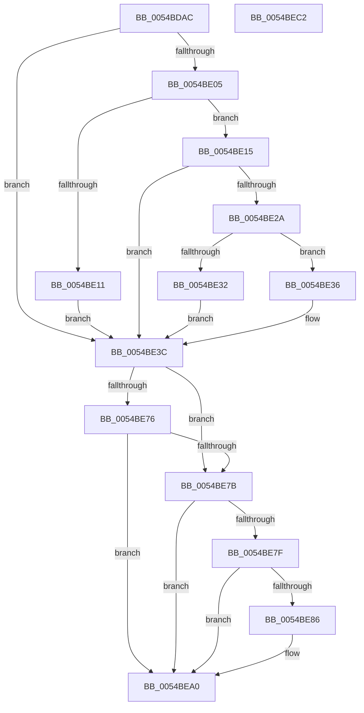

# HalpTimerConfigureQpcBypass

- RVA: `0x0054BDAC`–`0x0054BEC3` (길이 `279` bytes)
- VA: `0x000000014054BDAC`
- 실행 섹션: `.text`
- PDB 이름 있음: `예`; PDB Function 태그: `아니요`
- unwind 정보 RVA: `0x000C3FA8`
- 디코드: `79`개 명령, `279/279` bytes 표시
- 미해석 바이트: `0` (있으면 어셈블리에 `.byte`로 보존)

> 이 문서는 커널 이미지의 기계어와 PDB 기호를 분석해 생성했습니다. 4번과 5번은 함수 원형과 자료형을 바이너리 사용 방식에서 추정한 C 해석이며 원본 소스 복구 결과는 아닙니다.

## 1. Dependencies

- 직접 호출 지점: **7**; 고유 호출 대상: **6**
- 직접 호출자로 확인된 함수: **1**
- RIP 상대 이미지 참조: **2**

### Outgoing calls
- `0x0054BDD9` → [NtQuerySystemInformation](../../page/A5/NtQuerySystemInformation_function_00A57780.md) (function, `0x00A57780`)
- `0x0054BDF7` → [HalpFindTimer](HalpFindTimer_function_005488D0.md) (function, `0x005488D0`)
- `0x0054BE21` → [HalpGetCpuInfo](../49/HalpGetCpuInfo_function_00498A70.md) (function, `0x00498A70`)
- `0x0054BE43` → [KeAcquireSpinLockRaiseToDpc](../20/KeAcquireSpinLockRaiseToDpc_function_00208470.md) (function, `0x00208470`)
- `0x0054BE5F` → [RtlSetSystemGlobalData](../43/RtlSetSystemGlobalData_function_00435AF0.md) (function, `0x00435AF0`)
- `0x0054BE9B` → [RtlSetSystemGlobalData](../43/RtlSetSystemGlobalData_function_00435AF0.md) (function, `0x00435AF0`)
- `0x0054BEAA` → [KeReleaseSpinLock](../39/KeReleaseSpinLock_function_00392BA0.md) (function, `0x00392BA0`)

### Direct callers
- [HalpTimerInitSystem](../53/HalpTimerInitSystem_function_0053CB70.md) at `0x0053CC25`

### Static image references
- `0x0054BE3C` → RVA `0x00FC2220` (`.data`; read)
- `0x0054BE64` → RVA `0x00FC3FD0` (`.data`; read)

## 2. Other-region calls and transfers

- 다른 실행 섹션으로 향하는 call: **1**
  - `0x0054BDD9` → [NtQuerySystemInformation](../../page/A5/NtQuerySystemInformation_function_00A57780.md) (`.text` → `PAGE`)
- 별도 외부 분기/꼬리 이동을 확인하지 못했습니다.

## 3. Assembly (complete function range)

```asm
0054BDAC  48 8B C4                        mov rax, rsp
0054BDAF  48 89 58 18                     mov qword ptr [rax + 0x18], rbx
0054BDB3  48 89 68 20                     mov qword ptr [rax + 0x20], rbp
0054BDB7  56                              push rsi
0054BDB8  57                              push rdi
0054BDB9  41 57                           push r15
0054BDBB  48 83 EC 30                     sub rsp, 0x30
0054BDBF  33 ED                           xor ebp, ebp
0054BDC1  48 8D 50 10                     lea rdx, [rax + 0x10]
0054BDC5  45 33 C9                        xor r9d, r9d
0054BDC8  40 88 68 08                     mov byte ptr [rax + 8], bpl
0054BDCC  B9 C5 00 00 00                  mov ecx, 0xc5
0054BDD1  48 89 68 10                     mov qword ptr [rax + 0x10], rbp
0054BDD5  44 8D 45 08                     lea r8d, [rbp + 8]
0054BDD9  E8 A2 B9 50 00                  call 0x140a57780
0054BDDE  45 33 C9                        xor r9d, r9d
0054BDE1  40 0F B6 DD                     movzx ebx, bpl
0054BDE5  45 33 C0                        xor r8d, r8d
0054BDE8  C7 44 24 20 01 00 00 00         mov dword ptr [rsp + 0x20], 1
0054BDF0  33 D2                           xor edx, edx
0054BDF2  8D 4D 05                        lea ecx, [rbp + 5]
0054BDF5  8B F0                           mov esi, eax
0054BDF7  E8 D4 CA FF FF                  call 0x1405488d0
0054BDFC  44 8D 7D 10                     lea r15d, [rbp + 0x10]
0054BE00  48 85 C0                        test rax, rax
0054BE03  74 37                           je 0x14054be3c
0054BE05  F7 80 E0 00 00 00 00 00 00 01   test dword ptr [rax + 0xe0], 0x1000000
0054BE0F  74 04                           je 0x14054be15
0054BE11  B3 80                           mov bl, 0x80
0054BE13  EB 27                           jmp 0x14054be3c
0054BE15  4C 8D 4C 24 50                  lea r9, [rsp + 0x50]
0054BE1A  45 33 C0                        xor r8d, r8d
0054BE1D  33 D2                           xor edx, edx
0054BE1F  33 C9                           xor ecx, ecx
0054BE21  E8 4A CC F4 FF                  call 0x140498a70
0054BE26  84 C0                           test al, al
0054BE28  74 12                           je 0x14054be3c
0054BE2A  8A 44 24 50                     mov al, byte ptr [rsp + 0x50]
0054BE2E  3C 02                           cmp al, 2
0054BE30  75 04                           jne 0x14054be36
0054BE32  B3 20                           mov bl, 0x20
0054BE34  EB 06                           jmp 0x14054be3c
0054BE36  3C 01                           cmp al, 1
0054BE38  41 0F 44 DF                     cmove ebx, r15d
0054BE3C  48 8D 0D DD 63 A7 00            lea rcx, [rip + 0xa763dd]
0054BE43  E8 28 C6 CB FF                  call 0x140208470
0054BE48  41 B8 02 00 00 00               mov r8d, 2
0054BE4E  66 89 6C 24 50                  mov word ptr [rsp + 0x50], bp
0054BE53  48 8D 54 24 50                  lea rdx, [rsp + 0x50]
0054BE58  40 8A F8                        mov dil, al
0054BE5B  41 8D 48 0F                     lea ecx, [r8 + 0xf]
0054BE5F  E8 8C 9C EE FF                  call 0x140435af0
0054BE64  48 8B 0D 65 81 A7 00            mov rcx, qword ptr [rip + 0xa78165]
0054BE6B  8B 91 E4 00 00 00               mov edx, dword ptr [rcx + 0xe4]
0054BE71  83 FA 08                        cmp edx, 8
0054BE74  74 05                           je 0x14054be7b
0054BE76  83 FA 05                        cmp edx, 5
0054BE79  75 25                           jne 0x14054bea0
0054BE7B  85 F6                           test esi, esi
0054BE7D  78 21                           js 0x14054bea0
0054BE7F  48 39 6C 24 58                  cmp qword ptr [rsp + 0x58], rbp
0054BE84  74 1A                           je 0x14054bea0
0054BE86  80 CB 03                        or bl, 3
0054BE89  48 8D 54 24 50                  lea rdx, [rsp + 0x50]
0054BE8E  41 B8 01 00 00 00               mov r8d, 1
0054BE94  88 5C 24 50                     mov byte ptr [rsp + 0x50], bl
0054BE98  41 8B CF                        mov ecx, r15d
0054BE9B  E8 50 9C EE FF                  call 0x140435af0
0054BEA0  40 8A D7                        mov dl, dil
0054BEA3  48 8D 0D 76 63 A7 00            lea rcx, [rip + 0xa76376]
0054BEAA  E8 F1 6C E4 FF                  call 0x140392ba0
0054BEAF  48 8B 5C 24 60                  mov rbx, qword ptr [rsp + 0x60]
0054BEB4  48 8B 6C 24 68                  mov rbp, qword ptr [rsp + 0x68]
0054BEB9  48 83 C4 30                     add rsp, 0x30
0054BEBD  41 5F                           pop r15
0054BEBF  5F                              pop rdi
0054BEC0  5E                              pop rsi
0054BEC1  C3                              ret
0054BEC2  CC                              int3
```

## 4. C-style interpretation (structured pseudocode)

```c
__int64 __fastcall HalpTimerConfigureQpcBypass(__int64 a1, __int64 a2, __int64 a3, int a4)
{
    __int64 result;
    __int64 v_rbp;
    __int64 v_rbx;
    __int64 v_rsp;
    unsigned int v_stack_m28;
    unsigned __int64 v_stack_p10;
    unsigned __int64 v_stack_p18;
    unsigned __int64 v_stack_p20;
    unsigned __int64 v_stack_p8;

    *(unsigned __int64 *)(v_rsp + 24) = v_rbx;
    *(unsigned __int64 *)(v_rsp + 32) = v_rbp;
    v_rsp = (v_rsp) - (48);
    v_rbp = 0;
    a4 = 0;
    *(unsigned __int8 *)(v_rsp + 8) = 0;
    *(unsigned __int64 *)(v_rsp + 16) = 0;
    result = NtQuerySystemInformation(197, v_rsp + 16, v_rbp + 8, a4);
    a4 = 0;
    a3 = 0;
    v_stack_m28 = 1;
    a2 = 0;
    result = HalpFindTimer(v_rbp + 5, a2, a3, a4);
    if (result == 0) goto loc_0054BE3C;
    if (((*(unsigned int *)(result + 224)) & (0x1000000ULL)) == 0) goto loc_0054BE15;
    goto loc_0054BE3C;
loc_0054BE15:
    a3 = 0;
    a2 = 0;
    a1 = 0;
    result = HalpGetCpuInfo(a1, a2, a3, v_stack_p8);
    if ((unsigned __int8)(result) == 0) goto loc_0054BE3C;
    if (((unsigned __int8)(v_stack_p8)) != 2) goto loc_0054BE36;
    goto loc_0054BE3C;
loc_0054BE36:
    v_rbx = 32;
    if (((unsigned __int8)(v_stack_p8)) == 1) { v_rbx = (unsigned int)(v_rbp + 16); }
loc_0054BE3C:
    result = KeAcquireSpinLockRaiseToDpc(v_rip + 10970077, a2, a3, v_stack_p8);
    v_stack_p8 = 0;
    result = RtlSetSystemGlobalData(2 + 15, v_stack_p8, 2, v_stack_p8);
    if (((unsigned int)((unsigned int)(*(unsigned int *)(*(unsigned __int64 *)(v_rip + 10977637) + 228)))) == 8) goto loc_0054BE7B;
    if (((unsigned int)((unsigned int)(*(unsigned int *)(*(unsigned __int64 *)(v_rip + 10977637) + 228)))) != 5) goto loc_0054BEA0;
loc_0054BE7B:
    if (sign_flag) goto loc_0054BEA0;
    if (v_stack_p10 != 0) {
        v_rbx = (unsigned __int8)((v_rbx) | (3));
        a2 = v_stack_p8;
        a3 = 1;
        v_stack_p8 = (unsigned __int8)(v_rbx);
        a1 = (unsigned int)(v_rbp + 16);
        result = RtlSetSystemGlobalData(a1, a2, a3, v_stack_p8);
    }
    result = KeReleaseSpinLock(v_rip + 10969974, (unsigned __int8)((unsigned __int8)(result)), a3, v_stack_p8);
    v_rsp = (v_rsp) + (48);
    return result;
}
```

## 5. (Beta) C Style

```c
int64_t HalpTimerConfigureQpcBypass(int64_t Arg1, int64_t Arg2, int64_t Arg3, int32_t Arg4)
{
    int64_t result;
    int64_t local_rbp;
    int64_t local_rbx;
    int64_t local_rsp;
    uint32_t v_stack_m28;
    uint64_t v_stack_p10;
    uint64_t v_stack_p18;
    uint64_t v_stack_p20;
    uint64_t v_stack_p8;

    *(uint64_t *)(local_rsp + 0x18) = local_rbx;
    *(uint64_t *)(local_rsp + 0x20) = local_rbp;
    local_rsp = (local_rsp) - (48);
    local_rbp = 0;
    Arg4 = 0;
    *(uint8_t *)(local_rsp + 0x8) = 0;
    *(uint64_t *)(local_rsp + 0x10) = 0;
    result = NtQuerySystemInformation(197, local_rsp + 16, local_rbp + 8, Arg4);
    Arg4 = 0;
    Arg3 = 0;
    v_stack_m28 = 1;
    Arg2 = 0;
    result = HalpFindTimer(local_rbp + 5, Arg2, Arg3, Arg4);
    if (result == 0) goto loc_0054BE3C;
    if (((*(uint32_t *)(result + 0xE0)) & (0x1000000ULL)) == 0) goto loc_0054BE15;
    goto loc_0054BE3C;
loc_0054BE15:
    Arg3 = 0;
    Arg2 = 0;
    Arg1 = 0;
    result = HalpGetCpuInfo(Arg1, Arg2, Arg3, v_stack_p8);
    if ((uint8_t)(result) == 0) goto loc_0054BE3C;
    if (((uint8_t)(v_stack_p8)) != 2) goto loc_0054BE36;
    goto loc_0054BE3C;
loc_0054BE36:
    local_rbx = 32;
    if (((uint8_t)(v_stack_p8)) == 1) { local_rbx = (uint32_t)(local_rbp + 16); }
loc_0054BE3C:
    result = KeAcquireSpinLockRaiseToDpc(v_rip + 10970077, Arg2, Arg3, v_stack_p8);
    v_stack_p8 = 0;
    result = RtlSetSystemGlobalData(2 + 15, v_stack_p8, 2, v_stack_p8);
    if (((uint32_t)((uint32_t)(*(uint32_t *)(*(uint64_t *)(v_rip + 0xA78165) + 0xE4)))) == 8) goto loc_0054BE7B;
    if (((uint32_t)((uint32_t)(*(uint32_t *)(*(uint64_t *)(v_rip + 0xA78165) + 0xE4)))) != 5) goto loc_0054BEA0;
loc_0054BE7B:
    if (sign_flag) goto loc_0054BEA0;
    if (v_stack_p10 != 0) {
        local_rbx = (uint8_t)((local_rbx) | (3));
        Arg2 = v_stack_p8;
        Arg3 = 1;
        v_stack_p8 = (uint8_t)(local_rbx);
        Arg1 = (uint32_t)(local_rbp + 16);
        result = RtlSetSystemGlobalData(Arg1, Arg2, Arg3, v_stack_p8);
    }
    result = KeReleaseSpinLock(v_rip + 10969974, (uint8_t)((uint8_t)(result)), Arg3, v_stack_p8);
    local_rsp = (local_rsp) + (48);
    return result;
}
```

## 6. Execution-region graph

[열기: 2D/3D 그래프와 함수 탐색 컨트롤 패널](../../../control-panel.html?section=text&rva=0x0054BDAC&view=graph)

- 2D 그래프는 위에서 아래로 흐르고, 3D 그래프는 빈 공간을 드래그해 회전합니다. Shift+드래그는 이동, 휠은 확대·축소, 함수 노드 선택은 대상 보고서 이동입니다.

### Static fallback


