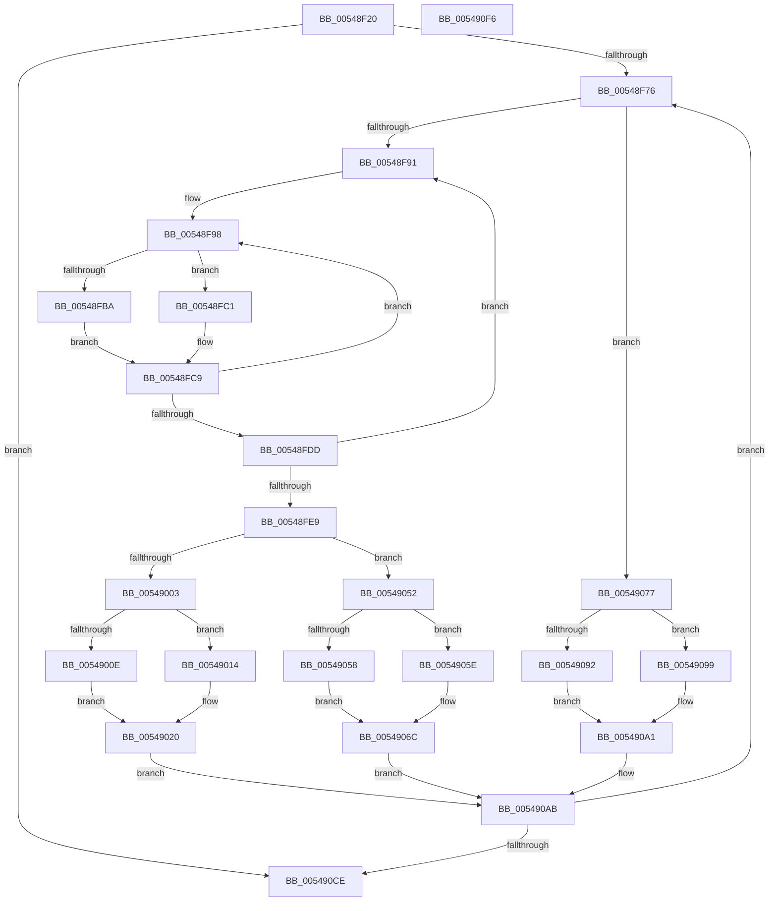

# HalpTimerDelayedQueryCounter

- RVA: `0x00548F20`–`0x005490F7` (길이 `471` bytes)
- VA: `0x0000000140548F20`
- 실행 섹션: `.text`
- PDB 이름 있음: `예`; PDB Function 태그: `아니요`
- unwind 정보 RVA: `0x00075C18`
- 디코드: `120`개 명령, `471/471` bytes 표시
- 미해석 바이트: `0` (있으면 어셈블리에 `.byte`로 보존)

> 이 문서는 커널 이미지의 기계어와 PDB 기호를 분석해 생성했습니다. 4번과 5번은 함수 원형과 자료형을 바이너리 사용 방식에서 추정한 C 해석이며 원본 소스 복구 결과는 아닙니다.

## 1. Dependencies

- 직접 호출 지점: **8**; 고유 호출 대상: **5**
- 직접 호출자로 확인된 함수: **0**
- RIP 상대 이미지 참조: **7**

### Outgoing calls
- `0x00548FA2` → [HalpTimerGetInternalData](../20/HalpTimerGetInternalData_function_00209500.md) (function, `0x00209500`)
- `0x00548FBA` → [HalpHpetQueryCounter](../37/HalpHpetQueryCounter_function_00379660.md) (function, `0x00379660`)
- `0x00548FC4` → [guard_dispatch_icall](../6B/guard_dispatch_icall_function_006BAAD0.md) (function, `0x006BAAD0`)
- `0x0054907A` → [HalpTimerGetInternalData](../20/HalpTimerGetInternalData_function_00209500.md) (function, `0x00209500`)
- `0x00549092` → [HalpHvCounterQueryCounter](../37/HalpHvCounterQueryCounter_function_00378F50.md) (function, `0x00378F50`)
- `0x0054909C` → [guard_dispatch_icall](../6B/guard_dispatch_icall_function_006BAAD0.md) (function, `0x006BAAD0`)
- `0x005490C0` → [HalpTimerScaleCounter](../37/HalpTimerScaleCounter_function_0037B354.md) (function, `0x0037B354`)
- `0x005490D4` → [guard_dispatch_icall](../6B/guard_dispatch_icall_function_006BAAD0.md) (function, `0x006BAAD0`)

### Direct callers
- 이 함수 시작 RVA로 연결되는 직접 call은 확인되지 않았습니다. 간접 호출은 완전히 역산할 수 없습니다.

### Static image references
- `0x00548F3C` → RVA `0x00E10348` (`.data`; read)
- `0x00548F46` → RVA `0x00FC3FD0` (`.data`; read)
- `0x00548F4D` → RVA `0x00E10354` (`.data`; read/write)
- `0x00548F57` → RVA `0x00FC3FB8` (`.data`; read)
- `0x00548F5E` → RVA `0x00E10348` (`.data`; write)
- `0x00548FAB` → RVA `0x00379660` (`HalpHpetQueryCounter`; read)
- `0x00549083` → RVA `0x00378F50` (`HalpHvCounterQueryCounter`; read)

## 2. Other-region calls and transfers

- 다른 실행 섹션으로 향하는 call: **0**
- 별도 외부 분기/꼬리 이동을 확인하지 못했습니다.

## 3. Assembly (complete function range)

```asm
00548F20  48 89 5C 24 08                  mov qword ptr [rsp + 8], rbx
00548F25  48 89 6C 24 10                  mov qword ptr [rsp + 0x10], rbp
00548F2A  48 89 74 24 18                  mov qword ptr [rsp + 0x18], rsi
00548F2F  57                              push rdi
00548F30  41 54                           push r12
00548F32  41 55                           push r13
00548F34  41 56                           push r14
00548F36  41 57                           push r15
00548F38  48 83 EC 20                     sub rsp, 0x20
00548F3C  4C 8B 3D 05 74 8C 00            mov r15, qword ptr [rip + 0x8c7405]
00548F43  4C 8B E9                        mov r13, rcx
00548F46  48 8B 05 83 B0 A7 00            mov rax, qword ptr [rip + 0xa7b083]
00548F4D  FF 05 01 74 8C 00               inc dword ptr [rip + 0x8c7401]
00548F53  4C 89 78 70                     mov qword ptr [rax + 0x70], r15
00548F57  48 8B 05 5A B0 A7 00            mov rax, qword ptr [rip + 0xa7b05a]
00548F5E  48 C7 05 DF 73 8C 00 00 00 00 00  mov qword ptr [rip + 0x8c73df], 0
00548F69  4C 8B 60 10                     mov r12, qword ptr [rax + 0x10]
00548F6D  4D 85 E4                        test r12, r12
00548F70  0F 84 58 01 00 00               je 0x1405490ce
00548F76  48 8B 35 53 B0 A7 00            mov rsi, qword ptr [rip + 0xa7b053]
00548F7D  83 BE DC 00 00 00 40            cmp dword ptr [rsi + 0xdc], 0x40
00548F84  48 8B BE C0 00 00 00            mov rdi, qword ptr [rsi + 0xc0]
00548F8B  0F 84 E6 00 00 00               je 0x140549077
00548F91  4C 8B B6 D0 00 00 00            mov r14, qword ptr [rsi + 0xd0]
00548F98  48 8B 9E C8 00 00 00            mov rbx, qword ptr [rsi + 0xc8]
00548F9F  48 8B CE                        mov rcx, rsi
00548FA2  E8 59 05 CC FF                  call 0x140209500
00548FA7  48 8B 56 70                     mov rdx, qword ptr [rsi + 0x70]
00548FAB  48 8D 0D AE 06 E3 FF            lea rcx, [rip - 0x1cf952]
00548FB2  48 3B D1                        cmp rdx, rcx
00548FB5  48 8B C8                        mov rcx, rax
00548FB8  75 07                           jne 0x140548fc1
00548FBA  E8 A1 06 E3 FF                  call 0x140379660
00548FBF  EB 08                           jmp 0x140548fc9
00548FC1  48 8B C2                        mov rax, rdx
00548FC4  E8 07 1B 17 00                  call 0x1406baad0
00548FC9  48 8B E8                        mov rbp, rax
00548FCC  F0 83 0C 24 00                  lock or dword ptr [rsp], 0
00548FD1  48 8B 86 C8 00 00 00            mov rax, qword ptr [rsi + 0xc8]
00548FD8  48 3B D8                        cmp rbx, rax
00548FDB  75 BB                           jne 0x140548f98
00548FDD  48 8B 8E D0 00 00 00            mov rcx, qword ptr [rsi + 0xd0]
00548FE4  4C 3B F1                        cmp r14, rcx
00548FE7  75 A8                           jne 0x140548f91
00548FE9  44 8B 96 DC 00 00 00            mov r10d, dword ptr [rsi + 0xdc]
00548FF0  41 8D 4A FF                     lea ecx, [r10 - 1]
00548FF4  0F B6 D1                        movzx edx, cl
00548FF7  48 8B CD                        mov rcx, rbp
00548FFA  48 33 CB                        xor rcx, rbx
00548FFD  48 0F A3 D1                     bt rcx, rdx
00549001  73 4F                           jae 0x140549052
00549003  BA 01 00 00 00                  mov edx, 1
00549008  41 83 FA 40                     cmp r10d, 0x40
0054900C  75 06                           jne 0x140549014
0054900E  49 83 CB FF                     or r11, 0xffffffffffffffff
00549012  EB 0C                           jmp 0x140549020
00549014  41 8B CA                        mov ecx, r10d
00549017  4C 8B DA                        mov r11, rdx
0054901A  49 D3 E3                        shl r11, cl
0054901D  4C 2B DA                        sub r11, rdx
00549020  4C 8B C2                        mov r8, rdx
00549023  4C 23 DB                        and r11, rbx
00549026  4D 8B CB                        mov r9, r11
00549029  41 8B CA                        mov ecx, r10d
0054902C  4C 33 CB                        xor r9, rbx
0054902F  49 D3 E0                        shl r8, cl
00549032  4C 0B CD                        or r9, rbp
00549035  41 83 FA 40                     cmp r10d, 0x40
00549039  49 0F 45 D0                     cmovne rdx, r8
0054903D  49 03 D1                        add rdx, r9
00549040  49 3B EB                        cmp rbp, r11
00549043  49 0F 43 D1                     cmovae rdx, r9
00549047  F0 48 0F B1 96 C8 00 00 00      lock cmpxchg qword ptr [rsi + 0xc8], rdx
00549050  EB 59                           jmp 0x1405490ab
00549052  41 83 FA 40                     cmp r10d, 0x40
00549056  75 06                           jne 0x14054905e
00549058  48 83 CA FF                     or rdx, 0xffffffffffffffff
0054905C  EB 0E                           jmp 0x14054906c
0054905E  41 8B CA                        mov ecx, r10d
00549061  BA 01 00 00 00                  mov edx, 1
00549066  48 D3 E2                        shl rdx, cl
00549069  48 FF CA                        dec rdx
0054906C  48 F7 D2                        not rdx
0054906F  48 23 D3                        and rdx, rbx
00549072  48 0B D5                        or rdx, rbp
00549075  EB 34                           jmp 0x1405490ab
00549077  48 8B CE                        mov rcx, rsi
0054907A  E8 81 04 CC FF                  call 0x140209500
0054907F  48 8B 56 70                     mov rdx, qword ptr [rsi + 0x70]
00549083  48 8D 0D C6 FE E2 FF            lea rcx, [rip - 0x1d013a]
0054908A  48 3B D1                        cmp rdx, rcx
0054908D  48 8B C8                        mov rcx, rax
00549090  75 07                           jne 0x140549099
00549092  E8 B9 FE E2 FF                  call 0x140378f50
00549097  EB 08                           jmp 0x1405490a1
00549099  48 8B C2                        mov rax, rdx
0054909C  E8 2F 1A 17 00                  call 0x1406baad0
005490A1  4C 8B B6 D0 00 00 00            mov r14, qword ptr [rsi + 0xd0]
005490A8  48 8B D0                        mov rdx, rax
005490AB  4C 8B 05 06 AF A7 00            mov r8, qword ptr [rip + 0xa7af06]
005490B2  49 8D 0C 16                     lea rcx, [r14 + rdx]
005490B6  48 8B D7                        mov rdx, rdi
005490B9  4D 8B 80 C0 00 00 00            mov r8, qword ptr [r8 + 0xc0]
005490C0  E8 8F 22 E3 FF                  call 0x14037b354
005490C5  49 3B C4                        cmp rax, r12
005490C8  0F 82 A8 FE FF FF               jb 0x140548f76
005490CE  49 8B CD                        mov rcx, r13
005490D1  49 8B C7                        mov rax, r15
005490D4  E8 F7 19 17 00                  call 0x1406baad0
005490D9  48 8B 5C 24 50                  mov rbx, qword ptr [rsp + 0x50]
005490DE  48 8B 6C 24 58                  mov rbp, qword ptr [rsp + 0x58]
005490E3  48 8B 74 24 60                  mov rsi, qword ptr [rsp + 0x60]
005490E8  48 83 C4 20                     add rsp, 0x20
005490EC  41 5F                           pop r15
005490EE  41 5E                           pop r14
005490F0  41 5D                           pop r13
005490F2  41 5C                           pop r12
005490F4  5F                              pop rdi
005490F5  C3                              ret
005490F6  CC                              int3
```

## 4. C-style interpretation (structured pseudocode)

```c
__int64 __fastcall HalpTimerDelayedQueryCounter(__int64 a1)
{
    __int64 result;
    __int64 v_r11;
    __int64 v_rsp;
    unsigned int v_stack_m48;
    unsigned __int64 v_stack_p10;
    unsigned __int64 v_stack_p18;
    unsigned __int64 v_stack_p8;

    v_stack_p8 = v_rbx;
    v_stack_p10 = v_rbp;
    v_stack_p18 = v_rsi;
    v_rsp = (v_rsp) - (32);
    *(unsigned __int64 *)(*(unsigned __int64 *)(v_rip + 10989699) + 112) = *(unsigned __int64 *)(v_rip + 9204741);
    *(unsigned __int64 *)(v_rip + 9204703) = 0;
    if (*(unsigned __int64 *)(*(unsigned __int64 *)(v_rip + 10989658) + 16) == 0) goto loc_005490CE;
loc_00548F76:
    if ((*(unsigned int *)(*(unsigned __int64 *)(v_rip + 10989651) + 220)) == 64) goto loc_00549077;
loc_00548F91:
loc_00548F98:
    result = HalpTimerGetInternalData(*(unsigned __int64 *)(v_rip + 10989651), a2, a3, a4);
    if ((*(unsigned __int64 *)(*(unsigned __int64 *)(v_rip + 10989651) + 112)) != (v_rip - 1898834)) goto loc_00548FC1;
    result = HalpHpetQueryCounter(result, *(unsigned __int64 *)(*(unsigned __int64 *)(v_rip + 10989651) + 112), a3, a4);
    goto loc_00548FC9;
loc_00548FC1:
    result = guard_dispatch_icall(result, *(unsigned __int64 *)(*(unsigned __int64 *)(v_rip + 10989651) + 112), a3, a4);
loc_00548FC9:
    if ((*(unsigned __int64 *)(*(unsigned __int64 *)(v_rip + 10989651) + 200)) != (*(unsigned __int64 *)(*(unsigned __int64 *)(v_rip + 10989651) + 200))) goto loc_00548F98;
    if ((*(unsigned __int64 *)(*(unsigned __int64 *)(v_rip + 10989651) + 208)) != (*(unsigned __int64 *)(*(unsigned __int64 *)(v_rip + 10989651) + 208))) goto loc_00548F91;
    a1 = (result) ^ (*(unsigned __int64 *)(*(unsigned __int64 *)(v_rip + 10989651) + 200));
    if (condition_is_above_or_equal) goto loc_00549052;
    if (((unsigned int)((unsigned int)(*(unsigned int *)(*(unsigned __int64 *)(v_rip + 10989651) + 220)))) != 64) goto loc_00549014;
    v_r11 = (v_r11) | (-1);
    goto loc_00549020;
loc_00549014:
    v_r11 = (1) << ((unsigned __int8)((unsigned int)((unsigned int)((unsigned int)(*(unsigned int *)(*(unsigned __int64 *)(v_rip + 10989651) + 220))))));
    v_r11 = (v_r11) - (1);
loc_00549020:
    v_r11 = (v_r11) & (*(unsigned __int64 *)(*(unsigned __int64 *)(v_rip + 10989651) + 200));
    a4 = (v_r11) ^ (*(unsigned __int64 *)(*(unsigned __int64 *)(v_rip + 10989651) + 200));
    a3 = (1) << ((unsigned __int8)((unsigned int)((unsigned int)((unsigned int)(*(unsigned int *)(*(unsigned __int64 *)(v_rip + 10989651) + 220))))));
    a4 = (a4) | (result);
    a2 = 1;
    if (((unsigned int)((unsigned int)(*(unsigned int *)(*(unsigned __int64 *)(v_rip + 10989651) + 220)))) != 64) { a2 = a3; }
    a2 = (a2) + (a4);
    if (result >= v_r11) { a2 = a4; }
    goto loc_005490AB;
loc_00549052:
    if (((unsigned int)((unsigned int)(*(unsigned int *)(*(unsigned __int64 *)(v_rip + 10989651) + 220)))) != 64) goto loc_0054905E;
    a2 = (a2) | (-1);
    goto loc_0054906C;
loc_0054905E:
    a2 = (1) << ((unsigned __int8)((unsigned int)((unsigned int)((unsigned int)(*(unsigned int *)(*(unsigned __int64 *)(v_rip + 10989651) + 220))))));
    a2 = (a2) - 1;
loc_0054906C:
    a2 = ~(a2);
    a2 = (a2) & (*(unsigned __int64 *)(*(unsigned __int64 *)(v_rip + 10989651) + 200));
    a2 = (a2) | (result);
    goto loc_005490AB;
loc_00549077:
    result = HalpTimerGetInternalData(*(unsigned __int64 *)(v_rip + 10989651), a2, a3, a4);
    if ((*(unsigned __int64 *)(*(unsigned __int64 *)(v_rip + 10989651) + 112)) != (v_rip - 1900858)) goto loc_00549099;
    result = HalpHvCounterQueryCounter(result, *(unsigned __int64 *)(*(unsigned __int64 *)(v_rip + 10989651) + 112), a3, a4);
    goto loc_005490A1;
loc_00549099:
    result = guard_dispatch_icall(result, *(unsigned __int64 *)(*(unsigned __int64 *)(v_rip + 10989651) + 112), a3, a4);
loc_005490A1:
loc_005490AB:
    result = HalpTimerScaleCounter(*(unsigned __int64 *)(*(unsigned __int64 *)(v_rip + 10989651) + 208) + result * 1, *(unsigned __int64 *)(*(unsigned __int64 *)(v_rip + 10989651) + 192), *(unsigned __int64 *)(*(unsigned __int64 *)(v_rip + 10989318) + 192), a4);
    if (result < (*(unsigned __int64 *)(*(unsigned __int64 *)(v_rip + 10989658) + 16))) goto loc_00548F76;
loc_005490CE:
    result = guard_dispatch_icall(a1, *(unsigned __int64 *)(*(unsigned __int64 *)(v_rip + 10989651) + 192), *(unsigned __int64 *)(*(unsigned __int64 *)(v_rip + 10989318) + 192), a4);
    v_rsp = (v_rsp) + (32);
    return result;
}
```

## 5. (Beta) C Style

```c
int64_t HalpTimerDelayedQueryCounter(int64_t Arg1)
{
    int64_t result;
    int64_t local_r11;
    int64_t local_rsp;
    uint32_t v_stack_m48;
    uint64_t v_stack_p10;
    uint64_t v_stack_p18;
    uint64_t v_stack_p8;

    v_stack_p8 = local_rbx;
    v_stack_p10 = local_rbp;
    v_stack_p18 = local_rsi;
    local_rsp = (local_rsp) - (32);
    *(uint64_t *)(*(uint64_t *)(v_rip + 0xA7B083) + 0x70) = *(uint64_t *)(v_rip + 0x8C7405);
    *(uint64_t *)(v_rip + 0x8C73DF) = 0;
    if (*(uint64_t *)(*(uint64_t *)(v_rip + 0xA7B05A) + 0x10) == 0) goto loc_005490CE;
loc_00548F76:
    if ((*(uint32_t *)(*(uint64_t *)(v_rip + 0xA7B053) + 0xDC)) == 64) goto loc_00549077;
loc_00548F91:
loc_00548F98:
    result = HalpTimerGetInternalData(*(uint64_t *)(v_rip + 0xA7B053), a2, a3, a4);
    if ((*(uint64_t *)(*(uint64_t *)(v_rip + 0xA7B053) + 0x70)) != (v_rip - 1898834)) goto loc_00548FC1;
    result = HalpHpetQueryCounter(result, *(uint64_t *)(*(uint64_t *)(v_rip + 0xA7B053) + 0x70), a3, a4);
    goto loc_00548FC9;
loc_00548FC1:
    result = guard_dispatch_icall(result, *(uint64_t *)(*(uint64_t *)(v_rip + 0xA7B053) + 0x70), a3, a4);
loc_00548FC9:
    if ((*(uint64_t *)(*(uint64_t *)(v_rip + 0xA7B053) + 0xC8)) != (*(uint64_t *)(*(uint64_t *)(v_rip + 0xA7B053) + 0xC8))) goto loc_00548F98;
    if ((*(uint64_t *)(*(uint64_t *)(v_rip + 0xA7B053) + 0xD0)) != (*(uint64_t *)(*(uint64_t *)(v_rip + 0xA7B053) + 0xD0))) goto loc_00548F91;
    Arg1 = (result) ^ (*(uint64_t *)(*(uint64_t *)(v_rip + 0xA7B053) + 0xC8));
    if (condition_is_above_or_equal) goto loc_00549052;
    if (((uint32_t)((uint32_t)(*(uint32_t *)(*(uint64_t *)(v_rip + 0xA7B053) + 0xDC)))) != 64) goto loc_00549014;
    local_r11 = (local_r11) | (-1);
    goto loc_00549020;
loc_00549014:
    local_r11 = (1) << ((uint8_t)((uint32_t)((uint32_t)((uint32_t)(*(uint32_t *)(*(uint64_t *)(v_rip + 0xA7B053) + 0xDC))))));
    local_r11 = (local_r11) - (1);
loc_00549020:
    local_r11 = (local_r11) & (*(uint64_t *)(*(uint64_t *)(v_rip + 0xA7B053) + 0xC8));
    a4 = (local_r11) ^ (*(uint64_t *)(*(uint64_t *)(v_rip + 0xA7B053) + 0xC8));
    a3 = (1) << ((uint8_t)((uint32_t)((uint32_t)((uint32_t)(*(uint32_t *)(*(uint64_t *)(v_rip + 0xA7B053) + 0xDC))))));
    a4 = (a4) | (result);
    a2 = 1;
    if (((uint32_t)((uint32_t)(*(uint32_t *)(*(uint64_t *)(v_rip + 0xA7B053) + 0xDC)))) != 64) { a2 = a3; }
    a2 = (a2) + (a4);
    if (result >= local_r11) { a2 = a4; }
    goto loc_005490AB;
loc_00549052:
    if (((uint32_t)((uint32_t)(*(uint32_t *)(*(uint64_t *)(v_rip + 0xA7B053) + 0xDC)))) != 64) goto loc_0054905E;
    a2 = (a2) | (-1);
    goto loc_0054906C;
loc_0054905E:
    a2 = (1) << ((uint8_t)((uint32_t)((uint32_t)((uint32_t)(*(uint32_t *)(*(uint64_t *)(v_rip + 0xA7B053) + 0xDC))))));
    a2 = (a2) - 1;
loc_0054906C:
    a2 = ~(a2);
    a2 = (a2) & (*(uint64_t *)(*(uint64_t *)(v_rip + 0xA7B053) + 0xC8));
    a2 = (a2) | (result);
    goto loc_005490AB;
loc_00549077:
    result = HalpTimerGetInternalData(*(uint64_t *)(v_rip + 0xA7B053), a2, a3, a4);
    if ((*(uint64_t *)(*(uint64_t *)(v_rip + 0xA7B053) + 0x70)) != (v_rip - 1900858)) goto loc_00549099;
    result = HalpHvCounterQueryCounter(result, *(uint64_t *)(*(uint64_t *)(v_rip + 0xA7B053) + 0x70), a3, a4);
    goto loc_005490A1;
loc_00549099:
    result = guard_dispatch_icall(result, *(uint64_t *)(*(uint64_t *)(v_rip + 0xA7B053) + 0x70), a3, a4);
loc_005490A1:
loc_005490AB:
    result = HalpTimerScaleCounter(*(uint64_t *)(*(uint64_t *)(v_rip + 0xA7B053) + 0xD0) + result * 1, *(uint64_t *)(*(uint64_t *)(v_rip + 0xA7B053) + 0xC0), *(uint64_t *)(*(uint64_t *)(v_rip + 0xA7AF06) + 0xC0), a4);
    if (result < (*(uint64_t *)(*(uint64_t *)(v_rip + 0xA7B05A) + 0x10))) goto loc_00548F76;
loc_005490CE:
    result = guard_dispatch_icall(Arg1, *(uint64_t *)(*(uint64_t *)(v_rip + 0xA7B053) + 0xC0), *(uint64_t *)(*(uint64_t *)(v_rip + 0xA7AF06) + 0xC0), a4);
    local_rsp = (local_rsp) + (32);
    return result;
}
```

## 6. Execution-region graph

[열기: 2D/3D 그래프와 함수 탐색 컨트롤 패널](../../../control-panel.html?section=text&rva=0x00548F20&view=graph)

- 2D 그래프는 위에서 아래로 흐르고, 3D 그래프는 빈 공간을 드래그해 회전합니다. Shift+드래그는 이동, 휠은 확대·축소, 함수 노드 선택은 대상 보고서 이동입니다.

### Static fallback


