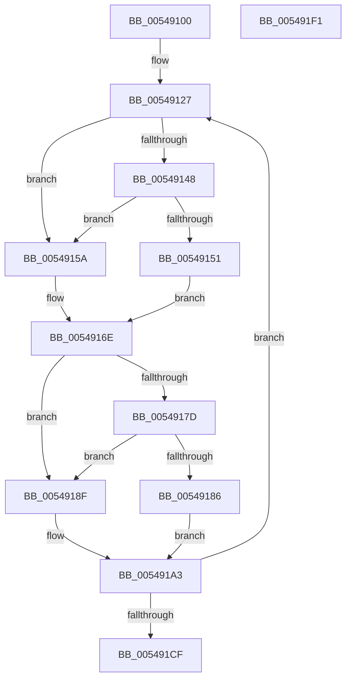

# HalpTimerDetermineValidTimerPairReadLatency

- RVA: `0x00549100`–`0x005491F2` (길이 `242` bytes)
- VA: `0x0000000140549100`
- 실행 섹션: `.text`
- PDB 이름 있음: `예`; PDB Function 태그: `아니요`
- unwind 정보 RVA: `0x0005E6B4`
- 디코드: `68`개 명령, `242/242` bytes 표시
- 미해석 바이트: `0` (있으면 어셈블리에 `.byte`로 보존)

> 이 문서는 커널 이미지의 기계어와 PDB 기호를 분석해 생성했습니다. 4번과 5번은 함수 원형과 자료형을 바이너리 사용 방식에서 추정한 C 해석이며 원본 소스 복구 결과는 아닙니다.

## 1. Dependencies

- 직접 호출 지점: **6**; 고유 호출 대상: **3**
- 직접 호출자로 확인된 함수: **2**
- RIP 상대 이미지 참조: **2**

### Outgoing calls
- `0x00549153` → [KeQueryPerformanceCounter](../37/KeQueryPerformanceCounter_function_0037E7E0.md) (function, `0x0037E7E0`)
- `0x0054915D` → [HalpTimerGetInternalData](../20/HalpTimerGetInternalData_function_00209500.md) (function, `0x00209500`)
- `0x00549169` → [guard_dispatch_icall](../6B/guard_dispatch_icall_function_006BAAD0.md) (function, `0x006BAAD0`)
- `0x00549188` → [KeQueryPerformanceCounter](../37/KeQueryPerformanceCounter_function_0037E7E0.md) (function, `0x0037E7E0`)
- `0x00549192` → [HalpTimerGetInternalData](../20/HalpTimerGetInternalData_function_00209500.md) (function, `0x00209500`)
- `0x0054919E` → [guard_dispatch_icall](../6B/guard_dispatch_icall_function_006BAAD0.md) (function, `0x006BAAD0`)

### Direct callers
- [HalpTimerMeasureFrequencies](HalpTimerMeasureFrequencies_function_005493C0.md) at `0x00549487`
- [HalpTimerMeasureProcessorsWorker](HalpTimerMeasureProcessorsWorker_function_0054D910.md) at `0x0054D9FD`

### Static image references
- `0x0054913F` → RVA `0x00FC3FD0` (`.data`; read)
- `0x00549148` → RVA `0x00FC4138` (`.data`; read)

## 2. Other-region calls and transfers

- 다른 실행 섹션으로 향하는 call: **0**
- 별도 외부 분기/꼬리 이동을 확인하지 못했습니다.

## 3. Assembly (complete function range)

```asm
00549100  48 8B C4                        mov rax, rsp
00549103  48 89 58 08                     mov qword ptr [rax + 8], rbx
00549107  48 89 68 10                     mov qword ptr [rax + 0x10], rbp
0054910B  48 89 70 18                     mov qword ptr [rax + 0x18], rsi
0054910F  48 89 78 20                     mov qword ptr [rax + 0x20], rdi
00549113  41 56                           push r14
00549115  48 83 EC 20                     sub rsp, 0x20
00549119  48 8B DA                        mov rbx, rdx
0054911C  48 8B F9                        mov rdi, rcx
0054911F  83 CE FF                        or esi, 0xffffffff
00549122  BD 19 00 00 00                  mov ebp, 0x19
00549127  0F 20 D0                        mov rax, cr2
0054912A  0F 22 D0                        mov cr2, rax
0054912D  0F 31                           rdtsc
0054912F  48 C1 E2 20                     shl rdx, 0x20
00549133  48 0B C2                        or rax, rdx
00549136  4C 8B F0                        mov r14, rax
00549139  0F 20 D2                        mov rdx, cr2
0054913C  0F 22 D2                        mov cr2, rdx
0054913F  48 3B 3D 8A AE A7 00            cmp rdi, qword ptr [rip + 0xa7ae8a]
00549146  75 12                           jne 0x14054915a
00549148  80 3D E9 AF A7 00 00            cmp byte ptr [rip + 0xa7afe9], 0
0054914F  74 09                           je 0x14054915a
00549151  33 C9                           xor ecx, ecx
00549153  E8 88 56 E3 FF                  call 0x14037e7e0
00549158  EB 14                           jmp 0x14054916e
0054915A  48 8B CF                        mov rcx, rdi
0054915D  E8 9E 03 CC FF                  call 0x140209500
00549162  48 8B C8                        mov rcx, rax
00549165  48 8B 47 70                     mov rax, qword ptr [rdi + 0x70]
00549169  E8 62 19 17 00                  call 0x1406baad0
0054916E  0F 20 D0                        mov rax, cr2
00549171  0F 22 D0                        mov cr2, rax
00549174  48 3B 1D 55 AE A7 00            cmp rbx, qword ptr [rip + 0xa7ae55]
0054917B  75 12                           jne 0x14054918f
0054917D  80 3D B4 AF A7 00 00            cmp byte ptr [rip + 0xa7afb4], 0
00549184  74 09                           je 0x14054918f
00549186  33 C9                           xor ecx, ecx
00549188  E8 53 56 E3 FF                  call 0x14037e7e0
0054918D  EB 14                           jmp 0x1405491a3
0054918F  48 8B CB                        mov rcx, rbx
00549192  E8 69 03 CC FF                  call 0x140209500
00549197  48 8B C8                        mov rcx, rax
0054919A  48 8B 43 70                     mov rax, qword ptr [rbx + 0x70]
0054919E  E8 2D 19 17 00                  call 0x1406baad0
005491A3  0F 20 D0                        mov rax, cr2
005491A6  0F 22 D0                        mov cr2, rax
005491A9  0F 31                           rdtsc
005491AB  48 C1 E2 20                     shl rdx, 0x20
005491AF  48 0B C2                        or rax, rdx
005491B2  0F 20 D1                        mov rcx, cr2
005491B5  0F 22 D1                        mov cr2, rcx
005491B8  49 2B C6                        sub rax, r14
005491BB  8B CE                           mov ecx, esi
005491BD  48 3B C1                        cmp rax, rcx
005491C0  0F 43 C6                        cmovae eax, esi
005491C3  8B F0                           mov esi, eax
005491C5  48 83 ED 01                     sub rbp, 1
005491C9  0F 85 58 FF FF FF               jne 0x140549127
005491CF  48 8B 5C 24 30                  mov rbx, qword ptr [rsp + 0x30]
005491D4  8D 04 85 00 00 00 00            lea eax, [rax*4]
005491DB  48 8B 6C 24 38                  mov rbp, qword ptr [rsp + 0x38]
005491E0  48 8B 74 24 40                  mov rsi, qword ptr [rsp + 0x40]
005491E5  48 8B 7C 24 48                  mov rdi, qword ptr [rsp + 0x48]
005491EA  48 83 C4 20                     add rsp, 0x20
005491EE  41 5E                           pop r14
005491F0  C3                              ret
005491F1  CC                              int3
```

## 4. C-style interpretation (structured pseudocode)

```c
__int64 __fastcall HalpTimerDetermineValidTimerPairReadLatency(__int64 a1, __int64 a2)
{
    __int64 result;
    __int64 v_rbp;
    __int64 v_rsi;
    __int64 v_rsp;
    unsigned __int64 v_stack_p10;
    unsigned __int64 v_stack_p18;
    unsigned __int64 v_stack_p20;
    unsigned __int64 v_stack_p8;

    *(unsigned __int64 *)(v_rsp + 8) = v_rbx;
    *(unsigned __int64 *)(v_rsp + 16) = v_rbp;
    *(unsigned __int64 *)(v_rsp + 24) = v_rsi;
    *(unsigned __int64 *)(v_rsp + 32) = v_rdi;
    v_rsp = (v_rsp) - (32);
    v_rsi = (unsigned int)((v_rsi) | (0xFFFFFFFFULL));
loc_00549127:
    a2 = (a2) << (32);
    result = (v_cr2) | (a2);
    if (a1 != (*(unsigned __int64 *)(v_rip + 10989194))) goto loc_0054915A;
    if ((*(unsigned __int8 *)(v_rip + 10989545)) == 0) goto loc_0054915A;
    a1 = 0;
    result = KeQueryPerformanceCounter(a1, v_cr2, a3, a4);
    goto loc_0054916E;
loc_0054915A:
    result = HalpTimerGetInternalData(0, v_cr2, a3, a4);
    result = guard_dispatch_icall(result, v_cr2, a3, a4);
loc_0054916E:
    if (a2 != (*(unsigned __int64 *)(v_rip + 10989141))) goto loc_0054918F;
    if ((*(unsigned __int8 *)(v_rip + 10989492)) == 0) goto loc_0054918F;
    a1 = 0;
    result = KeQueryPerformanceCounter(a1, v_cr2, a3, a4);
    goto loc_005491A3;
loc_0054918F:
    result = HalpTimerGetInternalData(a2, v_cr2, a3, a4);
    result = guard_dispatch_icall(result, v_cr2, a3, a4);
loc_005491A3:
    a2 = (v_cr2) << (32);
    result = (v_cr2) | (a2);
    result = (result) - (result);
    if (result >= ((unsigned int)((unsigned int)(v_rsi)))) { result = (unsigned int)(v_rsi); }
    v_rbp = (25) - (1);
    if (condition_is_not_equal) goto loc_00549127;
    v_rsp = (v_rsp) + (32);
    return result * 4;
}
```

## 5. (Beta) C Style

```c
int64_t HalpTimerDetermineValidTimerPairReadLatency(int64_t Arg1, int64_t Arg2)
{
    int64_t result;
    int64_t local_rbp;
    int64_t local_rsi;
    int64_t local_rsp;
    uint64_t v_stack_p10;
    uint64_t v_stack_p18;
    uint64_t v_stack_p20;
    uint64_t v_stack_p8;

    *(uint64_t *)(local_rsp + 0x8) = local_rbx;
    *(uint64_t *)(local_rsp + 0x10) = local_rbp;
    *(uint64_t *)(local_rsp + 0x18) = local_rsi;
    *(uint64_t *)(local_rsp + 0x20) = local_rdi;
    local_rsp = (local_rsp) - (32);
    local_rsi = (uint32_t)((local_rsi) | (0xFFFFFFFFULL));
loc_00549127:
    Arg2 = (Arg2) << (32);
    result = (v_cr2) | (Arg2);
    if (Arg1 != (*(uint64_t *)(v_rip + 0xA7AE8A))) goto loc_0054915A;
    if ((*(uint8_t *)(v_rip + 0xA7AFE9)) == 0) goto loc_0054915A;
    Arg1 = 0;
    result = KeQueryPerformanceCounter(Arg1, v_cr2, a3, a4);
    goto loc_0054916E;
loc_0054915A:
    result = HalpTimerGetInternalData(0, v_cr2, a3, a4);
    result = guard_dispatch_icall(result, v_cr2, a3, a4);
loc_0054916E:
    if (Arg2 != (*(uint64_t *)(v_rip + 0xA7AE55))) goto loc_0054918F;
    if ((*(uint8_t *)(v_rip + 0xA7AFB4)) == 0) goto loc_0054918F;
    Arg1 = 0;
    result = KeQueryPerformanceCounter(Arg1, v_cr2, a3, a4);
    goto loc_005491A3;
loc_0054918F:
    result = HalpTimerGetInternalData(Arg2, v_cr2, a3, a4);
    result = guard_dispatch_icall(result, v_cr2, a3, a4);
loc_005491A3:
    Arg2 = (v_cr2) << (32);
    result = (v_cr2) | (Arg2);
    result = (result) - (result);
    if (result >= ((uint32_t)((uint32_t)(local_rsi)))) { result = (uint32_t)(local_rsi); }
    local_rbp = (25) - (1);
    if (condition_is_not_equal) goto loc_00549127;
    local_rsp = (local_rsp) + (32);
    return result * 4;
}
```

## 6. Execution-region graph

[열기: 2D/3D 그래프와 함수 탐색 컨트롤 패널](../../../control-panel.html?section=text&rva=0x00549100&view=graph)

- 2D 그래프는 위에서 아래로 흐르고, 3D 그래프는 빈 공간을 드래그해 회전합니다. Shift+드래그는 이동, 휠은 확대·축소, 함수 노드 선택은 대상 보고서 이동입니다.

### Static fallback


