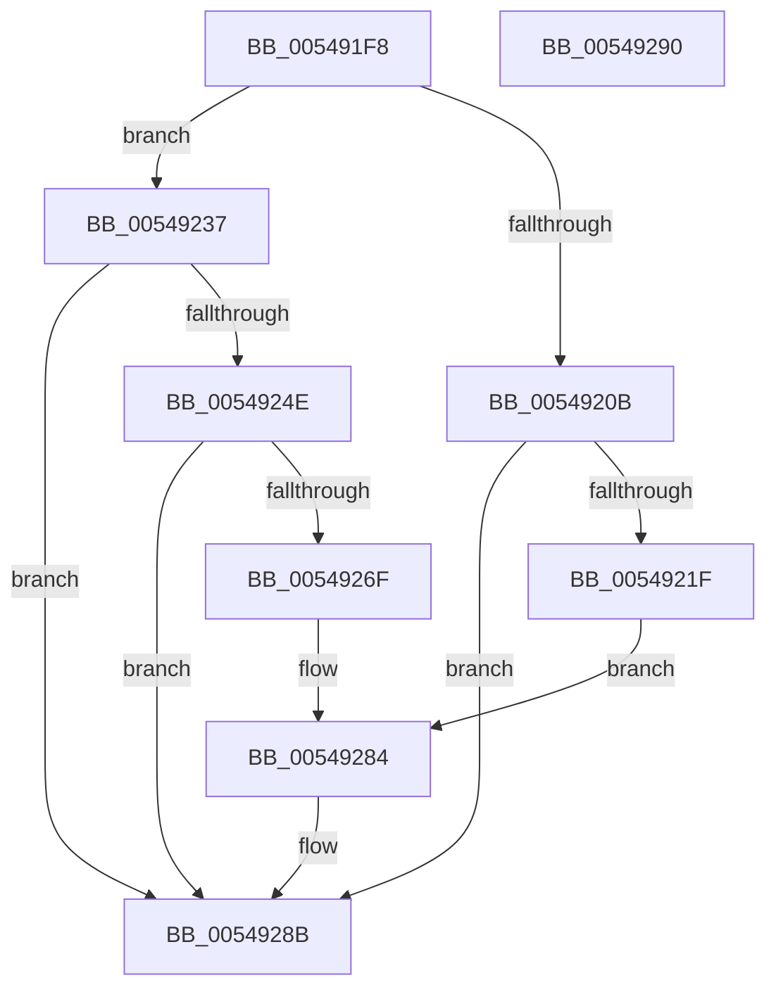

# HalpTimerFindBestAlwaysOnTimer

- RVA: `0x005491F8`–`0x00549291` (길이 `153` bytes)
- VA: `0x00000001405491F8`
- 실행 섹션: `.text`
- PDB 이름 있음: `예`; PDB Function 태그: `아니요`
- unwind 정보 RVA: `0x0005D2F4`
- 디코드: `39`개 명령, `153/153` bytes 표시
- 미해석 바이트: `0` (있으면 어셈블리에 `.byte`로 보존)

> 이 문서는 커널 이미지의 기계어와 PDB 기호를 분석해 생성했습니다. 4번과 5번은 함수 원형과 자료형을 바이너리 사용 방식에서 추정한 C 해석이며 원본 소스 복구 결과는 아닙니다.

## 1. Dependencies

- 직접 호출 지점: **4**; 고유 호출 대상: **1**
- 직접 호출자로 확인된 함수: **1**
- RIP 상대 이미지 참조: **0**

### Outgoing calls
- `0x00549215` → [HalpFindTimer](HalpFindTimer_function_005488D0.md) (function, `0x005488D0`)
- `0x00549244` → [HalpFindTimer](HalpFindTimer_function_005488D0.md) (function, `0x005488D0`)
- `0x00549265` → [HalpFindTimer](HalpFindTimer_function_005488D0.md) (function, `0x005488D0`)
- `0x00549286` → [HalpFindTimer](HalpFindTimer_function_005488D0.md) (function, `0x005488D0`)

### Direct callers
- [HalpTimerSelectRoles](../53/HalpTimerSelectRoles_function_0053D4B0.md) at `0x0053D649`
- [HalpTimerSelectRoles](../53/HalpTimerSelectRoles_function_0053D4B0.md) at `0x0053D76D`

### Static image references
- 디코드된 RIP-relative 메모리 참조가 없습니다.

## 2. Other-region calls and transfers

- 다른 실행 섹션으로 향하는 call: **0**
- 별도 외부 분기/꼬리 이동을 확인하지 못했습니다.

## 3. Assembly (complete function range)

```asm
005491F8  48 83 EC 38                     sub rsp, 0x38
005491FC  83 64 24 20 00                  and dword ptr [rsp + 0x20], 0
00549201  41 B8 00 60 00 00               mov r8d, 0x6000
00549207  84 C9                           test cl, cl
00549209  74 2C                           je 0x140549237
0054920B  45 33 C9                        xor r9d, r9d
0054920E  BA 02 80 00 00                  mov edx, 0x8002
00549213  33 C9                           xor ecx, ecx
00549215  E8 B6 F6 FF FF                  call 0x1405488d0
0054921A  48 85 C0                        test rax, rax
0054921D  75 6C                           jne 0x14054928b
0054921F  C7 44 24 20 01 00 00 00         mov dword ptr [rsp + 0x20], 1
00549227  45 33 C9                        xor r9d, r9d
0054922A  BA 02 80 00 00                  mov edx, 0x8002
0054922F  41 B8 00 6F 00 00               mov r8d, 0x6f00
00549235  EB 4D                           jmp 0x140549284
00549237  BA 20 80 00 00                  mov edx, 0x8020
0054923C  33 C9                           xor ecx, ecx
0054923E  41 B9 00 0F 00 00               mov r9d, 0xf00
00549244  E8 87 F6 FF FF                  call 0x1405488d0
00549249  48 85 C0                        test rax, rax
0054924C  75 3D                           jne 0x14054928b
0054924E  21 44 24 20                     and dword ptr [rsp + 0x20], eax
00549252  BA 40 80 00 00                  mov edx, 0x8040
00549257  33 C9                           xor ecx, ecx
00549259  41 B9 00 0F 00 00               mov r9d, 0xf00
0054925F  41 B8 00 60 00 00               mov r8d, 0x6000
00549265  E8 66 F6 FF FF                  call 0x1405488d0
0054926A  48 85 C0                        test rax, rax
0054926D  75 1C                           jne 0x14054928b
0054926F  21 44 24 20                     and dword ptr [rsp + 0x20], eax
00549273  BA 10 80 00 00                  mov edx, 0x8010
00549278  41 B9 00 0F 00 00               mov r9d, 0xf00
0054927E  41 B8 00 60 00 00               mov r8d, 0x6000
00549284  33 C9                           xor ecx, ecx
00549286  E8 45 F6 FF FF                  call 0x1405488d0
0054928B  48 83 C4 38                     add rsp, 0x38
0054928F  C3                              ret
00549290  CC                              int3
```

## 4. C-style interpretation (structured pseudocode)

```c
__int64 __fastcall HalpTimerFindBestAlwaysOnTimer(int a1, __int64 a2, __int64 a3, int a4)
{
    __int64 result;
    __int64 v_rsp;
    unsigned int v_stack_m18;

    v_rsp = (v_rsp) - (56);
    if ((unsigned __int8)(a1) == 0) goto loc_00549237;
    a4 = 0;
    a1 = 0;
    result = HalpFindTimer(a1, (unsigned int)(0x8002ULL), (unsigned int)(0x6000ULL), a4);
    if (result != 0) goto loc_0054928B;
    v_stack_m18 = 1;
    a4 = 0;
    goto loc_00549284;
loc_00549237:
    a1 = 0;
    result = HalpFindTimer(a1, (unsigned int)(0x8020ULL), (unsigned int)(0x6F00ULL), (unsigned int)(0xF00ULL));
    if (result != 0) goto loc_0054928B;
    a1 = 0;
    result = HalpFindTimer(a1, (unsigned int)(0x8040ULL), (unsigned int)(0x6000ULL), (unsigned int)(0xF00ULL));
    if (result != 0) goto loc_0054928B;
loc_00549284:
    a1 = 0;
    result = HalpFindTimer(a1, (unsigned int)(0x8010ULL), (unsigned int)(0x6000ULL), (unsigned int)(0xF00ULL));
loc_0054928B:
    v_rsp = (v_rsp) + (56);
    return result;
}
```

## 5. (Beta) C Style

```c
int64_t HalpTimerFindBestAlwaysOnTimer(int32_t Arg1, int64_t Arg2, int64_t Arg3, int32_t Arg4)
{
    int64_t result;
    int64_t local_rsp;
    uint32_t v_stack_m18;

    local_rsp = (local_rsp) - (56);
    if ((uint8_t)(Arg1) == 0) goto loc_00549237;
    Arg4 = 0;
    Arg1 = 0;
    result = HalpFindTimer(Arg1, (uint32_t)(0x8002ULL), (uint32_t)(0x6000ULL), Arg4);
    if (result != 0) goto loc_0054928B;
    v_stack_m18 = 1;
    Arg4 = 0;
    goto loc_00549284;
loc_00549237:
    Arg1 = 0;
    result = HalpFindTimer(Arg1, (uint32_t)(0x8020ULL), (uint32_t)(0x6F00ULL), (uint32_t)(0xF00ULL));
    if (result != 0) goto loc_0054928B;
    Arg1 = 0;
    result = HalpFindTimer(Arg1, (uint32_t)(0x8040ULL), (uint32_t)(0x6000ULL), (uint32_t)(0xF00ULL));
    if (result != 0) goto loc_0054928B;
loc_00549284:
    Arg1 = 0;
    result = HalpFindTimer(Arg1, (uint32_t)(0x8010ULL), (uint32_t)(0x6000ULL), (uint32_t)(0xF00ULL));
loc_0054928B:
    local_rsp = (local_rsp) + (56);
    return result;
}
```

## 6. Execution-region graph

[열기: 2D/3D 그래프와 함수 탐색 컨트롤 패널](../../../control-panel.html?section=text&rva=0x005491F8&view=graph)

- 2D 그래프는 위에서 아래로 흐르고, 3D 그래프는 빈 공간을 드래그해 회전합니다. Shift+드래그는 이동, 휠은 확대·축소, 함수 노드 선택은 대상 보고서 이동입니다.

### Static fallback


