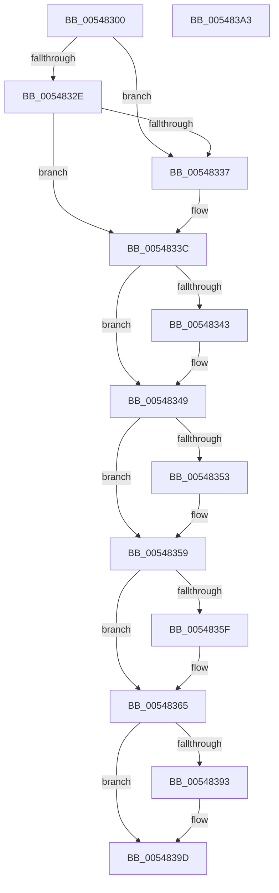

# HalpTimerGetClockConfiguration

- RVA: `0x00548300`–`0x005483A4` (길이 `164` bytes)
- VA: `0x0000000140548300`
- 실행 섹션: `.text`
- PDB 이름 있음: `예`; PDB Function 태그: `아니요`
- unwind 정보 RVA: `0x0005CF00`
- 디코드: `48`개 명령, `164/164` bytes 표시
- 미해석 바이트: `0` (있으면 어셈블리에 `.byte`로 보존)

> 이 문서는 커널 이미지의 기계어와 PDB 기호를 분석해 생성했습니다. 4번과 5번은 함수 원형과 자료형을 바이너리 사용 방식에서 추정한 C 해석이며 원본 소스 복구 결과는 아닙니다.

## 1. Dependencies

- 직접 호출 지점: **1**; 고유 호출 대상: **1**
- 직접 호출자로 확인된 함수: **0**
- RIP 상대 이미지 참조: **4**

### Outgoing calls
- `0x00548384` → [HalpTimerGetClockRates](HalpTimerGetClockRates_function_005483AC.md) (function, `0x005483AC`)

### Direct callers
- 이 함수 시작 RVA로 연결되는 직접 call은 확인되지 않았습니다. 간접 호출은 완전히 역산할 수 없습니다.

### Static image references
- `0x00548306` → RVA `0x00FC40F0` (`.data`; read)
- `0x00548349` → RVA `0x00FC4108` (`.data`; read)
- `0x00548389` → RVA `0x00FC22D8` (`.data`; read)
- `0x00548396` → RVA `0x00FC22D8` (`.data`; write)

## 2. Other-region calls and transfers

- 다른 실행 섹션으로 향하는 call: **0**
- 별도 외부 분기/꼬리 이동을 확인하지 못했습니다.

## 3. Assembly (complete function range)

```asm
00548300  40 53                           push rbx
00548302  48 83 EC 20                     sub rsp, 0x20
00548306  4C 8B 0D E3 BD A7 00            mov r9, qword ptr [rip + 0xa7bde3]
0054830D  0F 57 C0                        xorps xmm0, xmm0
00548310  0F 11 01                        movups xmmword ptr [rcx], xmm0
00548313  4C 8B C1                        mov r8, rcx
00548316  41 B2 01                        mov r10b, 1
00548319  0F 11 41 10                     movups xmmword ptr [rcx + 0x10], xmm0
0054831D  41 83 B9 E4 00 00 00 08         cmp dword ptr [r9 + 0xe4], 8
00548325  49 8D 91 E0 00 00 00            lea rdx, [r9 + 0xe0]
0054832C  74 09                           je 0x140548337
0054832E  8B 02                           mov eax, dword ptr [rdx]
00548330  32 C9                           xor cl, cl
00548332  41 84 C2                        test r10b, al
00548335  75 05                           jne 0x14054833c
00548337  B1 02                           mov cl, 2
00548339  41 88 08                        mov byte ptr [r8], cl
0054833C  8B 02                           mov eax, dword ptr [rdx]
0054833E  41 84 C2                        test r10b, al
00548341  74 06                           je 0x140548349
00548343  80 C9 04                        or cl, 4
00548346  41 88 08                        mov byte ptr [r8], cl
00548349  48 83 3D B7 BD A7 00 00         cmp qword ptr [rip + 0xa7bdb7], 0
00548351  74 06                           je 0x140548359
00548353  41 0A CA                        or cl, r10b
00548356  41 88 08                        mov byte ptr [r8], cl
00548359  8B 02                           mov eax, dword ptr [rdx]
0054835B  A8 20                           test al, 0x20
0054835D  74 06                           je 0x140548365
0054835F  80 C9 08                        or cl, 8
00548362  41 88 08                        mov byte ptr [r8], cl
00548365  41 8B 81 E4 00 00 00            mov eax, dword ptr [r9 + 0xe4]
0054836C  49 8D 58 10                     lea rbx, [r8 + 0x10]
00548370  41 89 40 04                     mov dword ptr [r8 + 4], eax
00548374  49 8B C9                        mov rcx, r9
00548377  8B 02                           mov eax, dword ptr [rdx]
00548379  48 8B D3                        mov rdx, rbx
0054837C  41 89 40 08                     mov dword ptr [r8 + 8], eax
00548380  49 83 C0 18                     add r8, 0x18
00548384  E8 23 00 00 00                  call 0x1405483ac
00548389  48 83 3D 47 9F A7 00 00         cmp qword ptr [rip + 0xa79f47], 0
00548391  75 0A                           jne 0x14054839d
00548393  48 8B 03                        mov rax, qword ptr [rbx]
00548396  48 89 05 3B 9F A7 00            mov qword ptr [rip + 0xa79f3b], rax
0054839D  48 83 C4 20                     add rsp, 0x20
005483A1  5B                              pop rbx
005483A2  C3                              ret
005483A3  CC                              int3
```

## 4. C-style interpretation (structured pseudocode)

```c
__int64 __fastcall HalpTimerGetClockConfiguration(__int64 a1)
{
    __int64 result;
    __int64 v_rsp;

    v_rsp = (v_rsp) - (32);
    *(unsigned __int64 *)(a1) = v_xmm0;
    *(unsigned __int64 *)(a1 + 16) = v_xmm0;
    if ((*(unsigned int *)(*(unsigned __int64 *)(v_rip + 10993123) + 228)) == 8) goto loc_00548337;
    a1 = 0;
    if (((1) & ((unsigned __int8)((unsigned int)(*(unsigned int *)(*(unsigned __int64 *)(v_rip + 10993123) + 224))))) == 0) {
        a1 = 2;
        *(unsigned __int8 *)(a1) = (unsigned __int8)(a1);
    }
    if (((1) & ((unsigned __int8)((unsigned int)(*(unsigned int *)(*(unsigned __int64 *)(v_rip + 10993123) + 224))))) != 0) {
        a1 = (unsigned __int8)((a1) | (4));
        *(unsigned __int8 *)(a1) = (unsigned __int8)(a1);
    }
    if ((*(unsigned __int64 *)(v_rip + 10993079)) != 0) {
        a1 = (unsigned __int8)((a1) | (1));
        *(unsigned __int8 *)(a1) = (unsigned __int8)(a1);
    }
    if ((((unsigned __int8)((unsigned int)(*(unsigned int *)(*(unsigned __int64 *)(v_rip + 10993123) + 224)))) & (32)) != 0) {
        a1 = (unsigned __int8)((a1) | (8));
        *(unsigned __int8 *)(a1) = (unsigned __int8)(a1);
    }
    *(unsigned int *)(a1 + 4) = (unsigned int)((unsigned int)(*(unsigned int *)(*(unsigned __int64 *)(v_rip + 10993123) + 228)));
    *(unsigned int *)(a1 + 8) = (unsigned int)((unsigned int)(*(unsigned int *)(*(unsigned __int64 *)(v_rip + 10993123) + 224)));
    a3 = (a1) + (24);
    result = HalpTimerGetClockRates(*(unsigned __int64 *)(v_rip + 10993123), a1 + 16, a3, *(unsigned __int64 *)(v_rip + 10993123));
    if ((*(unsigned __int64 *)(v_rip + 10985287)) == 0) {
        result = *(unsigned __int64 *)(a1 + 16);
        *(unsigned __int64 *)(v_rip + 10985275) = result;
    }
    v_rsp = (v_rsp) + (32);
    return result;
}
```

## 5. (Beta) C Style

```c
int64_t HalpTimerGetClockConfiguration(void *Arg1)
{
    uint8_t *arg1 = (uint8_t *)Arg1;

    int64_t result;
    int64_t local_rsp;

    local_rsp = (local_rsp) - (32);
    *(uint64_t *)(arg1) = v_xmm0;
    *(uint64_t *)(arg1 + 0x10) = v_xmm0;
    if ((*(uint32_t *)(*(uint64_t *)(v_rip + 0xA7BDE3) + 0xE4)) == 8) goto loc_00548337;
    Arg1 = 0;
    if (((1) & ((uint8_t)((uint32_t)(*(uint32_t *)(*(uint64_t *)(v_rip + 0xA7BDE3) + 0xE0))))) == 0) {
        Arg1 = 2;
        *(uint8_t *)(arg1) = (uint8_t)(Arg1);
    }
    if (((1) & ((uint8_t)((uint32_t)(*(uint32_t *)(*(uint64_t *)(v_rip + 0xA7BDE3) + 0xE0))))) != 0) {
        Arg1 = (uint8_t)((Arg1) | (4));
        *(uint8_t *)(arg1) = (uint8_t)(Arg1);
    }
    if ((*(uint64_t *)(v_rip + 0xA7BDB7)) != 0) {
        Arg1 = (uint8_t)((Arg1) | (1));
        *(uint8_t *)(arg1) = (uint8_t)(Arg1);
    }
    if ((((uint8_t)((uint32_t)(*(uint32_t *)(*(uint64_t *)(v_rip + 0xA7BDE3) + 0xE0)))) & (32)) != 0) {
        Arg1 = (uint8_t)((Arg1) | (8));
        *(uint8_t *)(arg1) = (uint8_t)(Arg1);
    }
    *(uint32_t *)(arg1 + 0x4) = (uint32_t)((uint32_t)(*(uint32_t *)(*(uint64_t *)(v_rip + 0xA7BDE3) + 0xE4)));
    *(uint32_t *)(arg1 + 0x8) = (uint32_t)((uint32_t)(*(uint32_t *)(*(uint64_t *)(v_rip + 0xA7BDE3) + 0xE0)));
    a3 = (Arg1) + (24);
    result = HalpTimerGetClockRates(*(uint64_t *)(v_rip + 0xA7BDE3), Arg1 + 16, a3, *(uint64_t *)(v_rip + 0xA7BDE3));
    if ((*(uint64_t *)(v_rip + 0xA79F47)) == 0) {
        result = *(uint64_t *)(arg1 + 0x10);
        *(uint64_t *)(v_rip + 0xA79F3B) = result;
    }
    local_rsp = (local_rsp) + (32);
    return result;
}
```

### 관측된 메모리 오프셋

구조체 형식이 확인되지 않은 접근은 인자 기준의 오프셋으로만 기록했습니다.

| 기준 인자 | 오프셋 표현 | 폭 (bit) | 접근 |
|---|---:|---:|---|
| `Arg1` | `+ 0x0` | `8` | `W` |
| `Arg1` | `+ 0x0` | `64` | `R` |
| `Arg1` | `+ 0x0` | `128` | `R` |
| `Arg1` | `+ 0x4` | `32` | `W` |
| `Arg1` | `+ 0x8` | `32` | `W` |
| `Arg1` | `+ 0x10` | `64` | `R` |
| `Arg1` | `+ 0x10` | `128` | `R` |

## 6. Execution-region graph

[열기: 2D/3D 그래프와 함수 탐색 컨트롤 패널](../../../control-panel.html?section=text&rva=0x00548300&view=graph)

- 2D 그래프는 위에서 아래로 흐르고, 3D 그래프는 빈 공간을 드래그해 회전합니다. Shift+드래그는 이동, 휠은 확대·축소, 함수 노드 선택은 대상 보고서 이동입니다.

### Static fallback


