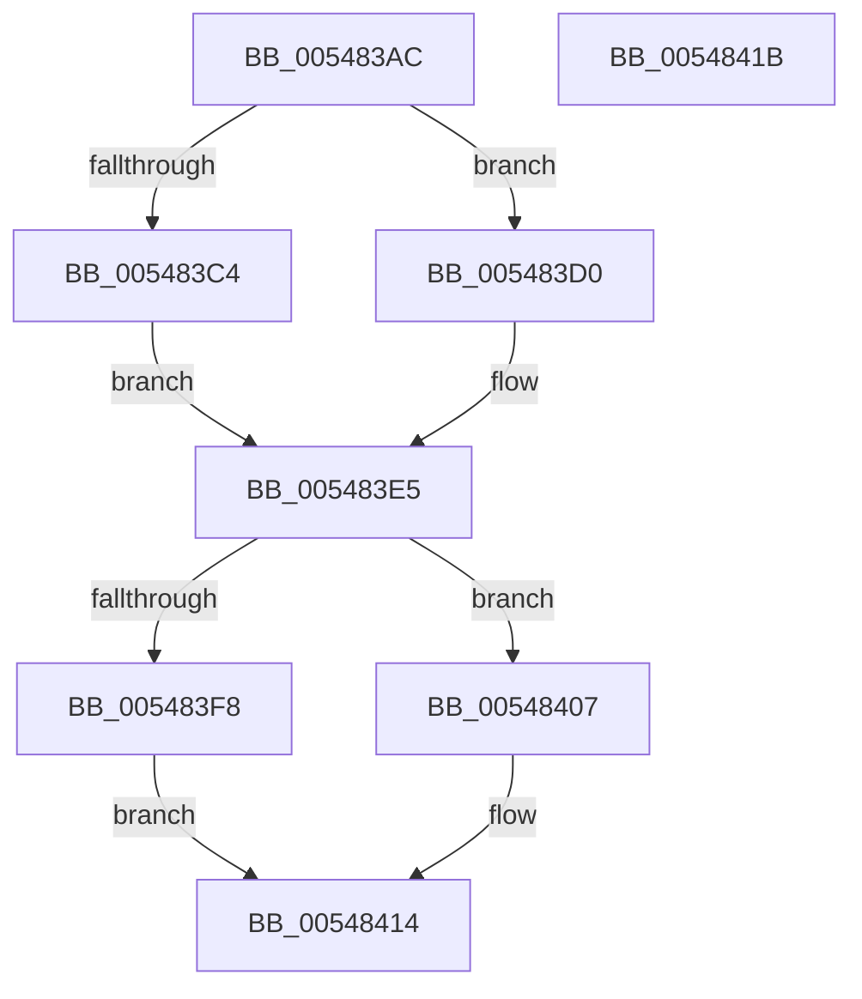

# HalpTimerGetClockRates

- RVA: `0x005483AC`–`0x0054841C` (길이 `112` bytes)
- VA: `0x00000001405483AC`
- 실행 섹션: `.text`
- PDB 이름 있음: `예`; PDB Function 태그: `아니요`
- unwind 정보 RVA: `0x000DB714`
- 디코드: `30`개 명령, `112/112` bytes 표시
- 미해석 바이트: `0` (있으면 어셈블리에 `.byte`로 보존)

> 이 문서는 커널 이미지의 기계어와 PDB 기호를 분석해 생성했습니다. 4번과 5번은 함수 원형과 자료형을 바이너리 사용 방식에서 추정한 C 해석이며 원본 소스 복구 결과는 아닙니다.

## 1. Dependencies

- 직접 호출 지점: **0**; 고유 호출 대상: **0**
- 직접 호출자로 확인된 함수: **4**
- RIP 상대 이미지 참조: **0**

### Outgoing calls
- 직접 디코드된 call 명령이 없습니다.

### Direct callers
- [HalpTimerWatchdogTriggerSystemReset](../39/HalpTimerWatchdogTriggerSystemReset_function_0039B410.md) at `0x0039B4D0`
- [HalpTimerFindIdealWatchdog](../53/HalpTimerFindIdealWatchdog_function_0053CAB0.md) at `0x0053CB06`
- [HalpTimerGetClockConfiguration](HalpTimerGetClockConfiguration_function_00548300.md) at `0x00548384`
- [HalpTimerInitializeSystemWatchdog](HalpTimerInitializeSystemWatchdog_function_0054C58C.md) at `0x0054C5B0`

### Static image references
- 디코드된 RIP-relative 메모리 참조가 없습니다.

## 2. Other-region calls and transfers

- 다른 실행 섹션으로 향하는 call: **0**
- 별도 외부 분기/꼬리 이동을 확인하지 못했습니다.

## 3. Assembly (complete function range)

```asm
005483AC  4C 8B 91 C0 00 00 00            mov r10, qword ptr [rcx + 0xc0]
005483B3  4C 8B C9                        mov r9, rcx
005483B6  8B 89 DC 00 00 00               mov ecx, dword ptr [rcx + 0xdc]
005483BC  4C 8B DA                        mov r11, rdx
005483BF  83 F9 28                        cmp ecx, 0x28
005483C2  76 0C                           jbe 0x1405483d0
005483C4  48 B8 00 00 00 00 00 80 96 98   movabs rax, 0x9896800000000000
005483CE  EB 15                           jmp 0x1405483e5
005483D0  B8 01 00 00 00                  mov eax, 1
005483D5  48 D3 E0                        shl rax, cl
005483D8  48 69 C0 80 96 98 00            imul rax, rax, 0x989680
005483DF  48 2D 80 96 98 00               sub rax, 0x989680
005483E5  33 D2                           xor edx, edx
005483E7  49 F7 F2                        div r10
005483EA  48 8B C8                        mov rcx, rax
005483ED  41 8B 81 E0 00 00 00            mov eax, dword ptr [r9 + 0xe0]
005483F4  84 C0                           test al, al
005483F6  79 0F                           jns 0x140548407
005483F8  8B D1                           mov edx, ecx
005483FA  41 8B 89 D8 00 00 00            mov ecx, dword ptr [r9 + 0xd8]
00548401  48 0F AF CA                     imul rcx, rdx
00548405  EB 0D                           jmp 0x140548414
00548407  33 D2                           xor edx, edx
00548409  B8 80 96 98 00                  mov eax, 0x989680
0054840E  49 F7 F2                        div r10
00548411  48 8B D0                        mov rdx, rax
00548414  49 89 0B                        mov qword ptr [r11], rcx
00548417  41 89 10                        mov dword ptr [r8], edx
0054841A  C3                              ret
0054841B  CC                              int3
```

## 4. C-style interpretation (structured pseudocode)

```c
__int64 __fastcall HalpTimerGetClockRates(__int64 a1, __int64 a2, __int64 a3)
{
    __int64 result;

    if (((unsigned int)((unsigned int)(*(unsigned int *)(a1 + 220)))) <= 40) goto loc_005483D0;
    goto loc_005483E5;
loc_005483D0:
    result = (1) << ((unsigned __int8)((unsigned int)(*(unsigned int *)(a1 + 220))));
    result = (result) * (result);
    result = (result) - (0x989680ULL);
loc_005483E5:
    a2 = 0;
    if (!sign_flag) goto loc_00548407;
    a1 = ((unsigned int)(*(unsigned int *)(a1 + 216))) * ((unsigned int)((unsigned int)(result)));
    goto loc_00548414;
loc_00548407:
    a2 = 0;
loc_00548414:
    *(unsigned __int64 *)(a2) = a1;
    *(unsigned int *)(a3) = (unsigned int)((unsigned int)(0x989680ULL));
    return (unsigned int)(0x989680ULL);
}
```

## 5. (Beta) C Style

```c
int64_t HalpTimerGetClockRates(void *Arg1, void *Arg2, void *Arg3)
{
    uint8_t *arg1 = (uint8_t *)Arg1;
    uint8_t *arg2 = (uint8_t *)Arg2;
    uint8_t *arg3 = (uint8_t *)Arg3;

    int64_t result;

    if (((uint32_t)((uint32_t)(*(uint32_t *)(arg1 + 0xDC)))) <= 40) goto loc_005483D0;
    goto loc_005483E5;
loc_005483D0:
    result = (1) << ((uint8_t)((uint32_t)(*(uint32_t *)(arg1 + 0xDC))));
    result = (result) * (result);
    result = (result) - (0x989680ULL);
loc_005483E5:
    Arg2 = 0;
    if (!sign_flag) goto loc_00548407;
    Arg1 = ((uint32_t)(*(uint32_t *)(arg1 + 0xD8))) * ((uint32_t)((uint32_t)(result)));
    goto loc_00548414;
loc_00548407:
    Arg2 = 0;
loc_00548414:
    *(void **)(arg2) = Arg1;
    *(uint32_t *)(arg3) = (uint32_t)((uint32_t)(0x989680ULL));
    return (uint32_t)(0x989680ULL);
}
```

### 관측된 메모리 오프셋

구조체 형식이 확인되지 않은 접근은 인자 기준의 오프셋으로만 기록했습니다.

| 기준 인자 | 오프셋 표현 | 폭 (bit) | 접근 |
|---|---:|---:|---|
| `Arg1` | `+ 0xC0` | `64` | `R` |
| `Arg1` | `+ 0xD8` | `32` | `R` |
| `Arg1` | `+ 0xDC` | `32` | `R` |
| `Arg1` | `+ 0xE0` | `32` | `R` |
| `Arg2` | `+ 0x0` | `64` | `W` |
| `Arg3` | `+ 0x0` | `32` | `W` |

## 6. Execution-region graph

[열기: 2D/3D 그래프와 함수 탐색 컨트롤 패널](../../../control-panel.html?section=text&rva=0x005483AC&view=graph)

- 2D 그래프는 위에서 아래로 흐르고, 3D 그래프는 빈 공간을 드래그해 회전합니다. Shift+드래그는 이동, 휠은 확대·축소, 함수 노드 선택은 대상 보고서 이동입니다.

### Static fallback


