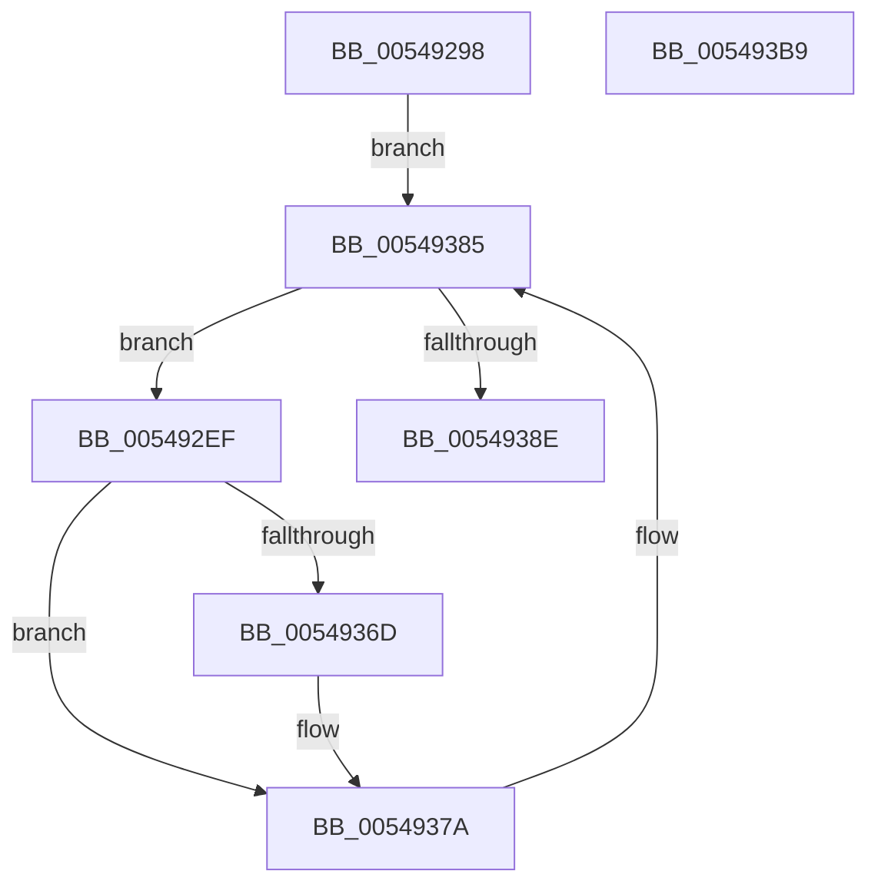

# HalpTimerInitPowerManagement

- RVA: `0x00549298`–`0x005493BA` (길이 `290` bytes)
- VA: `0x0000000140549298`
- 실행 섹션: `.text`
- PDB 이름 있음: `예`; PDB Function 태그: `아니요`
- unwind 정보 RVA: `0x000C3E9C`
- 디코드: `68`개 명령, `290/290` bytes 표시
- 미해석 바이트: `0` (있으면 어셈블리에 `.byte`로 보존)

> 이 문서는 커널 이미지의 기계어와 PDB 기호를 분석해 생성했습니다. 4번과 5번은 함수 원형과 자료형을 바이너리 사용 방식에서 추정한 C 해석이며 원본 소스 복구 결과는 아닙니다.

## 1. Dependencies

- 직접 호출 지점: **4**; 고유 호출 대상: **4**
- 직접 호출자로 확인된 함수: **1**
- RIP 상대 이미지 참조: **5**

### Outgoing calls
- `0x00549358` → [PoFxRegisterCoreDevice](../../page/75/PoFxRegisterCoreDevice_function_00758800.md) (function, `0x00758800`)
- `0x00549375` → [PoFxActivateComponent](../2D/PoFxActivateComponent_function_002D9D30.md) (function, `0x002D9D30`)
- `0x0054937D` → [PoFxStartDevicePowerManagement](../4B/PoFxStartDevicePowerManagement_function_004B5740.md) (function, `0x004B5740`)
- `0x00549397` → [_security_check_cookie](../6A/_security_check_cookie_function_006AC640.md) (function, `0x006AC640`)

### Direct callers
- [HalpTimerInitSystem](../53/HalpTimerInitSystem_function_0053CB70.md) at `0x0053CBF8`

### Static image references
- `0x005492B7` → RVA `0x00E0A740` (`.data`; read)
- `0x005492C9` → RVA `0x00FC4120` (`.data`; read)
- `0x0054930E` → RVA `0x0049E550` (`EmpCheckErrataList`; read)
- `0x0054931D` → RVA `0x00549EF0` (`HalpTimerPowerComponentIdleCallback`; read)
- `0x00549331` → RVA `0x00549F10` (`HalpTimerPowerCriticalTransitionCallback`; read)

## 2. Other-region calls and transfers

- 다른 실행 섹션으로 향하는 call: **1**
  - `0x00549358` → [PoFxRegisterCoreDevice](../../page/75/PoFxRegisterCoreDevice_function_00758800.md) (`.text` → `PAGE`)
- 별도 외부 분기/꼬리 이동을 확인하지 못했습니다.

## 3. Assembly (complete function range)

```asm
00549298  48 8B C4                        mov rax, rsp
0054929B  48 89 58 08                     mov qword ptr [rax + 8], rbx
0054929F  48 89 70 10                     mov qword ptr [rax + 0x10], rsi
005492A3  48 89 78 18                     mov qword ptr [rax + 0x18], rdi
005492A7  4C 89 78 20                     mov qword ptr [rax + 0x20], r15
005492AB  55                              push rbp
005492AC  48 8D 68 A1                     lea rbp, [rax - 0x5f]
005492B0  48 81 EC 90 00 00 00            sub rsp, 0x90
005492B7  48 8B 05 82 14 8C 00            mov rax, qword ptr [rip + 0x8c1482]
005492BE  48 33 C4                        xor rax, rsp
005492C1  48 89 45 4F                     mov qword ptr [rbp + 0x4f], rax
005492C5  83 65 4B 00                     and dword ptr [rbp + 0x4b], 0
005492C9  4C 8D 3D 50 AE A7 00            lea r15, [rip + 0xa7ae50]
005492D0  48 83 65 37 00                  and qword ptr [rbp + 0x37], 0
005492D5  48 83 65 3F 00                  and qword ptr [rbp + 0x3f], 0
005492DA  48 8B 1D 3F AE A7 00            mov rbx, qword ptr [rip + 0xa7ae3f]
005492E1  33 FF                           xor edi, edi
005492E3  C7 45 47 0A 00 00 00            mov dword ptr [rbp + 0x47], 0xa
005492EA  E9 96 00 00 00                  jmp 0x140549385
005492EF  48 8B 8B 20 01 00 00            mov rcx, qword ptr [rbx + 0x120]
005492F6  48 8D 45 37                     lea rax, [rbp + 0x37]
005492FA  48 83 65 07 00                  and qword ptr [rbp + 7], 0
005492FF  48 8D 55 E7                     lea rdx, [rbp - 0x19]
00549303  83 65 2B 00                     and dword ptr [rbp + 0x2b], 0
00549307  0F 57 C0                        xorps xmm0, xmm0
0054930A  48 89 45 2F                     mov qword ptr [rbp + 0x2f], rax
0054930E  48 8D 05 3B 52 F5 FF            lea rax, [rip - 0xaadc5]
00549315  48 89 45 EF                     mov qword ptr [rbp - 0x11], rax
00549319  48 8D 71 28                     lea rsi, [rcx + 0x28]
0054931D  48 8D 05 CC 0B 00 00            lea rax, [rip + 0xbcc]
00549324  66 0F 7F 45 17                  movdqa xmmword ptr [rbp + 0x17], xmm0
00549329  48 89 45 F7                     mov qword ptr [rbp - 9], rax
0054932D  48 83 C1 18                     add rcx, 0x18
00549331  48 8D 05 D8 0B 00 00            lea rax, [rip + 0xbd8]
00549338  C7 45 E7 01 00 00 00            mov dword ptr [rbp - 0x19], 1
0054933F  4C 8B C6                        mov r8, rsi
00549342  48 89 45 FF                     mov qword ptr [rbp - 1], rax
00549346  C7 45 EB 01 00 00 00            mov dword ptr [rbp - 0x15], 1
0054934D  C7 45 27 01 00 00 00            mov dword ptr [rbp + 0x27], 1
00549354  48 89 5D 0F                     mov qword ptr [rbp + 0xf], rbx
00549358  E8 A3 F4 20 00                  call 0x140758800
0054935D  8B 93 B8 00 00 00               mov edx, dword ptr [rbx + 0xb8]
00549363  8B F8                           mov edi, eax
00549365  80 E2 05                        and dl, 5
00549368  80 FA 04                        cmp dl, 4
0054936B  75 0D                           jne 0x14054937a
0054936D  48 8B 0E                        mov rcx, qword ptr [rsi]
00549370  45 33 C0                        xor r8d, r8d
00549373  33 D2                           xor edx, edx
00549375  E8 B6 09 D9 FF                  call 0x1402d9d30
0054937A  48 8B 0E                        mov rcx, qword ptr [rsi]
0054937D  E8 BE C3 F6 FF                  call 0x1404b5740
00549382  48 8B 1B                        mov rbx, qword ptr [rbx]
00549385  49 3B DF                        cmp rbx, r15
00549388  0F 85 61 FF FF FF               jne 0x1405492ef
0054938E  8B C7                           mov eax, edi
00549390  48 8B 4D 4F                     mov rcx, qword ptr [rbp + 0x4f]
00549394  48 33 CC                        xor rcx, rsp
00549397  E8 A4 32 16 00                  call 0x1406ac640
0054939C  4C 8D 9C 24 90 00 00 00         lea r11, [rsp + 0x90]
005493A4  49 8B 5B 10                     mov rbx, qword ptr [r11 + 0x10]
005493A8  49 8B 73 18                     mov rsi, qword ptr [r11 + 0x18]
005493AC  49 8B 7B 20                     mov rdi, qword ptr [r11 + 0x20]
005493B0  4D 8B 7B 28                     mov r15, qword ptr [r11 + 0x28]
005493B4  49 8B E3                        mov rsp, r11
005493B7  5D                              pop rbp
005493B8  C3                              ret
005493B9  CC                              int3
```

## 4. C-style interpretation (structured pseudocode)

```c
__int64 __fastcall HalpTimerInitPowerManagement(void)
{
    __int64 result;
    __int64 v_rdi;
    __int64 v_rsp;
    unsigned __int64 v_stack_m8;

    *(unsigned __int64 *)(v_rsp + 8) = v_rbx;
    *(unsigned __int64 *)(v_rsp + 16) = v_rsi;
    *(unsigned __int64 *)(v_rsp + 24) = v_rdi;
    *(unsigned __int64 *)(v_rsp + 32) = v_r15;
    v_rsp = (v_rsp) - (144);
    result = (*(unsigned __int64 *)(v_rip + 9180290)) ^ (v_rsp);
    *(unsigned __int64 *)(v_rsp - 95 + 79) = result;
    v_rdi = 0;
    *(unsigned int *)(v_rsp - 95 + 71) = 10;
    goto loc_00549385;
loc_005492EF:
    *(unsigned __int64 *)(v_rsp - 95 + 47) = v_rsp - 95 + 55;
    *(unsigned __int64 *)(v_rsp - 95 - 17) = v_rip - 699845;
    *(unsigned __int64 *)(v_rsp - 95 + 23) = v_xmm0;
    *(unsigned __int64 *)(v_rsp - 95 - 9) = v_rip + 3020;
    a1 = (*(unsigned __int64 *)(*(unsigned __int64 *)(v_rip + 10989119) + 288)) + (24);
    *(unsigned int *)(v_rsp - 95 - 25) = 1;
    *(unsigned __int64 *)(v_rsp - 95 - 1) = v_rip + 3032;
    *(unsigned int *)(v_rsp - 95 - 21) = 1;
    *(unsigned int *)(v_rsp - 95 + 39) = 1;
    *(unsigned __int64 *)(v_rsp - 95 + 15) = *(unsigned __int64 *)(v_rip + 10989119);
    result = PoFxRegisterCoreDevice(a1, v_rsp - 95 - 25, *(unsigned __int64 *)(*(unsigned __int64 *)(v_rip + 10989119) + 288) + 40, a4);
    a2 = (unsigned __int8)(((unsigned int)(*(unsigned int *)(*(unsigned __int64 *)(v_rip + 10989119) + 184))) & (5));
    if (((unsigned __int8)(a2)) == 4) {
        a1 = *(unsigned __int64 *)(*(unsigned __int64 *)(*(unsigned __int64 *)(v_rip + 10989119) + 288) + 40);
        a3 = 0;
        a2 = 0;
        result = PoFxActivateComponent(a1, a2, a3, a4);
    }
    result = PoFxStartDevicePowerManagement(*(unsigned __int64 *)(*(unsigned __int64 *)(*(unsigned __int64 *)(v_rip + 10989119) + 288) + 40), a2, a3, a4);
loc_00549385:
    if ((*(unsigned __int64 *)(*(unsigned __int64 *)(v_rip + 10989119))) != (v_rip + 10989136)) goto loc_005492EF;
    a1 = (*(unsigned __int64 *)(v_rsp - 95 + 79)) ^ (v_rsp);
    result = _security_check_cookie(a1, a2, a3, a4);
    return result;
}
```

## 5. (Beta) C Style

```c
void HalpTimerInitPowerManagement(void)
{
    int64_t result;
    int64_t local_rdi;
    int64_t local_rsp;
    uint64_t v_stack_m8;

    *(uint64_t *)(local_rsp + 0x8) = local_rbx;
    *(uint64_t *)(local_rsp + 0x10) = local_rsi;
    *(uint64_t *)(local_rsp + 0x18) = local_rdi;
    *(uint64_t *)(local_rsp + 0x20) = local_r15;
    local_rsp = (local_rsp) - (144);
    result = (*(uint64_t *)(v_rip + 0x8C1482)) ^ (local_rsp);
    *(uint64_t *)(local_rsp - 0x5F + 0x4F) = result;
    local_rdi = 0;
    *(uint32_t *)(local_rsp - 0x5F + 0x47) = 10;
    goto loc_00549385;
loc_005492EF:
    *(uint64_t *)(local_rsp - 0x5F + 0x2F) = local_rsp - 95 + 55;
    *(uint64_t *)(local_rsp - 0x5F - 0x11) = v_rip - 699845;
    *(uint64_t *)(local_rsp - 0x5F + 0x17) = v_xmm0;
    *(uint64_t *)(local_rsp - 0x5F - 0x9) = v_rip + 3020;
    a1 = (*(uint64_t *)(*(uint64_t *)(v_rip + 0xA7AE3F) + 0x120)) + (24);
    *(uint32_t *)(local_rsp - 0x5F - 0x19) = 1;
    *(uint64_t *)(local_rsp - 0x5F - 0x1) = v_rip + 3032;
    *(uint32_t *)(local_rsp - 0x5F - 0x15) = 1;
    *(uint32_t *)(local_rsp - 0x5F + 0x27) = 1;
    *(uint64_t *)(local_rsp - 0x5F + 0xF) = *(uint64_t *)(v_rip + 0xA7AE3F);
    result = PoFxRegisterCoreDevice(a1, local_rsp - 95 - 25, *(uint64_t *)(*(uint64_t *)(v_rip + 0xA7AE3F) + 0x120) + 40, a4);
    a2 = (uint8_t)(((uint32_t)(*(uint32_t *)(*(uint64_t *)(v_rip + 0xA7AE3F) + 0xB8))) & (5));
    if (((uint8_t)(a2)) == 4) {
        a1 = *(uint64_t *)(*(uint64_t *)(*(uint64_t *)(v_rip + 0xA7AE3F) + 0x120) + 0x28);
        a3 = 0;
        a2 = 0;
        result = PoFxActivateComponent(a1, a2, a3, a4);
    }
    result = PoFxStartDevicePowerManagement(*(uint64_t *)(*(uint64_t *)(*(uint64_t *)(v_rip + 0xA7AE3F) + 0x120) + 0x28), a2, a3, a4);
loc_00549385:
    if ((*(uint64_t *)(*(uint64_t *)(v_rip + 0xA7AE3F))) != (v_rip + 10989136)) goto loc_005492EF;
    a1 = (*(uint64_t *)(local_rsp - 0x5F + 0x4F)) ^ (local_rsp);
    result = _security_check_cookie(a1, a2, a3, a4);
    return result;
}
```

## 6. Execution-region graph

[열기: 2D/3D 그래프와 함수 탐색 컨트롤 패널](../../../control-panel.html?section=text&rva=0x00549298&view=graph)

- 2D 그래프는 위에서 아래로 흐르고, 3D 그래프는 빈 공간을 드래그해 회전합니다. Shift+드래그는 이동, 휠은 확대·축소, 함수 노드 선택은 대상 보고서 이동입니다.

### Static fallback


