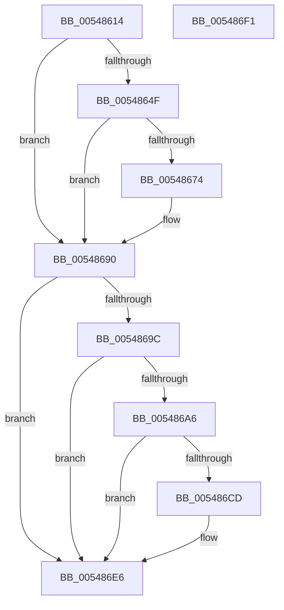

# HalpTimerInitializeClockPn

- RVA: `0x00548614`–`0x005486F2` (길이 `222` bytes)
- VA: `0x0000000140548614`
- 실행 섹션: `.text`
- PDB 이름 있음: `예`; PDB Function 태그: `아니요`
- unwind 정보 RVA: `0x0006E5F8`
- 디코드: `51`개 명령, `222/222` bytes 표시
- 미해석 바이트: `0` (있으면 어셈블리에 `.byte`로 보존)

> 이 문서는 커널 이미지의 기계어와 PDB 기호를 분석해 생성했습니다. 4번과 5번은 함수 원형과 자료형을 바이너리 사용 방식에서 추정한 C 해석이며 원본 소스 복구 결과는 아닙니다.

## 1. Dependencies

- 직접 호출 지점: **7**; 고유 호출 대상: **3**
- 직접 호출자로 확인된 함수: **1**
- RIP 상대 이미지 참조: **5**

### Outgoing calls
- `0x00548639` → [HalpInterruptSetIdtEntry](../55/HalpInterruptSetIdtEntry_function_0055BAE0.md) (function, `0x0055BAE0`)
- `0x00548663` → [HalpInterruptSetIdtEntry](../55/HalpInterruptSetIdtEntry_function_0055BAE0.md) (function, `0x0055BAE0`)
- `0x00548677` → [HalpTimerGetInternalData](../20/HalpTimerGetInternalData_function_00209500.md) (function, `0x00209500`)
- `0x0054868B` → [guard_dispatch_icall](../6B/guard_dispatch_icall_function_006BAAD0.md) (function, `0x006BAAD0`)
- `0x005486BC` → [HalpInterruptSetIdtEntry](../55/HalpInterruptSetIdtEntry_function_0055BAE0.md) (function, `0x0055BAE0`)
- `0x005486D0` → [HalpTimerGetInternalData](../20/HalpTimerGetInternalData_function_00209500.md) (function, `0x00209500`)
- `0x005486E1` → [guard_dispatch_icall](../6B/guard_dispatch_icall_function_006BAAD0.md) (function, `0x006BAAD0`)

### Direct callers
- [HalpTimerInitSystem](../53/HalpTimerInitSystem_function_0053CB70.md) at `0x0053CD7E`

### Static image references
- `0x00548625` → RVA `0x00399CC0` (`HalpTimerClockIpiRoutine`; read)
- `0x0054863E` → RVA `0x00FC40F0` (`.data`; read)
- `0x00548657` → RVA `0x002086A0` (`HalpTimerClockInterrupt`; read)
- `0x00548690` → RVA `0x00FC4108` (`.data`; read)
- `0x005486AB` → RVA `0x00560240` (`HalpTimerAlwaysOnClockInterrupt`; read)

## 2. Other-region calls and transfers

- 다른 실행 섹션으로 향하는 call: **0**
- 별도 외부 분기/꼬리 이동을 확인하지 못했습니다.

## 3. Assembly (complete function range)

```asm
00548614  48 89 5C 24 08                  mov qword ptr [rsp + 8], rbx
00548619  57                              push rdi
0054861A  48 83 EC 30                     sub rsp, 0x30
0054861E  48 C7 C7 FD FF FF FF            mov rdi, 0xfffffffffffffffd
00548625  48 8D 15 94 16 E5 FF            lea rdx, [rip - 0x1ae96c]
0054862C  41 B0 0D                        mov r8b, 0xd
0054862F  48 89 7C 24 20                  mov qword ptr [rsp + 0x20], rdi
00548634  B9 D2 00 00 00                  mov ecx, 0xd2
00548639  E8 A2 34 01 00                  call 0x14055bae0
0054863E  48 8B 1D AB BA A7 00            mov rbx, qword ptr [rip + 0xa7baab]
00548645  8B 83 E0 00 00 00               mov eax, dword ptr [rbx + 0xe0]
0054864B  A8 01                           test al, 1
0054864D  74 41                           je 0x140548690
0054864F  41 B0 0D                        mov r8b, 0xd
00548652  48 89 7C 24 20                  mov qword ptr [rsp + 0x20], rdi
00548657  48 8D 15 42 00 CC FF            lea rdx, [rip - 0x33ffbe]
0054865E  B9 D1 00 00 00                  mov ecx, 0xd1
00548663  E8 78 34 01 00                  call 0x14055bae0
00548668  F7 83 E0 00 00 00 00 08 00 00   test dword ptr [rbx + 0xe0], 0x800
00548672  74 1C                           je 0x140548690
00548674  48 8B CB                        mov rcx, rbx
00548677  E8 84 0E CC FF                  call 0x140209500
0054867C  48 8B C8                        mov rcx, rax
0054867F  BA D1 00 00 00                  mov edx, 0xd1
00548684  48 8B 83 A8 00 00 00            mov rax, qword ptr [rbx + 0xa8]
0054868B  E8 40 24 17 00                  call 0x1406baad0
00548690  48 8B 1D 71 BA A7 00            mov rbx, qword ptr [rip + 0xa7ba71]
00548697  48 85 DB                        test rbx, rbx
0054869A  74 4A                           je 0x1405486e6
0054869C  8B 83 E0 00 00 00               mov eax, dword ptr [rbx + 0xe0]
005486A2  A8 01                           test al, 1
005486A4  74 40                           je 0x1405486e6
005486A6  48 89 7C 24 20                  mov qword ptr [rsp + 0x20], rdi
005486AB  48 8D 15 8E 7B 01 00            lea rdx, [rip + 0x17b8e]
005486B2  BF D3 00 00 00                  mov edi, 0xd3
005486B7  41 B0 0D                        mov r8b, 0xd
005486BA  8B CF                           mov ecx, edi
005486BC  E8 1F 34 01 00                  call 0x14055bae0
005486C1  F7 83 E0 00 00 00 00 08 00 00   test dword ptr [rbx + 0xe0], 0x800
005486CB  74 19                           je 0x1405486e6
005486CD  48 8B CB                        mov rcx, rbx
005486D0  E8 2B 0E CC FF                  call 0x140209500
005486D5  48 8B C8                        mov rcx, rax
005486D8  8B D7                           mov edx, edi
005486DA  48 8B 83 A8 00 00 00            mov rax, qword ptr [rbx + 0xa8]
005486E1  E8 EA 23 17 00                  call 0x1406baad0
005486E6  48 8B 5C 24 40                  mov rbx, qword ptr [rsp + 0x40]
005486EB  48 83 C4 30                     add rsp, 0x30
005486EF  5F                              pop rdi
005486F0  C3                              ret
005486F1  CC                              int3
```

## 4. C-style interpretation (structured pseudocode)

```c
__int64 __fastcall HalpTimerInitializeClockPn(void)
{
    __int64 result;
    __int64 v_rsp;
    unsigned __int64 v_stack_m18;
    unsigned __int64 v_stack_p8;

    v_stack_p8 = v_rbx;
    v_rsp = (v_rsp) - (48);
    v_stack_m18 = -3;
    result = HalpInterruptSetIdtEntry(210, v_rip - 1763692, 13, a4);
    if ((((unsigned __int8)((unsigned int)(*(unsigned int *)(*(unsigned __int64 *)(v_rip + 10992299) + 224)))) & (1)) == 0) goto loc_00548690;
    v_stack_m18 = -3;
    result = HalpInterruptSetIdtEntry(209, v_rip - 3407806, 13, a4);
    if (((*(unsigned int *)(*(unsigned __int64 *)(v_rip + 10992299) + 224)) & (0x800ULL)) != 0) {
        a1 = *(unsigned __int64 *)(v_rip + 10992299);
        result = HalpTimerGetInternalData(a1, v_rip - 3407806, 13, a4);
        a1 = result;
        a2 = 209;
        result = *(unsigned __int64 *)(*(unsigned __int64 *)(v_rip + 10992299) + 168);
        result = guard_dispatch_icall(a1, a2, 13, a4);
    }
    if (*(unsigned __int64 *)(v_rip + 10992241) == 0) goto loc_005486E6;
    if ((((unsigned __int8)((unsigned int)(*(unsigned int *)(*(unsigned __int64 *)(v_rip + 10992241) + 224)))) & (1)) == 0) goto loc_005486E6;
    v_stack_m18 = -3;
    result = HalpInterruptSetIdtEntry(211, v_rip + 97166, 13, a4);
    if (((*(unsigned int *)(*(unsigned __int64 *)(v_rip + 10992241) + 224)) & (0x800ULL)) != 0) {
        a1 = *(unsigned __int64 *)(v_rip + 10992241);
        result = HalpTimerGetInternalData(a1, v_rip + 97166, 13, a4);
        a1 = result;
        a2 = 211;
        result = *(unsigned __int64 *)(*(unsigned __int64 *)(v_rip + 10992241) + 168);
        result = guard_dispatch_icall(a1, a2, 13, a4);
    }
    v_rsp = (v_rsp) + (48);
    return result;
}
```

## 5. (Beta) C Style

```c
void HalpTimerInitializeClockPn(void)
{
    int64_t result;
    int64_t local_rsp;
    uint64_t v_stack_m18;
    uint64_t v_stack_p8;

    v_stack_p8 = local_rbx;
    local_rsp = (local_rsp) - (48);
    v_stack_m18 = -3;
    result = HalpInterruptSetIdtEntry(210, v_rip - 1763692, 13, a4);
    if ((((uint8_t)((uint32_t)(*(uint32_t *)(*(uint64_t *)(v_rip + 0xA7BAAB) + 0xE0)))) & (1)) == 0) goto loc_00548690;
    v_stack_m18 = -3;
    result = HalpInterruptSetIdtEntry(209, v_rip - 3407806, 13, a4);
    if (((*(uint32_t *)(*(uint64_t *)(v_rip + 0xA7BAAB) + 0xE0)) & (0x800ULL)) != 0) {
        a1 = *(uint64_t *)(v_rip + 0xA7BAAB);
        result = HalpTimerGetInternalData(a1, v_rip - 3407806, 13, a4);
        a1 = result;
        a2 = 209;
        result = *(uint64_t *)(*(uint64_t *)(v_rip + 0xA7BAAB) + 0xA8);
        result = guard_dispatch_icall(a1, a2, 13, a4);
    }
    if (*(uint64_t *)(v_rip + 0xA7BA71) == 0) goto loc_005486E6;
    if ((((uint8_t)((uint32_t)(*(uint32_t *)(*(uint64_t *)(v_rip + 0xA7BA71) + 0xE0)))) & (1)) == 0) goto loc_005486E6;
    v_stack_m18 = -3;
    result = HalpInterruptSetIdtEntry(211, v_rip + 97166, 13, a4);
    if (((*(uint32_t *)(*(uint64_t *)(v_rip + 0xA7BA71) + 0xE0)) & (0x800ULL)) != 0) {
        a1 = *(uint64_t *)(v_rip + 0xA7BA71);
        result = HalpTimerGetInternalData(a1, v_rip + 97166, 13, a4);
        a1 = result;
        a2 = 211;
        result = *(uint64_t *)(*(uint64_t *)(v_rip + 0xA7BA71) + 0xA8);
        result = guard_dispatch_icall(a1, a2, 13, a4);
    }
    local_rsp = (local_rsp) + (48);
    return result;
}
```

## 6. Execution-region graph

[열기: 2D/3D 그래프와 함수 탐색 컨트롤 패널](../../../control-panel.html?section=text&rva=0x00548614&view=graph)

- 2D 그래프는 위에서 아래로 흐르고, 3D 그래프는 빈 공간을 드래그해 회전합니다. Shift+드래그는 이동, 휠은 확대·축소, 함수 노드 선택은 대상 보고서 이동입니다.

### Static fallback


