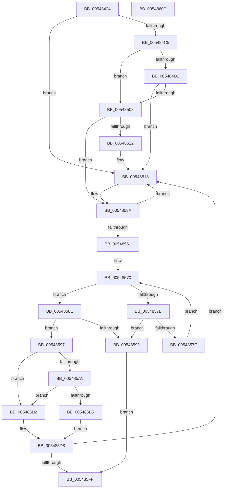

# HalpTimerInitializeClock

- RVA: `0x00548424`–`0x0054860E` (길이 `490` bytes)
- VA: `0x0000000140548424`
- 실행 섹션: `.text`
- PDB 이름 있음: `예`; PDB Function 태그: `아니요`
- unwind 정보 RVA: `0x000C3E08`
- 디코드: `122`개 명령, `490/490` bytes 표시
- 미해석 바이트: `0` (있으면 어셈블리에 `.byte`로 보존)

> 이 문서는 커널 이미지의 기계어와 PDB 기호를 분석해 생성했습니다. 4번과 5번은 함수 원형과 자료형을 바이너리 사용 방식에서 추정한 C 해석이며 원본 소스 복구 결과는 아닙니다.

## 1. Dependencies

- 직접 호출 지점: **9**; 고유 호출 대상: **8**
- 직접 호출자로 확인된 함수: **2**
- RIP 상대 이미지 참조: **8**

### Outgoing calls
- `0x0054845D` → [HalpInterruptSetIdtEntry](../55/HalpInterruptSetIdtEntry_function_0055BAE0.md) (function, `0x0055BAE0`)
- `0x005484B9` → [HalpTimerConfigureInterrupt](HalpTimerConfigureInterrupt_function_00548AB0.md) (function, `0x00548AB0`)
- `0x005484FC` → [HalpTimerConfigureInterrupt](HalpTimerConfigureInterrupt_function_00548AB0.md) (function, `0x00548AB0`)
- `0x00548534` → [KeBugCheckEx](../4F/KeBugCheckEx_function_004FD660.md) (function, `0x004FD660`)
- `0x00548555` → [HalpSetTimer](../42/HalpSetTimer_function_0042BD30.md) (function, `0x0042BD30`)
- `0x00548584` → [KeStallExecutionProcessor](../44/KeStallExecutionProcessor_function_0044F620.md) (function, `0x0044F620`)
- `0x005485C3` → [HalpTimerUnmapInterrupt](HalpTimerUnmapInterrupt_function_0054A140.md) (function, `0x0054A140`)
- `0x005485C8` → [HalpTimerInitializeClock](HalpTimerInitializeClock_function_00548424.md) (function, `0x00548424`)
- `0x005485F1` → [HalpTimerSetProblemEx](../4F/HalpTimerSetProblemEx_function_004FAEC4.md) (function, `0x004FAEC4`)

### Direct callers
- [HalpTimerInitSystem](../53/HalpTimerInitSystem_function_0053CB70.md) at `0x0053CE91`
- [HalpTimerInitializeClock](HalpTimerInitializeClock_function_00548424.md) at `0x005485C8`

### Static image references
- `0x00548435` → RVA `0x00399CC0` (`HalpTimerClockIpiRoutine`; read)
- `0x0054843C` → RVA `0x00FC40F0` (`.data`; read)
- `0x00548462` → RVA `0x00F231B0` (`.data`; read)
- `0x00548499` → RVA `0x005604C0` (`HalpTimerClockInterruptStub`; read)
- `0x005484C5` → RVA `0x00FC4108` (`.data`; read)
- `0x005484D1` → RVA `0x00560240` (`HalpTimerAlwaysOnClockInterrupt`; read)
- `0x00548518` → RVA `0x00E10358` (`.data`; read)
- `0x005485E3` → RVA `0x00023E30` (`.rdata`; read)

## 2. Other-region calls and transfers

- 다른 실행 섹션으로 향하는 call: **0**
- 별도 외부 분기/꼬리 이동을 확인하지 못했습니다.

## 3. Assembly (complete function range)

```asm
00548424  48 8B C4                        mov rax, rsp
00548427  48 89 58 10                     mov qword ptr [rax + 0x10], rbx
0054842B  57                              push rdi
0054842C  48 83 EC 50                     sub rsp, 0x50
00548430  48 83 60 08 00                  and qword ptr [rax + 8], 0
00548435  48 8D 15 84 18 E5 FF            lea rdx, [rip - 0x1ae77c]
0054843C  48 8B 1D AD BC A7 00            mov rbx, qword ptr [rip + 0xa7bcad]
00548443  0F 57 C0                        xorps xmm0, xmm0
00548446  48 C7 C7 FD FF FF FF            mov rdi, 0xfffffffffffffffd
0054844D  41 B0 0D                        mov r8b, 0xd
00548450  B9 D2 00 00 00                  mov ecx, 0xd2
00548455  48 89 78 C8                     mov qword ptr [rax - 0x38], rdi
00548459  0F 11 40 E8                     movups xmmword ptr [rax - 0x18], xmm0
0054845D  E8 7E 36 01 00                  call 0x14055bae0
00548462  48 8B 05 47 AD 9D 00            mov rax, qword ptr [rip + 0x9dad47]
00548469  41 B0 0D                        mov r8b, 0xd
0054846C  BA D1 00 00 00                  mov edx, 0xd1
00548471  8B 08                           mov ecx, dword ptr [rax]
00548473  33 C0                           xor eax, eax
00548475  89 44 24 4A                     mov dword ptr [rsp + 0x4a], eax
00548479  66 89 44 24 4E                  mov word ptr [rsp + 0x4e], ax
0054847E  8B C1                           mov eax, ecx
00548480  C1 E8 06                        shr eax, 6
00548483  83 E1 3F                        and ecx, 0x3f
00548486  66 89 44 24 48                  mov word ptr [rsp + 0x48], ax
0054848B  8D 47 04                        lea eax, [rdi + 4]
0054848E  48 D3 E0                        shl rax, cl
00548491  48 8B CB                        mov rcx, rbx
00548494  48 89 44 24 40                  mov qword ptr [rsp + 0x40], rax
00548499  48 8D 05 20 80 01 00            lea rax, [rip + 0x18020]
005484A0  48 89 44 24 38                  mov qword ptr [rsp + 0x38], rax
005484A5  48 8D 44 24 40                  lea rax, [rsp + 0x40]
005484AA  48 89 44 24 30                  mov qword ptr [rsp + 0x30], rax
005484AF  83 64 24 28 00                  and dword ptr [rsp + 0x28], 0
005484B4  48 89 7C 24 20                  mov qword ptr [rsp + 0x20], rdi
005484B9  E8 F2 05 00 00                  call 0x140548ab0
005484BE  44 8B D0                        mov r10d, eax
005484C1  85 C0                           test eax, eax
005484C3  78 53                           js 0x140548518
005484C5  48 8B 0D 3C BC A7 00            mov rcx, qword ptr [rip + 0xa7bc3c]
005484CC  48 85 C9                        test rcx, rcx
005484CF  74 37                           je 0x140548508
005484D1  48 8D 05 68 7D 01 00            lea rax, [rip + 0x17d68]
005484D8  41 B0 0D                        mov r8b, 0xd
005484DB  48 89 44 24 38                  mov qword ptr [rsp + 0x38], rax
005484E0  BA D3 00 00 00                  mov edx, 0xd3
005484E5  48 8D 44 24 40                  lea rax, [rsp + 0x40]
005484EA  48 89 44 24 30                  mov qword ptr [rsp + 0x30], rax
005484EF  C7 44 24 28 04 00 00 00         mov dword ptr [rsp + 0x28], 4
005484F7  48 89 7C 24 20                  mov qword ptr [rsp + 0x20], rdi
005484FC  E8 AF 05 00 00                  call 0x140548ab0
00548501  44 8B D0                        mov r10d, eax
00548504  85 C0                           test eax, eax
00548506  78 10                           js 0x140548518
00548508  8B 83 E0 00 00 00               mov eax, dword ptr [rbx + 0xe0]
0054850E  A8 50                           test al, 0x50
00548510  75 28                           jne 0x14054853a
00548512  41 BA BB 00 00 C0               mov r10d, 0xc00000bb
00548518  4C 63 0D 39 7E 8C 00            movsxd r9, dword ptr [rip + 0x8c7e39]
0054851F  4C 8B C3                        mov r8, rbx
00548522  49 63 C2                        movsxd rax, r10d
00548525  BA 10 01 00 00                  mov edx, 0x110
0054852A  B9 5C 00 00 00                  mov ecx, 0x5c
0054852F  48 89 44 24 20                  mov qword ptr [rsp + 0x20], rax
00548534  E8 27 51 FB FF                  call 0x1404fd660
00548539  CC                              int3
0054853A  48 8D 44 24 60                  lea rax, [rsp + 0x60]
0054853F  41 B1 01                        mov r9b, 1
00548542  BA 02 00 00 00                  mov edx, 2
00548547  48 89 44 24 20                  mov qword ptr [rsp + 0x20], rax
0054854C  41 B8 5A 62 02 00               mov r8d, 0x2625a
00548552  48 8B CB                        mov rcx, rbx
00548555  E8 D6 37 EE FF                  call 0x14042bd30
0054855A  44 8B D0                        mov r10d, eax
0054855D  85 C0                           test eax, eax
0054855F  78 B7                           js 0x140548518
00548561  C7 43 40 00 00 00 00            mov dword ptr [rbx + 0x40], 0
00548568  0F 20 D0                        mov rax, cr2
0054856B  0F 22 D0                        mov cr2, rax
0054856E  33 FF                           xor edi, edi
00548570  8B 43 40                        mov eax, dword ptr [rbx + 0x40]
00548573  81 FF B8 0B 00 00               cmp edi, 0xbb8
00548579  73 13                           jae 0x14054858e
0054857B  85 C0                           test eax, eax
0054857D  75 13                           jne 0x140548592
0054857F  B9 10 27 00 00                  mov ecx, 0x2710
00548584  E8 97 70 F0 FF                  call 0x14044f620
00548589  83 C7 0A                        add edi, 0xa
0054858C  EB E2                           jmp 0x140548570
0054858E  85 C0                           test eax, eax
00548590  74 05                           je 0x140548597
00548592  45 33 D2                        xor r10d, r10d
00548595  EB 68                           jmp 0x1405485ff
00548597  8B 83 B8 00 00 00               mov eax, dword ptr [rbx + 0xb8]
0054859D  A8 10                           test al, 0x10
0054859F  74 31                           je 0x1405485d2
005485A1  0F BA B3 E0 00 00 00 0A         btr dword ptr [rbx + 0xe0], 0xa
005485A9  F7 83 E0 00 00 00 00 0F 00 00   test dword ptr [rbx + 0xe0], 0xf00
005485B3  74 1D                           je 0x1405485d2
005485B5  45 33 C9                        xor r9d, r9d
005485B8  45 33 C0                        xor r8d, r8d
005485BB  BA D1 00 00 00                  mov edx, 0xd1
005485C0  48 8B CB                        mov rcx, rbx
005485C3  E8 78 1B 00 00                  call 0x14054a140
005485C8  E8 57 FE FF FF                  call 0x140548424
005485CD  44 8B D0                        mov r10d, eax
005485D0  EB 06                           jmp 0x1405485d8
005485D2  41 BA 01 00 00 C0               mov r10d, 0xc0000001
005485D8  45 33 C0                        xor r8d, r8d
005485DB  C7 44 24 20 13 01 00 00         mov dword ptr [rsp + 0x20], 0x113
005485E3  4C 8D 0D 46 B8 AD FF            lea r9, [rip - 0x5247ba]
005485EA  48 8B CB                        mov rcx, rbx
005485ED  41 8D 50 19                     lea edx, [r8 + 0x19]
005485F1  E8 CE 28 FB FF                  call 0x1404faec4
005485F6  45 85 D2                        test r10d, r10d
005485F9  0F 88 19 FF FF FF               js 0x140548518
005485FF  48 8B 5C 24 68                  mov rbx, qword ptr [rsp + 0x68]
00548604  41 8B C2                        mov eax, r10d
00548607  48 83 C4 50                     add rsp, 0x50
0054860B  5F                              pop rdi
0054860C  C3                              ret
0054860D  CC                              int3
```

## 4. C-style interpretation (structured pseudocode)

```c
__int64 __fastcall HalpTimerInitializeClock(void)
{
    __int64 result;
    __int64 v_r10;
    __int64 v_rdi;
    __int64 v_rsp;
    unsigned __int16 v_stack_m10;
    unsigned __int64 v_stack_m18;
    unsigned __int64 v_stack_m20;
    unsigned __int64 v_stack_m28;
    unsigned int v_stack_m30;
    unsigned __int64 v_stack_m38;
    unsigned __int16 v_stack_mA;
    unsigned int v_stack_mE;
    unsigned __int64 v_stack_p10;
    unsigned __int64 v_stack_p8;

    *(unsigned __int64 *)(v_rsp + 16) = v_rbx;
    v_rsp = (v_rsp) - (80);
    *(unsigned __int64 *)(v_rsp - 56) = -3;
    *(unsigned __int64 *)(v_rsp - 24) = v_xmm0;
    result = HalpInterruptSetIdtEntry(210, v_rip - 1763196, 13, a4);
    result = 0;
    v_stack_mE = 0;
    v_stack_mA = 0;
    result = (unsigned int)(((unsigned int)((unsigned int)((unsigned int)(*(unsigned int *)(*(unsigned __int64 *)(v_rip + 10333511)))))) >> (6));
    a1 = (unsigned int)(((unsigned int)(*(unsigned int *)(*(unsigned __int64 *)(v_rip + 10333511)))) & (63));
    v_stack_m10 = (unsigned __int16)(result);
    result = (-3 + 4) << ((unsigned __int8)(a1));
    v_stack_m18 = result;
    v_stack_m20 = v_rip + 98336;
    v_stack_m28 = v_stack_m18;
    v_stack_m38 = -3;
    result = HalpTimerConfigureInterrupt(*(unsigned __int64 *)(v_rip + 10992813), 209, 13, a4);
    if (sign_flag) goto loc_00548518;
    if (*(unsigned __int64 *)(v_rip + 10992700) == 0) goto loc_00548508;
    v_stack_m20 = v_rip + 97640;
    v_stack_m28 = v_stack_m18;
    v_stack_m30 = 4;
    v_stack_m38 = -3;
    result = HalpTimerConfigureInterrupt(*(unsigned __int64 *)(v_rip + 10992700), 211, 13, a4);
    if (sign_flag) goto loc_00548518;
loc_00548508:
    if ((((unsigned __int8)((unsigned int)(*(unsigned int *)(*(unsigned __int64 *)(v_rip + 10992813) + 224)))) & (80)) != 0) goto loc_0054853A;
loc_00548518:
    v_stack_m38 = (int)((unsigned int)((unsigned int)(0xC00000BBULL)));
    result = KeBugCheckEx(92, 272, *(unsigned __int64 *)(v_rip + 10992813), (int)(*(unsigned int *)(v_rip + 9207353)));
loc_0054853A:
    v_stack_m38 = v_stack_p8;
    result = HalpSetTimer(*(unsigned __int64 *)(v_rip + 10992813), 2, (unsigned int)(0x2625AULL), 1);
    if (sign_flag) goto loc_00548518;
    *(unsigned int *)(*(unsigned __int64 *)(v_rip + 10992813) + 64) = 0;
    v_rdi = 0;
loc_00548570:
    if (0 >= 0xBB8ULL) goto loc_0054858E;
    if ((unsigned int)((unsigned int)(*(unsigned int *)(*(unsigned __int64 *)(v_rip + 10992813) + 64))) != 0) goto loc_00548592;
    result = KeStallExecutionProcessor((unsigned int)(0x2710ULL), 2, (unsigned int)(0x2625AULL), 1);
    v_rdi = (unsigned int)((v_rdi) + (10));
    goto loc_00548570;
loc_0054858E:
    if ((unsigned int)(result) == 0) goto loc_00548597;
loc_00548592:
    v_r10 = 0;
    goto loc_005485FF;
loc_00548597:
    if ((((unsigned __int8)((unsigned int)(*(unsigned int *)(*(unsigned __int64 *)(v_rip + 10992813) + 184)))) & (16)) == 0) goto loc_005485D2;
    if (((*(unsigned int *)(*(unsigned __int64 *)(v_rip + 10992813) + 224)) & (0xF00ULL)) == 0) goto loc_005485D2;
    a4 = 0;
    a3 = 0;
    result = HalpTimerUnmapInterrupt(*(unsigned __int64 *)(v_rip + 10992813), 209, a3, a4);
    result = HalpTimerInitializeClock(*(unsigned __int64 *)(v_rip + 10992813), 209, a3, a4);
    goto loc_005485D8;
loc_005485D2:
loc_005485D8:
    a3 = 0;
    v_stack_m38 = 275;
    result = HalpTimerSetProblemEx(*(unsigned __int64 *)(v_rip + 10992813), a3 + 25, a3, v_rip - 5392314);
    if (sign_flag) goto loc_00548518;
loc_005485FF:
    v_rsp = (v_rsp) + (80);
    return (unsigned int)((unsigned int)((unsigned int)(0xC0000001ULL)));
}
```

## 5. (Beta) C Style

```c
void HalpTimerInitializeClock(void)
{
    int64_t result;
    int64_t local_r10;
    int64_t local_rdi;
    int64_t local_rsp;
    uint16_t v_stack_m10;
    uint64_t v_stack_m18;
    uint64_t v_stack_m20;
    uint64_t v_stack_m28;
    uint32_t v_stack_m30;
    uint64_t v_stack_m38;
    uint16_t v_stack_mA;
    uint32_t v_stack_mE;
    uint64_t v_stack_p10;
    uint64_t v_stack_p8;

    *(uint64_t *)(local_rsp + 0x10) = local_rbx;
    local_rsp = (local_rsp) - (80);
    *(uint64_t *)(local_rsp - 0x38) = -3;
    *(uint64_t *)(local_rsp - 0x18) = v_xmm0;
    result = HalpInterruptSetIdtEntry(210, v_rip - 1763196, 13, a4);
    result = 0;
    v_stack_mE = 0;
    v_stack_mA = 0;
    result = (uint32_t)(((uint32_t)((uint32_t)((uint32_t)(*(uint32_t *)(*(uint64_t *)(v_rip + 0x9DAD47)))))) >> (6));
    a1 = (uint32_t)(((uint32_t)(*(uint32_t *)(*(uint64_t *)(v_rip + 0x9DAD47)))) & (63));
    v_stack_m10 = (uint16_t)(result);
    result = (-3 + 4) << ((uint8_t)(a1));
    v_stack_m18 = result;
    v_stack_m20 = v_rip + 98336;
    v_stack_m28 = v_stack_m18;
    v_stack_m38 = -3;
    result = HalpTimerConfigureInterrupt(*(uint64_t *)(v_rip + 0xA7BCAD), 209, 13, a4);
    if (sign_flag) goto loc_00548518;
    if (*(uint64_t *)(v_rip + 0xA7BC3C) == 0) goto loc_00548508;
    v_stack_m20 = v_rip + 97640;
    v_stack_m28 = v_stack_m18;
    v_stack_m30 = 4;
    v_stack_m38 = -3;
    result = HalpTimerConfigureInterrupt(*(uint64_t *)(v_rip + 0xA7BC3C), 211, 13, a4);
    if (sign_flag) goto loc_00548518;
loc_00548508:
    if ((((uint8_t)((uint32_t)(*(uint32_t *)(*(uint64_t *)(v_rip + 0xA7BCAD) + 0xE0)))) & (80)) != 0) goto loc_0054853A;
loc_00548518:
    v_stack_m38 = (int32_t)((uint32_t)((uint32_t)(0xC00000BBULL)));
    result = KeBugCheckEx(92, 272, *(uint64_t *)(v_rip + 0xA7BCAD), (int32_t)(*(uint32_t *)(v_rip + 0x8C7E39)));
loc_0054853A:
    v_stack_m38 = v_stack_p8;
    result = HalpSetTimer(*(uint64_t *)(v_rip + 0xA7BCAD), 2, (uint32_t)(0x2625AULL), 1);
    if (sign_flag) goto loc_00548518;
    *(uint32_t *)(*(uint64_t *)(v_rip + 0xA7BCAD) + 0x40) = 0;
    local_rdi = 0;
loc_00548570:
    if (0 >= 0xBB8ULL) goto loc_0054858E;
    if ((uint32_t)((uint32_t)(*(uint32_t *)(*(uint64_t *)(v_rip + 0xA7BCAD) + 0x40))) != 0) goto loc_00548592;
    result = KeStallExecutionProcessor((uint32_t)(0x2710ULL), 2, (uint32_t)(0x2625AULL), 1);
    local_rdi = (uint32_t)((local_rdi) + (10));
    goto loc_00548570;
loc_0054858E:
    if ((uint32_t)(result) == 0) goto loc_00548597;
loc_00548592:
    local_r10 = 0;
    goto loc_005485FF;
loc_00548597:
    if ((((uint8_t)((uint32_t)(*(uint32_t *)(*(uint64_t *)(v_rip + 0xA7BCAD) + 0xB8)))) & (16)) == 0) goto loc_005485D2;
    if (((*(uint32_t *)(*(uint64_t *)(v_rip + 0xA7BCAD) + 0xE0)) & (0xF00ULL)) == 0) goto loc_005485D2;
    a4 = 0;
    a3 = 0;
    result = HalpTimerUnmapInterrupt(*(uint64_t *)(v_rip + 0xA7BCAD), 209, a3, a4);
    result = HalpTimerInitializeClock(*(uint64_t *)(v_rip + 0xA7BCAD), 209, a3, a4);
    goto loc_005485D8;
loc_005485D2:
loc_005485D8:
    a3 = 0;
    v_stack_m38 = 275;
    result = HalpTimerSetProblemEx(*(uint64_t *)(v_rip + 0xA7BCAD), a3 + 25, a3, v_rip - 5392314);
    if (sign_flag) goto loc_00548518;
loc_005485FF:
    local_rsp = (local_rsp) + (80);
    return (uint32_t)((uint32_t)((uint32_t)(0xC0000001ULL)));
}
```

## 6. Execution-region graph

[열기: 2D/3D 그래프와 함수 탐색 컨트롤 패널](../../../control-panel.html?section=text&rva=0x00548424&view=graph)

- 2D 그래프는 위에서 아래로 흐르고, 3D 그래프는 빈 공간을 드래그해 회전합니다. Shift+드래그는 이동, 휠은 확대·축소, 함수 노드 선택은 대상 보고서 이동입니다.

### Static fallback


