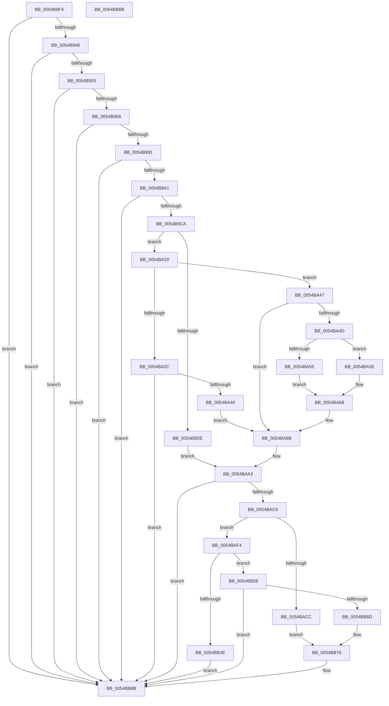

# HalpTimerInitializeHypervisorTimer

- RVA: `0x0054B8F4`–`0x0054BBB9` (길이 `709` bytes)
- VA: `0x000000014054B8F4`
- 실행 섹션: `.text`
- PDB 이름 있음: `예`; PDB Function 태그: `아니요`
- unwind 정보 RVA: `0x000C3F7C`
- 디코드: `177`개 명령, `709/709` bytes 표시
- 미해석 바이트: `0` (있으면 어셈블리에 `.byte`로 보존)

> 이 문서는 커널 이미지의 기계어와 PDB 기호를 분석해 생성했습니다. 4번과 5번은 함수 원형과 자료형을 바이너리 사용 방식에서 추정한 C 해석이며 원본 소스 복구 결과는 아닙니다.

## 1. Dependencies

- 직접 호출 지점: **13**; 고유 호출 대상: **13**
- 직접 호출자로 확인된 함수: **1**
- RIP 상대 이미지 참조: **4**

### Outgoing calls
- `0x0054B93B` → [HalpIsPartitionCpuManager](../4F/HalpIsPartitionCpuManager_function_004F8DEC.md) (function, `0x004F8DEC`)
- `0x0054B980` → [HalpFindTimer](HalpFindTimer_function_005488D0.md) (function, `0x005488D0`)
- `0x0054B994` → [HalpTimerInitialize](../53/HalpTimerInitialize_function_0053CF38.md) (function, `0x0053CF38`)
- `0x0054B9B6` → [HalpTimerTestHypervisorTimer](HalpTimerTestHypervisorTimer_function_0054BBC0.md) (function, `0x0054BBC0`)
- `0x0054BA16` → [HalpHvBuildDeviceId](../../pagelk/B5/HalpHvBuildDeviceId_function_00B5C680.md) (function, `0x00B5C680`)
- `0x0054BA33` → [HalpInterruptGsiToLine](../2D/HalpInterruptGsiToLine_function_002D2DD0.md) (function, `0x002D2DD0`)
- `0x0054BA83` → [HalpInterruptApplyOverrides](../2D/HalpInterruptApplyOverrides_function_002D2CE0.md) (function, `0x002D2CE0`)
- `0x0054BAB9` → [guard_dispatch_icall](../6B/guard_dispatch_icall_function_006BAAD0.md) (function, `0x006BAAD0`)
- `0x0054BB34` → [HalpInterruptLookupController](../2D/HalpInterruptLookupController_function_002D20D4.md) (function, `0x002D20D4`)
- `0x0054BB52` → [HalpInterruptSetProblemEx](../48/HalpInterruptSetProblemEx_function_0048AC8C.md) (function, `0x0048AC8C`)
- `0x0054BB64` → [HalpInterruptSetRemappedLineStateInternal](HalpInterruptSetRemappedLineStateInternal_function_00542F48.md) (function, `0x00542F48`)
- `0x0054BB86` → [HalpTimerEnableHypervisorTimer](../4D/HalpTimerEnableHypervisorTimer_function_004D6ECC.md) (function, `0x004D6ECC`)
- `0x0054BB92` → [_security_check_cookie](../6A/_security_check_cookie_function_006AC640.md) (function, `0x006AC640`)

### Direct callers
- [HalpTimerInitSystem](../53/HalpTimerInitSystem_function_0053CB70.md) at `0x0053CDC8`

### Static image references
- `0x0054B917` → RVA `0x00E0A740` (`.data`; read)
- `0x0054B948` → RVA `0x00FC1CC0` (`.data`; read)
- `0x0054B9AF` → RVA `0x00FC4110` (`.data`; write)
- `0x0054BB3E` → RVA `0x00010AA8` (`.rdata`; read)

## 2. Other-region calls and transfers

- 다른 실행 섹션으로 향하는 call: **1**
  - `0x0054BA16` → [HalpHvBuildDeviceId](../../pagelk/B5/HalpHvBuildDeviceId_function_00B5C680.md) (`.text` → `PAGELK`)
- 별도 외부 분기/꼬리 이동을 확인하지 못했습니다.

## 3. Assembly (complete function range)

```asm
0054B8F4  48 8B C4                        mov rax, rsp
0054B8F7  48 89 58 08                     mov qword ptr [rax + 8], rbx
0054B8FB  48 89 70 10                     mov qword ptr [rax + 0x10], rsi
0054B8FF  4C 89 60 18                     mov qword ptr [rax + 0x18], r12
0054B903  4C 89 68 20                     mov qword ptr [rax + 0x20], r13
0054B907  55                              push rbp
0054B908  41 56                           push r14
0054B90A  41 57                           push r15
0054B90C  48 8D 68 A1                     lea rbp, [rax - 0x5f]
0054B910  48 81 EC B0 00 00 00            sub rsp, 0xb0
0054B917  48 8B 05 22 EE 8B 00            mov rax, qword ptr [rip + 0x8bee22]
0054B91E  48 33 C4                        xor rax, rsp
0054B921  48 89 45 3F                     mov qword ptr [rbp + 0x3f], rax
0054B925  45 33 ED                        xor r13d, r13d
0054B928  0F 57 C0                        xorps xmm0, xmm0
0054B92B  4C 89 6D DF                     mov qword ptr [rbp - 0x21], r13
0054B92F  0F 11 45 1F                     movups xmmword ptr [rbp + 0x1f], xmm0
0054B933  4C 89 6D CF                     mov qword ptr [rbp - 0x31], r13
0054B937  44 88 6D C7                     mov byte ptr [rbp - 0x39], r13b
0054B93B  E8 AC D4 FA FF                  call 0x1404f8dec
0054B940  84 C0                           test al, al
0054B942  0F 84 43 02 00 00               je 0x14054bb8b
0054B948  4C 39 2D 71 63 A7 00            cmp qword ptr [rip + 0xa76371], r13
0054B94F  0F 84 36 02 00 00               je 0x14054bb8b
0054B955  33 C9                           xor ecx, ecx
0054B957  B8 06 00 00 40                  mov eax, 0x40000006
0054B95C  0F A2                           cpuid
0054B95E  0F BA E0 08                     bt eax, 8
0054B962  0F 83 23 02 00 00               jae 0x14054bb8b
0054B968  41 8D 55 20                     lea edx, [r13 + 0x20]
0054B96C  44 89 6C 24 20                  mov dword ptr [rsp + 0x20], r13d
0054B971  8D 4A E3                        lea ecx, [rdx - 0x1d]
0054B974  41 B9 00 0F 00 00               mov r9d, 0xf00
0054B97A  41 B8 00 60 00 00               mov r8d, 0x6000
0054B980  E8 4B CF FF FF                  call 0x1405488d0
0054B985  48 8B D8                        mov rbx, rax
0054B988  48 85 C0                        test rax, rax
0054B98B  0F 84 FA 01 00 00               je 0x14054bb8b
0054B991  48 8B C8                        mov rcx, rax
0054B994  E8 9F 15 FF FF                  call 0x14053cf38
0054B999  85 C0                           test eax, eax
0054B99B  0F 88 EA 01 00 00               js 0x14054bb8b
0054B9A1  83 8B B8 00 00 00 04            or dword ptr [rbx + 0xb8], 4
0054B9A8  48 8D 55 C7                     lea rdx, [rbp - 0x39]
0054B9AC  48 8B CB                        mov rcx, rbx
0054B9AF  48 89 1D 5A 87 A7 00            mov qword ptr [rip + 0xa7875a], rbx
0054B9B6  E8 05 02 00 00                  call 0x14054bbc0
0054B9BB  4C 89 2D 4E 87 A7 00            mov qword ptr [rip + 0xa7874e], r13
0054B9C2  85 C0                           test eax, eax
0054B9C4  0F 88 C1 01 00 00               js 0x14054bb8b
0054B9CA  41 8D 75 01                     lea esi, [r13 + 1]
0054B9CE  4C 8B 63 48                     mov r12, qword ptr [rbx + 0x48]
0054B9D2  45 8A FD                        mov r15b, r13b
0054B9D5  45 8B F5                        mov r14d, r13d
0054B9D8  44 38 6D C7                     cmp byte ptr [rbp - 0x39], r13b
0054B9DC  74 42                           je 0x14054ba20
0054B9DE  48 8B 93 20 01 00 00            mov rdx, qword ptr [rbx + 0x120]
0054B9E5  4C 8D 4D DF                     lea r9, [rbp - 0x21]
0054B9E9  45 33 C0                        xor r8d, r8d
0054B9EC  8B 4A 04                        mov ecx, dword ptr [rdx + 4]
0054B9EF  8B 02                           mov eax, dword ptr [rdx]
0054B9F1  C1 E8 08                        shr eax, 8
0054B9F4  66 89 45 CD                     mov word ptr [rbp - 0x33], ax
0054B9F8  8A 02                           mov al, byte ptr [rdx]
0054B9FA  C1 E9 05                        shr ecx, 5
0054B9FD  88 45 CC                        mov byte ptr [rbp - 0x34], al
0054BA00  80 E1 07                        and cl, 7
0054BA03  8A 42 04                        mov al, byte ptr [rdx + 4]
0054BA06  48 83 C2 08                     add rdx, 8
0054BA0A  C0 E0 03                        shl al, 3
0054BA0D  0A C8                           or cl, al
0054BA0F  88 4D CB                        mov byte ptr [rbp - 0x35], cl
0054BA12  48 8D 4D CB                     lea rcx, [rbp - 0x35]
0054BA16  E8 65 0C 61 00                  call 0x140b5c680
0054BA1B  E9 83 00 00 00                  jmp 0x14054baa3
0054BA20  8B 83 E0 00 00 00               mov eax, dword ptr [rbx + 0xe0]
0054BA26  0F BA E0 09                     bt eax, 9
0054BA2A  73 1B                           jae 0x14054ba47
0054BA2C  8B 4B 58                        mov ecx, dword ptr [rbx + 0x58]
0054BA2F  48 8D 55 CF                     lea rdx, [rbp - 0x31]
0054BA33  E8 98 73 D8 FF                  call 0x1402d2dd0
0054BA38  85 C0                           test eax, eax
0054BA3A  0F 88 4B 01 00 00               js 0x14054bb8b
0054BA40  45 8A 7C 24 04                  mov r15b, byte ptr [r12 + 4]
0054BA45  EB 24                           jmp 0x14054ba6b
0054BA47  0F BA E0 08                     bt eax, 8
0054BA4B  73 1E                           jae 0x14054ba6b
0054BA4D  8B 43 54                        mov eax, dword ptr [rbx + 0x54]
0054BA50  83 F8 08                        cmp eax, 8
0054BA53  73 09                           jae 0x14054ba5e
0054BA55  C7 45 CF 00 B0 00 00            mov dword ptr [rbp - 0x31], 0xb000
0054BA5C  EB 0A                           jmp 0x14054ba68
0054BA5E  C7 45 CF 01 B0 00 00            mov dword ptr [rbp - 0x31], 0xb001
0054BA65  83 C0 F8                        add eax, -8
0054BA68  89 45 D3                        mov dword ptr [rbp - 0x2d], eax
0054BA6B  8B 43 60                        mov eax, dword ptr [rbx + 0x60]
0054BA6E  4C 8D 45 CB                     lea r8, [rbp - 0x35]
0054BA72  89 45 CB                        mov dword ptr [rbp - 0x35], eax
0054BA75  48 8D 55 D7                     lea rdx, [rbp - 0x29]
0054BA79  8B 43 5C                        mov eax, dword ptr [rbx + 0x5c]
0054BA7C  48 8D 4D CF                     lea rcx, [rbp - 0x31]
0054BA80  89 45 D7                        mov dword ptr [rbp - 0x29], eax
0054BA83  E8 58 72 D8 FF                  call 0x1402d2ce0
0054BA88  8B 75 CB                        mov esi, dword ptr [rbp - 0x35]
0054BA8B  48 B8 00 00 00 00 00 00 00 80   movabs rax, 0x8000000000000000
0054BA95  44 8B 75 D7                     mov r14d, dword ptr [rbp - 0x29]
0054BA99  48 89 45 DF                     mov qword ptr [rbp - 0x21], rax
0054BA9D  8A 45 CF                        mov al, byte ptr [rbp - 0x31]
0054BAA0  88 45 DF                        mov byte ptr [rbp - 0x21], al
0054BAA3  48 8B 05 16 62 A7 00            mov rax, qword ptr [rip + 0xa76216]
0054BAAA  4C 8D 4D 1F                     lea r9, [rbp + 0x1f]
0054BAAE  48 8B 55 DF                     mov rdx, qword ptr [rbp - 0x21]
0054BAB2  45 8A C7                        mov r8b, r15b
0054BAB5  41 8B 0C 24                     mov ecx, dword ptr [r12]
0054BAB9  E8 12 F0 16 00                  call 0x1406baad0
0054BABE  85 C0                           test eax, eax
0054BAC0  0F 88 C5 00 00 00               js 0x14054bb8b
0054BAC6  44 38 6D C7                     cmp byte ptr [rbp - 0x39], r13b
0054BACA  74 28                           je 0x14054baf4
0054BACC  44 89 AB EC 00 00 00            mov dword ptr [rbx + 0xec], r13d
0054BAD3  8B 45 27                        mov eax, dword ptr [rbp + 0x27]
0054BAD6  89 83 E8 00 00 00               mov dword ptr [rbx + 0xe8], eax
0054BADC  8B 45 2B                        mov eax, dword ptr [rbp + 0x2b]
0054BADF  48 89 83 F0 00 00 00            mov qword ptr [rbx + 0xf0], rax
0054BAE6  8B 83 B8 00 00 00               mov eax, dword ptr [rbx + 0xb8]
0054BAEC  83 C8 10                        or eax, 0x10
0054BAEF  E9 82 00 00 00                  jmp 0x14054bb76
0054BAF4  8B 45 27                        mov eax, dword ptr [rbp + 0x27]
0054BAF7  41 B8 01 00 00 00               mov r8d, 1
0054BAFD  83 4D F7 FF                     or dword ptr [rbp - 9], 0xffffffff
0054BB01  8B 4D CF                        mov ecx, dword ptr [rbp - 0x31]
0054BB04  89 45 07                        mov dword ptr [rbp + 7], eax
0054BB07  8B 45 2B                        mov eax, dword ptr [rbp + 0x2b]
0054BB0A  89 45 0B                        mov dword ptr [rbp + 0xb], eax
0054BB0D  44 89 6D EB                     mov dword ptr [rbp - 0x15], r13d
0054BB11  48 C7 45 FF 08 00 00 00         mov qword ptr [rbp - 1], 8
0054BB19  4C 89 6D 0F                     mov qword ptr [rbp + 0xf], r13
0054BB1D  48 C7 45 17 D4 00 00 00         mov qword ptr [rbp + 0x17], 0xd4
0054BB25  44 89 75 E7                     mov dword ptr [rbp - 0x19], r14d
0054BB29  89 75 EF                        mov dword ptr [rbp - 0x11], esi
0054BB2C  44 89 6D F3                     mov dword ptr [rbp - 0xd], r13d
0054BB30  44 89 45 FB                     mov dword ptr [rbp - 5], r8d
0054BB34  E8 9B 65 D8 FF                  call 0x1402d20d4
0054BB39  48 85 C0                        test rax, rax
0054BB3C  75 1B                           jne 0x14054bb59
0054BB3E  4C 8D 0D 63 4F AC FF            lea r9, [rip - 0x53b09d]
0054BB45  C7 44 24 20 C4 0C 00 00         mov dword ptr [rsp + 0x20], 0xcc4
0054BB4D  8D 50 11                        lea edx, [rax + 0x11]
0054BB50  33 C9                           xor ecx, ecx
0054BB52  E8 35 F1 F3 FF                  call 0x14048ac8c
0054BB57  EB 32                           jmp 0x14054bb8b
0054BB59  4C 8D 45 E7                     lea r8, [rbp - 0x19]
0054BB5D  48 8B C8                        mov rcx, rax
0054BB60  48 8D 55 CF                     lea rdx, [rbp - 0x31]
0054BB64  E8 DF 73 FF FF                  call 0x140542f48
0054BB69  85 C0                           test eax, eax
0054BB6B  78 1E                           js 0x14054bb8b
0054BB6D  8B 83 B8 00 00 00               mov eax, dword ptr [rbx + 0xb8]
0054BB73  83 E0 EF                        and eax, 0xffffffef
0054BB76  83 C8 40                        or eax, 0x40
0054BB79  48 89 1D 90 85 A7 00            mov qword ptr [rip + 0xa78590], rbx
0054BB80  89 83 B8 00 00 00               mov dword ptr [rbx + 0xb8], eax
0054BB86  E8 41 B3 F8 FF                  call 0x1404d6ecc
0054BB8B  48 8B 4D 3F                     mov rcx, qword ptr [rbp + 0x3f]
0054BB8F  48 33 CC                        xor rcx, rsp
0054BB92  E8 A9 0A 16 00                  call 0x1406ac640
0054BB97  4C 8D 9C 24 B0 00 00 00         lea r11, [rsp + 0xb0]
0054BB9F  49 8B 5B 20                     mov rbx, qword ptr [r11 + 0x20]
0054BBA3  49 8B 73 28                     mov rsi, qword ptr [r11 + 0x28]
0054BBA7  4D 8B 63 30                     mov r12, qword ptr [r11 + 0x30]
0054BBAB  4D 8B 6B 38                     mov r13, qword ptr [r11 + 0x38]
0054BBAF  49 8B E3                        mov rsp, r11
0054BBB2  41 5F                           pop r15
0054BBB4  41 5E                           pop r14
0054BBB6  5D                              pop rbp
0054BBB7  C3                              ret
0054BBB8  CC                              int3
```

## 4. C-style interpretation (structured pseudocode)

```c
__int64 __fastcall HalpTimerInitializeHypervisorTimer(int a1)
{
    __int64 result;
    __int64 v_r13;
    __int64 v_rsp;
    unsigned __int64 v_stack_m18;
    unsigned int v_stack_mA8;

    *(unsigned __int64 *)(v_rsp + 8) = v_rbx;
    *(unsigned __int64 *)(v_rsp + 16) = v_rsi;
    *(unsigned __int64 *)(v_rsp + 24) = v_r12;
    *(unsigned __int64 *)(v_rsp + 32) = v_r13;
    v_rsp = (v_rsp) - (176);
    result = (*(unsigned __int64 *)(v_rip + 9170466)) ^ (v_rsp);
    *(unsigned __int64 *)(v_rsp - 95 + 63) = result;
    v_r13 = 0;
    *(unsigned __int64 *)(v_rsp - 95 - 33) = 0;
    *(unsigned __int64 *)(v_rsp - 95 + 31) = v_xmm0;
    *(unsigned __int64 *)(v_rsp - 95 - 49) = 0;
    *(unsigned __int8 *)(v_rsp - 95 - 57) = 0;
    result = HalpIsPartitionCpuManager(a1, a2, a3, a4);
    if ((unsigned __int8)(result) == 0) goto loc_0054BB8B;
    if ((*(unsigned __int64 *)(v_rip + 10969969)) == 0) goto loc_0054BB8B;
    a1 = 0;
    if (condition_is_above_or_equal) goto loc_0054BB8B;
    v_stack_mA8 = 0;
    result = HalpFindTimer(v_r13 + 32 - 29, v_r13 + 32, (unsigned int)(0x6000ULL), (unsigned int)(0xF00ULL));
    if (result == 0) goto loc_0054BB8B;
    result = HalpTimerInitialize(result, v_r13 + 32, (unsigned int)(0x6000ULL), (unsigned int)(0xF00ULL));
    if (sign_flag) goto loc_0054BB8B;
    *(unsigned __int64 *)(v_rip + 10979162) = result;
    result = HalpTimerTestHypervisorTimer(result, v_rsp - 95 - 57, (unsigned int)(0x6000ULL), (unsigned int)(0xF00ULL));
    *(unsigned __int64 *)(v_rip + 10979150) = 0;
    if (sign_flag) goto loc_0054BB8B;
    if ((*(unsigned __int8 *)(v_rsp - 95 - 57)) == 0) goto loc_0054BA20;
    a3 = 0;
    result = (unsigned int)(((unsigned int)(*(unsigned int *)(*(unsigned __int64 *)(result + 288)))) >> (8));
    *(unsigned __int16 *)(v_rsp - 95 - 51) = (unsigned __int16)(result);
    a1 = (unsigned int)(((unsigned int)(*(unsigned int *)(*(unsigned __int64 *)(result + 288) + 4))) >> (5));
    *(unsigned __int8 *)(v_rsp - 95 - 52) = (unsigned __int8)(*(unsigned __int8 *)(*(unsigned __int64 *)(result + 288)));
    a1 = (unsigned __int8)((a1) & (7));
    a2 = (*(unsigned __int64 *)(result + 288)) + (8);
    result = (unsigned __int8)((*(unsigned __int8 *)(*(unsigned __int64 *)(result + 288) + 4)) << (3));
    a1 = (unsigned __int8)((a1) | ((unsigned __int8)(result)));
    *(unsigned __int8 *)(v_rsp - 95 - 53) = (unsigned __int8)(a1);
    result = HalpHvBuildDeviceId(v_rsp - 95 - 53, a2, a3, v_rsp - 95 - 33);
    goto loc_0054BAA3;
loc_0054BA20:
    if (condition_is_above_or_equal) goto loc_0054BA47;
    result = HalpInterruptGsiToLine((unsigned int)(*(unsigned int *)(result + 88)), v_rsp - 95 - 49, a3, v_rsp - 95 - 33);
    if (sign_flag) goto loc_0054BB8B;
    goto loc_0054BA6B;
loc_0054BA47:
    if (condition_is_above_or_equal) goto loc_0054BA6B;
    if (((unsigned int)((unsigned int)(*(unsigned int *)(result + 84)))) >= 8) goto loc_0054BA5E;
    *(unsigned int *)(v_rsp - 95 - 49) = 0xB000ULL;
    goto loc_0054BA68;
loc_0054BA5E:
    *(unsigned int *)(v_rsp - 95 - 49) = 0xB001ULL;
    result = (unsigned int)(((unsigned int)(*(unsigned int *)(result + 84))) + (-8));
loc_0054BA68:
    *(unsigned int *)(v_rsp - 95 - 45) = (unsigned int)(result);
loc_0054BA6B:
    *(unsigned int *)(v_rsp - 95 - 53) = (unsigned int)((unsigned int)(*(unsigned int *)(result + 96)));
    *(unsigned int *)(v_rsp - 95 - 41) = (unsigned int)((unsigned int)(*(unsigned int *)(result + 92)));
    result = HalpInterruptApplyOverrides(v_rsp - 95 - 49, v_rsp - 95 - 41, v_rsp - 95 - 53, v_rsp - 95 - 33);
    *(unsigned __int64 *)(v_rsp - 95 - 33) = result;
    *(unsigned __int8 *)(v_rsp - 95 - 33) = (unsigned __int8)(*(unsigned __int8 *)(v_rsp - 95 - 49));
loc_0054BAA3:
    result = guard_dispatch_icall((unsigned int)(*(unsigned int *)(*(unsigned __int64 *)(result + 72))), *(unsigned __int64 *)(v_rsp - 95 - 33), (unsigned __int8)(*(unsigned __int8 *)(*(unsigned __int64 *)(result + 72) + 4)), v_rsp - 95 + 31);
    if (sign_flag) goto loc_0054BB8B;
    if ((*(unsigned __int8 *)(v_rsp - 95 - 57)) == 0) goto loc_0054BAF4;
    *(unsigned int *)(result + 236) = 0;
    *(unsigned int *)(result + 232) = (unsigned int)((unsigned int)(*(unsigned int *)(v_rsp - 95 + 39)));
    *(unsigned __int64 *)(result + 240) = (unsigned int)(*(unsigned int *)(v_rsp - 95 + 43));
    result = (unsigned int)(((unsigned int)(*(unsigned int *)(result + 184))) | (16));
    goto loc_0054BB76;
loc_0054BAF4:
    *(unsigned int *)(v_rsp - 95 + 7) = (unsigned int)((unsigned int)(*(unsigned int *)(v_rsp - 95 + 39)));
    *(unsigned int *)(v_rsp - 95 + 11) = (unsigned int)((unsigned int)(*(unsigned int *)(v_rsp - 95 + 43)));
    *(unsigned int *)(v_rsp - 95 - 21) = 0;
    *(unsigned __int64 *)(v_rsp - 95 - 1) = 8;
    *(unsigned __int64 *)(v_rsp - 95 + 15) = 0;
    *(unsigned __int64 *)(v_rsp - 95 + 23) = 212;
    *(unsigned int *)(v_rsp - 95 - 25) = (unsigned int)((unsigned int)(*(unsigned int *)(v_rsp - 95 - 41)));
    *(unsigned int *)(v_rsp - 95 - 17) = (unsigned int)((unsigned int)(*(unsigned int *)(v_rsp - 95 - 53)));
    *(unsigned int *)(v_rsp - 95 - 13) = 0;
    *(unsigned int *)(v_rsp - 95 - 5) = 1;
    result = HalpInterruptLookupController((unsigned int)(*(unsigned int *)(v_rsp - 95 - 49)), *(unsigned __int64 *)(v_rsp - 95 - 33), 1, v_rsp - 95 + 31);
    if (result != 0) goto loc_0054BB59;
    v_stack_mA8 = 0xCC4ULL;
    a1 = 0;
    result = HalpInterruptSetProblemEx(a1, result + 17, 1, v_rip - 5484701);
    goto loc_0054BB8B;
loc_0054BB59:
    result = HalpInterruptSetRemappedLineStateInternal(result, v_rsp - 95 - 49, v_rsp - 95 - 25, v_rip - 5484701);
    if (sign_flag) goto loc_0054BB8B;
    result = (unsigned int)(((unsigned int)(*(unsigned int *)(result + 184))) & (0xFFFFFFEFULL));
loc_0054BB76:
    result = (unsigned int)((result) | (64));
    *(unsigned __int64 *)(v_rip + 10978704) = result;
    *(unsigned int *)(result + 184) = (unsigned int)(result);
    result = HalpTimerEnableHypervisorTimer(result, v_rsp - 95 - 49, v_rsp - 95 - 25, v_rip - 5484701);
loc_0054BB8B:
    a1 = (*(unsigned __int64 *)(v_rsp - 95 + 63)) ^ (v_rsp);
    result = _security_check_cookie(a1, v_rsp - 95 - 49, v_rsp - 95 - 25, v_rip - 5484701);
    return result;
}
```

## 5. (Beta) C Style

```c
int64_t HalpTimerInitializeHypervisorTimer(int32_t Arg1)
{
    int64_t result;
    int64_t local_r13;
    int64_t local_rsp;
    uint64_t v_stack_m18;
    uint32_t v_stack_mA8;

    *(uint64_t *)(local_rsp + 0x8) = local_rbx;
    *(uint64_t *)(local_rsp + 0x10) = local_rsi;
    *(uint64_t *)(local_rsp + 0x18) = local_r12;
    *(uint64_t *)(local_rsp + 0x20) = local_r13;
    local_rsp = (local_rsp) - (176);
    result = (*(uint64_t *)(v_rip + 0x8BEE22)) ^ (local_rsp);
    *(uint64_t *)(local_rsp - 0x5F + 0x3F) = result;
    local_r13 = 0;
    *(uint64_t *)(local_rsp - 0x5F - 0x21) = 0;
    *(uint64_t *)(local_rsp - 0x5F + 0x1F) = v_xmm0;
    *(uint64_t *)(local_rsp - 0x5F - 0x31) = 0;
    *(uint8_t *)(local_rsp - 0x5F - 0x39) = 0;
    result = HalpIsPartitionCpuManager(Arg1, a2, a3, a4);
    if ((uint8_t)(result) == 0) goto loc_0054BB8B;
    if ((*(uint64_t *)(v_rip + 0xA76371)) == 0) goto loc_0054BB8B;
    Arg1 = 0;
    if (condition_is_above_or_equal) goto loc_0054BB8B;
    v_stack_mA8 = 0;
    result = HalpFindTimer(local_r13 + 32 - 29, local_r13 + 32, (uint32_t)(0x6000ULL), (uint32_t)(0xF00ULL));
    if (result == 0) goto loc_0054BB8B;
    result = HalpTimerInitialize(result, local_r13 + 32, (uint32_t)(0x6000ULL), (uint32_t)(0xF00ULL));
    if (sign_flag) goto loc_0054BB8B;
    *(uint64_t *)(v_rip + 0xA7875A) = result;
    result = HalpTimerTestHypervisorTimer(result, local_rsp - 95 - 57, (uint32_t)(0x6000ULL), (uint32_t)(0xF00ULL));
    *(uint64_t *)(v_rip + 0xA7874E) = 0;
    if (sign_flag) goto loc_0054BB8B;
    if ((*(uint8_t *)(local_rsp - 0x5F - 0x39)) == 0) goto loc_0054BA20;
    a3 = 0;
    result = (uint32_t)(((uint32_t)(*(uint32_t *)(*(uint64_t *)(result + 0x120)))) >> (8));
    *(uint16_t *)(local_rsp - 0x5F - 0x33) = (uint16_t)(result);
    Arg1 = (uint32_t)(((uint32_t)(*(uint32_t *)(*(uint64_t *)(result + 0x120) + 0x4))) >> (5));
    *(uint8_t *)(local_rsp - 0x5F - 0x34) = (uint8_t)(*(uint8_t *)(*(uint64_t *)(result + 0x120)));
    Arg1 = (uint8_t)((Arg1) & (7));
    a2 = (*(uint64_t *)(result + 0x120)) + (8);
    result = (uint8_t)((*(uint8_t *)(*(uint64_t *)(result + 0x120) + 0x4)) << (3));
    Arg1 = (uint8_t)((Arg1) | ((uint8_t)(result)));
    *(uint8_t *)(local_rsp - 0x5F - 0x35) = (uint8_t)(Arg1);
    result = HalpHvBuildDeviceId(local_rsp - 95 - 53, a2, a3, local_rsp - 95 - 33);
    goto loc_0054BAA3;
loc_0054BA20:
    if (condition_is_above_or_equal) goto loc_0054BA47;
    result = HalpInterruptGsiToLine((uint32_t)(*(uint32_t *)(result + 0x58)), local_rsp - 95 - 49, a3, local_rsp - 95 - 33);
    if (sign_flag) goto loc_0054BB8B;
    goto loc_0054BA6B;
loc_0054BA47:
    if (condition_is_above_or_equal) goto loc_0054BA6B;
    if (((uint32_t)((uint32_t)(*(uint32_t *)(result + 0x54)))) >= 8) goto loc_0054BA5E;
    *(uint32_t *)(local_rsp - 0x5F - 0x31) = 0xB000ULL;
    goto loc_0054BA68;
loc_0054BA5E:
    *(uint32_t *)(local_rsp - 0x5F - 0x31) = 0xB001ULL;
    result = (uint32_t)(((uint32_t)(*(uint32_t *)(result + 0x54))) + (-8));
loc_0054BA68:
    *(uint32_t *)(local_rsp - 0x5F - 0x2D) = (uint32_t)(result);
loc_0054BA6B:
    *(uint32_t *)(local_rsp - 0x5F - 0x35) = (uint32_t)((uint32_t)(*(uint32_t *)(result + 0x60)));
    *(uint32_t *)(local_rsp - 0x5F - 0x29) = (uint32_t)((uint32_t)(*(uint32_t *)(result + 0x5C)));
    result = HalpInterruptApplyOverrides(local_rsp - 95 - 49, local_rsp - 95 - 41, local_rsp - 95 - 53, local_rsp - 95 - 33);
    *(uint64_t *)(local_rsp - 0x5F - 0x21) = result;
    *(uint8_t *)(local_rsp - 0x5F - 0x21) = (uint8_t)(*(uint8_t *)(local_rsp - 0x5F - 0x31));
loc_0054BAA3:
    result = guard_dispatch_icall((uint32_t)(*(uint32_t *)(*(uint64_t *)(result + 0x48))), *(uint64_t *)(local_rsp - 0x5F - 0x21), (uint8_t)(*(uint8_t *)(*(uint64_t *)(result + 0x48) + 0x4)), local_rsp - 95 + 31);
    if (sign_flag) goto loc_0054BB8B;
    if ((*(uint8_t *)(local_rsp - 0x5F - 0x39)) == 0) goto loc_0054BAF4;
    *(uint32_t *)(result + 0xEC) = 0;
    *(uint32_t *)(result + 0xE8) = (uint32_t)((uint32_t)(*(uint32_t *)(local_rsp - 0x5F + 0x27)));
    *(uint64_t *)(result + 0xF0) = (uint32_t)(*(uint32_t *)(local_rsp - 0x5F + 0x2B));
    result = (uint32_t)(((uint32_t)(*(uint32_t *)(result + 0xB8))) | (16));
    goto loc_0054BB76;
loc_0054BAF4:
    *(uint32_t *)(local_rsp - 0x5F + 0x7) = (uint32_t)((uint32_t)(*(uint32_t *)(local_rsp - 0x5F + 0x27)));
    *(uint32_t *)(local_rsp - 0x5F + 0xB) = (uint32_t)((uint32_t)(*(uint32_t *)(local_rsp - 0x5F + 0x2B)));
    *(uint32_t *)(local_rsp - 0x5F - 0x15) = 0;
    *(uint64_t *)(local_rsp - 0x5F - 0x1) = 8;
    *(uint64_t *)(local_rsp - 0x5F + 0xF) = 0;
    *(uint64_t *)(local_rsp - 0x5F + 0x17) = 212;
    *(uint32_t *)(local_rsp - 0x5F - 0x19) = (uint32_t)((uint32_t)(*(uint32_t *)(local_rsp - 0x5F - 0x29)));
    *(uint32_t *)(local_rsp - 0x5F - 0x11) = (uint32_t)((uint32_t)(*(uint32_t *)(local_rsp - 0x5F - 0x35)));
    *(uint32_t *)(local_rsp - 0x5F - 0xD) = 0;
    *(uint32_t *)(local_rsp - 0x5F - 0x5) = 1;
    result = HalpInterruptLookupController((uint32_t)(*(uint32_t *)(local_rsp - 0x5F - 0x31)), *(uint64_t *)(local_rsp - 0x5F - 0x21), 1, local_rsp - 95 + 31);
    if (result != 0) goto loc_0054BB59;
    v_stack_mA8 = 0xCC4ULL;
    Arg1 = 0;
    result = HalpInterruptSetProblemEx(Arg1, result + 17, 1, v_rip - 5484701);
    goto loc_0054BB8B;
loc_0054BB59:
    result = HalpInterruptSetRemappedLineStateInternal(result, local_rsp - 95 - 49, local_rsp - 95 - 25, v_rip - 5484701);
    if (sign_flag) goto loc_0054BB8B;
    result = (uint32_t)(((uint32_t)(*(uint32_t *)(result + 0xB8))) & (0xFFFFFFEFULL));
loc_0054BB76:
    result = (uint32_t)((result) | (64));
    *(uint64_t *)(v_rip + 0xA78590) = result;
    *(uint32_t *)(result + 0xB8) = (uint32_t)(result);
    result = HalpTimerEnableHypervisorTimer(result, local_rsp - 95 - 49, local_rsp - 95 - 25, v_rip - 5484701);
loc_0054BB8B:
    Arg1 = (*(uint64_t *)(local_rsp - 0x5F + 0x3F)) ^ (local_rsp);
    result = _security_check_cookie(Arg1, local_rsp - 95 - 49, local_rsp - 95 - 25, v_rip - 5484701);
    return result;
}
```

## 6. Execution-region graph

[열기: 2D/3D 그래프와 함수 탐색 컨트롤 패널](../../../control-panel.html?section=text&rva=0x0054B8F4&view=graph)

- 2D 그래프는 위에서 아래로 흐르고, 3D 그래프는 빈 공간을 드래그해 회전합니다. Shift+드래그는 이동, 휠은 확대·축소, 함수 노드 선택은 대상 보고서 이동입니다.

### Static fallback


