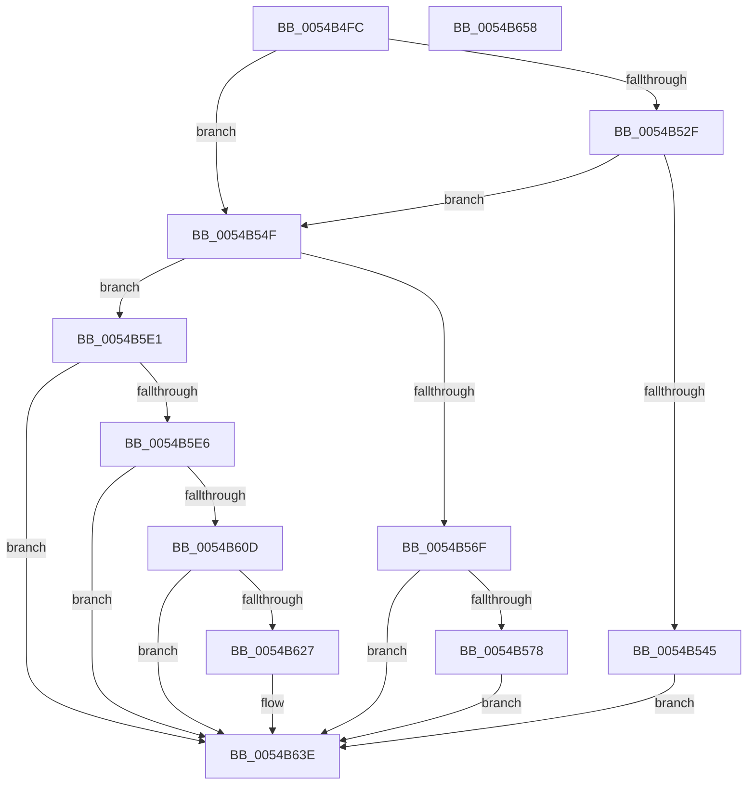

# HalpTimerInitializeProfiling

- RVA: `0x0054B4FC`–`0x0054B659` (길이 `349` bytes)
- VA: `0x000000014054B4FC`
- 실행 섹션: `.text`
- PDB 이름 있음: `예`; PDB Function 태그: `아니요`
- unwind 정보 RVA: `0x0008B1F4`
- 디코드: `84`개 명령, `349/349` bytes 표시
- 미해석 바이트: `0` (있으면 어셈블리에 `.byte`로 보존)

> 이 문서는 커널 이미지의 기계어와 PDB 기호를 분석해 생성했습니다. 4번과 5번은 함수 원형과 자료형을 바이너리 사용 방식에서 추정한 C 해석이며 원본 소스 복구 결과는 아닙니다.

## 1. Dependencies

- 직접 호출 지점: **9**; 고유 호출 대상: **7**
- 직접 호출자로 확인된 함수: **1**
- RIP 상대 이미지 참조: **6**

### Outgoing calls
- `0x0054B534` → [HalpMmAllocatePerProcessorMemory](HalpMmAllocatePerProcessorMemory_function_00544AA8.md) (function, `0x00544AA8`)
- `0x0054B55E` → [HalpSetProfileSourceInterval](../4F/HalpSetProfileSourceInterval_function_004FC36C.md) (function, `0x004FC36C`)
- `0x0054B5D8` → [HalpTimerConfigureInterrupt](HalpTimerConfigureInterrupt_function_00548AB0.md) (function, `0x00548AB0`)
- `0x0054B5FE` → [HalpInterruptSetIdtEntry](../55/HalpInterruptSetIdtEntry_function_0055BAE0.md) (function, `0x0055BAE0`)
- `0x0054B610` → [HalpTimerGetInternalData](../20/HalpTimerGetInternalData_function_00209500.md) (function, `0x00209500`)
- `0x0054B61C` → [guard_dispatch_icall](../6B/guard_dispatch_icall_function_006BAAD0.md) (function, `0x006BAAD0`)
- `0x0054B62A` → [HalpTimerGetInternalData](../20/HalpTimerGetInternalData_function_00209500.md) (function, `0x00209500`)
- `0x0054B639` → [guard_dispatch_icall](../6B/guard_dispatch_icall_function_006BAAD0.md) (function, `0x006BAAD0`)
- `0x0054B648` → [_security_check_cookie](../6A/_security_check_cookie_function_006AC640.md) (function, `0x006AC640`)

### Direct callers
- [HalpTimerInitSystem](../53/HalpTimerInitSystem_function_0053CB70.md) at `0x0053CD83`
- [HalpTimerInitSystem](../53/HalpTimerInitSystem_function_0053CB70.md) at `0x0053CE9D`

### Static image references
- `0x0054B506` → RVA `0x00E0A740` (`.data`; read)
- `0x0054B515` → RVA `0x00FC3FC0` (`.data`; read)
- `0x0054B51E` → RVA `0x00FC21E8` (`.data`; read)
- `0x0054B539` → RVA `0x00FC21E8` (`.data`; write)
- `0x0054B578` → RVA `0x00F231B0` (`.data`; read)
- `0x0054B57F` → RVA `0x00560560` (`HalpTimerProfileInterrupt`; read)

## 2. Other-region calls and transfers

- 다른 실행 섹션으로 향하는 call: **0**
- 별도 외부 분기/꼬리 이동을 확인하지 못했습니다.

## 3. Assembly (complete function range)

```asm
0054B4FC  48 89 5C 24 08                  mov qword ptr [rsp + 8], rbx
0054B501  57                              push rdi
0054B502  48 83 EC 60                     sub rsp, 0x60
0054B506  48 8B 05 33 F2 8B 00            mov rax, qword ptr [rip + 0x8bf233]
0054B50D  48 33 C4                        xor rax, rsp
0054B510  48 89 44 24 58                  mov qword ptr [rsp + 0x58], rax
0054B515  48 8B 1D A4 8A A7 00            mov rbx, qword ptr [rip + 0xa78aa4]
0054B51C  33 FF                           xor edi, edi
0054B51E  48 39 3D C3 6C A7 00            cmp qword ptr [rip + 0xa76cc3], rdi
0054B525  0F 57 C0                        xorps xmm0, xmm0
0054B528  0F 11 44 24 48                  movups xmmword ptr [rsp + 0x48], xmm0
0054B52D  75 20                           jne 0x14054b54f
0054B52F  B9 28 01 00 00                  mov ecx, 0x128
0054B534  E8 6F 95 FF FF                  call 0x140544aa8
0054B539  48 89 05 A8 6C A7 00            mov qword ptr [rip + 0xa76ca8], rax
0054B540  48 85 C0                        test rax, rax
0054B543  75 0A                           jne 0x14054b54f
0054B545  BF 17 00 00 C0                  mov edi, 0xc0000017
0054B54A  E9 EF 00 00 00                  jmp 0x14054b63e
0054B54F  48 8D 54 24 40                  lea rdx, [rsp + 0x40]
0054B554  C7 44 24 40 10 27 00 00         mov dword ptr [rsp + 0x40], 0x2710
0054B55C  33 C9                           xor ecx, ecx
0054B55E  E8 09 0E FB FF                  call 0x1404fc36c
0054B563  65 8B 04 25 A4 01 00 00         mov eax, dword ptr gs:[0x1a4]
0054B56B  85 C0                           test eax, eax
0054B56D  75 72                           jne 0x14054b5e1
0054B56F  48 85 DB                        test rbx, rbx
0054B572  0F 84 C6 00 00 00               je 0x14054b63e
0054B578  48 8B 05 31 7C 9D 00            mov rax, qword ptr [rip + 0x9d7c31]
0054B57F  48 8D 15 DA 4F 01 00            lea rdx, [rip + 0x14fda]
0054B586  48 89 54 24 38                  mov qword ptr [rsp + 0x38], rdx
0054B58B  41 B0 0F                        mov r8b, 0xf
0054B58E  BA FD 00 00 00                  mov edx, 0xfd
0054B593  8B 08                           mov ecx, dword ptr [rax]
0054B595  33 C0                           xor eax, eax
0054B597  89 44 24 52                     mov dword ptr [rsp + 0x52], eax
0054B59B  66 89 44 24 56                  mov word ptr [rsp + 0x56], ax
0054B5A0  8B C1                           mov eax, ecx
0054B5A2  C1 E8 06                        shr eax, 6
0054B5A5  83 E1 3F                        and ecx, 0x3f
0054B5A8  66 89 44 24 50                  mov word ptr [rsp + 0x50], ax
0054B5AD  B8 01 00 00 00                  mov eax, 1
0054B5B2  48 D3 E0                        shl rax, cl
0054B5B5  48 8B CB                        mov rcx, rbx
0054B5B8  48 89 44 24 48                  mov qword ptr [rsp + 0x48], rax
0054B5BD  48 8D 44 24 48                  lea rax, [rsp + 0x48]
0054B5C2  48 89 44 24 30                  mov qword ptr [rsp + 0x30], rax
0054B5C7  C7 44 24 28 01 00 00 00         mov dword ptr [rsp + 0x28], 1
0054B5CF  48 C7 44 24 20 FD FF FF FF      mov qword ptr [rsp + 0x20], 0xfffffffffffffffd
0054B5D8  E8 D3 D4 FF FF                  call 0x140548ab0
0054B5DD  8B F8                           mov edi, eax
0054B5DF  EB 5D                           jmp 0x14054b63e
0054B5E1  48 85 DB                        test rbx, rbx
0054B5E4  74 58                           je 0x14054b63e
0054B5E6  41 B0 0F                        mov r8b, 0xf
0054B5E9  48 C7 44 24 20 FD FF FF FF      mov qword ptr [rsp + 0x20], 0xfffffffffffffffd
0054B5F2  48 8D 15 67 4F 01 00            lea rdx, [rip + 0x14f67]
0054B5F9  B9 FD 00 00 00                  mov ecx, 0xfd
0054B5FE  E8 DD 04 01 00                  call 0x14055bae0
0054B603  8B 83 E0 00 00 00               mov eax, dword ptr [rbx + 0xe0]
0054B609  A8 01                           test al, 1
0054B60B  74 31                           je 0x14054b63e
0054B60D  48 8B CB                        mov rcx, rbx
0054B610  E8 EB DE CB FF                  call 0x140209500
0054B615  48 8B C8                        mov rcx, rax
0054B618  48 8B 43 68                     mov rax, qword ptr [rbx + 0x68]
0054B61C  E8 AF F4 16 00                  call 0x1406baad0
0054B621  8B F8                           mov edi, eax
0054B623  85 C0                           test eax, eax
0054B625  78 17                           js 0x14054b63e
0054B627  48 8B CB                        mov rcx, rbx
0054B62A  E8 D1 DE CB FF                  call 0x140209500
0054B62F  48 8B C8                        mov rcx, rax
0054B632  48 8B 83 88 00 00 00            mov rax, qword ptr [rbx + 0x88]
0054B639  E8 92 F4 16 00                  call 0x1406baad0
0054B63E  8B C7                           mov eax, edi
0054B640  48 8B 4C 24 58                  mov rcx, qword ptr [rsp + 0x58]
0054B645  48 33 CC                        xor rcx, rsp
0054B648  E8 F3 0F 16 00                  call 0x1406ac640
0054B64D  48 8B 5C 24 70                  mov rbx, qword ptr [rsp + 0x70]
0054B652  48 83 C4 60                     add rsp, 0x60
0054B656  5F                              pop rdi
0054B657  C3                              ret
0054B658  CC                              int3
```

## 4. C-style interpretation (structured pseudocode)

```c
__int64 __fastcall HalpTimerInitializeProfiling(void)
{
    __int64 result;
    __int64 v_rdi;
    __int64 v_rsp;
    unsigned __int64 v_stack_m10;
    unsigned __int16 v_stack_m12;
    unsigned int v_stack_m16;
    unsigned __int16 v_stack_m18;
    unsigned __int64 v_stack_m20;
    unsigned __int64 v_stack_m28;
    unsigned __int64 v_stack_m30;
    unsigned __int64 v_stack_m38;
    unsigned int v_stack_m40;
    unsigned __int64 v_stack_m48;
    unsigned __int64 v_stack_p8;

    v_stack_p8 = v_rbx;
    v_rsp = (v_rsp) - (96);
    result = (*(unsigned __int64 *)(v_rip + 9171507)) ^ (v_rsp);
    v_stack_m10 = result;
    v_rdi = 0;
    v_stack_m20 = v_xmm0;
    if ((*(unsigned __int64 *)(v_rip + 10972355)) != 0) goto loc_0054B54F;
    result = HalpMmAllocatePerProcessorMemory(296, a2, a3, a4);
    *(unsigned __int64 *)(v_rip + 10972328) = result;
    if (result != 0) goto loc_0054B54F;
    goto loc_0054B63E;
loc_0054B54F:
    v_stack_m28 = 0x2710ULL;
    a1 = 0;
    result = HalpSetProfileSourceInterval(a1, v_stack_m28, a3, a4);
    if ((unsigned int)((unsigned int)(*(unsigned int *)(gs_base + (0 + 420)))) != 0) goto loc_0054B5E1;
    if (*(unsigned __int64 *)(v_rip + 10980004) == 0) goto loc_0054B63E;
    v_stack_m30 = v_rip + 85978;
    result = 0;
    v_stack_m16 = 0;
    v_stack_m12 = 0;
    result = (unsigned int)(((unsigned int)((unsigned int)((unsigned int)(*(unsigned int *)(*(unsigned __int64 *)(v_rip + 10320945)))))) >> (6));
    a1 = (unsigned int)(((unsigned int)(*(unsigned int *)(*(unsigned __int64 *)(v_rip + 10320945)))) & (63));
    v_stack_m18 = (unsigned __int16)(result);
    result = (1) << ((unsigned __int8)(a1));
    v_stack_m20 = result;
    v_stack_m38 = v_stack_m20;
    v_stack_m40 = 1;
    v_stack_m48 = -3;
    result = HalpTimerConfigureInterrupt(*(unsigned __int64 *)(v_rip + 10980004), 253, 15, a4);
    goto loc_0054B63E;
loc_0054B5E1:
    if (*(unsigned __int64 *)(v_rip + 10980004) == 0) goto loc_0054B63E;
    v_stack_m48 = -3;
    result = HalpInterruptSetIdtEntry(253, v_rip + 85863, 15, a4);
    if ((((unsigned __int8)((unsigned int)(*(unsigned int *)(*(unsigned __int64 *)(v_rip + 10980004) + 224)))) & (1)) == 0) goto loc_0054B63E;
    result = HalpTimerGetInternalData(*(unsigned __int64 *)(v_rip + 10980004), v_rip + 85863, 15, a4);
    result = guard_dispatch_icall(result, v_rip + 85863, 15, a4);
    if (!(sign_flag)) {
        a1 = *(unsigned __int64 *)(v_rip + 10980004);
        result = HalpTimerGetInternalData(a1, v_rip + 85863, 15, a4);
        a1 = result;
        result = *(unsigned __int64 *)(*(unsigned __int64 *)(v_rip + 10980004) + 136);
        result = guard_dispatch_icall(a1, v_rip + 85863, 15, a4);
    }
    a1 = (v_stack_m10) ^ (v_rsp);
    result = _security_check_cookie(a1, v_rip + 85863, 15, a4);
    v_rsp = (v_rsp) + (96);
    return result;
}
```

## 5. (Beta) C Style

```c
void HalpTimerInitializeProfiling(void)
{
    int64_t result;
    int64_t local_rdi;
    int64_t local_rsp;
    uint64_t v_stack_m10;
    uint16_t v_stack_m12;
    uint32_t v_stack_m16;
    uint16_t v_stack_m18;
    uint64_t v_stack_m20;
    uint64_t v_stack_m28;
    uint64_t v_stack_m30;
    uint64_t v_stack_m38;
    uint32_t v_stack_m40;
    uint64_t v_stack_m48;
    uint64_t v_stack_p8;

    v_stack_p8 = local_rbx;
    local_rsp = (local_rsp) - (96);
    result = (*(uint64_t *)(v_rip + 0x8BF233)) ^ (local_rsp);
    v_stack_m10 = result;
    local_rdi = 0;
    v_stack_m20 = v_xmm0;
    if ((*(uint64_t *)(v_rip + 0xA76CC3)) != 0) goto loc_0054B54F;
    result = HalpMmAllocatePerProcessorMemory(296, a2, a3, a4);
    *(uint64_t *)(v_rip + 0xA76CA8) = result;
    if (result != 0) goto loc_0054B54F;
    goto loc_0054B63E;
loc_0054B54F:
    v_stack_m28 = 0x2710ULL;
    a1 = 0;
    result = HalpSetProfileSourceInterval(a1, v_stack_m28, a3, a4);
    if ((uint32_t)((uint32_t)(*(uint32_t *)(gs_base + (0 + 0x1A4)))) != 0) goto loc_0054B5E1;
    if (*(uint64_t *)(v_rip + 0xA78AA4) == 0) goto loc_0054B63E;
    v_stack_m30 = v_rip + 85978;
    result = 0;
    v_stack_m16 = 0;
    v_stack_m12 = 0;
    result = (uint32_t)(((uint32_t)((uint32_t)((uint32_t)(*(uint32_t *)(*(uint64_t *)(v_rip + 0x9D7C31)))))) >> (6));
    a1 = (uint32_t)(((uint32_t)(*(uint32_t *)(*(uint64_t *)(v_rip + 0x9D7C31)))) & (63));
    v_stack_m18 = (uint16_t)(result);
    result = (1) << ((uint8_t)(a1));
    v_stack_m20 = result;
    v_stack_m38 = v_stack_m20;
    v_stack_m40 = 1;
    v_stack_m48 = -3;
    result = HalpTimerConfigureInterrupt(*(uint64_t *)(v_rip + 0xA78AA4), 253, 15, a4);
    goto loc_0054B63E;
loc_0054B5E1:
    if (*(uint64_t *)(v_rip + 0xA78AA4) == 0) goto loc_0054B63E;
    v_stack_m48 = -3;
    result = HalpInterruptSetIdtEntry(253, v_rip + 85863, 15, a4);
    if ((((uint8_t)((uint32_t)(*(uint32_t *)(*(uint64_t *)(v_rip + 0xA78AA4) + 0xE0)))) & (1)) == 0) goto loc_0054B63E;
    result = HalpTimerGetInternalData(*(uint64_t *)(v_rip + 0xA78AA4), v_rip + 85863, 15, a4);
    result = guard_dispatch_icall(result, v_rip + 85863, 15, a4);
    if (!(sign_flag)) {
        a1 = *(uint64_t *)(v_rip + 0xA78AA4);
        result = HalpTimerGetInternalData(a1, v_rip + 85863, 15, a4);
        a1 = result;
        result = *(uint64_t *)(*(uint64_t *)(v_rip + 0xA78AA4) + 0x88);
        result = guard_dispatch_icall(a1, v_rip + 85863, 15, a4);
    }
    a1 = (v_stack_m10) ^ (local_rsp);
    result = _security_check_cookie(a1, v_rip + 85863, 15, a4);
    local_rsp = (local_rsp) + (96);
    return result;
}
```

## 6. Execution-region graph

[열기: 2D/3D 그래프와 함수 탐색 컨트롤 패널](../../../control-panel.html?section=text&rva=0x0054B4FC&view=graph)

- 2D 그래프는 위에서 아래로 흐르고, 3D 그래프는 빈 공간을 드래그해 회전합니다. Shift+드래그는 이동, 휠은 확대·축소, 함수 노드 선택은 대상 보고서 이동입니다.

### Static fallback


