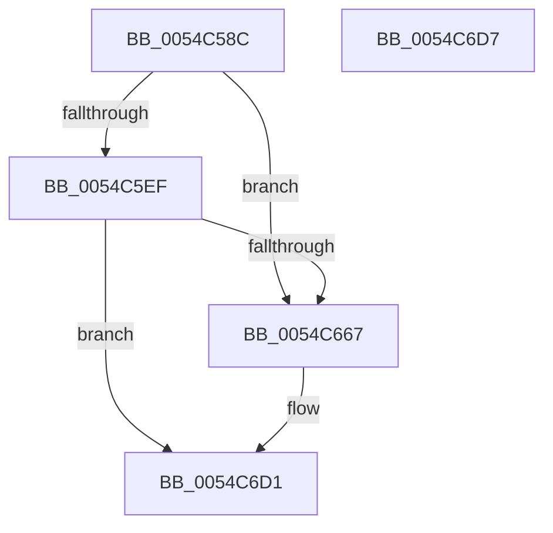

# HalpTimerInitializeSystemWatchdog

- RVA: `0x0054C58C`–`0x0054C6D8` (길이 `332` bytes)
- VA: `0x000000014054C58C`
- 실행 섹션: `.text`
- PDB 이름 있음: `예`; PDB Function 태그: `아니요`
- unwind 정보 RVA: `0x000B5DC4`
- 디코드: `67`개 명령, `332/332` bytes 표시
- 미해석 바이트: `0` (있으면 어셈블리에 `.byte`로 보존)

> 이 문서는 커널 이미지의 기계어와 PDB 기호를 분석해 생성했습니다. 4번과 5번은 함수 원형과 자료형을 바이너리 사용 방식에서 추정한 C 해석이며 원본 소스 복구 결과는 아닙니다.

## 1. Dependencies

- 직접 호출 지점: **3**; 고유 호출 대상: **3**
- 직접 호출자로 확인된 함수: **1**
- RIP 상대 이미지 참조: **18**

### Outgoing calls
- `0x0054C5B0` → [HalpTimerGetClockRates](HalpTimerGetClockRates_function_005483AC.md) (function, `0x005483AC`)
- `0x0054C65E` → [HalpInterruptConnect](HalpInterruptConnect_function_005426F8.md) (function, `0x005426F8`)
- `0x0054C6B7` → [HalpTimerWatchdogStart](HalpTimerWatchdogStart_function_0054C710.md) (function, `0x0054C710`)

### Direct callers
- [HalpTimerInitSystem](../53/HalpTimerInitSystem_function_0053CB70.md) at `0x0053CC16`

### Static image references
- `0x0054C594` → RVA `0x00FC4028` (`.data`; read)
- `0x0054C5D1` → RVA `0x00FC2168` (`.data`; write)
- `0x0054C5E6` → RVA `0x00FC2178` (`.data`; write)
- `0x0054C600` → RVA `0x00FC7120` (`ALMOSTRO`; read)
- `0x0054C607` → RVA `0x005605C0` (`HalpTimerWatchdogPreResetInterrupt`; read)
- `0x0054C619` → RVA `0x00FC7128` (`ALMOSTRO`; read)
- `0x0054C66C` → RVA `0x0054C7A0` (`HalpTimerWatchdogStop`; read)
- `0x0054C673` → RVA `0x00E00B28` (`.data`; write)
- `0x0054C67A` → RVA `0x0054C710` (`HalpTimerWatchdogStart`; read)
- `0x0054C681` → RVA `0x00E00B18` (`.data`; write)
- `0x0054C688` → RVA `0x00707F60` (`HalpTimerWatchdogGeneratedLastReset`; read)
- `0x0054C68F` → RVA `0x00E00B30` (`.data`; write)
- `0x0054C696` → RVA `0x0039B410` (`HalpTimerWatchdogTriggerSystemReset`; read)
- `0x0054C69D` → RVA `0x00E00B38` (`.data`; write)
- `0x0054C6A4` → RVA `0x0054C6E0` (`HalpTimerWatchdogQueryDueTime`; read)
- `0x0054C6AB` → RVA `0x00E00BC8` (`.data`; write)
- `0x0054C6C1` → RVA `0x0039B3B0` (`HalpTimerWatchdogResetCountdown`; read)
- `0x0054C6C8` → RVA `0x00E00B20` (`.data`; write)

## 2. Other-region calls and transfers

- 다른 실행 섹션으로 향하는 call: **0**
- 별도 외부 분기/꼬리 이동을 확인하지 못했습니다.

## 3. Assembly (complete function range)

```asm
0054C58C  48 8B C4                        mov rax, rsp
0054C58F  53                              push rbx
0054C590  48 83 EC 70                     sub rsp, 0x70
0054C594  48 8B 1D 8D 7A A7 00            mov rbx, qword ptr [rip + 0xa77a8d]
0054C59B  4C 8D 40 08                     lea r8, [rax + 8]
0054C59F  48 83 60 18 00                  and qword ptr [rax + 0x18], 0
0054C5A4  48 8D 50 10                     lea rdx, [rax + 0x10]
0054C5A8  48 83 60 10 00                  and qword ptr [rax + 0x10], 0
0054C5AD  48 8B CB                        mov rcx, rbx
0054C5B0  E8 F7 BD FF FF                  call 0x1405483ac
0054C5B5  4C 8B 84 24 88 00 00 00         mov r8, qword ptr [rsp + 0x88]
0054C5BD  B8 00 5E D0 B2                  mov eax, 0xb2d05e00
0054C5C2  4C 3B C0                        cmp r8, rax
0054C5C5  4C 0F 47 C0                     cmova r8, rax
0054C5C9  4C 89 84 24 88 00 00 00         mov qword ptr [rsp + 0x88], r8
0054C5D1  4C 89 05 90 5B A7 00            mov qword ptr [rip + 0xa75b90], r8
0054C5D8  49 C1 E8 02                     shr r8, 2
0054C5DC  F7 83 E0 00 00 00 00 00 08 00   test dword ptr [rbx + 0xe0], 0x80000
0054C5E6  4C 89 05 8B 5B A7 00            mov qword ptr [rip + 0xa75b8b], r8
0054C5ED  74 78                           je 0x14054c667
0054C5EF  33 D2                           xor edx, edx
0054C5F1  48 8D 84 24 90 00 00 00         lea rax, [rsp + 0x90]
0054C5F9  48 89 44 24 58                  mov qword ptr [rsp + 0x58], rax
0054C5FE  33 C9                           xor ecx, ecx
0054C600  66 3B 15 19 AB A7 00            cmp dx, word ptr [rip + 0xa7ab19]
0054C607  48 8D 05 B2 3F 01 00            lea rax, [rip + 0x13fb2]
0054C60E  C7 44 24 50 05 00 00 00         mov dword ptr [rsp + 0x50], 5
0054C616  0F 57 C0                        xorps xmm0, xmm0
0054C619  48 0F 42 0D 07 AB A7 00         cmovb rcx, qword ptr [rip + 0xa7ab07]
0054C621  41 B1 0F                        mov r9b, 0xf
0054C624  C6 44 24 48 0F                  mov byte ptr [rsp + 0x48], 0xf
0054C629  41 B8 F0 00 00 00               mov r8d, 0xf0
0054C62F  48 21 54 24 40                  and qword ptr [rsp + 0x40], rdx
0054C634  48 21 54 24 38                  and qword ptr [rsp + 0x38], rdx
0054C639  8B 53 58                        mov edx, dword ptr [rbx + 0x58]
0054C63C  48 89 44 24 30                  mov qword ptr [rsp + 0x30], rax
0054C641  8B 43 60                        mov eax, dword ptr [rbx + 0x60]
0054C644  89 44 24 28                     mov dword ptr [rsp + 0x28], eax
0054C648  8B 43 5C                        mov eax, dword ptr [rbx + 0x5c]
0054C64B  0F 11 44 24 60                  movups xmmword ptr [rsp + 0x60], xmm0
0054C650  48 89 4C 24 60                  mov qword ptr [rsp + 0x60], rcx
0054C655  48 8D 4C 24 60                  lea rcx, [rsp + 0x60]
0054C65A  89 44 24 20                     mov dword ptr [rsp + 0x20], eax
0054C65E  E8 95 60 FF FF                  call 0x1405426f8
0054C663  85 C0                           test eax, eax
0054C665  78 6A                           js 0x14054c6d1
0054C667  F0 83 0C 24 00                  lock or dword ptr [rsp], 0
0054C66C  48 8D 05 2D 01 00 00            lea rax, [rip + 0x12d]
0054C673  48 89 05 AE 44 8B 00            mov qword ptr [rip + 0x8b44ae], rax
0054C67A  48 8D 05 8F 00 00 00            lea rax, [rip + 0x8f]
0054C681  48 89 05 90 44 8B 00            mov qword ptr [rip + 0x8b4490], rax
0054C688  48 8D 05 D1 B8 1B 00            lea rax, [rip + 0x1bb8d1]
0054C68F  48 89 05 9A 44 8B 00            mov qword ptr [rip + 0x8b449a], rax
0054C696  48 8D 05 73 ED E4 FF            lea rax, [rip - 0x1b128d]
0054C69D  48 89 05 94 44 8B 00            mov qword ptr [rip + 0x8b4494], rax
0054C6A4  48 8D 05 35 00 00 00            lea rax, [rip + 0x35]
0054C6AB  48 89 05 16 45 8B 00            mov qword ptr [rip + 0x8b4516], rax
0054C6B2  F0 83 0C 24 00                  lock or dword ptr [rsp], 0
0054C6B7  E8 54 00 00 00                  call 0x14054c710
0054C6BC  F0 83 0C 24 00                  lock or dword ptr [rsp], 0
0054C6C1  48 8D 05 E8 EC E4 FF            lea rax, [rip - 0x1b1318]
0054C6C8  48 89 05 51 44 8B 00            mov qword ptr [rip + 0x8b4451], rax
0054C6CF  33 C0                           xor eax, eax
0054C6D1  48 83 C4 70                     add rsp, 0x70
0054C6D5  5B                              pop rbx
0054C6D6  C3                              ret
0054C6D7  CC                              int3
```

## 4. C-style interpretation (structured pseudocode)

```c
__int64 __fastcall HalpTimerInitializeSystemWatchdog(void)
{
    __int64 result;
    __int64 v_rsp;
    unsigned __int64 v_stack_m18;
    unsigned __int64 v_stack_m20;
    unsigned int v_stack_m28;
    unsigned __int8 v_stack_m30;
    unsigned __int64 v_stack_m38;
    unsigned __int64 v_stack_m40;
    unsigned __int64 v_stack_m48;
    unsigned int v_stack_m50;
    unsigned int v_stack_m58;
    unsigned int v_stack_m78;
    unsigned __int64 v_stack_p10;
    unsigned __int64 v_stack_p18;

    v_rsp = (v_rsp) - (112);
    result = HalpTimerGetClockRates(*(unsigned __int64 *)(v_rip + 10975885), v_rsp + 16, v_rsp + 8, a4);
    a3 = v_stack_p10;
    if (v_stack_p10 > ((unsigned int)(0xB2D05E00ULL))) { a3 = (unsigned int)(0xB2D05E00ULL); }
    v_stack_p10 = a3;
    *(unsigned __int64 *)(v_rip + 10967952) = a3;
    a3 = (a3) >> (2);
    *(unsigned __int64 *)(v_rip + 10967947) = a3;
    if (((*(unsigned int *)(*(unsigned __int64 *)(v_rip + 10975885) + 224)) & (0x80000ULL)) == 0) goto loc_0054C667;
    a2 = 0;
    v_stack_m20 = v_stack_p18;
    a1 = 0;
    v_stack_m28 = 5;
    if (0 < (*(unsigned __int16 *)(v_rip + 10988313))) { a1 = *(unsigned __int64 *)(v_rip + 10988295); }
    v_stack_m30 = 15;
    v_stack_m48 = v_rip + 81842;
    v_stack_m50 = (unsigned int)((unsigned int)(*(unsigned int *)(*(unsigned __int64 *)(v_rip + 10975885) + 96)));
    v_stack_m18 = v_xmm0;
    v_stack_m18 = a1;
    v_stack_m58 = (unsigned int)((unsigned int)(*(unsigned int *)(*(unsigned __int64 *)(v_rip + 10975885) + 92)));
    result = HalpInterruptConnect(v_stack_m18, (unsigned int)(*(unsigned int *)(*(unsigned __int64 *)(v_rip + 10975885) + 88)), 240, 15);
    if (!(sign_flag)) {
        result = v_rip + 301;
        *(unsigned __int64 *)(v_rip + 9127086) = result;
        result = v_rip + 143;
        *(unsigned __int64 *)(v_rip + 9127056) = result;
        result = v_rip + 1816785;
        *(unsigned __int64 *)(v_rip + 9127066) = result;
        result = v_rip - 1774221;
        *(unsigned __int64 *)(v_rip + 9127060) = result;
        result = v_rip + 53;
        *(unsigned __int64 *)(v_rip + 9127190) = result;
        result = HalpTimerWatchdogStart(v_stack_m18, (unsigned int)(*(unsigned int *)(*(unsigned __int64 *)(v_rip + 10975885) + 88)), 240, 15);
        result = v_rip - 1774360;
        *(unsigned __int64 *)(v_rip + 9126993) = result;
        result = 0;
    }
    v_rsp = (v_rsp) + (112);
    return result;
}
```

## 5. (Beta) C Style

```c
void HalpTimerInitializeSystemWatchdog(void)
{
    int64_t result;
    int64_t local_rsp;
    uint64_t v_stack_m18;
    uint64_t v_stack_m20;
    uint32_t v_stack_m28;
    uint8_t v_stack_m30;
    uint64_t v_stack_m38;
    uint64_t v_stack_m40;
    uint64_t v_stack_m48;
    uint32_t v_stack_m50;
    uint32_t v_stack_m58;
    uint32_t v_stack_m78;
    uint64_t v_stack_p10;
    uint64_t v_stack_p18;

    local_rsp = (local_rsp) - (112);
    result = HalpTimerGetClockRates(*(uint64_t *)(v_rip + 0xA77A8D), local_rsp + 16, local_rsp + 8, a4);
    a3 = v_stack_p10;
    if (v_stack_p10 > ((uint32_t)(0xB2D05E00ULL))) { a3 = (uint32_t)(0xB2D05E00ULL); }
    v_stack_p10 = a3;
    *(uint64_t *)(v_rip + 0xA75B90) = a3;
    a3 = (a3) >> (2);
    *(uint64_t *)(v_rip + 0xA75B8B) = a3;
    if (((*(uint32_t *)(*(uint64_t *)(v_rip + 0xA77A8D) + 0xE0)) & (0x80000ULL)) == 0) goto loc_0054C667;
    a2 = 0;
    v_stack_m20 = v_stack_p18;
    a1 = 0;
    v_stack_m28 = 5;
    if (0 < (*(uint16_t *)(v_rip + 0xA7AB19))) { a1 = *(uint64_t *)(v_rip + 0xA7AB07); }
    v_stack_m30 = 15;
    v_stack_m48 = v_rip + 81842;
    v_stack_m50 = (uint32_t)((uint32_t)(*(uint32_t *)(*(uint64_t *)(v_rip + 0xA77A8D) + 0x60)));
    v_stack_m18 = v_xmm0;
    v_stack_m18 = a1;
    v_stack_m58 = (uint32_t)((uint32_t)(*(uint32_t *)(*(uint64_t *)(v_rip + 0xA77A8D) + 0x5C)));
    result = HalpInterruptConnect(v_stack_m18, (uint32_t)(*(uint32_t *)(*(uint64_t *)(v_rip + 0xA77A8D) + 0x58)), 240, 15);
    if (!(sign_flag)) {
        result = v_rip + 301;
        *(uint64_t *)(v_rip + 0x8B44AE) = result;
        result = v_rip + 143;
        *(uint64_t *)(v_rip + 0x8B4490) = result;
        result = v_rip + 1816785;
        *(uint64_t *)(v_rip + 0x8B449A) = result;
        result = v_rip - 1774221;
        *(uint64_t *)(v_rip + 0x8B4494) = result;
        result = v_rip + 53;
        *(uint64_t *)(v_rip + 0x8B4516) = result;
        result = HalpTimerWatchdogStart(v_stack_m18, (uint32_t)(*(uint32_t *)(*(uint64_t *)(v_rip + 0xA77A8D) + 0x58)), 240, 15);
        result = v_rip - 1774360;
        *(uint64_t *)(v_rip + 0x8B4451) = result;
        result = 0;
    }
    local_rsp = (local_rsp) + (112);
    return result;
}
```

## 6. Execution-region graph

[열기: 2D/3D 그래프와 함수 탐색 컨트롤 패널](../../../control-panel.html?section=text&rva=0x0054C58C&view=graph)

- 2D 그래프는 위에서 아래로 흐르고, 3D 그래프는 빈 공간을 드래그해 회전합니다. Shift+드래그는 이동, 휠은 확대·축소, 함수 노드 선택은 대상 보고서 이동입니다.

### Static fallback


