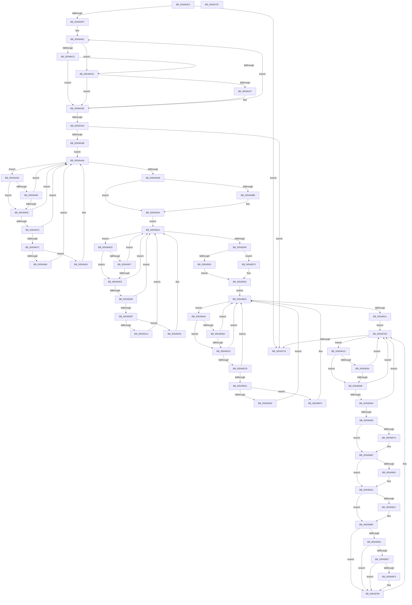

# HalpTimerMeasureFrequencies

- RVA: `0x005493C0`–`0x00549730` (길이 `880` bytes)
- VA: `0x00000001405493C0`
- 실행 섹션: `.text`
- PDB 이름 있음: `예`; PDB Function 태그: `아니요`
- unwind 정보 RVA: `0x00084C9C`
- 디코드: `237`개 명령, `880/880` bytes 표시
- 미해석 바이트: `0` (있으면 어셈블리에 `.byte`로 보존)

> 이 문서는 커널 이미지의 기계어와 PDB 기호를 분석해 생성했습니다. 4번과 5번은 함수 원형과 자료형을 바이너리 사용 방식에서 추정한 C 해석이며 원본 소스 복구 결과는 아닙니다.

## 1. Dependencies

- 직접 호출 지점: **19**; 고유 호출 대상: **8**
- 직접 호출자로 확인된 함수: **1**
- RIP 상대 이미지 참조: **1**

### Outgoing calls
- `0x00549427` → [HalpTimerInitialize](../53/HalpTimerInitialize_function_0053CF38.md) (function, `0x0053CF38`)
- `0x00549440` → [KeStallExecutionProcessor](../44/KeStallExecutionProcessor_function_0044F620.md) (function, `0x0044F620`)
- `0x00549487` → [HalpTimerDetermineValidTimerPairReadLatency](HalpTimerDetermineValidTimerPairReadLatency_function_00549100.md) (function, `0x00549100`)
- `0x00549491` → [HalpTimerGetInternalData](../20/HalpTimerGetInternalData_function_00209500.md) (function, `0x00209500`)
- `0x0054949D` → [guard_dispatch_icall](../6B/guard_dispatch_icall_function_006BAAD0.md) (function, `0x006BAAD0`)
- `0x005494BE` → [HalpTimerGetInternalData](../20/HalpTimerGetInternalData_function_00209500.md) (function, `0x00209500`)
- `0x005494CF` → [guard_dispatch_icall](../6B/guard_dispatch_icall_function_006BAAD0.md) (function, `0x006BAAD0`)
- `0x0054952B` → [HalpTimerReadTimerPairWithLatencyLimit](HalpTimerReadTimerPairWithLatencyLimit_function_00549F28.md) (function, `0x00549F28`)
- `0x00549535` → [HalpTimerGetInternalData](../20/HalpTimerGetInternalData_function_00209500.md) (function, `0x00209500`)
- `0x00549541` → [guard_dispatch_icall](../6B/guard_dispatch_icall_function_006BAAD0.md) (function, `0x006BAAD0`)
- `0x0054956E` → [HalpTimerStallExecutionProcessor](../20/HalpTimerStallExecutionProcessor_function_00208F60.md) (function, `0x00208F60`)
- `0x00549575` → [HalpTimerGetInternalData](../20/HalpTimerGetInternalData_function_00209500.md) (function, `0x00209500`)
- `0x00549589` → [guard_dispatch_icall](../6B/guard_dispatch_icall_function_006BAAD0.md) (function, `0x006BAAD0`)
- `0x005495ED` → [HalpTimerReadTimerPairWithLatencyLimit](HalpTimerReadTimerPairWithLatencyLimit_function_00549F28.md) (function, `0x00549F28`)
- `0x005495F7` → [HalpTimerGetInternalData](../20/HalpTimerGetInternalData_function_00209500.md) (function, `0x00209500`)
- `0x00549603` → [guard_dispatch_icall](../6B/guard_dispatch_icall_function_006BAAD0.md) (function, `0x006BAAD0`)
- `0x005496B7` → [HalpTimerScaleCounter](../37/HalpTimerScaleCounter_function_0037B354.md) (function, `0x0037B354`)
- `0x005496F6` → [HalpTimerGetInternalData](../20/HalpTimerGetInternalData_function_00209500.md) (function, `0x00209500`)
- `0x00549701` → [guard_dispatch_icall](../6B/guard_dispatch_icall_function_006BAAD0.md) (function, `0x006BAAD0`)

### Direct callers
- [HalpTimerSelectRoles](../53/HalpTimerSelectRoles_function_0053D4B0.md) at `0x0053D4E0`

### Static image references
- `0x005493DF` → RVA `0x00FC4120` (`.data`; read)

## 2. Other-region calls and transfers

- 다른 실행 섹션으로 향하는 call: **0**
- 별도 외부 분기/꼬리 이동을 확인하지 못했습니다.

## 3. Assembly (complete function range)

```asm
005493C0  48 89 5C 24 08                  mov qword ptr [rsp + 8], rbx
005493C5  48 89 6C 24 10                  mov qword ptr [rsp + 0x10], rbp
005493CA  48 89 74 24 18                  mov qword ptr [rsp + 0x18], rsi
005493CF  57                              push rdi
005493D0  41 56                           push r14
005493D2  41 57                           push r15
005493D4  48 83 EC 30                     sub rsp, 0x30
005493D8  44 8B B9 E0 00 00 00            mov r15d, dword ptr [rcx + 0xe0]
005493DF  48 8D 2D 3A AD A7 00            lea rbp, [rip + 0xa7ad3a]
005493E6  48 8B 1D 33 AD A7 00            mov rbx, qword ptr [rip + 0xa7ad33]
005493ED  41 83 E7 02                     and r15d, 2
005493F1  32 D2                           xor dl, dl
005493F3  48 8B F1                        mov rsi, rcx
005493F6  48 3B DD                        cmp rbx, rbp
005493F9  0F 84 17 03 00 00               je 0x140549716
005493FF  41 B6 08                        mov r14b, 8
00549402  48 8B CB                        mov rcx, rbx
00549405  48 8B 1B                        mov rbx, qword ptr [rbx]
00549408  48 83 B9 C0 00 00 00 00         cmp qword ptr [rcx + 0xc0], 0
00549410  74 0B                           je 0x14054941d
00549412  8B 81 B8 00 00 00               mov eax, dword ptr [rcx + 0xb8]
00549418  41 84 C6                        test r14b, al
0054941B  74 11                           je 0x14054942e
0054941D  8B 81 E0 00 00 00               mov eax, dword ptr [rcx + 0xe0]
00549423  A8 02                           test al, 2
00549425  74 07                           je 0x14054942e
00549427  E8 0C 3B FF FF                  call 0x14053cf38
0054942C  B2 01                           mov dl, 1
0054942E  48 3B DD                        cmp rbx, rbp
00549431  75 CF                           jne 0x140549402
00549433  84 D2                           test dl, dl
00549435  0F 84 DB 02 00 00               je 0x140549716
0054943B  B9 DC 05 00 00                  mov ecx, 0x5dc
00549440  E8 DB 61 F0 FF                  call 0x14044f620
00549445  48 8B 3D D4 AC A7 00            mov rdi, qword ptr [rip + 0xa7acd4]
0054944C  EB 58                           jmp 0x1405494a6
0054944E  48 8B DF                        mov rbx, rdi
00549451  48 8B 3F                        mov rdi, qword ptr [rdi]
00549454  48 83 BB C0 00 00 00 00         cmp qword ptr [rbx + 0xc0], 0
0054945C  48 8D 8B B8 00 00 00            lea rcx, [rbx + 0xb8]
00549463  74 07                           je 0x14054946c
00549465  8B 01                           mov eax, dword ptr [rcx]
00549467  41 84 C6                        test r14b, al
0054946A  74 3A                           je 0x1405494a6
0054946C  8B 83 E0 00 00 00               mov eax, dword ptr [rbx + 0xe0]
00549472  A8 02                           test al, 2
00549474  74 30                           je 0x1405494a6
00549476  8B 01                           mov eax, dword ptr [rcx]
00549478  A8 02                           test al, 2
0054947A  74 2A                           je 0x1405494a6
0054947C  48 8B CB                        mov rcx, rbx
0054947F  45 85 FF                        test r15d, r15d
00549482  74 0D                           je 0x140549491
00549484  48 8B D6                        mov rdx, rsi
00549487  E8 74 FC FF FF                  call 0x140549100
0054948C  89 43 30                        mov dword ptr [rbx + 0x30], eax
0054948F  EB 15                           jmp 0x1405494a6
00549491  E8 6A 00 CC FF                  call 0x140209500
00549496  48 8B C8                        mov rcx, rax
00549499  48 8B 43 70                     mov rax, qword ptr [rbx + 0x70]
0054949D  E8 2E 16 17 00                  call 0x1406baad0
005494A2  48 89 43 10                     mov qword ptr [rbx + 0x10], rax
005494A6  48 3B FD                        cmp rdi, rbp
005494A9  75 A3                           jne 0x14054944e
005494AB  0F 20 D0                        mov rax, cr2
005494AE  0F 22 D0                        mov cr2, rax
005494B1  8B 86 E0 00 00 00               mov eax, dword ptr [rsi + 0xe0]
005494B7  A8 02                           test al, 2
005494B9  75 19                           jne 0x1405494d4
005494BB  48 8B CE                        mov rcx, rsi
005494BE  E8 3D 00 CC FF                  call 0x140209500
005494C3  48 8B C8                        mov rcx, rax
005494C6  33 D2                           xor edx, edx
005494C8  48 8B 86 B0 00 00 00            mov rax, qword ptr [rsi + 0xb0]
005494CF  E8 FC 15 17 00                  call 0x1406baad0
005494D4  48 8B 1D 45 AC A7 00            mov rbx, qword ptr [rip + 0xa7ac45]
005494DB  EB 6D                           jmp 0x14054954a
005494DD  48 8B FB                        mov rdi, rbx
005494E0  4C 8B D3                        mov r10, rbx
005494E3  48 8B 1B                        mov rbx, qword ptr [rbx]
005494E6  48 83 BF C0 00 00 00 00         cmp qword ptr [rdi + 0xc0], 0
005494EE  48 8D 8F B8 00 00 00            lea rcx, [rdi + 0xb8]
005494F5  74 07                           je 0x1405494fe
005494F7  8B 01                           mov eax, dword ptr [rcx]
005494F9  41 84 C6                        test r14b, al
005494FC  74 4C                           je 0x14054954a
005494FE  41 8B 82 E0 00 00 00            mov eax, dword ptr [r10 + 0xe0]
00549505  A8 02                           test al, 2
00549507  74 41                           je 0x14054954a
00549509  8B 01                           mov eax, dword ptr [rcx]
0054950B  A8 02                           test al, 2
0054950D  74 3B                           je 0x14054954a
0054950F  45 85 FF                        test r15d, r15d
00549512  74 1E                           je 0x140549532
00549514  41 8B 4A 30                     mov ecx, dword ptr [r10 + 0x30]
00549518  49 8D 42 18                     lea rax, [r10 + 0x18]
0054951C  4C 8D 4F 10                     lea r9, [rdi + 0x10]
00549520  48 89 44 24 20                  mov qword ptr [rsp + 0x20], rax
00549525  4C 8B C6                        mov r8, rsi
00549528  49 8B D2                        mov rdx, r10
0054952B  E8 F8 09 00 00                  call 0x140549f28
00549530  EB 18                           jmp 0x14054954a
00549532  49 8B CA                        mov rcx, r10
00549535  E8 C6 FF CB FF                  call 0x140209500
0054953A  48 8B C8                        mov rcx, rax
0054953D  49 8B 42 70                     mov rax, qword ptr [r10 + 0x70]
00549541  E8 8A 15 17 00                  call 0x1406baad0
00549546  48 89 47 10                     mov qword ptr [rdi + 0x10], rax
0054954A  48 3B DD                        cmp rbx, rbp
0054954D  75 8E                           jne 0x1405494dd
0054954F  0F 20 D0                        mov rax, cr2
00549552  0F 22 D0                        mov cr2, rax
00549555  8B 86 E0 00 00 00               mov eax, dword ptr [rsi + 0xe0]
0054955B  48 8B CE                        mov rcx, rsi
0054955E  A8 02                           test al, 2
00549560  74 13                           je 0x140549575
00549562  41 BE D0 12 13 00               mov r14d, 0x1312d0
00549568  45 33 C0                        xor r8d, r8d
0054956B  41 8B D6                        mov edx, r14d
0054956E  E8 ED F9 CB FF                  call 0x140208f60
00549573  EB 1C                           jmp 0x140549591
00549575  E8 86 FF CB FF                  call 0x140209500
0054957A  48 8B C8                        mov rcx, rax
0054957D  BA D0 12 13 00                  mov edx, 0x1312d0
00549582  48 8B 86 B0 00 00 00            mov rax, qword ptr [rsi + 0xb0]
00549589  E8 42 15 17 00                  call 0x1406baad0
0054958E  4C 8B F0                        mov r14, rax
00549591  0F 20 D1                        mov rcx, cr2
00549594  0F 22 D1                        mov cr2, rcx
00549597  48 8B 1D 82 AB A7 00            mov rbx, qword ptr [rip + 0xa7ab82]
0054959E  EB 6C                           jmp 0x14054960c
005495A0  48 8B FB                        mov rdi, rbx
005495A3  4C 8B D3                        mov r10, rbx
005495A6  48 8B 1B                        mov rbx, qword ptr [rbx]
005495A9  48 83 BF C0 00 00 00 00         cmp qword ptr [rdi + 0xc0], 0
005495B1  48 8D 8F B8 00 00 00            lea rcx, [rdi + 0xb8]
005495B8  74 06                           je 0x1405495c0
005495BA  8B 01                           mov eax, dword ptr [rcx]
005495BC  A8 08                           test al, 8
005495BE  74 4C                           je 0x14054960c
005495C0  41 8B 82 E0 00 00 00            mov eax, dword ptr [r10 + 0xe0]
005495C7  A8 02                           test al, 2
005495C9  74 41                           je 0x14054960c
005495CB  8B 01                           mov eax, dword ptr [rcx]
005495CD  A8 02                           test al, 2
005495CF  74 3B                           je 0x14054960c
005495D1  45 85 FF                        test r15d, r15d
005495D4  74 1E                           je 0x1405495f4
005495D6  41 8B 4A 30                     mov ecx, dword ptr [r10 + 0x30]
005495DA  49 8D 42 28                     lea rax, [r10 + 0x28]
005495DE  4C 8D 4F 20                     lea r9, [rdi + 0x20]
005495E2  48 89 44 24 20                  mov qword ptr [rsp + 0x20], rax
005495E7  4C 8B C6                        mov r8, rsi
005495EA  49 8B D2                        mov rdx, r10
005495ED  E8 36 09 00 00                  call 0x140549f28
005495F2  EB 18                           jmp 0x14054960c
005495F4  49 8B CA                        mov rcx, r10
005495F7  E8 04 FF CB FF                  call 0x140209500
005495FC  48 8B C8                        mov rcx, rax
005495FF  49 8B 42 70                     mov rax, qword ptr [r10 + 0x70]
00549603  E8 C8 14 17 00                  call 0x1406baad0
00549608  48 89 47 20                     mov qword ptr [rdi + 0x20], rax
0054960C  48 3B DD                        cmp rbx, rbp
0054960F  75 8F                           jne 0x1405495a0
00549611  48 8B 1D 08 AB A7 00            mov rbx, qword ptr [rip + 0xa7ab08]
00549618  E9 F0 00 00 00                  jmp 0x14054970d
0054961D  4C 8B DB                        mov r11, rbx
00549620  48 8B 1B                        mov rbx, qword ptr [rbx]
00549623  49 83 BB C0 00 00 00 00         cmp qword ptr [r11 + 0xc0], 0
0054962B  49 8D 8B B8 00 00 00            lea rcx, [r11 + 0xb8]
00549632  74 0A                           je 0x14054963e
00549634  8B 01                           mov eax, dword ptr [rcx]
00549636  A8 08                           test al, 8
00549638  0F 84 CF 00 00 00               je 0x14054970d
0054963E  41 8B 83 E0 00 00 00            mov eax, dword ptr [r11 + 0xe0]
00549645  A8 02                           test al, 2
00549647  0F 84 C0 00 00 00               je 0x14054970d
0054964D  8B 39                           mov edi, dword ptr [rcx]
0054964F  40 F6 C7 02                     test dil, 2
00549653  0F 84 B4 00 00 00               je 0x14054970d
00549659  49 8B 4B 20                     mov rcx, qword ptr [r11 + 0x20]
0054965D  49 8B 43 10                     mov rax, qword ptr [r11 + 0x10]
00549661  48 8B E9                        mov rbp, rcx
00549664  49 8B 53 28                     mov rdx, qword ptr [r11 + 0x28]
00549668  48 2B E8                        sub rbp, rax
0054966B  4D 8B 43 18                     mov r8, qword ptr [r11 + 0x18]
0054966F  4C 8B CA                        mov r9, rdx
00549672  4D 2B C8                        sub r9, r8
00549675  48 3B C8                        cmp rcx, rax
00549678  73 12                           jae 0x14054968c
0054967A  41 8B 8B DC 00 00 00            mov ecx, dword ptr [r11 + 0xdc]
00549681  B8 01 00 00 00                  mov eax, 1
00549686  48 D3 E0                        shl rax, cl
00549689  48 03 E8                        add rbp, rax
0054968C  49 3B D0                        cmp rdx, r8
0054968F  73 11                           jae 0x1405496a2
00549691  8B 8E DC 00 00 00               mov ecx, dword ptr [rsi + 0xdc]
00549697  B8 01 00 00 00                  mov eax, 1
0054969C  48 D3 E0                        shl rax, cl
0054969F  4C 03 C8                        add r9, rax
005496A2  45 85 FF                        test r15d, r15d
005496A5  74 18                           je 0x1405496bf
005496A7  48 8B 96 C0 00 00 00            mov rdx, qword ptr [rsi + 0xc0]
005496AE  41 B8 80 96 98 00               mov r8d, 0x989680
005496B4  49 8B C9                        mov rcx, r9
005496B7  E8 98 1C E3 FF                  call 0x14037b354
005496BC  4C 8B F0                        mov r14, rax
005496BF  48 69 C5 80 96 98 00            imul rax, rbp, 0x989680
005496C6  33 D2                           xor edx, edx
005496C8  83 E7 F7                        and edi, 0xfffffff7
005496CB  49 F7 F6                        div r14
005496CE  41 89 BB B8 00 00 00            mov dword ptr [r11 + 0xb8], edi
005496D5  49 89 83 C0 00 00 00            mov qword ptr [r11 + 0xc0], rax
005496DC  4C 3B DE                        cmp r11, rsi
005496DF  74 25                           je 0x140549706
005496E1  40 F6 C7 04                     test dil, 4
005496E5  75 1F                           jne 0x140549706
005496E7  49 8B 93 88 00 00 00            mov rdx, qword ptr [r11 + 0x88]
005496EE  48 85 D2                        test rdx, rdx
005496F1  74 13                           je 0x140549706
005496F3  49 8B CB                        mov rcx, r11
005496F6  E8 05 FE CB FF                  call 0x140209500
005496FB  48 8B C8                        mov rcx, rax
005496FE  48 8B C2                        mov rax, rdx
00549701  E8 CA 13 17 00                  call 0x1406baad0
00549706  48 8D 2D 13 AA A7 00            lea rbp, [rip + 0xa7aa13]
0054970D  48 3B DD                        cmp rbx, rbp
00549710  0F 85 07 FF FF FF               jne 0x14054961d
00549716  48 8B 5C 24 50                  mov rbx, qword ptr [rsp + 0x50]
0054971B  48 8B 6C 24 58                  mov rbp, qword ptr [rsp + 0x58]
00549720  48 8B 74 24 60                  mov rsi, qword ptr [rsp + 0x60]
00549725  48 83 C4 30                     add rsp, 0x30
00549729  41 5F                           pop r15
0054972B  41 5E                           pop r14
0054972D  5F                              pop rdi
0054972E  C3                              ret
0054972F  CC                              int3
```

## 4. C-style interpretation (structured pseudocode)

```c
__int64 __fastcall HalpTimerMeasureFrequencies(__int64 a1, unsigned __int8 a2)
{
    __int64 result;
    __int64 v_r14;
    __int64 v_r15;
    __int64 v_rbp;
    __int64 v_rdi;
    __int64 v_rsp;
    unsigned __int64 v_stack_m28;
    unsigned __int64 v_stack_p10;
    unsigned __int64 v_stack_p18;
    unsigned __int64 v_stack_p8;

    v_stack_p8 = v_rbx;
    v_stack_p10 = v_rbp;
    v_stack_p18 = v_rsi;
    v_rsp = (v_rsp) - (48);
    v_r15 = (unsigned int)(((unsigned int)(*(unsigned int *)(a1 + 224))) & (2));
    a2 = 0;
    if ((*(unsigned __int64 *)(v_rip + 10988851)) == (v_rip + 10988858)) goto loc_00549716;
loc_00549402:
    if ((*(unsigned __int64 *)(*(unsigned __int64 *)(v_rip + 10988851) + 192)) == 0) goto loc_0054941D;
    if (((8) & ((unsigned __int8)((unsigned int)(*(unsigned int *)(*(unsigned __int64 *)(v_rip + 10988851) + 184))))) == 0) goto loc_0054942E;
loc_0054941D:
    result = (unsigned int)(*(unsigned int *)(*(unsigned __int64 *)(v_rip + 10988851) + 224));
    if ((((unsigned __int8)((unsigned int)(*(unsigned int *)(*(unsigned __int64 *)(v_rip + 10988851) + 224)))) & (2)) != 0) {
        result = HalpTimerInitialize(*(unsigned __int64 *)(v_rip + 10988851), a2, a3, a4);
        a2 = 1;
    }
    if ((*(unsigned __int64 *)(*(unsigned __int64 *)(v_rip + 10988851))) != (v_rip + 10988858)) goto loc_00549402;
    if (a2 == 0) goto loc_00549716;
    result = KeStallExecutionProcessor((unsigned int)(0x5DCULL), a2, a3, a4);
    goto loc_005494A6;
loc_0054944E:
    if ((*(unsigned __int64 *)(*(unsigned __int64 *)(v_rip + 10988756) + 192)) == 0) goto loc_0054946C;
    if (((8) & ((unsigned __int8)((unsigned int)(*(unsigned int *)(*(unsigned __int64 *)(v_rip + 10988756) + 184))))) == 0) goto loc_005494A6;
loc_0054946C:
    if ((((unsigned __int8)((unsigned int)(*(unsigned int *)(*(unsigned __int64 *)(v_rip + 10988756) + 224)))) & (2)) == 0) goto loc_005494A6;
    if ((((unsigned __int8)((unsigned int)(*(unsigned int *)(*(unsigned __int64 *)(v_rip + 10988756) + 184)))) & (2)) == 0) goto loc_005494A6;
    if ((unsigned int)(v_r15) == 0) goto loc_00549491;
    result = HalpTimerDetermineValidTimerPairReadLatency(*(unsigned __int64 *)(v_rip + 10988756), a1, a3, a4);
    *(unsigned int *)(*(unsigned __int64 *)(v_rip + 10988756) + 48) = (unsigned int)(result);
    goto loc_005494A6;
loc_00549491:
    result = HalpTimerGetInternalData(*(unsigned __int64 *)(v_rip + 10988756), a1, a3, a4);
    result = guard_dispatch_icall(result, a1, a3, a4);
    *(unsigned __int64 *)(*(unsigned __int64 *)(v_rip + 10988756) + 16) = result;
loc_005494A6:
    if ((*(unsigned __int64 *)(*(unsigned __int64 *)(v_rip + 10988756))) != (v_rip + 10988858)) goto loc_0054944E;
    result = (unsigned int)(*(unsigned int *)(a1 + 224));
    if ((((unsigned __int8)((unsigned int)(*(unsigned int *)(a1 + 224)))) & (2)) == 0) {
        a1 = a1;
        result = HalpTimerGetInternalData(a1, a1, a3, a4);
        a1 = result;
        a2 = 0;
        result = *(unsigned __int64 *)(a1 + 176);
        result = guard_dispatch_icall(a1, a2, a3, a4);
    }
    goto loc_0054954A;
loc_005494DD:
    if ((*(unsigned __int64 *)(*(unsigned __int64 *)(v_rip + 10988613) + 192)) == 0) goto loc_005494FE;
    if (((8) & ((unsigned __int8)((unsigned int)(*(unsigned int *)(*(unsigned __int64 *)(v_rip + 10988613) + 184))))) == 0) goto loc_0054954A;
loc_005494FE:
    if ((((unsigned __int8)((unsigned int)(*(unsigned int *)(*(unsigned __int64 *)(v_rip + 10988613) + 224)))) & (2)) == 0) goto loc_0054954A;
    if ((((unsigned __int8)((unsigned int)(*(unsigned int *)(*(unsigned __int64 *)(v_rip + 10988613) + 184)))) & (2)) == 0) goto loc_0054954A;
    if ((unsigned int)(v_r15) == 0) goto loc_00549532;
    v_stack_m28 = *(unsigned __int64 *)(v_rip + 10988613) + 24;
    result = HalpTimerReadTimerPairWithLatencyLimit((unsigned int)(*(unsigned int *)(*(unsigned __int64 *)(v_rip + 10988613) + 48)), *(unsigned __int64 *)(v_rip + 10988613), a1, *(unsigned __int64 *)(v_rip + 10988613) + 16);
    goto loc_0054954A;
loc_00549532:
    result = HalpTimerGetInternalData(*(unsigned __int64 *)(v_rip + 10988613), *(unsigned __int64 *)(v_rip + 10988613), a1, *(unsigned __int64 *)(v_rip + 10988613) + 16);
    result = guard_dispatch_icall(result, *(unsigned __int64 *)(v_rip + 10988613), a1, *(unsigned __int64 *)(v_rip + 10988613) + 16);
    *(unsigned __int64 *)(*(unsigned __int64 *)(v_rip + 10988613) + 16) = result;
loc_0054954A:
    if ((*(unsigned __int64 *)(*(unsigned __int64 *)(v_rip + 10988613))) != (v_rip + 10988858)) goto loc_005494DD;
    if ((((unsigned __int8)((unsigned int)(*(unsigned int *)(a1 + 224)))) & (2)) == 0) goto loc_00549575;
    a3 = 0;
    result = HalpTimerStallExecutionProcessor(a1, (unsigned int)((unsigned int)((unsigned int)(0x1312D0ULL))), a3, *(unsigned __int64 *)(v_rip + 10988613) + 16);
    goto loc_00549591;
loc_00549575:
    result = HalpTimerGetInternalData(a1, (unsigned int)((unsigned int)((unsigned int)(0x1312D0ULL))), a3, *(unsigned __int64 *)(v_rip + 10988613) + 16);
    result = guard_dispatch_icall(result, (unsigned int)(0x1312D0ULL), a3, *(unsigned __int64 *)(v_rip + 10988613) + 16);
loc_00549591:
    goto loc_0054960C;
loc_005495A0:
    if ((*(unsigned __int64 *)(*(unsigned __int64 *)(v_rip + 10988418) + 192)) == 0) goto loc_005495C0;
    if ((((unsigned __int8)((unsigned int)(*(unsigned int *)(*(unsigned __int64 *)(v_rip + 10988418) + 184)))) & (8)) == 0) goto loc_0054960C;
loc_005495C0:
    if ((((unsigned __int8)((unsigned int)(*(unsigned int *)(*(unsigned __int64 *)(v_rip + 10988418) + 224)))) & (2)) == 0) goto loc_0054960C;
    if ((((unsigned __int8)((unsigned int)(*(unsigned int *)(*(unsigned __int64 *)(v_rip + 10988418) + 184)))) & (2)) == 0) goto loc_0054960C;
    if ((unsigned int)(v_r15) == 0) goto loc_005495F4;
    v_stack_m28 = *(unsigned __int64 *)(v_rip + 10988418) + 40;
    result = HalpTimerReadTimerPairWithLatencyLimit((unsigned int)(*(unsigned int *)(*(unsigned __int64 *)(v_rip + 10988418) + 48)), *(unsigned __int64 *)(v_rip + 10988418), a1, *(unsigned __int64 *)(v_rip + 10988418) + 32);
    goto loc_0054960C;
loc_005495F4:
    result = HalpTimerGetInternalData(*(unsigned __int64 *)(v_rip + 10988418), *(unsigned __int64 *)(v_rip + 10988418), a1, *(unsigned __int64 *)(v_rip + 10988418) + 32);
    result = guard_dispatch_icall(result, *(unsigned __int64 *)(v_rip + 10988418), a1, *(unsigned __int64 *)(v_rip + 10988418) + 32);
    *(unsigned __int64 *)(*(unsigned __int64 *)(v_rip + 10988418) + 32) = result;
loc_0054960C:
    if ((*(unsigned __int64 *)(*(unsigned __int64 *)(v_rip + 10988418))) != (v_rip + 10988858)) goto loc_005495A0;
    goto loc_0054970D;
loc_0054961D:
    if ((*(unsigned __int64 *)(*(unsigned __int64 *)(v_rip + 10988296) + 192)) == 0) goto loc_0054963E;
    if ((((unsigned __int8)((unsigned int)(*(unsigned int *)(*(unsigned __int64 *)(v_rip + 10988296) + 184)))) & (8)) == 0) goto loc_0054970D;
loc_0054963E:
    if ((((unsigned __int8)((unsigned int)(*(unsigned int *)(*(unsigned __int64 *)(v_rip + 10988296) + 224)))) & (2)) == 0) goto loc_0054970D;
    if ((((unsigned __int8)((unsigned int)(*(unsigned int *)(*(unsigned __int64 *)(v_rip + 10988296) + 184)))) & (2)) == 0) goto loc_0054970D;
    v_rbp = (*(unsigned __int64 *)(*(unsigned __int64 *)(v_rip + 10988296) + 32)) - (*(unsigned __int64 *)(*(unsigned __int64 *)(v_rip + 10988296) + 16));
    a4 = (*(unsigned __int64 *)(*(unsigned __int64 *)(v_rip + 10988296) + 40)) - (*(unsigned __int64 *)(*(unsigned __int64 *)(v_rip + 10988296) + 24));
    result = *(unsigned __int64 *)(*(unsigned __int64 *)(v_rip + 10988296) + 16);
    if ((*(unsigned __int64 *)(*(unsigned __int64 *)(v_rip + 10988296) + 32)) < (*(unsigned __int64 *)(*(unsigned __int64 *)(v_rip + 10988296) + 16))) {
        a1 = *(unsigned int *)(*(unsigned __int64 *)(v_rip + 10988296) + 220);
        result = 1;
        result = (result) << ((unsigned __int8)(a1));
        v_rbp = (v_rbp) + (result);
    }
    if ((*(unsigned __int64 *)(*(unsigned __int64 *)(v_rip + 10988296) + 40)) < (*(unsigned __int64 *)(*(unsigned __int64 *)(v_rip + 10988296) + 24))) {
        a1 = *(unsigned int *)(a1 + 220);
        result = 1;
        result = (result) << ((unsigned __int8)(a1));
        a4 = (a4) + (result);
    }
    v_r14 = result;
    if ((unsigned int)(v_r15) != 0) {
        a2 = *(unsigned __int64 *)(a1 + 192);
        a3 = 0x989680ULL;
        a1 = a4;
        result = HalpTimerScaleCounter(a1, a2, a3, a4);
        v_r14 = result;
    }
    result = (result) * (v_rbp);
    a2 = 0;
    v_rdi = (unsigned int)(((unsigned int)(*(unsigned int *)(*(unsigned __int64 *)(v_rip + 10988296) + 184))) & (0xFFFFFFF7ULL));
    *(unsigned int *)(*(unsigned __int64 *)(v_rip + 10988296) + 184) = (unsigned int)(v_rdi);
    *(unsigned __int64 *)(*(unsigned __int64 *)(v_rip + 10988296) + 192) = result;
    if ((*(unsigned __int64 *)(v_rip + 10988296)) == a1) goto loc_00549706;
    if ((((unsigned __int8)(v_rdi)) & (4)) != 0) goto loc_00549706;
    if (*(unsigned __int64 *)(*(unsigned __int64 *)(v_rip + 10988296) + 136) != 0) {
        a1 = *(unsigned __int64 *)(v_rip + 10988296);
        result = HalpTimerGetInternalData(a1, *(unsigned __int64 *)(*(unsigned __int64 *)(v_rip + 10988296) + 136), a3, a4);
        a1 = result;
        result = *(unsigned __int64 *)(*(unsigned __int64 *)(v_rip + 10988296) + 136);
        result = guard_dispatch_icall(a1, *(unsigned __int64 *)(*(unsigned __int64 *)(v_rip + 10988296) + 136), a3, a4);
    }
loc_0054970D:
    if ((*(unsigned __int64 *)(*(unsigned __int64 *)(v_rip + 10988296))) != (v_rip + 10988051)) goto loc_0054961D;
loc_00549716:
    v_rsp = (v_rsp) + (48);
    return result;
}
```

## 5. (Beta) C Style

```c
int64_t HalpTimerMeasureFrequencies(void *Arg1, uint8_t Arg2)
{
    uint8_t *arg1 = (uint8_t *)Arg1;

    int64_t result;
    int64_t local_r14;
    int64_t local_r15;
    int64_t local_rbp;
    int64_t local_rdi;
    int64_t local_rsp;
    uint64_t v_stack_m28;
    uint64_t v_stack_p10;
    uint64_t v_stack_p18;
    uint64_t v_stack_p8;

    v_stack_p8 = local_rbx;
    v_stack_p10 = local_rbp;
    v_stack_p18 = local_rsi;
    local_rsp = (local_rsp) - (48);
    local_r15 = (uint32_t)(((uint32_t)(*(uint32_t *)(arg1 + 0xE0))) & (2));
    Arg2 = 0;
    if ((*(uint64_t *)(v_rip + 0xA7AD33)) == (v_rip + 10988858)) goto loc_00549716;
loc_00549402:
    if ((*(uint64_t *)(*(uint64_t *)(v_rip + 0xA7AD33) + 0xC0)) == 0) goto loc_0054941D;
    if (((8) & ((uint8_t)((uint32_t)(*(uint32_t *)(*(uint64_t *)(v_rip + 0xA7AD33) + 0xB8))))) == 0) goto loc_0054942E;
loc_0054941D:
    result = (uint32_t)(*(uint32_t *)(*(uint64_t *)(v_rip + 0xA7AD33) + 0xE0));
    if ((((uint8_t)((uint32_t)(*(uint32_t *)(*(uint64_t *)(v_rip + 0xA7AD33) + 0xE0)))) & (2)) != 0) {
        result = HalpTimerInitialize(*(uint64_t *)(v_rip + 0xA7AD33), Arg2, a3, a4);
        Arg2 = 1;
    }
    if ((*(uint64_t *)(*(uint64_t *)(v_rip + 0xA7AD33))) != (v_rip + 10988858)) goto loc_00549402;
    if (Arg2 == 0) goto loc_00549716;
    result = KeStallExecutionProcessor((uint32_t)(0x5DCULL), Arg2, a3, a4);
    goto loc_005494A6;
loc_0054944E:
    if ((*(uint64_t *)(*(uint64_t *)(v_rip + 0xA7ACD4) + 0xC0)) == 0) goto loc_0054946C;
    if (((8) & ((uint8_t)((uint32_t)(*(uint32_t *)(*(uint64_t *)(v_rip + 0xA7ACD4) + 0xB8))))) == 0) goto loc_005494A6;
loc_0054946C:
    if ((((uint8_t)((uint32_t)(*(uint32_t *)(*(uint64_t *)(v_rip + 0xA7ACD4) + 0xE0)))) & (2)) == 0) goto loc_005494A6;
    if ((((uint8_t)((uint32_t)(*(uint32_t *)(*(uint64_t *)(v_rip + 0xA7ACD4) + 0xB8)))) & (2)) == 0) goto loc_005494A6;
    if ((uint32_t)(local_r15) == 0) goto loc_00549491;
    result = HalpTimerDetermineValidTimerPairReadLatency(*(uint64_t *)(v_rip + 0xA7ACD4), Arg1, a3, a4);
    *(uint32_t *)(*(uint64_t *)(v_rip + 0xA7ACD4) + 0x30) = (uint32_t)(result);
    goto loc_005494A6;
loc_00549491:
    result = HalpTimerGetInternalData(*(uint64_t *)(v_rip + 0xA7ACD4), Arg1, a3, a4);
    result = guard_dispatch_icall(result, Arg1, a3, a4);
    *(uint64_t *)(*(uint64_t *)(v_rip + 0xA7ACD4) + 0x10) = result;
loc_005494A6:
    if ((*(uint64_t *)(*(uint64_t *)(v_rip + 0xA7ACD4))) != (v_rip + 10988858)) goto loc_0054944E;
    result = (uint32_t)(*(uint32_t *)(arg1 + 0xE0));
    if ((((uint8_t)((uint32_t)(*(uint32_t *)(arg1 + 0xE0)))) & (2)) == 0) {
        Arg1 = Arg1;
        result = HalpTimerGetInternalData(Arg1, Arg1, a3, a4);
        Arg1 = result;
        Arg2 = 0;
        result = *(uint64_t *)(arg1 + 0xB0);
        result = guard_dispatch_icall(Arg1, Arg2, a3, a4);
    }
    goto loc_0054954A;
loc_005494DD:
    if ((*(uint64_t *)(*(uint64_t *)(v_rip + 0xA7AC45) + 0xC0)) == 0) goto loc_005494FE;
    if (((8) & ((uint8_t)((uint32_t)(*(uint32_t *)(*(uint64_t *)(v_rip + 0xA7AC45) + 0xB8))))) == 0) goto loc_0054954A;
loc_005494FE:
    if ((((uint8_t)((uint32_t)(*(uint32_t *)(*(uint64_t *)(v_rip + 0xA7AC45) + 0xE0)))) & (2)) == 0) goto loc_0054954A;
    if ((((uint8_t)((uint32_t)(*(uint32_t *)(*(uint64_t *)(v_rip + 0xA7AC45) + 0xB8)))) & (2)) == 0) goto loc_0054954A;
    if ((uint32_t)(local_r15) == 0) goto loc_00549532;
    v_stack_m28 = *(uint64_t *)(v_rip + 0xA7AC45) + 24;
    result = HalpTimerReadTimerPairWithLatencyLimit((uint32_t)(*(uint32_t *)(*(uint64_t *)(v_rip + 0xA7AC45) + 0x30)), *(uint64_t *)(v_rip + 0xA7AC45), Arg1, *(uint64_t *)(v_rip + 0xA7AC45) + 16);
    goto loc_0054954A;
loc_00549532:
    result = HalpTimerGetInternalData(*(uint64_t *)(v_rip + 0xA7AC45), *(uint64_t *)(v_rip + 0xA7AC45), Arg1, *(uint64_t *)(v_rip + 0xA7AC45) + 16);
    result = guard_dispatch_icall(result, *(uint64_t *)(v_rip + 0xA7AC45), Arg1, *(uint64_t *)(v_rip + 0xA7AC45) + 16);
    *(uint64_t *)(*(uint64_t *)(v_rip + 0xA7AC45) + 0x10) = result;
loc_0054954A:
    if ((*(uint64_t *)(*(uint64_t *)(v_rip + 0xA7AC45))) != (v_rip + 10988858)) goto loc_005494DD;
    if ((((uint8_t)((uint32_t)(*(uint32_t *)(arg1 + 0xE0)))) & (2)) == 0) goto loc_00549575;
    a3 = 0;
    result = HalpTimerStallExecutionProcessor(Arg1, (uint32_t)((uint32_t)((uint32_t)(0x1312D0ULL))), a3, *(uint64_t *)(v_rip + 0xA7AC45) + 16);
    goto loc_00549591;
loc_00549575:
    result = HalpTimerGetInternalData(Arg1, (uint32_t)((uint32_t)((uint32_t)(0x1312D0ULL))), a3, *(uint64_t *)(v_rip + 0xA7AC45) + 16);
    result = guard_dispatch_icall(result, (uint32_t)(0x1312D0ULL), a3, *(uint64_t *)(v_rip + 0xA7AC45) + 16);
loc_00549591:
    goto loc_0054960C;
loc_005495A0:
    if ((*(uint64_t *)(*(uint64_t *)(v_rip + 0xA7AB82) + 0xC0)) == 0) goto loc_005495C0;
    if ((((uint8_t)((uint32_t)(*(uint32_t *)(*(uint64_t *)(v_rip + 0xA7AB82) + 0xB8)))) & (8)) == 0) goto loc_0054960C;
loc_005495C0:
    if ((((uint8_t)((uint32_t)(*(uint32_t *)(*(uint64_t *)(v_rip + 0xA7AB82) + 0xE0)))) & (2)) == 0) goto loc_0054960C;
    if ((((uint8_t)((uint32_t)(*(uint32_t *)(*(uint64_t *)(v_rip + 0xA7AB82) + 0xB8)))) & (2)) == 0) goto loc_0054960C;
    if ((uint32_t)(local_r15) == 0) goto loc_005495F4;
    v_stack_m28 = *(uint64_t *)(v_rip + 0xA7AB82) + 40;
    result = HalpTimerReadTimerPairWithLatencyLimit((uint32_t)(*(uint32_t *)(*(uint64_t *)(v_rip + 0xA7AB82) + 0x30)), *(uint64_t *)(v_rip + 0xA7AB82), Arg1, *(uint64_t *)(v_rip + 0xA7AB82) + 32);
    goto loc_0054960C;
loc_005495F4:
    result = HalpTimerGetInternalData(*(uint64_t *)(v_rip + 0xA7AB82), *(uint64_t *)(v_rip + 0xA7AB82), Arg1, *(uint64_t *)(v_rip + 0xA7AB82) + 32);
    result = guard_dispatch_icall(result, *(uint64_t *)(v_rip + 0xA7AB82), Arg1, *(uint64_t *)(v_rip + 0xA7AB82) + 32);
    *(uint64_t *)(*(uint64_t *)(v_rip + 0xA7AB82) + 0x20) = result;
loc_0054960C:
    if ((*(uint64_t *)(*(uint64_t *)(v_rip + 0xA7AB82))) != (v_rip + 10988858)) goto loc_005495A0;
    goto loc_0054970D;
loc_0054961D:
    if ((*(uint64_t *)(*(uint64_t *)(v_rip + 0xA7AB08) + 0xC0)) == 0) goto loc_0054963E;
    if ((((uint8_t)((uint32_t)(*(uint32_t *)(*(uint64_t *)(v_rip + 0xA7AB08) + 0xB8)))) & (8)) == 0) goto loc_0054970D;
loc_0054963E:
    if ((((uint8_t)((uint32_t)(*(uint32_t *)(*(uint64_t *)(v_rip + 0xA7AB08) + 0xE0)))) & (2)) == 0) goto loc_0054970D;
    if ((((uint8_t)((uint32_t)(*(uint32_t *)(*(uint64_t *)(v_rip + 0xA7AB08) + 0xB8)))) & (2)) == 0) goto loc_0054970D;
    local_rbp = (*(uint64_t *)(*(uint64_t *)(v_rip + 0xA7AB08) + 0x20)) - (*(uint64_t *)(*(uint64_t *)(v_rip + 0xA7AB08) + 0x10));
    a4 = (*(uint64_t *)(*(uint64_t *)(v_rip + 0xA7AB08) + 0x28)) - (*(uint64_t *)(*(uint64_t *)(v_rip + 0xA7AB08) + 0x18));
    result = *(uint64_t *)(*(uint64_t *)(v_rip + 0xA7AB08) + 0x10);
    if ((*(uint64_t *)(*(uint64_t *)(v_rip + 0xA7AB08) + 0x20)) < (*(uint64_t *)(*(uint64_t *)(v_rip + 0xA7AB08) + 0x10))) {
        Arg1 = *(uint32_t *)(*(uint64_t *)(v_rip + 0xA7AB08) + 0xDC);
        result = 1;
        result = (result) << ((uint8_t)(Arg1));
        local_rbp = (local_rbp) + (result);
    }
    if ((*(uint64_t *)(*(uint64_t *)(v_rip + 0xA7AB08) + 0x28)) < (*(uint64_t *)(*(uint64_t *)(v_rip + 0xA7AB08) + 0x18))) {
        Arg1 = *(uint32_t *)(arg1 + 0xDC);
        result = 1;
        result = (result) << ((uint8_t)(Arg1));
        a4 = (a4) + (result);
    }
    local_r14 = result;
    if ((uint32_t)(local_r15) != 0) {
        Arg2 = *(uint64_t *)(arg1 + 0xC0);
        a3 = 0x989680ULL;
        Arg1 = a4;
        result = HalpTimerScaleCounter(Arg1, Arg2, a3, a4);
        local_r14 = result;
    }
    result = (result) * (local_rbp);
    Arg2 = 0;
    local_rdi = (uint32_t)(((uint32_t)(*(uint32_t *)(*(uint64_t *)(v_rip + 0xA7AB08) + 0xB8))) & (0xFFFFFFF7ULL));
    *(uint32_t *)(*(uint64_t *)(v_rip + 0xA7AB08) + 0xB8) = (uint32_t)(local_rdi);
    *(uint64_t *)(*(uint64_t *)(v_rip + 0xA7AB08) + 0xC0) = result;
    if ((*(uint64_t *)(v_rip + 0xA7AB08)) == Arg1) goto loc_00549706;
    if ((((uint8_t)(local_rdi)) & (4)) != 0) goto loc_00549706;
    if (*(uint64_t *)(*(uint64_t *)(v_rip + 0xA7AB08) + 0x88) != 0) {
        Arg1 = *(uint64_t *)(v_rip + 0xA7AB08);
        result = HalpTimerGetInternalData(Arg1, *(uint64_t *)(*(uint64_t *)(v_rip + 0xA7AB08) + 0x88), a3, a4);
        Arg1 = result;
        result = *(uint64_t *)(*(uint64_t *)(v_rip + 0xA7AB08) + 0x88);
        result = guard_dispatch_icall(Arg1, *(uint64_t *)(*(uint64_t *)(v_rip + 0xA7AB08) + 0x88), a3, a4);
    }
loc_0054970D:
    if ((*(uint64_t *)(*(uint64_t *)(v_rip + 0xA7AB08))) != (v_rip + 10988051)) goto loc_0054961D;
loc_00549716:
    local_rsp = (local_rsp) + (48);
    return result;
}
```

### 관측된 메모리 오프셋

구조체 형식이 확인되지 않은 접근은 인자 기준의 오프셋으로만 기록했습니다.

| 기준 인자 | 오프셋 표현 | 폭 (bit) | 접근 |
|---|---:|---:|---|
| `Arg1` | `+ 0xB0` | `64` | `R` |
| `Arg1` | `+ 0xC0` | `64` | `R` |
| `Arg1` | `+ 0xDC` | `32` | `R` |
| `Arg1` | `+ 0xE0` | `32` | `R` |

## 6. Execution-region graph

[열기: 2D/3D 그래프와 함수 탐색 컨트롤 패널](../../../control-panel.html?section=text&rva=0x005493C0&view=graph)

- 2D 그래프는 위에서 아래로 흐르고, 3D 그래프는 빈 공간을 드래그해 회전합니다. Shift+드래그는 이동, 휠은 확대·축소, 함수 노드 선택은 대상 보고서 이동입니다.

### Static fallback


