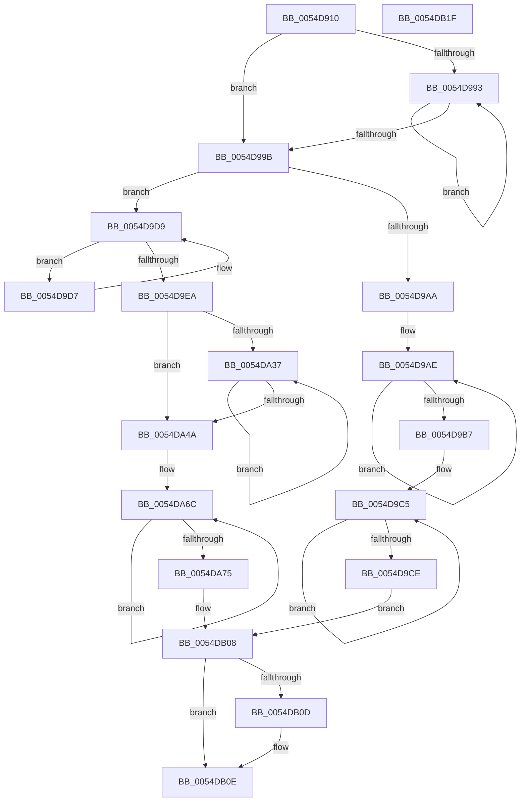

# HalpTimerMeasureProcessorsWorker

- RVA: `0x0054D910`–`0x0054DB20` (길이 `528` bytes)
- VA: `0x000000014054D910`
- 실행 섹션: `.text`
- PDB 이름 있음: `예`; PDB Function 태그: `아니요`
- unwind 정보 RVA: `0x000C40AC`
- 디코드: `141`개 명령, `528/528` bytes 표시
- 미해석 바이트: `0` (있으면 어셈블리에 `.byte`로 보존)

> 이 문서는 커널 이미지의 기계어와 PDB 기호를 분석해 생성했습니다. 4번과 5번은 함수 원형과 자료형을 바이너리 사용 방식에서 추정한 C 해석이며 원본 소스 복구 결과는 아닙니다.

## 1. Dependencies

- 직접 호출 지점: **9**; 고유 호출 대상: **8**
- 직접 호출자로 확인된 함수: **0**
- RIP 상대 이미지 참조: **1**

### Outgoing calls
- `0x0054D941` → [HalpDisableInterrupts](../25/HalpDisableInterrupts_function_002521A0.md) (function, `0x002521A0`)
- `0x0054D94E` → [KeQueryActiveProcessorCountEx](../24/KeQueryActiveProcessorCountEx_function_00249EF0.md) (function, `0x00249EF0`)
- `0x0054D979` → [HalpFindTimer](HalpFindTimer_function_005488D0.md) (function, `0x005488D0`)
- `0x0054D9BC` → [KeStallExecutionProcessor](../44/KeStallExecutionProcessor_function_0044F620.md) (function, `0x0044F620`)
- `0x0054D9EE` → [KeQueryPerformanceCounter](../37/KeQueryPerformanceCounter_function_0037E7E0.md) (function, `0x0037E7E0`)
- `0x0054D9FD` → [HalpTimerDetermineValidTimerPairReadLatency](HalpTimerDetermineValidTimerPairReadLatency_function_00549100.md) (function, `0x00549100`)
- `0x0054DA1D` → [HalpTimerReadTimerPairWithLatencyLimit](HalpTimerReadTimerPairWithLatencyLimit_function_00549F28.md) (function, `0x00549F28`)
- `0x0054DA63` → [HalpTimerReadTimerPairWithLatencyLimit](HalpTimerReadTimerPairWithLatencyLimit_function_00549F28.md) (function, `0x00549F28`)
- `0x0054DA8F` → [HalpTimerScaleCounter](../37/HalpTimerScaleCounter_function_0037B354.md) (function, `0x0037B354`)

### Direct callers
- 이 함수 시작 RVA로 연결되는 직접 call은 확인되지 않았습니다. 간접 호출은 완전히 역산할 수 없습니다.

### Static image references
- `0x0054D9F3` → RVA `0x00FC3FD0` (`.data`; read)

## 2. Other-region calls and transfers

- 다른 실행 섹션으로 향하는 call: **0**
- 별도 외부 분기/꼬리 이동을 확인하지 못했습니다.

## 3. Assembly (complete function range)

```asm
0054D910  40 55                           push rbp
0054D912  53                              push rbx
0054D913  56                              push rsi
0054D914  57                              push rdi
0054D915  41 55                           push r13
0054D917  41 56                           push r14
0054D919  41 57                           push r15
0054D91B  48 8B EC                        mov rbp, rsp
0054D91E  48 83 EC 40                     sub rsp, 0x40
0054D922  48 83 65 40 00                  and qword ptr [rbp + 0x40], 0
0054D927  48 8B F9                        mov rdi, rcx
0054D92A  48 83 65 50 00                  and qword ptr [rbp + 0x50], 0
0054D92F  48 83 65 F0 00                  and qword ptr [rbp - 0x10], 0
0054D934  48 83 65 48 00                  and qword ptr [rbp + 0x48], 0
0054D939  48 83 65 58 00                  and qword ptr [rbp + 0x58], 0
0054D93E  8B 59 10                        mov ebx, dword ptr [rcx + 0x10]
0054D941  E8 5A 48 D0 FF                  call 0x1402521a0
0054D946  B9 FF FF 00 00                  mov ecx, 0xffff
0054D94B  44 8A F0                        mov r14b, al
0054D94E  E8 9D C5 CF FF                  call 0x140249ef0
0054D953  65 4C 8B 3C 25 18 00 00 00      mov r15, qword ptr gs:[0x18]
0054D95C  45 33 C9                        xor r9d, r9d
0054D95F  65 4C 8B 2C 25 18 00 00 00      mov r13, qword ptr gs:[0x18]
0054D968  45 33 C0                        xor r8d, r8d
0054D96B  33 D2                           xor edx, edx
0054D96D  C7 44 24 20 01 00 00 00         mov dword ptr [rsp + 0x20], 1
0054D975  8B CB                           mov ecx, ebx
0054D977  8B F0                           mov esi, eax
0054D979  E8 52 AF FF FF                  call 0x1405488d0
0054D97E  48 8B D8                        mov rbx, rax
0054D981  0F 20 D1                        mov rcx, cr2
0054D984  0F 22 D1                        mov cr2, rcx
0054D987  83 C9 FF                        or ecx, 0xffffffff
0054D98A  F0 0F C1 0F                     lock xadd dword ptr [rdi], ecx
0054D98E  83 F9 01                        cmp ecx, 1
0054D991  74 08                           je 0x14054d99b
0054D993  F3 90                           pause
0054D995  8B 0F                           mov ecx, dword ptr [rdi]
0054D997  85 C9                           test ecx, ecx
0054D999  75 F8                           jne 0x14054d993
0054D99B  65 48 8B 04 25 20 00 00 00      mov rax, qword ptr gs:[0x20]
0054D9A4  83 78 24 00                     cmp dword ptr [rax + 0x24], 0
0054D9A8  75 2F                           jne 0x14054d9d9
0054D9AA  F0 FF 47 04                     lock inc dword ptr [rdi + 4]
0054D9AE  F3 90                           pause
0054D9B0  8B 47 04                        mov eax, dword ptr [rdi + 4]
0054D9B3  3B C6                           cmp eax, esi
0054D9B5  75 F7                           jne 0x14054d9ae
0054D9B7  B9 48 E8 01 00                  mov ecx, 0x1e848
0054D9BC  E8 5F 1C F0 FF                  call 0x14044f620
0054D9C1  F0 FF 47 08                     lock inc dword ptr [rdi + 8]
0054D9C5  F3 90                           pause
0054D9C7  8B 47 08                        mov eax, dword ptr [rdi + 8]
0054D9CA  3B C6                           cmp eax, esi
0054D9CC  75 F7                           jne 0x14054d9c5
0054D9CE  F0 FF 47 0C                     lock inc dword ptr [rdi + 0xc]
0054D9D2  E9 31 01 00 00                  jmp 0x14054db08
0054D9D7  F3 90                           pause
0054D9D9  65 48 8B 0C 25 20 00 00 00      mov rcx, qword ptr gs:[0x20]
0054D9E2  8B 47 04                        mov eax, dword ptr [rdi + 4]
0054D9E5  3B 41 24                        cmp eax, dword ptr [rcx + 0x24]
0054D9E8  75 ED                           jne 0x14054d9d7
0054D9EA  48 8D 4D F0                     lea rcx, [rbp - 0x10]
0054D9EE  E8 ED 0D E3 FF                  call 0x14037e7e0
0054D9F3  48 8B 15 D6 65 A7 00            mov rdx, qword ptr [rip + 0xa765d6]
0054D9FA  48 8B CB                        mov rcx, rbx
0054D9FD  E8 FE B6 FF FF                  call 0x140549100
0054DA02  4C 8B 05 C7 65 A7 00            mov r8, qword ptr [rip + 0xa765c7]
0054DA09  4C 8D 4D 48                     lea r9, [rbp + 0x48]
0054DA0D  8B F0                           mov esi, eax
0054DA0F  48 8B D3                        mov rdx, rbx
0054DA12  48 8D 45 58                     lea rax, [rbp + 0x58]
0054DA16  8B CE                           mov ecx, esi
0054DA18  48 89 44 24 20                  mov qword ptr [rsp + 0x20], rax
0054DA1D  E8 06 C5 FF FF                  call 0x140549f28
0054DA22  F0 FF 47 04                     lock inc dword ptr [rdi + 4]
0054DA26  65 48 8B 14 25 20 00 00 00      mov rdx, qword ptr gs:[0x20]
0054DA2F  8B 4F 08                        mov ecx, dword ptr [rdi + 8]
0054DA32  3B 4A 24                        cmp ecx, dword ptr [rdx + 0x24]
0054DA35  74 13                           je 0x14054da4a
0054DA37  F3 90                           pause
0054DA39  65 48 8B 0C 25 20 00 00 00      mov rcx, qword ptr gs:[0x20]
0054DA42  8B 47 08                        mov eax, dword ptr [rdi + 8]
0054DA45  3B 41 24                        cmp eax, dword ptr [rcx + 0x24]
0054DA48  75 ED                           jne 0x14054da37
0054DA4A  4C 8B 05 7F 65 A7 00            mov r8, qword ptr [rip + 0xa7657f]
0054DA51  48 8D 45 50                     lea rax, [rbp + 0x50]
0054DA55  4C 8D 4D 40                     lea r9, [rbp + 0x40]
0054DA59  48 89 44 24 20                  mov qword ptr [rsp + 0x20], rax
0054DA5E  48 8B D3                        mov rdx, rbx
0054DA61  8B CE                           mov ecx, esi
0054DA63  E8 C0 C4 FF FF                  call 0x140549f28
0054DA68  F0 FF 47 08                     lock inc dword ptr [rdi + 8]
0054DA6C  F3 90                           pause
0054DA6E  8B 47 0C                        mov eax, dword ptr [rdi + 0xc]
0054DA71  85 C0                           test eax, eax
0054DA73  74 F7                           je 0x14054da6c
0054DA75  48 8B 4D 50                     mov rcx, qword ptr [rbp + 0x50]
0054DA79  41 B8 40 42 0F 00               mov r8d, 0xf4240
0054DA7F  4C 8B 5D 40                     mov r11, qword ptr [rbp + 0x40]
0054DA83  48 2B 4D 58                     sub rcx, qword ptr [rbp + 0x58]
0054DA87  48 8B 55 F0                     mov rdx, qword ptr [rbp - 0x10]
0054DA8B  4C 2B 5D 48                     sub r11, qword ptr [rbp + 0x48]
0054DA8F  E8 C0 D8 E2 FF                  call 0x14037b354
0054DA94  4C 8B C0                        mov r8, rax
0054DA97  33 D2                           xor edx, edx
0054DA99  49 69 C3 40 42 0F 00            imul rax, r11, 0xf4240
0054DAA0  49 F7 F0                        div r8
0054DAA3  4C 8B C0                        mov r8, rax
0054DAA6  48 8D 88 88 13 00 00            lea rcx, [rax + 0x1388]
0054DAAD  48 B8 4B 59 86 38 D6 C5 6D 34   movabs rax, 0x346dc5d63886594b
0054DAB7  48 F7 E1                        mul rcx
0054DABA  48 C1 EA 0B                     shr rdx, 0xb
0054DABE  48 69 CA 10 27 00 00            imul rcx, rdx, 0x2710
0054DAC5  49 89 8F C0 00 00 00            mov qword ptr [r15 + 0xc0], rcx
0054DACC  49 8D 88 20 A1 07 00            lea rcx, [r8 + 0x7a120]
0054DAD3  49 B8 DB 34 B6 D7 82 DE 1B 43   movabs r8, 0x431bde82d7b634db
0054DADD  49 8B C0                        mov rax, r8
0054DAE0  48 F7 E1                        mul rcx
0054DAE3  49 8B C0                        mov rax, r8
0054DAE6  48 C1 EA 12                     shr rdx, 0x12
0054DAEA  48 69 CA 40 42 0F 00            imul rcx, rdx, 0xf4240
0054DAF1  48 F7 E1                        mul rcx
0054DAF4  48 C1 EA 12                     shr rdx, 0x12
0054DAF8  41 89 55 64                     mov dword ptr [r13 + 0x64], edx
0054DAFC  65 48 8B 04 25 20 00 00 00      mov rax, qword ptr gs:[0x20]
0054DB05  89 50 44                        mov dword ptr [rax + 0x44], edx
0054DB08  45 84 F6                        test r14b, r14b
0054DB0B  74 01                           je 0x14054db0e
0054DB0D  FB                              sti
0054DB0E  33 C0                           xor eax, eax
0054DB10  48 83 C4 40                     add rsp, 0x40
0054DB14  41 5F                           pop r15
0054DB16  41 5E                           pop r14
0054DB18  41 5D                           pop r13
0054DB1A  5F                              pop rdi
0054DB1B  5E                              pop rsi
0054DB1C  5B                              pop rbx
0054DB1D  5D                              pop rbp
0054DB1E  C3                              ret
0054DB1F  CC                              int3
```

## 4. C-style interpretation (structured pseudocode)

```c
__int64 __fastcall HalpTimerMeasureProcessorsWorker(__int64 a1, int a2, int a3, int a4)
{
    __int64 result;
    __int64 v_r11;
    __int64 v_rsp;
    unsigned __int64 v_stack_m48;
    unsigned int v_stack_m58;
    unsigned __int64 v_stack_p10;
    unsigned __int64 v_stack_p18;
    unsigned __int64 v_stack_p20;
    unsigned __int64 v_stack_p8;

    v_rsp = (v_rsp) - (64);
    result = HalpDisableInterrupts(a1, a2, a3, a4);
    result = KeQueryActiveProcessorCountEx((unsigned int)(0xFFFFULL), a2, a3, a4);
    a4 = 0;
    a3 = 0;
    a2 = 0;
    v_stack_m58 = 1;
    result = HalpFindTimer((unsigned int)((unsigned int)((unsigned int)(*(unsigned int *)(a1 + 16)))), a2, a3, a4);
    a1 = (unsigned int)((v_cr2) | (0xFFFFFFFFULL));
    if (((unsigned int)(a1)) == 1) goto loc_0054D99B;
loc_0054D993:
    if ((unsigned int)((unsigned int)(*(unsigned int *)(a1))) != 0) goto loc_0054D993;
loc_0054D99B:
    if ((*(unsigned int *)(*(unsigned __int64 *)(gs_base + (0 + 32)) + 36)) != 0) goto loc_0054D9D9;
loc_0054D9AE:
    if (((unsigned int)((unsigned int)(*(unsigned int *)(a1 + 4)))) != ((unsigned int)((unsigned int)((unsigned int)(result))))) goto loc_0054D9AE;
    result = KeStallExecutionProcessor((unsigned int)(0x1E848ULL), a2, a3, a4);
loc_0054D9C5:
    if (((unsigned int)((unsigned int)(*(unsigned int *)(a1 + 8)))) != ((unsigned int)((unsigned int)((unsigned int)(result))))) goto loc_0054D9C5;
    goto loc_0054DB08;
loc_0054D9D7:
loc_0054D9D9:
    if (((unsigned int)((unsigned int)(*(unsigned int *)(a1 + 4)))) != (*(unsigned int *)(*(unsigned __int64 *)(gs_base + (0 + 32)) + 36))) goto loc_0054D9D7;
    result = KeQueryPerformanceCounter(v_stack_m48, a2, a3, a4);
    result = HalpTimerDetermineValidTimerPairReadLatency(result, *(unsigned __int64 *)(v_rip + 10970582), a3, a4);
    v_stack_m58 = v_stack_p20;
    result = HalpTimerReadTimerPairWithLatencyLimit((unsigned int)((unsigned int)((unsigned int)((unsigned int)(result)))), result, *(unsigned __int64 *)(v_rip + 10970567), v_stack_p10);
    if (((unsigned int)((unsigned int)(*(unsigned int *)(a1 + 8)))) == (*(unsigned int *)(*(unsigned __int64 *)(gs_base + (0 + 32)) + 36))) goto loc_0054DA4A;
loc_0054DA37:
    if (((unsigned int)((unsigned int)(*(unsigned int *)(a1 + 8)))) != (*(unsigned int *)(*(unsigned __int64 *)(gs_base + (0 + 32)) + 36))) goto loc_0054DA37;
loc_0054DA4A:
    v_stack_m58 = v_stack_p18;
    result = HalpTimerReadTimerPairWithLatencyLimit((unsigned int)((unsigned int)((unsigned int)((unsigned int)(result)))), result, *(unsigned __int64 *)(v_rip + 10970495), v_stack_p8);
loc_0054DA6C:
    if ((unsigned int)((unsigned int)(*(unsigned int *)(a1 + 12))) == 0) goto loc_0054DA6C;
    a1 = (v_stack_p18) - (v_stack_p20);
    v_r11 = (v_stack_p8) - (v_stack_p10);
    result = HalpTimerScaleCounter(a1, v_stack_m48, (unsigned int)(0xF4240ULL), v_stack_p8);
    a2 = 0;
    result = (result) * (v_r11);
    a2 = (a2) >> (11);
    a1 = (result + 5000) * (a2);
    *(unsigned __int64 *)(*(unsigned __int64 *)(gs_base + (0 + 24)) + 192) = a1;
    a2 = (a2) >> (18);
    a1 = (result + 500000) * (a2);
    a2 = (a2) >> (18);
    *(unsigned int *)(*(unsigned __int64 *)(gs_base + (0 + 24)) + 100) = a2;
    *(unsigned int *)(*(unsigned __int64 *)(gs_base + (0 + 32)) + 68) = a2;
loc_0054DB08:
    if ((unsigned __int8)((unsigned __int8)(result)) != 0) {
    }
    result = 0;
    v_rsp = (v_rsp) + (64);
    return result;
}
```

## 5. (Beta) C Style

```c
int64_t HalpTimerMeasureProcessorsWorker(void *Arg1, int32_t Arg2, int32_t Arg3, int32_t Arg4)
{
    uint8_t *arg1 = (uint8_t *)Arg1;

    int64_t result;
    int64_t local_r11;
    int64_t local_rsp;
    uint64_t v_stack_m48;
    uint32_t v_stack_m58;
    uint64_t v_stack_p10;
    uint64_t v_stack_p18;
    uint64_t v_stack_p20;
    uint64_t v_stack_p8;

    local_rsp = (local_rsp) - (64);
    result = HalpDisableInterrupts(Arg1, Arg2, Arg3, Arg4);
    result = KeQueryActiveProcessorCountEx((uint32_t)(0xFFFFULL), Arg2, Arg3, Arg4);
    Arg4 = 0;
    Arg3 = 0;
    Arg2 = 0;
    v_stack_m58 = 1;
    result = HalpFindTimer((uint32_t)((uint32_t)((uint32_t)(*(uint32_t *)(arg1 + 0x10)))), Arg2, Arg3, Arg4);
    Arg1 = (uint32_t)((v_cr2) | (0xFFFFFFFFULL));
    if (((uint32_t)(Arg1)) == 1) goto loc_0054D99B;
loc_0054D993:
    if ((uint32_t)((uint32_t)(*(uint32_t *)(arg1))) != 0) goto loc_0054D993;
loc_0054D99B:
    if ((*(uint32_t *)(*(uint64_t *)(gs_base + (0 + 0x20)) + 0x24)) != 0) goto loc_0054D9D9;
loc_0054D9AE:
    if (((uint32_t)((uint32_t)(*(uint32_t *)(arg1 + 0x4)))) != ((uint32_t)((uint32_t)((uint32_t)(result))))) goto loc_0054D9AE;
    result = KeStallExecutionProcessor((uint32_t)(0x1E848ULL), Arg2, Arg3, Arg4);
loc_0054D9C5:
    if (((uint32_t)((uint32_t)(*(uint32_t *)(arg1 + 0x8)))) != ((uint32_t)((uint32_t)((uint32_t)(result))))) goto loc_0054D9C5;
    goto loc_0054DB08;
loc_0054D9D7:
loc_0054D9D9:
    if (((uint32_t)((uint32_t)(*(uint32_t *)(arg1 + 0x4)))) != (*(uint32_t *)(*(uint64_t *)(gs_base + (0 + 0x20)) + 0x24))) goto loc_0054D9D7;
    result = KeQueryPerformanceCounter(v_stack_m48, Arg2, Arg3, Arg4);
    result = HalpTimerDetermineValidTimerPairReadLatency(result, *(uint64_t *)(v_rip + 0xA765D6), Arg3, Arg4);
    v_stack_m58 = v_stack_p20;
    result = HalpTimerReadTimerPairWithLatencyLimit((uint32_t)((uint32_t)((uint32_t)((uint32_t)(result)))), result, *(uint64_t *)(v_rip + 0xA765C7), v_stack_p10);
    if (((uint32_t)((uint32_t)(*(uint32_t *)(arg1 + 0x8)))) == (*(uint32_t *)(*(uint64_t *)(gs_base + (0 + 0x20)) + 0x24))) goto loc_0054DA4A;
loc_0054DA37:
    if (((uint32_t)((uint32_t)(*(uint32_t *)(arg1 + 0x8)))) != (*(uint32_t *)(*(uint64_t *)(gs_base + (0 + 0x20)) + 0x24))) goto loc_0054DA37;
loc_0054DA4A:
    v_stack_m58 = v_stack_p18;
    result = HalpTimerReadTimerPairWithLatencyLimit((uint32_t)((uint32_t)((uint32_t)((uint32_t)(result)))), result, *(uint64_t *)(v_rip + 0xA7657F), v_stack_p8);
loc_0054DA6C:
    if ((uint32_t)((uint32_t)(*(uint32_t *)(arg1 + 0xC))) == 0) goto loc_0054DA6C;
    Arg1 = (v_stack_p18) - (v_stack_p20);
    local_r11 = (v_stack_p8) - (v_stack_p10);
    result = HalpTimerScaleCounter(Arg1, v_stack_m48, (uint32_t)(0xF4240ULL), v_stack_p8);
    Arg2 = 0;
    result = (result) * (local_r11);
    Arg2 = (Arg2) >> (11);
    Arg1 = (result + 5000) * (Arg2);
    *(void **)(*(uint64_t *)(gs_base + (0 + 0x18)) + 0xC0) = Arg1;
    Arg2 = (Arg2) >> (18);
    Arg1 = (result + 500000) * (Arg2);
    Arg2 = (Arg2) >> (18);
    *(uint32_t *)(*(uint64_t *)(gs_base + (0 + 0x18)) + 0x64) = Arg2;
    *(uint32_t *)(*(uint64_t *)(gs_base + (0 + 0x20)) + 0x44) = Arg2;
loc_0054DB08:
    if ((uint8_t)((uint8_t)(result)) != 0) {
    }
    result = 0;
    local_rsp = (local_rsp) + (64);
    return result;
}
```

### 관측된 메모리 오프셋

구조체 형식이 확인되지 않은 접근은 인자 기준의 오프셋으로만 기록했습니다.

| 기준 인자 | 오프셋 표현 | 폭 (bit) | 접근 |
|---|---:|---:|---|
| `Arg1` | `+ 0x0` | `32` | `R` |
| `Arg1` | `+ 0x0` | `32` | `R/W` |
| `Arg1` | `+ 0x4` | `32` | `R` |
| `Arg1` | `+ 0x4` | `32` | `R/W` |
| `Arg1` | `+ 0x8` | `32` | `R` |
| `Arg1` | `+ 0x8` | `32` | `R/W` |
| `Arg1` | `+ 0xC` | `32` | `R` |
| `Arg1` | `+ 0xC` | `32` | `R/W` |
| `Arg1` | `+ 0x10` | `32` | `R` |

## 6. Execution-region graph

[열기: 2D/3D 그래프와 함수 탐색 컨트롤 패널](../../../control-panel.html?section=text&rva=0x0054D910&view=graph)

- 2D 그래프는 위에서 아래로 흐르고, 3D 그래프는 빈 공간을 드래그해 회전합니다. Shift+드래그는 이동, 휠은 확대·축소, 함수 노드 선택은 대상 보고서 이동입니다.

### Static fallback


