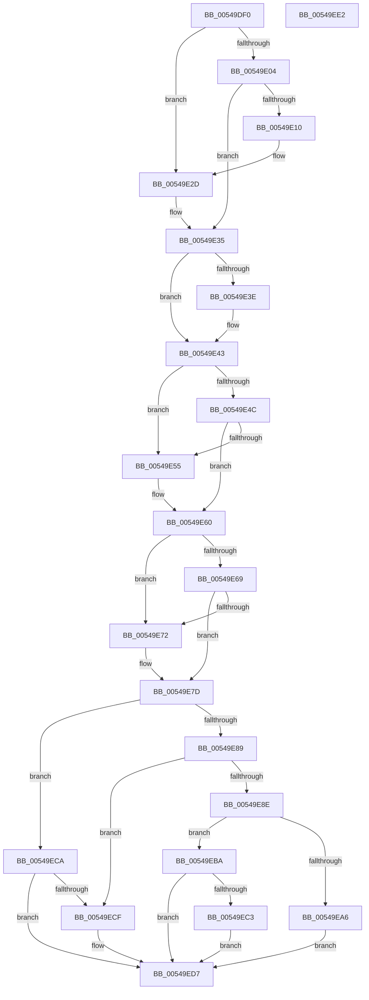

# HalpTimerPowerChange

- RVA: `0x00549DF0`–`0x00549EE3` (길이 `243` bytes)
- VA: `0x0000000140549DF0`
- 실행 섹션: `.text`
- PDB 이름 있음: `예`; PDB Function 태그: `아니요`
- unwind 정보 RVA: `0x0006E5F8`
- 디코드: `63`개 명령, `243/243` bytes 표시
- 미해석 바이트: `0` (있으면 어셈블리에 `.byte`로 보존)

> 이 문서는 커널 이미지의 기계어와 PDB 기호를 분석해 생성했습니다. 4번과 5번은 함수 원형과 자료형을 바이너리 사용 방식에서 추정한 C 해석이며 원본 소스 복구 결과는 아닙니다.

## 1. Dependencies

- 직접 호출 지점: **7**; 고유 호출 대상: **7**
- 직접 호출자로 확인된 함수: **1**
- RIP 상대 이미지 참조: **7**

### Outgoing calls
- `0x00549E27` → [KeBugCheckEx](../4F/KeBugCheckEx_function_004FD660.md) (function, `0x004FD660`)
- `0x00549E3E` → [HalpTimerClockPowerChange](HalpTimerClockPowerChange_function_005481A0.md) (function, `0x005481A0`)
- `0x00549E5B` → [HalpTimerPerformanceCounterPowerChange](HalpTimerPerformanceCounterPowerChange_function_00549738.md) (function, `0x00549738`)
- `0x00549E78` → [HalpTimerStallCounterPowerChange](HalpTimerStallCounterPowerChange_function_0054A078.md) (function, `0x0054A078`)
- `0x00549E91` → [HalpTimerGetInternalData](../20/HalpTimerGetInternalData_function_00209500.md) (function, `0x00209500`)
- `0x00549E9D` → [guard_dispatch_icall](../6B/guard_dispatch_icall_function_006BAAD0.md) (function, `0x006BAAD0`)
- `0x00549EC3` → [HalpTimerRestartProfileInterrupt](HalpTimerRestartProfileInterrupt_function_0054B6A4.md) (function, `0x0054B6A4`)

### Direct callers
- [HalpTimerPowerCriticalTransitionCallback](HalpTimerPowerCriticalTransitionCallback_function_00549F10.md) at `0x00549F17`

### Static image references
- `0x00549E35` → RVA `0x00FC40F0` (`.data`; read)
- `0x00549E43` → RVA `0x00FC3FD0` (`.data`; read)
- `0x00549E4C` → RVA `0x00FC3FB8` (`.data`; read)
- `0x00549E60` → RVA `0x00FC4100` (`.data`; read)
- `0x00549E69` → RVA `0x00FC40C8` (`.data`; read)
- `0x00549E7D` → RVA `0x00FC3FC0` (`.data`; read)
- `0x00549EBA` → RVA `0x00E10368` (`.data`; read)

## 2. Other-region calls and transfers

- 다른 실행 섹션으로 향하는 call: **0**
- 별도 외부 분기/꼬리 이동을 확인하지 못했습니다.

## 3. Assembly (complete function range)

```asm
00549DF0  48 89 5C 24 08                  mov qword ptr [rsp + 8], rbx
00549DF5  57                              push rdi
00549DF6  48 83 EC 30                     sub rsp, 0x30
00549DFA  40 8A FA                        mov dil, dl
00549DFD  48 8B D9                        mov rbx, rcx
00549E00  84 D2                           test dl, dl
00549E02  75 29                           jne 0x140549e2d
00549E04  F7 81 E0 00 00 00 00 80 00 00   test dword ptr [rcx + 0xe0], 0x8000
00549E0E  74 25                           je 0x140549e35
00549E10  48 83 64 24 20 00               and qword ptr [rsp + 0x20], 0
00549E16  4C 8B C9                        mov r9, rcx
00549E19  B9 5C 00 00 00                  mov ecx, 0x5c
00549E1E  BA 13 01 00 00                  mov edx, 0x113
00549E23  44 8D 41 C4                     lea r8d, [rcx - 0x3c]
00549E27  E8 34 38 FB FF                  call 0x1404fd660
00549E2C  CC                              int3
00549E2D  0F BA B1 B8 00 00 00 07         btr dword ptr [rcx + 0xb8], 7
00549E35  48 3B 1D B4 A2 A7 00            cmp rbx, qword ptr [rip + 0xa7a2b4]
00549E3C  75 05                           jne 0x140549e43
00549E3E  E8 5D E3 FF FF                  call 0x1405481a0
00549E43  48 3B 1D 86 A1 A7 00            cmp rbx, qword ptr [rip + 0xa7a186]
00549E4A  74 09                           je 0x140549e55
00549E4C  48 3B 1D 65 A1 A7 00            cmp rbx, qword ptr [rip + 0xa7a165]
00549E53  75 0B                           jne 0x140549e60
00549E55  40 8A D7                        mov dl, dil
00549E58  48 8B CB                        mov rcx, rbx
00549E5B  E8 D8 F8 FF FF                  call 0x140549738
00549E60  48 3B 1D 99 A2 A7 00            cmp rbx, qword ptr [rip + 0xa7a299]
00549E67  74 09                           je 0x140549e72
00549E69  48 3B 1D 58 A2 A7 00            cmp rbx, qword ptr [rip + 0xa7a258]
00549E70  75 0B                           jne 0x140549e7d
00549E72  40 8A D7                        mov dl, dil
00549E75  48 8B CB                        mov rcx, rbx
00549E78  E8 FB 01 00 00                  call 0x14054a078
00549E7D  48 8B 15 3C A1 A7 00            mov rdx, qword ptr [rip + 0xa7a13c]
00549E84  48 3B DA                        cmp rbx, rdx
00549E87  75 41                           jne 0x140549eca
00549E89  40 84 FF                        test dil, dil
00549E8C  74 41                           je 0x140549ecf
00549E8E  48 8B CA                        mov rcx, rdx
00549E91  E8 6A F6 CB FF                  call 0x140209500
00549E96  48 8B C8                        mov rcx, rax
00549E99  48 8B 42 68                     mov rax, qword ptr [rdx + 0x68]
00549E9D  E8 2E 0C 17 00                  call 0x1406baad0
00549EA2  85 C0                           test eax, eax
00549EA4  79 14                           jns 0x140549eba
00549EA6  8B 83 B8 00 00 00               mov eax, dword ptr [rbx + 0xb8]
00549EAC  83 E0 FD                        and eax, 0xfffffffd
00549EAF  83 C8 01                        or eax, 1
00549EB2  89 83 B8 00 00 00               mov dword ptr [rbx + 0xb8], eax
00549EB8  EB 1D                           jmp 0x140549ed7
00549EBA  83 3D A7 64 8C 00 00            cmp dword ptr [rip + 0x8c64a7], 0
00549EC1  74 14                           je 0x140549ed7
00549EC3  E8 DC 17 00 00                  call 0x14054b6a4
00549EC8  EB 0D                           jmp 0x140549ed7
00549ECA  40 84 FF                        test dil, dil
00549ECD  75 08                           jne 0x140549ed7
00549ECF  0F BA AB B8 00 00 00 07         bts dword ptr [rbx + 0xb8], 7
00549ED7  48 8B 5C 24 40                  mov rbx, qword ptr [rsp + 0x40]
00549EDC  48 83 C4 30                     add rsp, 0x30
00549EE0  5F                              pop rdi
00549EE1  C3                              ret
00549EE2  CC                              int3
```

## 4. C-style interpretation (structured pseudocode)

```c
__int64 __fastcall HalpTimerPowerChange(__int64 a1, unsigned __int8 a2)
{
    __int64 result;
    __int64 v_rsp;
    unsigned __int64 v_stack_m18;
    unsigned __int64 v_stack_p8;

    v_stack_p8 = v_rbx;
    v_rsp = (v_rsp) - (48);
    if (a2 != 0) goto loc_00549E2D;
    if (((*(unsigned int *)(a1 + 224)) & (0x8000ULL)) == 0) goto loc_00549E35;
    result = KeBugCheckEx(92, 275, 92 - 60, a1);
loc_00549E2D:
loc_00549E35:
    if (a1 == (*(unsigned __int64 *)(v_rip + 10986164))) {
        result = HalpTimerClockPowerChange(92, 275, 92 - 60, a1);
    }
    if (a1 == (*(unsigned __int64 *)(v_rip + 10985862))) goto loc_00549E55;
    if (a1 == (*(unsigned __int64 *)(v_rip + 10985829))) {
        a2 = a2;
        a1 = a1;
        result = HalpTimerPerformanceCounterPowerChange(a1, a2, 92 - 60, a1);
    }
    if (a1 == (*(unsigned __int64 *)(v_rip + 10986137))) goto loc_00549E72;
    if (a1 == (*(unsigned __int64 *)(v_rip + 10986072))) {
        a2 = a2;
        a1 = a1;
        result = HalpTimerStallCounterPowerChange(a1, a2, 92 - 60, a1);
    }
    if (a1 != (*(unsigned __int64 *)(v_rip + 10985788))) goto loc_00549ECA;
    if (a2 == 0) goto loc_00549ECF;
    result = HalpTimerGetInternalData(*(unsigned __int64 *)(v_rip + 10985788), *(unsigned __int64 *)(v_rip + 10985788), 92 - 60, a1);
    result = guard_dispatch_icall(result, *(unsigned __int64 *)(v_rip + 10985788), 92 - 60, a1);
    if (!sign_flag) goto loc_00549EBA;
    result = (unsigned int)(((unsigned int)(*(unsigned int *)(a1 + 184))) & (0xFFFFFFFDULL));
    result = (unsigned int)((result) | (1));
    *(unsigned int *)(a1 + 184) = (unsigned int)(result);
    goto loc_00549ED7;
loc_00549EBA:
    if ((*(unsigned int *)(v_rip + 9200807)) == 0) goto loc_00549ED7;
    result = HalpTimerRestartProfileInterrupt(result, *(unsigned __int64 *)(v_rip + 10985788), 92 - 60, a1);
    goto loc_00549ED7;
loc_00549ECA:
    if (a2 == 0) {
    }
    v_rsp = (v_rsp) + (48);
    return result;
}
```

## 5. (Beta) C Style

```c
int64_t HalpTimerPowerChange(void *Arg1, uint8_t Arg2)
{
    uint8_t *arg1 = (uint8_t *)Arg1;

    int64_t result;
    int64_t local_rsp;
    uint64_t v_stack_m18;
    uint64_t v_stack_p8;

    v_stack_p8 = local_rbx;
    local_rsp = (local_rsp) - (48);
    if (Arg2 != 0) goto loc_00549E2D;
    if (((*(uint32_t *)(arg1 + 0xE0)) & (0x8000ULL)) == 0) goto loc_00549E35;
    result = KeBugCheckEx(92, 275, 92 - 60, Arg1);
loc_00549E2D:
loc_00549E35:
    if (Arg1 == (*(uint64_t *)(v_rip + 0xA7A2B4))) {
        result = HalpTimerClockPowerChange(92, 275, 92 - 60, Arg1);
    }
    if (Arg1 == (*(uint64_t *)(v_rip + 0xA7A186))) goto loc_00549E55;
    if (Arg1 == (*(uint64_t *)(v_rip + 0xA7A165))) {
        Arg2 = Arg2;
        Arg1 = Arg1;
        result = HalpTimerPerformanceCounterPowerChange(Arg1, Arg2, 92 - 60, Arg1);
    }
    if (Arg1 == (*(uint64_t *)(v_rip + 0xA7A299))) goto loc_00549E72;
    if (Arg1 == (*(uint64_t *)(v_rip + 0xA7A258))) {
        Arg2 = Arg2;
        Arg1 = Arg1;
        result = HalpTimerStallCounterPowerChange(Arg1, Arg2, 92 - 60, Arg1);
    }
    if (Arg1 != (*(uint64_t *)(v_rip + 0xA7A13C))) goto loc_00549ECA;
    if (Arg2 == 0) goto loc_00549ECF;
    result = HalpTimerGetInternalData(*(uint64_t *)(v_rip + 0xA7A13C), *(uint64_t *)(v_rip + 0xA7A13C), 92 - 60, Arg1);
    result = guard_dispatch_icall(result, *(uint64_t *)(v_rip + 0xA7A13C), 92 - 60, Arg1);
    if (!sign_flag) goto loc_00549EBA;
    result = (uint32_t)(((uint32_t)(*(uint32_t *)(arg1 + 0xB8))) & (0xFFFFFFFDULL));
    result = (uint32_t)((result) | (1));
    *(uint32_t *)(arg1 + 0xB8) = (uint32_t)(result);
    goto loc_00549ED7;
loc_00549EBA:
    if ((*(uint32_t *)(v_rip + 0x8C64A7)) == 0) goto loc_00549ED7;
    result = HalpTimerRestartProfileInterrupt(result, *(uint64_t *)(v_rip + 0xA7A13C), 92 - 60, Arg1);
    goto loc_00549ED7;
loc_00549ECA:
    if (Arg2 == 0) {
    }
    local_rsp = (local_rsp) + (48);
    return result;
}
```

### 관측된 메모리 오프셋

구조체 형식이 확인되지 않은 접근은 인자 기준의 오프셋으로만 기록했습니다.

| 기준 인자 | 오프셋 표현 | 폭 (bit) | 접근 |
|---|---:|---:|---|
| `Arg1` | `+ 0xE0` | `32` | `R` |

## 6. Execution-region graph

[열기: 2D/3D 그래프와 함수 탐색 컨트롤 패널](../../../control-panel.html?section=text&rva=0x00549DF0&view=graph)

- 2D 그래프는 위에서 아래로 흐르고, 3D 그래프는 빈 공간을 드래그해 회전합니다. Shift+드래그는 이동, 휠은 확대·축소, 함수 노드 선택은 대상 보고서 이동입니다.

### Static fallback


